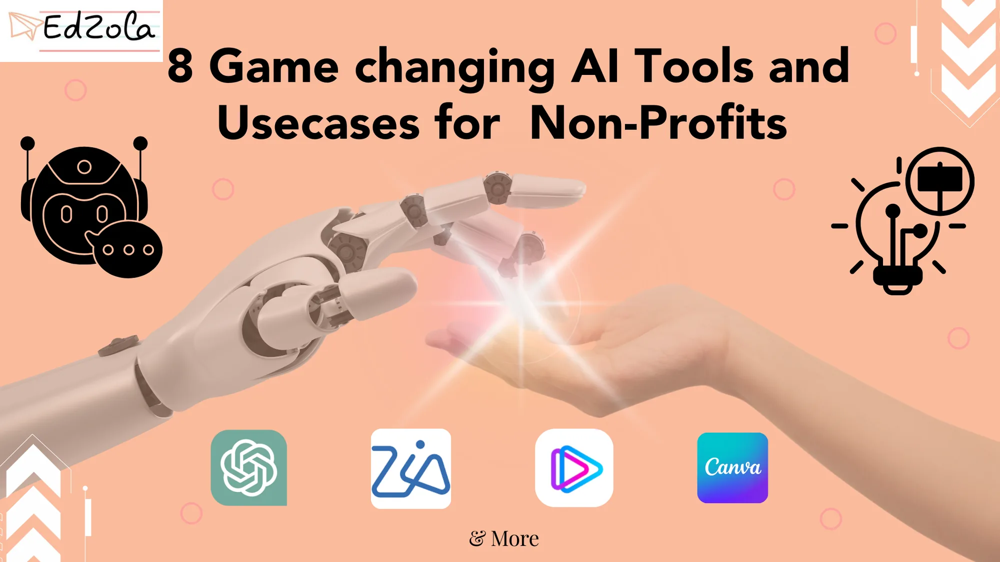

- [All Posts](https://www.edzola.com/blog)
- [EdZola Digital Guides](https://www.edzola.com/blog/categories/edzola-digital-guides)
- [Non-Profit data management & MIS](https://www.edzola.com/blog/categories/data-management)
- [Zoho Creator for NGOs](https://www.edzola.com/blog/categories/zoho-creator-for-ngos)
- [CRM & Fundraising](https://www.edzola.com/blog/categories/crm-fundraising)
- [Tech for Upskilling NGOs](https://www.edzola.com/blog/categories/tech-for-upskilling-ngos)
- [Zoho for NonProfits](https://www.edzola.com/blog/categories/zoho)
- [Data analytics - M&E](https://www.edzola.com/blog/categories/data-analytics-m-e-impact-measur)
- [AI for NGOs](https://www.edzola.com/blog/categories/ai-for-ngos)
- [Digital Transformation of NGOs](https://www.edzola.com/blog/categories/digital-transformation)
- [HRMS](https://www.edzola.com/blog/categories/hrms)
Search[## Let’s Listen to Everyone: Voice AI for the Social Sector](https://www.edzola.com/post/let-s-listen-to-everyone-voice-intelligence-for-the-social-sector)I want to tell you about Lakshmi. She has no formal schooling. She has never seen a web form, and she never will. But last quarter, she completed health survey in three minutes. On her own. In Telugu. Her phone rang. She picked up. She talked. That was it. That one call explains what we are building at zolabs.ai better than any pitch I could write. We call it voice intelligence but really, it is just an old idea done properly: if you want to know about people's lives, listenSep 173 min read[## Voice & Chat AI for NGO Data Collection in India: Bridging the Last-Mile Gap](https://www.edzola.com/post/voice-chat-ai-for-ngo-data-collection-in-india-bridging-the-last-mile-gap)Why last-mile data is hard and why voice changes the game Across health, livelihoods, education, and climate programs, NGOs struggle with low literacy, app fatigue, limited devices and patchy connectivity all of which lead to partial, delayed or biased data. India’s “AI for social impact” momentum is real, spanning healthcare, education, agriculture and the environment, but last-mile capture remains the bottleneck. Two India-scale examples show the promise of inclusive AI:Dec 9, 20253 min read[## 3 Levels of AI That Will Transform Nonprofits in 2025 and Beyond - A Special Edition for Social Impact Professionals](https://www.edzola.com/post/3-levels-of-ai-that-will-transform-nonprofits-in-2025-and-beyond-a-special-edition-for-social-sector)Many nonprofits and social impact teams ask the same question: “Where do we even begin with AI?” AI can feel confusing. There's too much...Sep 22, 20257 min read[## AI Agent for Qualitative Data Analysis: Transforming How the Social Sector Collects and Understands Field Insights](https://www.edzola.com/post/ai-agent-for-qualitative-data-analysis-transforming-how-the-social-sector-collects-and-understands)In the social impact and non-profit sectors, collecting and analyzing qualitative data is a critical step in evaluating programs, shaping...Jan 15, 20253 min read[## 8 Game-Changing AI Tools and Usecases for Nonprofits (ChatGPT, Polymath.ai and more!)](https://www.edzola.com/post/8-game-changing-ai-tools-and-usecases-for-nonprofits-chatgpt-polymath-ai-and-more)In the fast-paced world of today, Non-Profit organizations are constantly seeking innovative ways to make a bigger impact on their...Nov 15, 20234 min read
