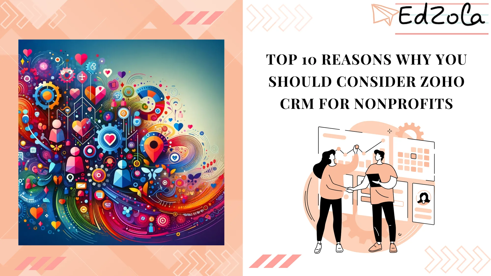
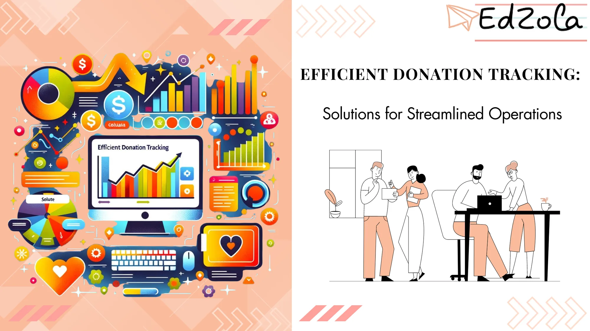
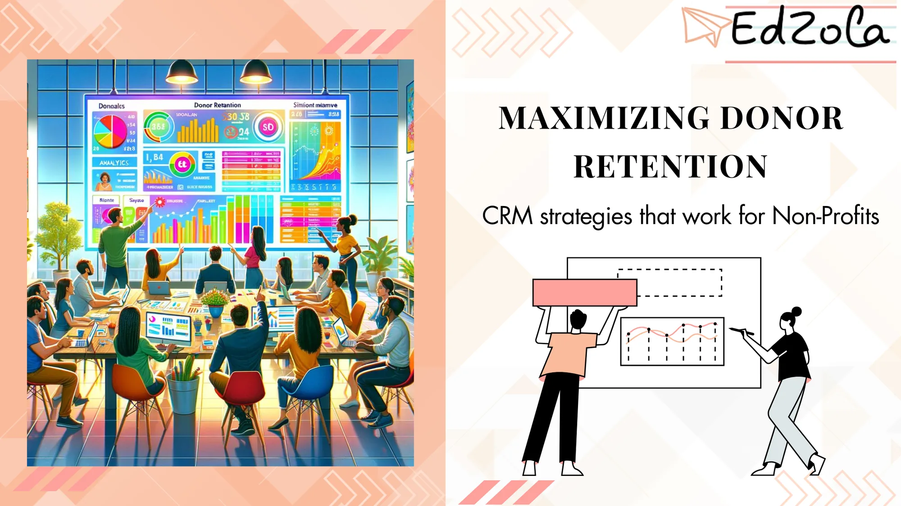
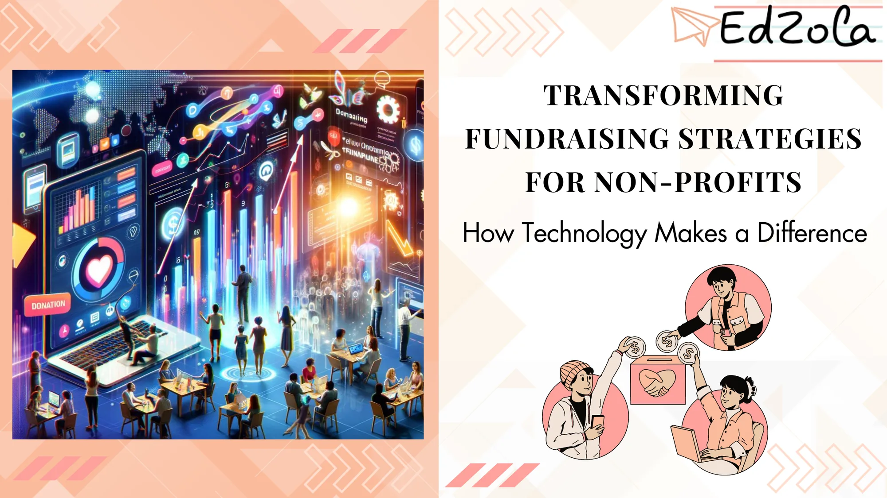
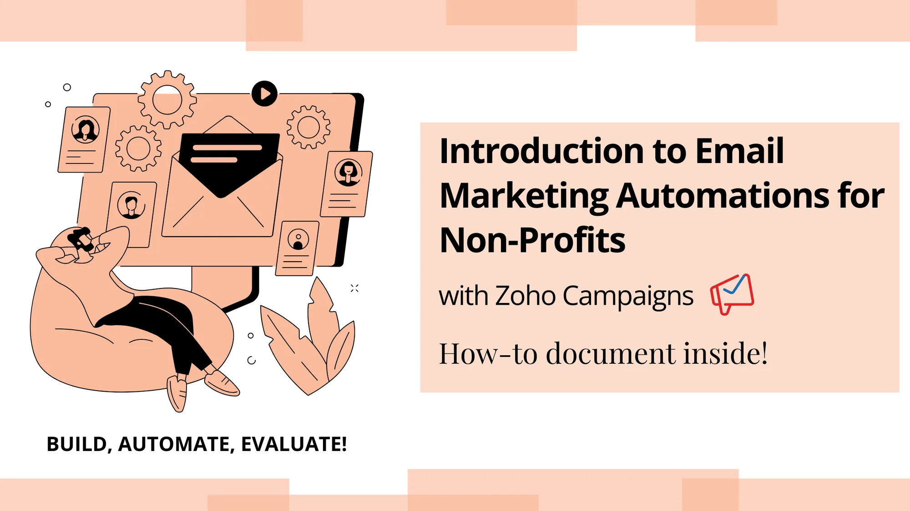

- [All Posts](https://www.edzola.com/blog)
- [EdZola Digital Guides](https://www.edzola.com/blog/categories/edzola-digital-guides)
- [Non-Profit data management & MIS](https://www.edzola.com/blog/categories/data-management)
- [Zoho Creator for NGOs](https://www.edzola.com/blog/categories/zoho-creator-for-ngos)
- [CRM & Fundraising](https://www.edzola.com/blog/categories/crm-fundraising)
- [Tech for Upskilling NGOs](https://www.edzola.com/blog/categories/tech-for-upskilling-ngos)
- [Zoho for NonProfits](https://www.edzola.com/blog/categories/zoho)
- [Data analytics - M&E](https://www.edzola.com/blog/categories/data-analytics-m-e-impact-measur)
- [AI for NGOs](https://www.edzola.com/blog/categories/ai-for-ngos)
- [Digital Transformation of NGOs](https://www.edzola.com/blog/categories/digital-transformation)
- [HRMS](https://www.edzola.com/blog/categories/hrms)
Search[## Transforming Nonprofit Operations: Leveraging AI Features of Zoho CRM](https://www.edzola.com/post/nonprofit-technology-assessment-evaluate-your-ngo-s-tech-needs)In the nonprofit sector, leveraging existing software systems is key to decreasing manual tasks, improving workflows, and boosting...Apr 12, 20245 min read[## Top 5 Reasons Why Zoho Books Is Your Ideal Solution for Non-profit Accounting Management](https://www.edzola.com/post/top-5-reasons-why-zoho-books-is-your-ideal-solution-for-non-profit-accounting-management)Managing the finances of a non-profit organization can be a challenging task. It requires a tool that’s not only efficient but also...Apr 2, 20246 min read[## Top 10 reasons why you should consider Zoho CRM for Nonprofits](https://www.edzola.com/post/top-10-reasons-why-you-should-consider-zoho-crm-for-nonprofits)In the nonprofit sector, the art of relationship management is key to success. It's not just about tracking donations; it's about...Mar 26, 20244 min read[## Efficient Donation Tracking: Solutions for Streamlined Operations](https://www.edzola.com/post/efficient-donation-tracking-solutions-for-streamlined-operations)Efficient Donation Tracking involves using specialized software and strategies to effectively monitor, manage, and optimize fundraising...Mar 13, 20245 min read[## Donor Delight: Customizing Your Donor Management for Optimal Engagement](https://www.edzola.com/post/donor-delight-customizing-your-donor-management-for-optimal-engagement)In today's competitive fundraising landscape, donor engagement is critical for nonprofit organizations to thrive and make a lasting...Mar 7, 20245 min read[## Maximizing Donor Retention: CRM Strategies That Work for Non-Profits](https://www.edzola.com/post/maximizing-donor-retention-crm-strategies-that-work-for-non-profits)Donor retention is a crucial aspect of maintaining financial stability and achieving long-term success and CRM is the the one-stop answerFeb 26, 20245 min read[## Funding Frustrations: Strategies to Overcome Insufficient Funding Challenges](https://www.edzola.com/post/funding-frustrations-strategies-to-overcome-insufficient-funding-challenges)Nonprofits across the globe face immense challenges when it comes to securing sufficient funding for their programs and initiatives....Feb 23, 20244 min read[## Transforming Fundraising Strategies for Non-Profits: How Technology Makes a Difference](https://www.edzola.com/post/transforming-fundraising-strategies-for-non-profits-how-technology-makes-a-difference)Technological advancements have not only revolutionized the way organizations operate but have also opened up new avenues for donor outreachFeb 20, 20246 min read[## Introduction to Email Marketing Automations for Nonprofits](https://www.edzola.com/post/introduction-to-email-marketing-automations-for-nonprofits)Enhance your Nonprofit's email marketing efforts with automation! Get a glimpse into the endless automation possibilities with Zoho CampaignJan 31, 20244 min read
