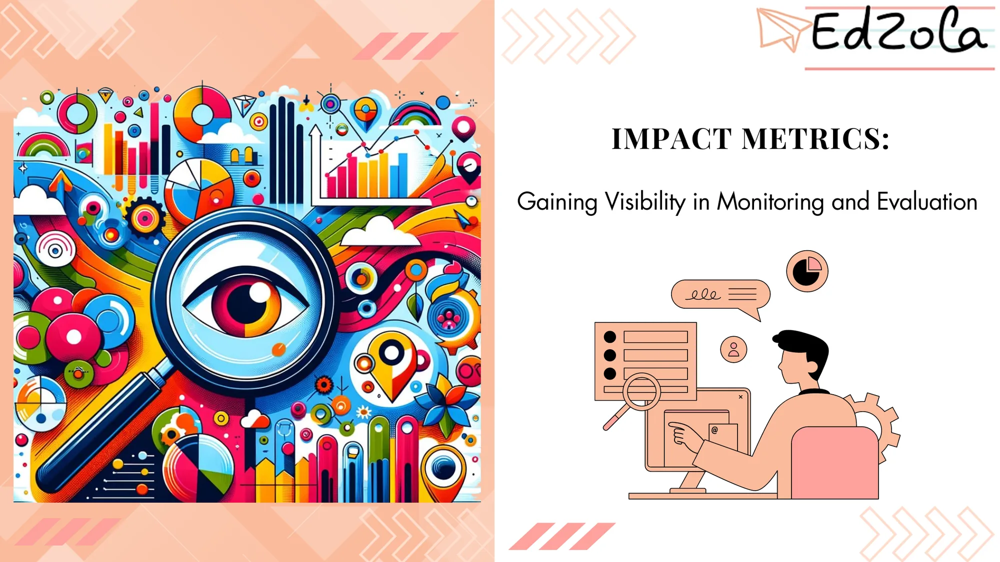
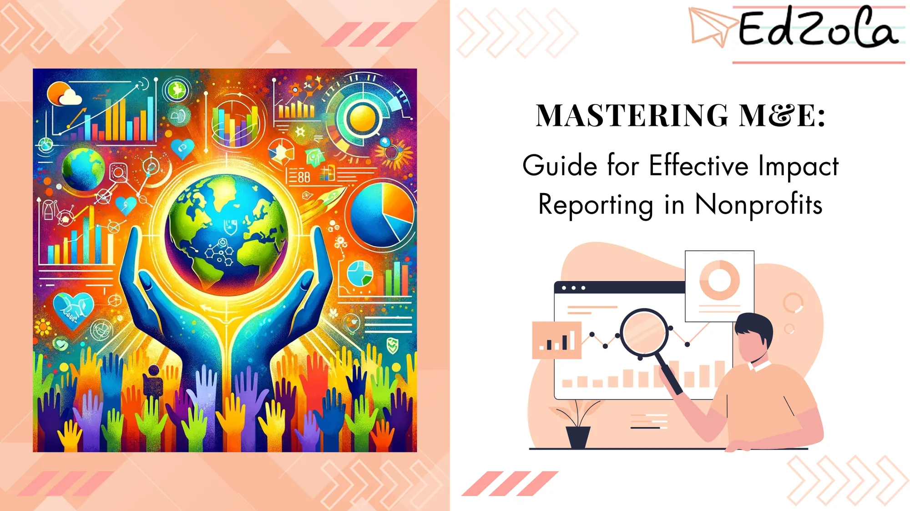
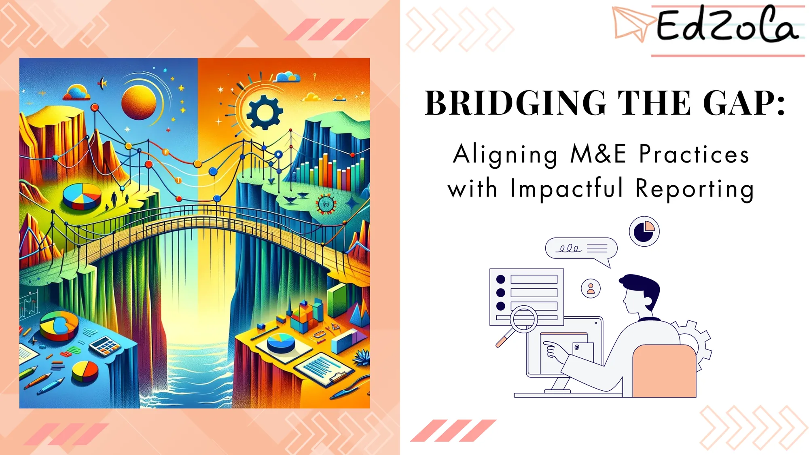
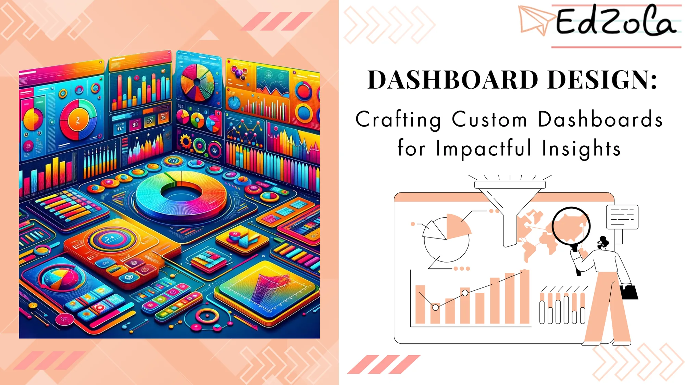
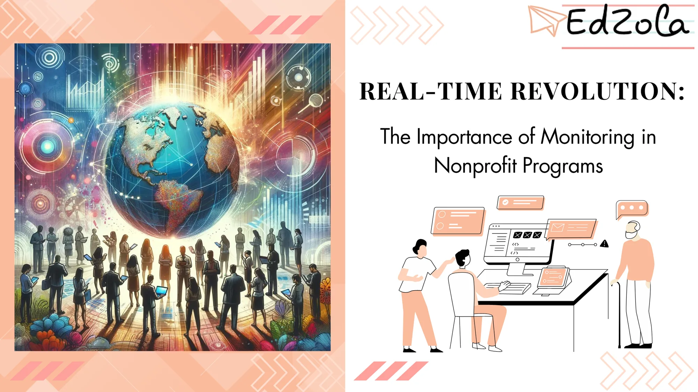
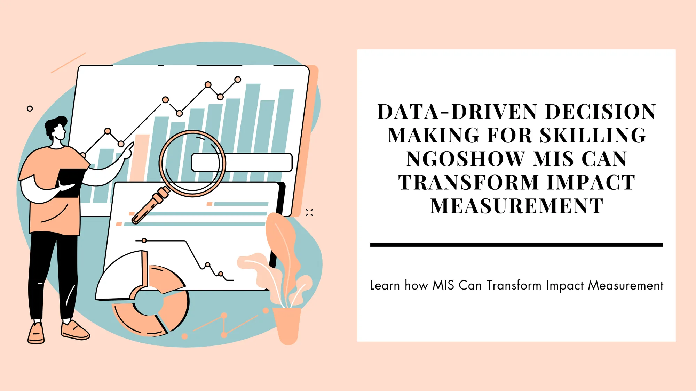
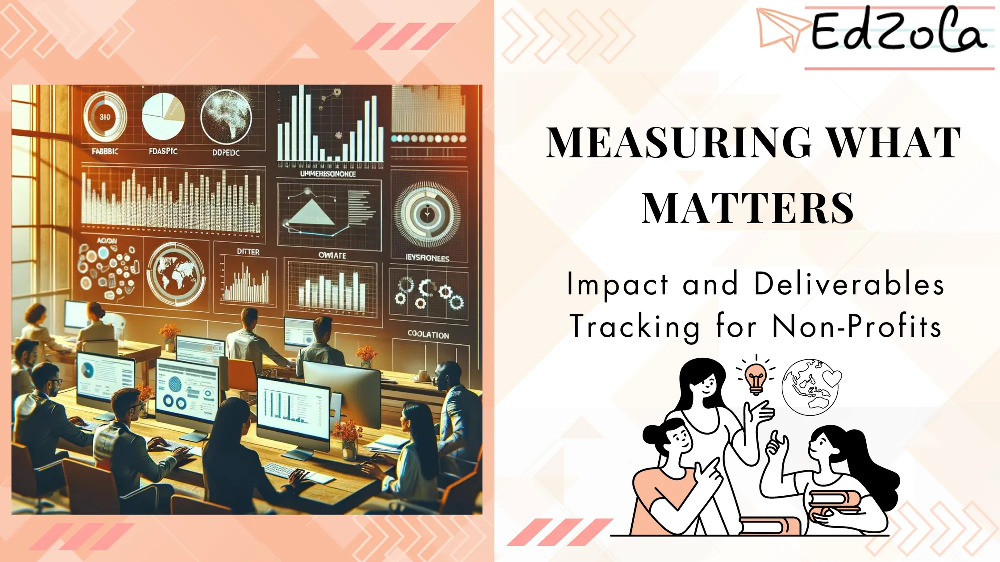

- [All Posts](https://www.edzola.com/blog)
- [EdZola Digital Guides](https://www.edzola.com/blog/categories/edzola-digital-guides)
- [Non-Profit data management & MIS](https://www.edzola.com/blog/categories/data-management)
- [Zoho Creator for NGOs](https://www.edzola.com/blog/categories/zoho-creator-for-ngos)
- [CRM & Fundraising](https://www.edzola.com/blog/categories/crm-fundraising)
- [Tech for Upskilling NGOs](https://www.edzola.com/blog/categories/tech-for-upskilling-ngos)
- [Zoho for NonProfits](https://www.edzola.com/blog/categories/zoho)
- [Data analytics - M&E](https://www.edzola.com/blog/categories/data-analytics-m-e-impact-measur)
- [AI for NGOs](https://www.edzola.com/blog/categories/ai-for-ngos)
- [Digital Transformation of NGOs](https://www.edzola.com/blog/categories/digital-transformation)
- [HRMS](https://www.edzola.com/blog/categories/hrms)
Search[## Mastering Non-Profit Data Management for Better Outcomes: The Power of Data-Driven Decisions](https://www.edzola.com/post/mastering-non-profit-data-management-for-better-outcomes-the-power-of-data-driven-decisions)In today's data-driven world, non-profit organizations are increasingly recognizing the importance of harnessing the power of data to optimize their operations, enhance their impact, and drive positive change. By effectively managing and leveraging data, non-profits can gain valuable insights that inform strategic planning, improve donor management, and evaluate the outcomes of their programs. In this article, we will delve into the key components of effective non-profit dataJan 30, 20255 min read[## Impact Metrics: Gaining Visibility in Monitoring and Evaluation](https://www.edzola.com/post/impact-metrics-gaining-visibility-in-monitoring-and-evaluation)Monitoring and evaluation are pivotal for the success of nonprofits, guaranteeing optimal resource allocation and favorable program...Dec 3, 20245 min read[## Mastering M&E: Guide for Effective Impact Reporting in Nonprofits](https://www.edzola.com/post/mastering-m-e-strategies-for-effective-impact-reporting-in-nonprofits)Measuring and evaluating impact is crucial for nonprofit success. As nonprofits strive to make a difference in their communities, they...Mar 20, 20245 min read[## Bridging the Gap: Aligning M&E Practices with Impactful Reporting](https://www.edzola.com/post/bridging-the-gap-aligning-m-e-practices-with-impactful-reporting)In the world of nonprofit organizations, the ability to effectively measure and evaluate performance is crucial for success. Monitoring...Mar 19, 20245 min read[## Dashboard Design: Crafting Custom Dashboards for Impactful Insights](https://www.edzola.com/post/dashboard-design-crafting-custom-dashboards-for-impactful-insights)Nonprofit organizations are constantly seeking ways to gain meaningful insights from their data. One powerful tool that has emerged in...Mar 15, 20246 min read[## Real-Time Revolution: The Importance of Monitoring in Nonprofit Programs](https://www.edzola.com/post/real-time-revolution-the-importance-of-monitoring-in-nonprofit-programs)Nonprofit organizations play a vital role in addressing various social issues and bringing about positive change in our communities....Mar 12, 20245 min read[## Data-Driven Decision Making for Skilling NGOs: How MIS Can Transform Impact Measurement](https://www.edzola.com/post/data-driven-decision-making-for-skilling-ngos-how-mis-can-transform-impact-measurement)Harness the power of Management Information Systems (MIS), and transform your impact measurement strategiesFeb 21, 20244 min read[## Measuring What Matters: Impact and Deliverables Tracking for Non-Profits](https://www.edzola.com/post/measuring-what-matters-impact-and-deliverables-tracking-for-non-profits)Non-profit organizations are constantly faced with the challenge of effectively measuring and tracking the impact of their activities and...Feb 15, 20246 min read[## 4 Strategies to Streamline Student Management System in Upskilling NGOs](https://www.edzola.com/post/4-strategies-to-streamline-student-management-system-in-upskilling-ngos)NGOs focused on upskilling students play a crucial role in empowering individuals and communities. To effectively support their mission,...Feb 13, 20247 min read
