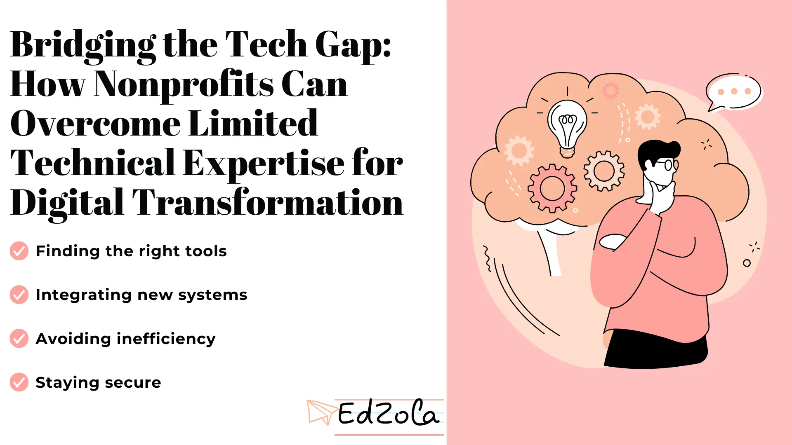
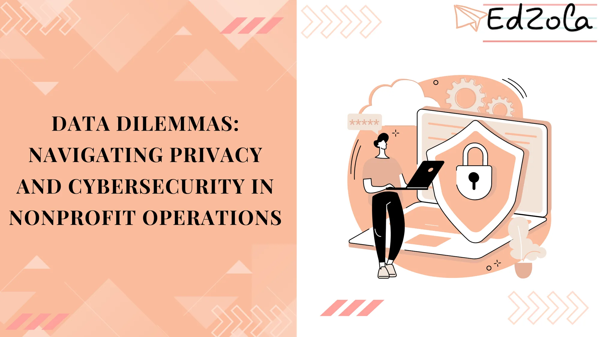
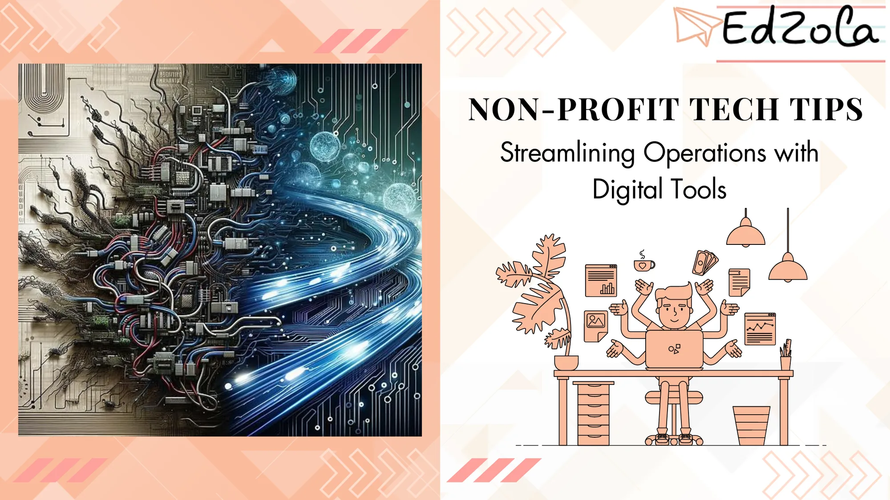

- [All Posts](https://www.edzola.com/blog)
- [EdZola Digital Guides](https://www.edzola.com/blog/categories/edzola-digital-guides)
- [Non-Profit data management & MIS](https://www.edzola.com/blog/categories/data-management)
- [Zoho Creator for NGOs](https://www.edzola.com/blog/categories/zoho-creator-for-ngos)
- [CRM & Fundraising](https://www.edzola.com/blog/categories/crm-fundraising)
- [Tech for Upskilling NGOs](https://www.edzola.com/blog/categories/tech-for-upskilling-ngos)
- [Zoho for NonProfits](https://www.edzola.com/blog/categories/zoho)
- [Data analytics - M&E](https://www.edzola.com/blog/categories/data-analytics-m-e-impact-measur)
- [AI for NGOs](https://www.edzola.com/blog/categories/ai-for-ngos)
- [Digital Transformation of NGOs](https://www.edzola.com/blog/categories/digital-transformation)
- [HRMS](https://www.edzola.com/blog/categories/hrms)
Search[## Bridging the Tech Gap: How Nonprofits Can Overcome Limited Technical Expertise for Digital Transformation](https://www.edzola.com/post/bridging-the-tech-gap-how-nonprofits-can-overcome-limited-technical-expertise-for-digital-transform)Is your nonprofit ready to adopt digital transformation? Imagine your team excited to use new tools but unsure how to use them...Nov 15, 20244 min read[## From 0 to 1: Practical Tips for Social Enterprises to Leverage Technology in Their Digital Transformation](https://www.edzola.com/post/from-0-to-1-practical-tips-for-social-enterprises-to-leverage-technology-in-their-digital-transform)Over the last four-plus years, working closely with nonprofits, We’ve come to realize that standard digital transformation frameworks...Oct 9, 20243 min read[## Data Dilemmas: Navigating Privacy and Cybersecurity in Nonprofit Operations](https://www.edzola.com/post/data-dilemmas-navigating-privacy-and-cybersecurity-in-nonprofit-operations)Nonprofits face unique challenges in managing data privacy and cybersecurity. Entrusted with sensitive information from donors,...Apr 8, 20246 min read[## Is it time to migrate from outdated legacy systems? Signs to notice for Nonprofits](https://www.edzola.com/post/is-it-time-to-migrate-on-from-legacy-systems-signs-to-notice-for-nonprofits)If you're noticing these signs, then it's time for migration from your legacy systems and for exploring trending technologies that can revitApr 4, 20248 min read[## How to Perform Tech Evaluation: Criteria for Technology Assessment in Nonprofits](https://www.edzola.com/post/how-to-perform-tech-evaluation-criteria-for-technology-assessment-in-nonprofits)Technology plays a pivotal role in the success of nonprofit organizations. Whether it's engaging donors, streamlining fundraising...Apr 1, 20245 min read[## Key Criteria for Choosing the Right Technology Partner for Your Nonprofit](https://www.edzola.com/post/key-criteria-for-choosing-the-right-technology-partner-for-your-nonprofit)Nonprofit organizations are increasingly recognizing the importance of technology in achieving their mission. From streamlining...Mar 22, 20245 min read[## Build or Buy: Navigating the Software Solution Dilemma for Nonprofits](https://www.edzola.com/post/build-or-buy-navigating-the-software-solution-dilemma-for-nonprofits)Nonprofit organizations are increasingly recognizing the need for innovative technology solutions to drive their missions forward....Mar 21, 20244 min read[## Tech Trends: Keeping Your Nonprofit Ahead in the Digital Transformation Race](https://www.edzola.com/post/tech-trends-keeping-your-nonprofit-ahead-in-the-digital-transformation-race)Nonprofit organizations are facing the challenge of staying ahead in the digital transformation race. With the increasing reliance on...Mar 11, 20245 min read[## Non-Profit Tech Tips: Streamlining Operations with Digital Tools](https://www.edzola.com/post/non-profit-tech-tips-streamlining-operations-with-digital-tools)Technology plays a crucial role in the success of any organization, and non-profits are no exception. With the aim of making a positive...Feb 12, 20244 min read
