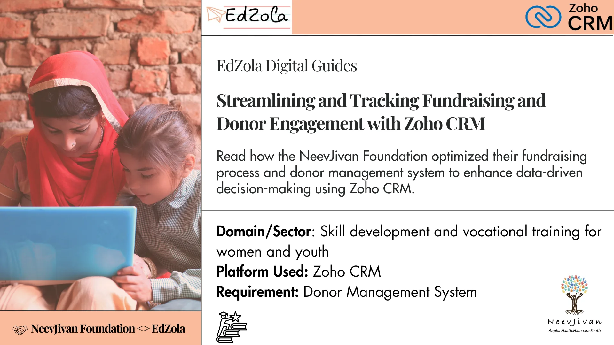
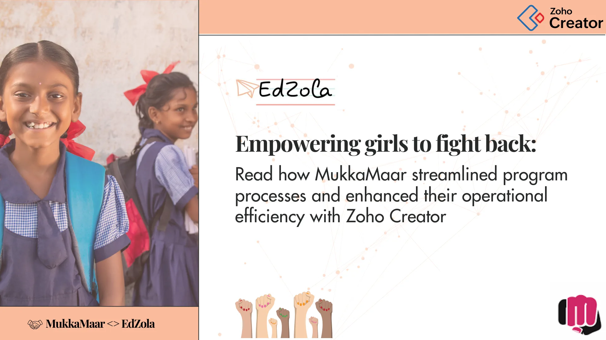

- [All Posts](https://www.edzola.com/blog)
- [EdZola Digital Guides](https://www.edzola.com/blog/categories/edzola-digital-guides)
- [Non-Profit data management & MIS](https://www.edzola.com/blog/categories/data-management)
- [Zoho Creator for NGOs](https://www.edzola.com/blog/categories/zoho-creator-for-ngos)
- [CRM & Fundraising](https://www.edzola.com/blog/categories/crm-fundraising)
- [Tech for Upskilling NGOs](https://www.edzola.com/blog/categories/tech-for-upskilling-ngos)
- [Zoho for NonProfits](https://www.edzola.com/blog/categories/zoho)
- [Data analytics - M&E](https://www.edzola.com/blog/categories/data-analytics-m-e-impact-measur)
- [AI for NGOs](https://www.edzola.com/blog/categories/ai-for-ngos)
- [Digital Transformation of NGOs](https://www.edzola.com/blog/categories/digital-transformation)
- [HRMS](https://www.edzola.com/blog/categories/hrms)
Search[## EDG: Aria CFO Services – Enabling Effective Project Management and Team Collaboration with Zoho Projects](https://www.edzola.com/post/edg-aria-cfo-services-effective-project-management-and-team-collaboration-with-zoho-projects)Read how ARIA CFO Services streamlined their operations by implementing a project management system and enhanced team collaboration and delivery excellence with Zoho Projects. Key Information: Time taken: 2 months Result : They are managing their internal processes efficiently, leading to increased productivity. EdZola <> Aria Partnership Aria CFO Services partnered with EdZola in 2024 to set up a simpler, more organized way to manage their projects using Zoho Projects. EarFeb 236 min read[## Compass MIS: Transforming State-Wide Teacher Training with Tech](https://www.edzola.com/post/compass-mis-transforming-state-wide-teacher-training-with-tech)Key Indicators 1. Challenges of Indian Education Bodies 2. The Emerging Need and Willingness to Integrate Technology 3. Timeline of the Project 4. Solutions the MIS Offers 5. Results 6. Use Cases to highlight the benefits 7. Tips for Non-Profit or Other Practitioners (Collective) 8. What does Mainak Roy, Co-Founder & CEO of SEF, say about us? 9 . Key Learnings: Building Tech for Government at Scale 10. Next Steps: Expanding to More States 1. Challenges of Indian Education BoJan 611 min read[## EDG: Tapasya – Tracking Government Scheme Beneficiaries’ Data with Zoho Creator](https://www.edzola.com/post/edg-tapasyatracking-government-scheme-beneficiaries-data-with-zoho-creator)Read how Tapasya streamlined its project management system to track government scheme beneficiaries’ data for better decision-making...Oct 7, 20255 min read[## EDG: Aangan Trust – Streamlining HR Operations and Employee Data Management through Zoho People](https://www.edzola.com/post/edg-aangan-trust-streamlining-hr-operations-and-employee-data-management-through-zoho-people)Read how Aangan Trust simplified their HR management system for their employees with Zoho People. Key Information: Time taken: 4 months ...Sep 3, 20256 min read[## EDG: Trust for Retailers & Retail Associates of India - Streamlining Program Management for Better Data-Driven Decisions with Zoho Creator](https://www.edzola.com/post/edg-trust-for-retailers-retail-associates-of-india-streamlining-program-management)Read how TRRAIN streamlined their process by setting up a MIS system and leveraged the data for effective program management with Zoho...Jan 13, 20256 min read[## EDG: NeevJivan Foundation - Streamlining and Tracking Fundraising and Donor Engagement with Zoho CRM](https://www.edzola.com/post/neevjivan-foundation-streamlining-and-tracking-fundraising-and-donor-engagement-with-zoho-crm)Read how the NeevJivan Foundation optimized their fundraising process and donor management system to enhance data-driven decision-making...Nov 27, 20244 min read[## EDG: Tap India Foundation -Tracking Out of School Children data](https://www.edzola.com/post/tap-india-foundation-tracking-out-of-school-children-data-with-zoho-creator)Read how TAP India Foundation streamlined their central program management system to enhance data-driven decision-making using Zoho CreatorJul 1, 20245 min read[## EDG: Avanti Fellows - Streamlining Telecalling Systems for Efficient Student Program Management](https://www.edzola.com/post/edzola-digital-guides-avanti-connect)Read how Avanti Fellows streamlined their process by setting up telecalling systems & leveraged the data for effective program management.Jun 20, 20245 min read[## EDG: MukkaMaar - Empowering Girl Children to Fight Back](https://www.edzola.com/post/zohocreator-for-mukkamaar)Read How MukkaMaar streamlined program processes and enhanced their operational efficiency with Zoho CreatorMar 20, 20244 min read
