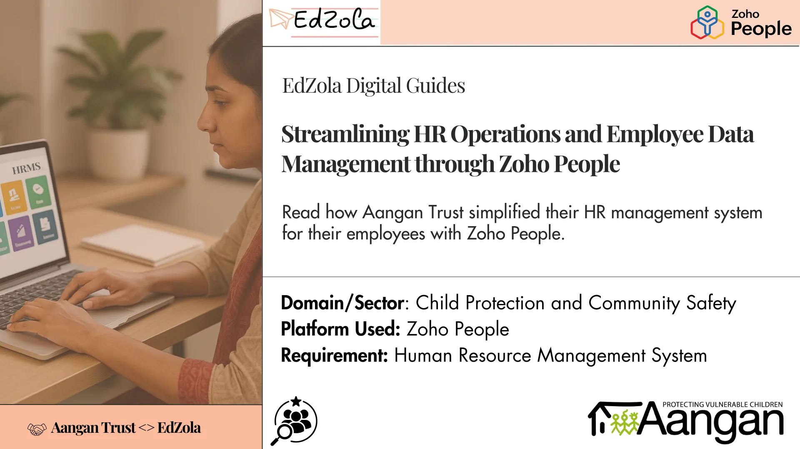
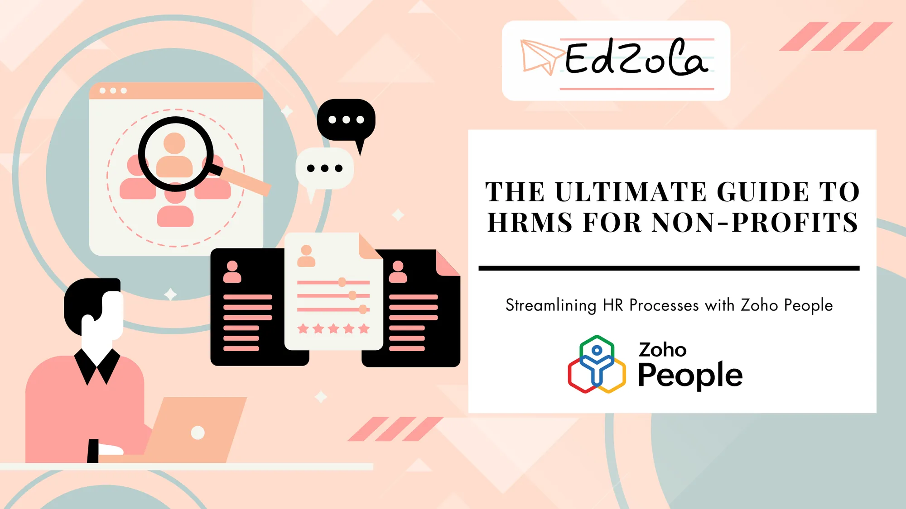

- [All Posts](https://www.edzola.com/blog)
- [EdZola Digital Guides](https://www.edzola.com/blog/categories/edzola-digital-guides)
- [Non-Profit data management & MIS](https://www.edzola.com/blog/categories/data-management)
- [Zoho Creator for NGOs](https://www.edzola.com/blog/categories/zoho-creator-for-ngos)
- [CRM & Fundraising](https://www.edzola.com/blog/categories/crm-fundraising)
- [Tech for Upskilling NGOs](https://www.edzola.com/blog/categories/tech-for-upskilling-ngos)
- [Zoho for NonProfits](https://www.edzola.com/blog/categories/zoho)
- [Data analytics - M&E](https://www.edzola.com/blog/categories/data-analytics-m-e-impact-measur)
- [AI for NGOs](https://www.edzola.com/blog/categories/ai-for-ngos)
- [Digital Transformation of NGOs](https://www.edzola.com/blog/categories/digital-transformation)
- [HRMS](https://www.edzola.com/blog/categories/hrms)
Search[## EDG: Aangan Trust – Streamlining HR Operations and Employee Data Management through Zoho People](https://www.edzola.com/post/edg-aangan-trust-streamlining-hr-operations-and-employee-data-management-through-zoho-people)Read how Aangan Trust simplified their HR management system for their employees with Zoho People. Key Information: Time taken: 4 months ...Sep 3, 20256 min read[## Overcoming Implementation Challenges in HR Management Systems](https://www.edzola.com/post/overcoming-implementation-challenges-in-hr-management-systems)Human resources (HR) management systems have become an integral part of organizations, helping them streamline their HR processes and...Mar 18, 20245 min read[## The Ultimate Guide to HRMS for Non-Profits: Streamlining HR Processes with Zoho People](https://www.edzola.com/post/the-ultimate-guide-to-hrms-for-non-profits-streamlining-hr-processes-with-zoho-people)The success of any non-profit depends heavily on its ability to attract and retain dedicated and passionate employees. To achieve this,...Feb 19, 20245 min read
