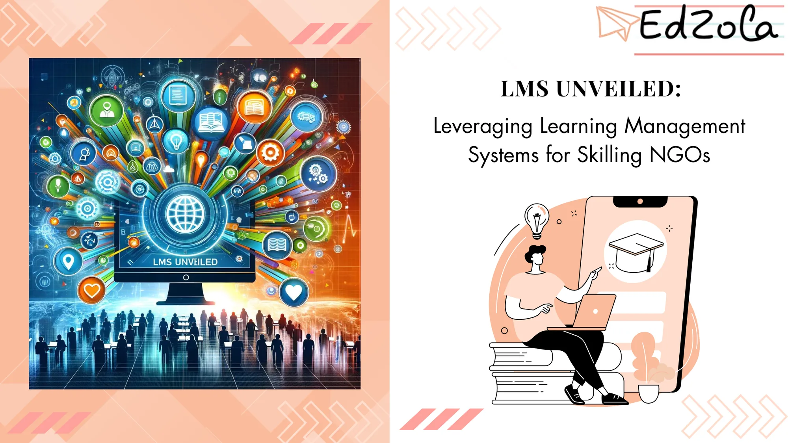

- [All Posts](https://www.edzola.com/blog)
- [EdZola Digital Guides](https://www.edzola.com/blog/categories/edzola-digital-guides)
- [Non-Profit data management & MIS](https://www.edzola.com/blog/categories/data-management)
- [Zoho Creator for NGOs](https://www.edzola.com/blog/categories/zoho-creator-for-ngos)
- [CRM & Fundraising](https://www.edzola.com/blog/categories/crm-fundraising)
- [Tech for Upskilling NGOs](https://www.edzola.com/blog/categories/tech-for-upskilling-ngos)
- [Zoho for NonProfits](https://www.edzola.com/blog/categories/zoho)
- [Data analytics - M&E](https://www.edzola.com/blog/categories/data-analytics-m-e-impact-measur)
- [AI for NGOs](https://www.edzola.com/blog/categories/ai-for-ngos)
- [Digital Transformation of NGOs](https://www.edzola.com/blog/categories/digital-transformation)
- [HRMS](https://www.edzola.com/blog/categories/hrms)
Search[## Stop Chasing Tools. Start With the Human Need](https://www.edzola.com/post/stop-chasing-tools-start-with-the-human-need)Why most nonprofit tech fails?
It’s not the tools, it’s the habits.
Learn how to fix the foundation before you invest.May 21, 20253 min read[## LMS Unveiled: Leveraging Learning Management Systems for NGOs](https://www.edzola.com/post/lms-unveiled-leveraging-learning-management-systems-for-skilling-ngos)Non-profit organizations (NGOs) play a crucial role in addressing societal challenges and uplifting communities. One area where NGOs have...Mar 28, 20245 min read[## Data-Driven Decision Making for Skilling NGOs: How MIS Can Transform Impact Measurement](https://www.edzola.com/post/data-driven-decision-making-for-skilling-ngos-how-mis-can-transform-impact-measurement)Harness the power of Management Information Systems (MIS), and transform your impact measurement strategiesFeb 21, 20244 min read[## 4 Strategies to Streamline Student Management System in Upskilling NGOs](https://www.edzola.com/post/4-strategies-to-streamline-student-management-system-in-upskilling-ngos)NGOs focused on upskilling students play a crucial role in empowering individuals and communities. To effectively support their mission,...Feb 13, 20247 min read[## Tech for Impact - Case Study on The Nudge Institute](https://www.edzola.com/post/tech-for-impact-case-study-fp)Learn how Future Perfect program has leveraged technology by partnering with EdZola to get rewarding results and scale their impact.Aug 17, 20221 min read
