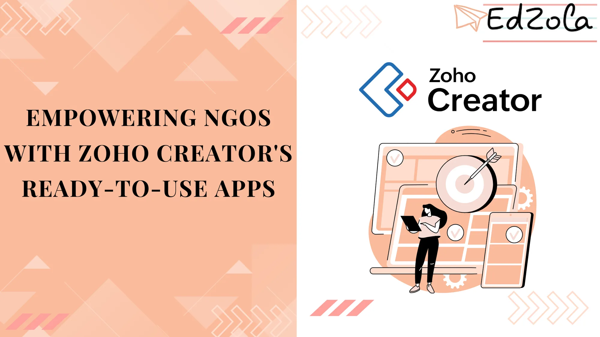

- [All Posts](https://www.edzola.com/blog)
- [EdZola Digital Guides](https://www.edzola.com/blog/categories/edzola-digital-guides)
- [Non-Profit data management & MIS](https://www.edzola.com/blog/categories/data-management)
- [Zoho Creator for NGOs](https://www.edzola.com/blog/categories/zoho-creator-for-ngos)
- [CRM & Fundraising](https://www.edzola.com/blog/categories/crm-fundraising)
- [Tech for Upskilling NGOs](https://www.edzola.com/blog/categories/tech-for-upskilling-ngos)
- [Zoho for NonProfits](https://www.edzola.com/blog/categories/zoho)
- [Data analytics - M&E](https://www.edzola.com/blog/categories/data-analytics-m-e-impact-measur)
- [AI for NGOs](https://www.edzola.com/blog/categories/ai-for-ngos)
- [Digital Transformation of NGOs](https://www.edzola.com/blog/categories/digital-transformation)
- [HRMS](https://www.edzola.com/blog/categories/hrms)
Search[## Transform Your Nonprofit with FundZola: 7 Essential Modules for Indian Nonprofits to Simplify Donor Management And Fundraising](https://www.edzola.com/post/transform-your-nonprofit-with-fundzola-7-essential-modules-for-indian-nonprofits-to-simplify-donor)If you’re an NGO leader, finance head or Fundraising manager you’ve likely faced this situation: “We spend more time fixing donor records than fundraising.” “Generating 80G and Fund Utilization Certificates manually? It’s a full-time job.” Whether you're managing hundreds of donors, reporting to corporate funders or preparing for audits, working across Excel files, Google Drive folders and WhatsApp confirmations drains time and creates clunky processes. Manual donor trackingAug 19, 20255 min read[## Streamline Your NGO's Operation with Zoho Creator: A Guide to Essential Automation Features](https://www.edzola.com/post/elevate-your-ngo-s-impact-with-zoho-creator-a-guide-to-automation-excellence)For NGOs in today’s fast-paced world, efficiency isn't just a luxury; it's essential for success. Zoho Creator has emerged as a powerful ally in this context, offering low-code solutions that transform the way NGOs operate. This innovative platform automates routine tasks, from managing emails and approvals to processing data, enabling NGOs to focus more on their core mission and less on administrative workload. As the demand for agility and control in NGO management grows,Jul 10, 20256 min read[## Empowering NGOs with Zoho Creator's Ready-to-Use Apps](https://www.edzola.com/post/empowering-ngos-with-zoho-creator-s-ready-to-use-apps)In this article we explore how Zoho Creator’s apps are specifically tailored to meet the unique needs of the nonprofit sector, helping theseApr 15, 20258 min read[## Ways Nonprofits Can Leverage User Portal Feature in Zoho Creator](https://www.edzola.com/post/ways-nonprofits-can-leverage-user-portal-feature-in-zoho-creator)This blog explores how nonprofits can leverage Zoho Creator's user portal to empower volunteers, donors, employees, and beneficiaries, withApr 2, 20254 min read[## Zoho Creator Unleashed: Expertise in Program Management for Nonprofits](https://www.edzola.com/post/zoho-creator-unleashed-expertise-in-program-management-for-nonprofits)Effective program management is essential for the success of any nonprofit organization. With limited resources and a constant need to drive impact, nonprofits face unique challenges that require innovative solutions. Enter Zoho Creator, a powerful and versatile platform that empowers nonprofits to streamline their program management processes and achieve their mission with ease. In this article, we will explore Zoho Creator and delve into its key features and benefits for noMar 25, 20255 min read[## How to Overcome Legacy System Challenges with a Centralized Data Management Platform - Zoho Creator](https://www.edzola.com/post/how-to-overcome-legacy-system-challenges-with-a-centralized-data-management-platform-zoho-creator)Many organizations, including nonprofits, find themselves struggling with outdated legacy systems that hinder their ability to effectively manage their data. These legacy systems are often fragmented, inflexible, and difficult to maintain, resulting in inefficiencies, data silos, and missed opportunities. However, with the right strategies and tools in place, organizations can break free from their legacy systems and transition to a modern, centralized data management platforMar 24, 20254 min read[## Is it time to migrate from outdated legacy systems? Signs to notice for Nonprofits](https://www.edzola.com/post/is-it-time-to-migrate-on-from-legacy-systems-signs-to-notice-for-nonprofits)If you're noticing these signs, then it's time for migration from your legacy systems and for exploring trending technologies that can revitApr 4, 20248 min read[## Streamlining Non-Profit Operations with Zoho Creator](https://www.edzola.com/post/streamlining-non-profit-operations-with-zoho-creator-apps)Running a non-profit organization can be a fulfilling yet challenging endeavor. From managing donations and volunteers to coordinating...Mar 5, 20245 min read[## Innovating for Impact: How Non-Profits Can Harness Low-Code Platforms for Social Good](https://www.edzola.com/post/innovating-for-impact-how-non-profits-can-harness-low-code-platforms-for-social-good)Technology has revolutionized nearly every aspect of our lives, from how we communicate to how we access information. It has transformed...Mar 4, 20245 min read
