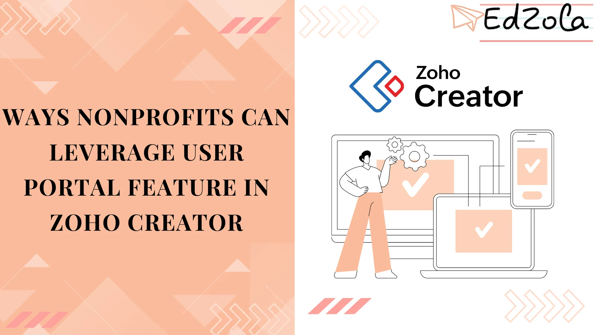
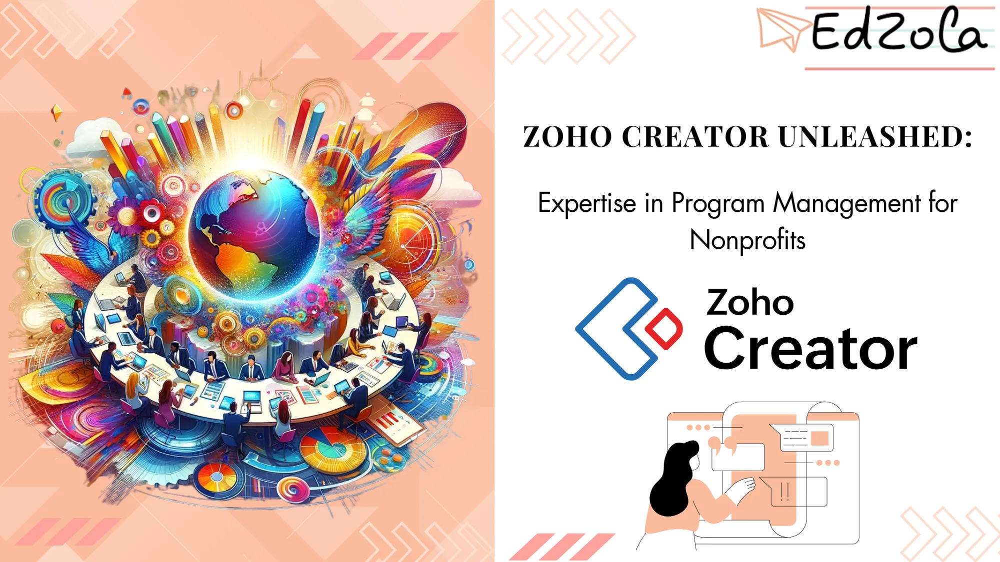
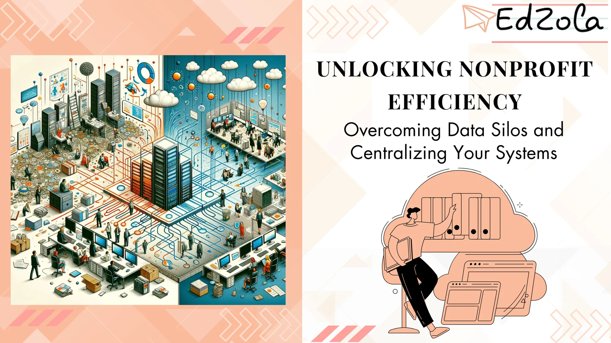
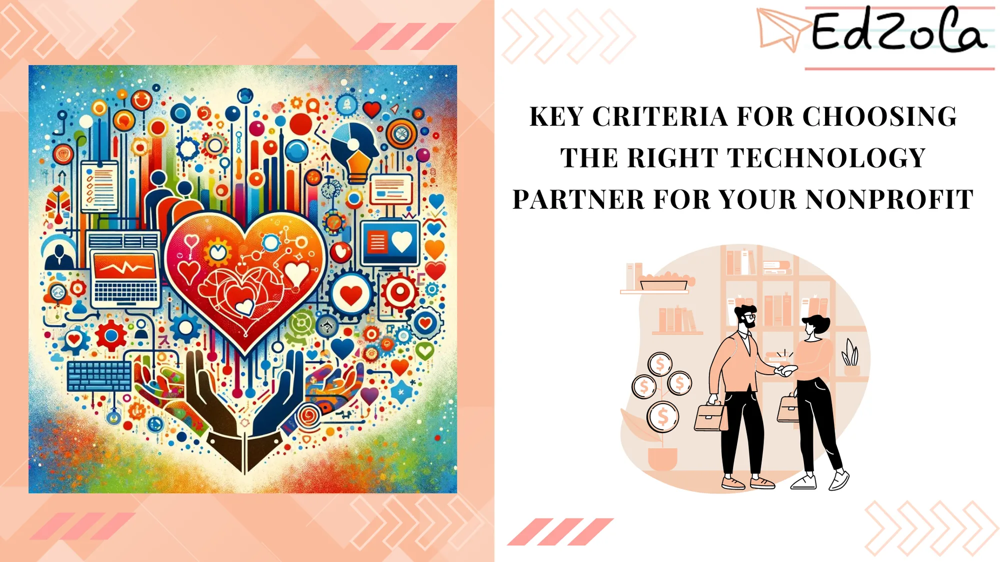
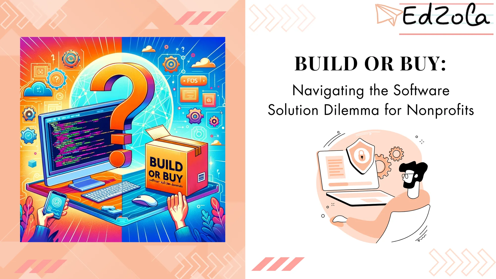
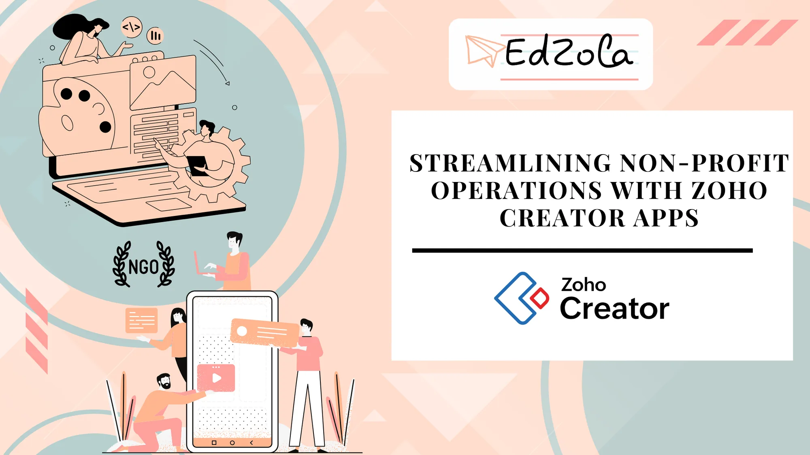
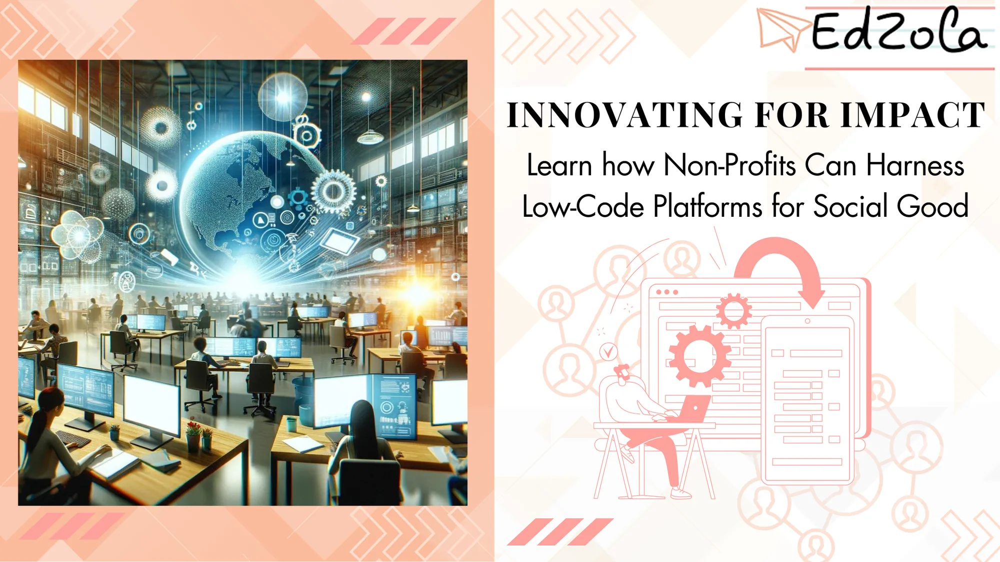
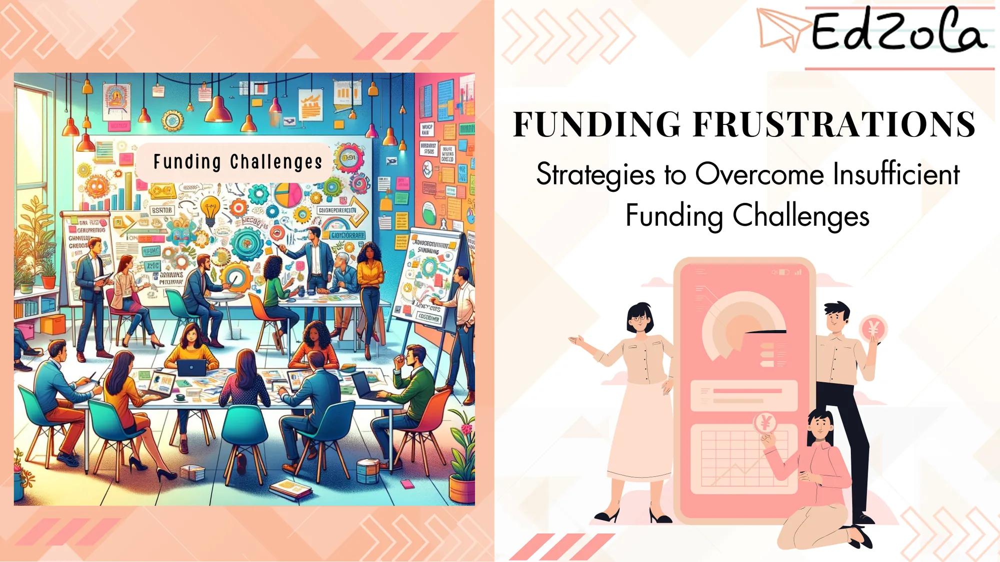

- [All Posts](https://www.edzola.com/blog)
- [EdZola Digital Guides](https://www.edzola.com/blog/categories/edzola-digital-guides)
- [Non-Profit data management & MIS](https://www.edzola.com/blog/categories/data-management)
- [Zoho Creator for NGOs](https://www.edzola.com/blog/categories/zoho-creator-for-ngos)
- [CRM & Fundraising](https://www.edzola.com/blog/categories/crm-fundraising)
- [Tech for Upskilling NGOs](https://www.edzola.com/blog/categories/tech-for-upskilling-ngos)
- [Zoho for NonProfits](https://www.edzola.com/blog/categories/zoho)
- [Data analytics - M&E](https://www.edzola.com/blog/categories/data-analytics-m-e-impact-measur)
- [AI for NGOs](https://www.edzola.com/blog/categories/ai-for-ngos)
- [Digital Transformation of NGOs](https://www.edzola.com/blog/categories/digital-transformation)
- [HRMS](https://www.edzola.com/blog/categories/hrms)
Search[## Ways Nonprofits Can Leverage User Portal Feature in Zoho Creator](https://www.edzola.com/post/ways-nonprofits-can-leverage-user-portal-feature-in-zoho-creator)This blog explores how nonprofits can leverage Zoho Creator's user portal to empower volunteers, donors, employees, and beneficiaries, withApr 2, 20254 min read[## Zoho Creator Unleashed: Expertise in Program Management for Nonprofits](https://www.edzola.com/post/zoho-creator-unleashed-expertise-in-program-management-for-nonprofits)Effective program management is essential for the success of any nonprofit organization. With limited resources and a constant need to drive impact, nonprofits face unique challenges that require innovative solutions. Enter Zoho Creator, a powerful and versatile platform that empowers nonprofits to streamline their program management processes and achieve their mission with ease. In this article, we will explore Zoho Creator and delve into its key features and benefits for noMar 25, 20255 min read[## Unlocking Nonprofit Efficiency: Overcoming Data Silos and Centralizing Your Systems](https://www.edzola.com/post/unlocking-nonprofit-efficiency-overcoming-data-silos-and-centralizing-your-systems)One of the most significant obstacles is the presence of data silos within their organizations. These silos, characterized by fragmented...Sep 18, 20244 min read[## Top 5 Reasons Why Zoho Books Is Your Ideal Solution for Non-profit Accounting Management](https://www.edzola.com/post/top-5-reasons-why-zoho-books-is-your-ideal-solution-for-non-profit-accounting-management)Managing the finances of a non-profit organization can be a challenging task. It requires a tool that’s not only efficient but also...Apr 2, 20246 min read[## Key Criteria for Choosing the Right Technology Partner for Your Nonprofit](https://www.edzola.com/post/key-criteria-for-choosing-the-right-technology-partner-for-your-nonprofit)Nonprofit organizations are increasingly recognizing the importance of technology in achieving their mission. From streamlining...Mar 22, 20245 min read[## Build or Buy: Navigating the Software Solution Dilemma for Nonprofits](https://www.edzola.com/post/build-or-buy-navigating-the-software-solution-dilemma-for-nonprofits)Nonprofit organizations are increasingly recognizing the need for innovative technology solutions to drive their missions forward....Mar 21, 20244 min read[## Streamlining Non-Profit Operations with Zoho Creator](https://www.edzola.com/post/streamlining-non-profit-operations-with-zoho-creator-apps)Running a non-profit organization can be a fulfilling yet challenging endeavor. From managing donations and volunteers to coordinating...Mar 5, 20245 min read[## Innovating for Impact: How Non-Profits Can Harness Low-Code Platforms for Social Good](https://www.edzola.com/post/innovating-for-impact-how-non-profits-can-harness-low-code-platforms-for-social-good)Technology has revolutionized nearly every aspect of our lives, from how we communicate to how we access information. It has transformed...Mar 4, 20245 min read[## Funding Frustrations: Strategies to Overcome Insufficient Funding Challenges](https://www.edzola.com/post/funding-frustrations-strategies-to-overcome-insufficient-funding-challenges)Nonprofits across the globe face immense challenges when it comes to securing sufficient funding for their programs and initiatives....Feb 23, 20244 min read
