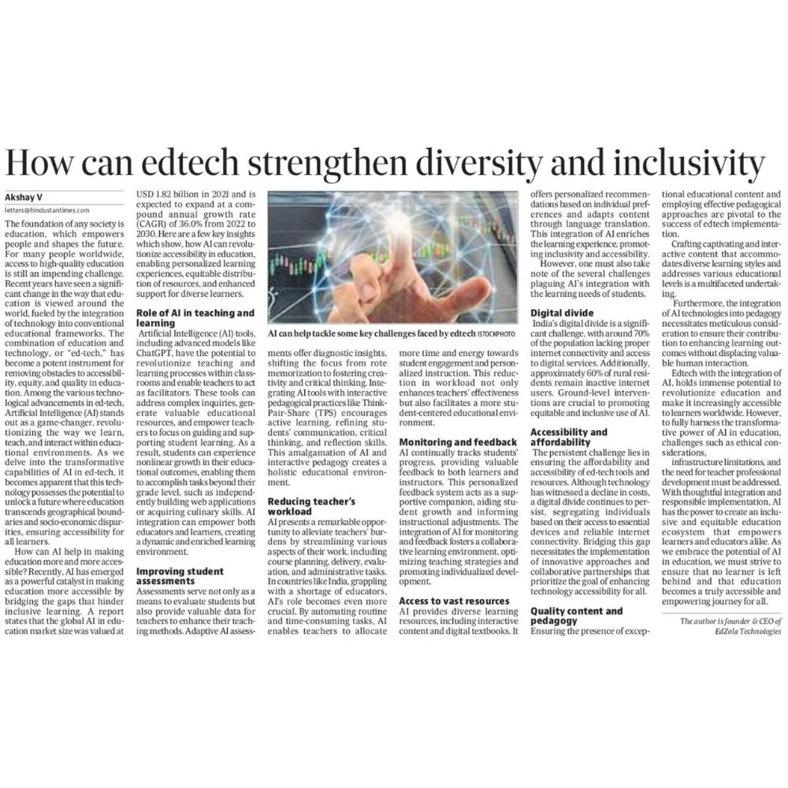
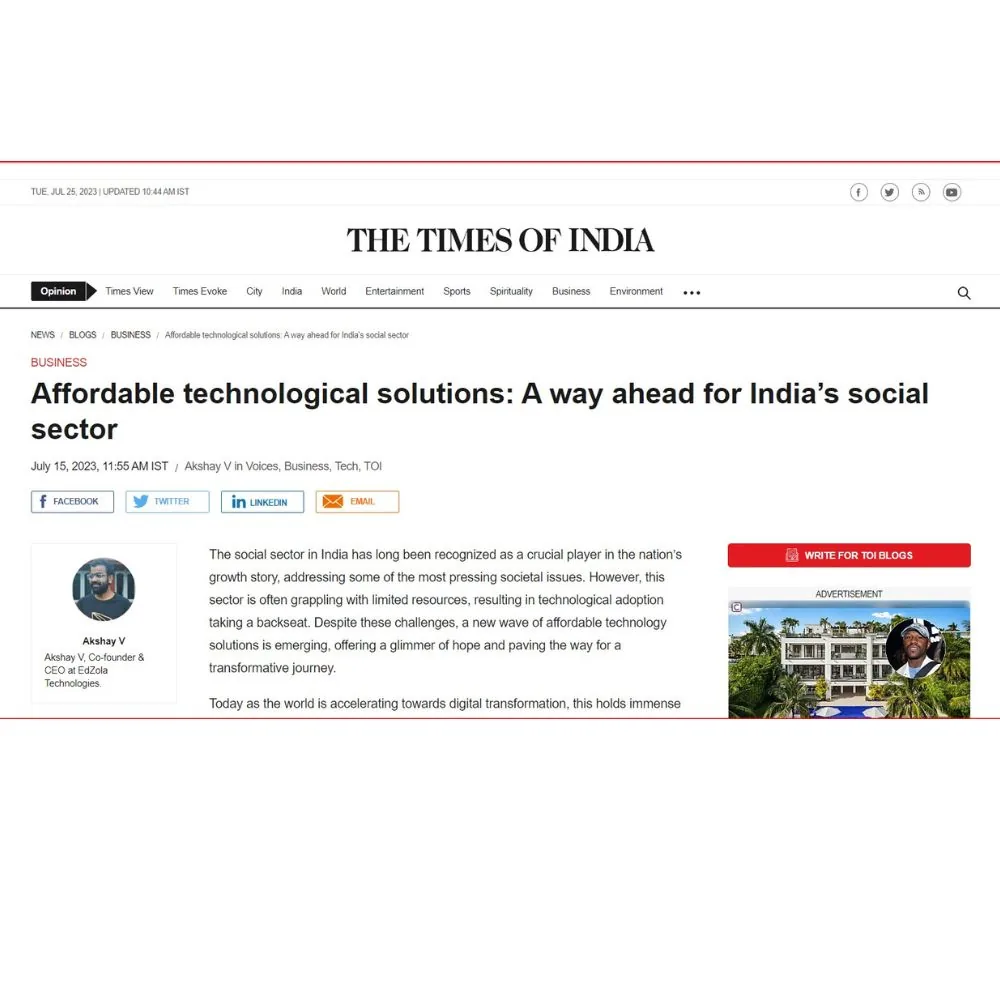
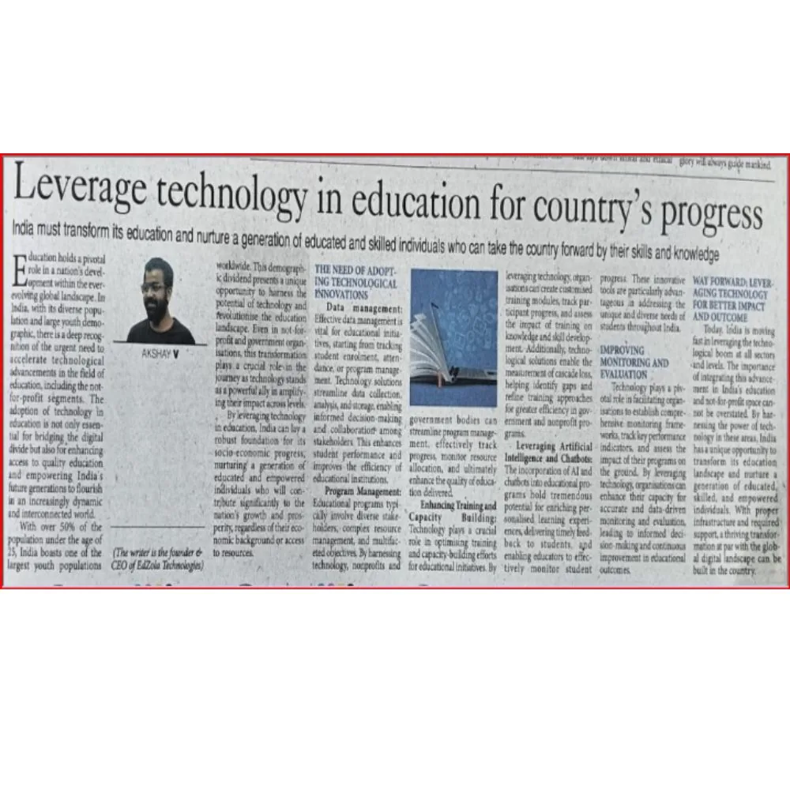
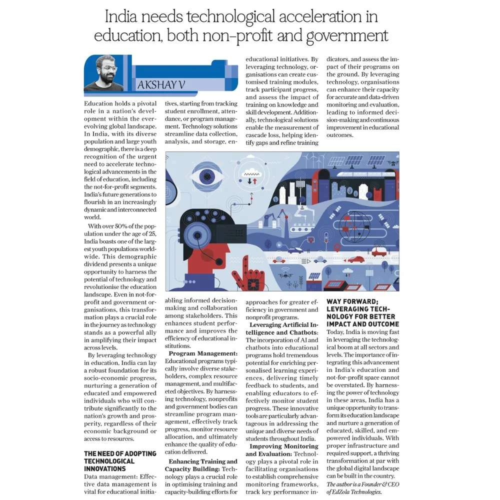
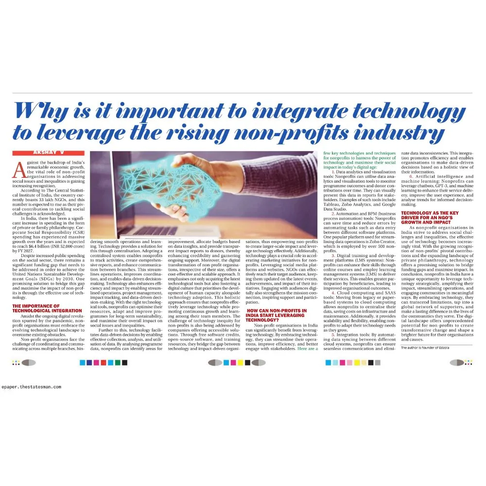
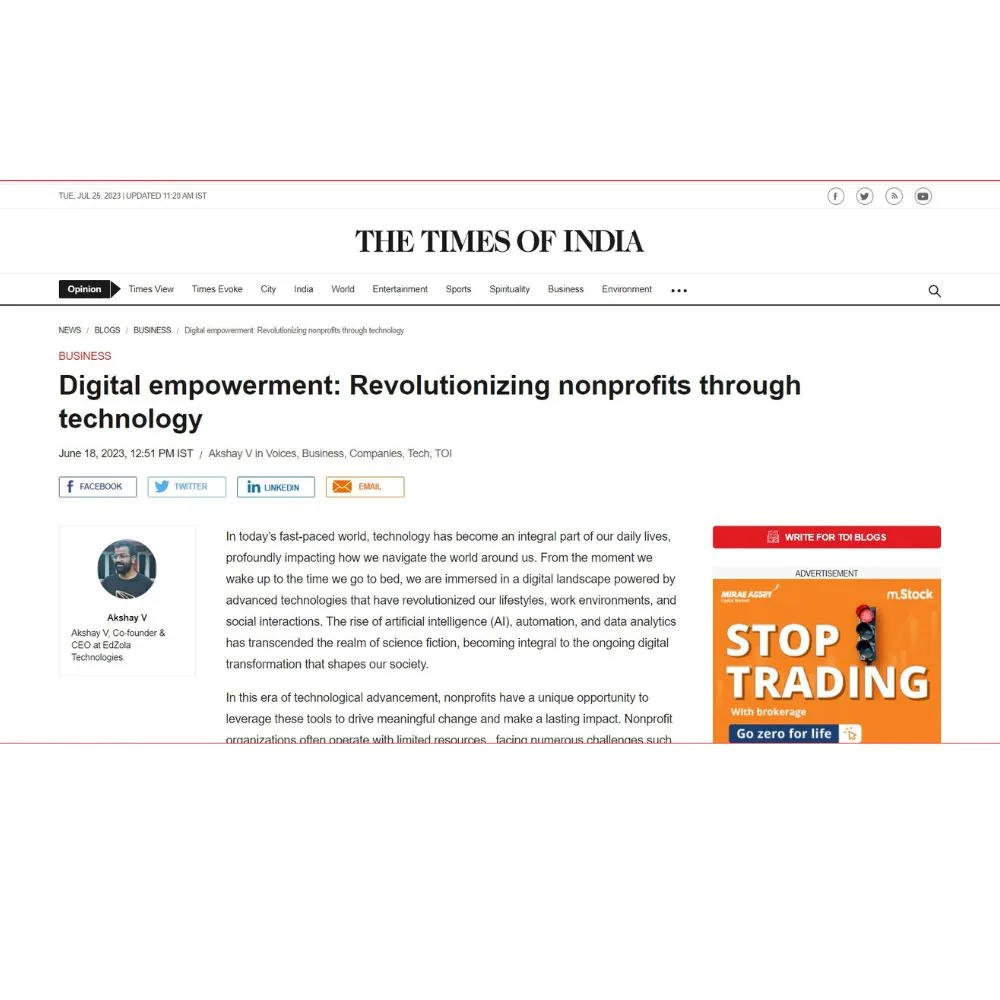
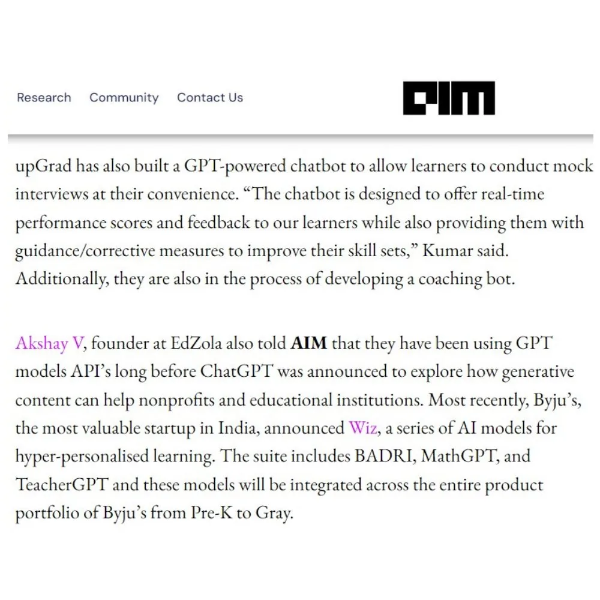
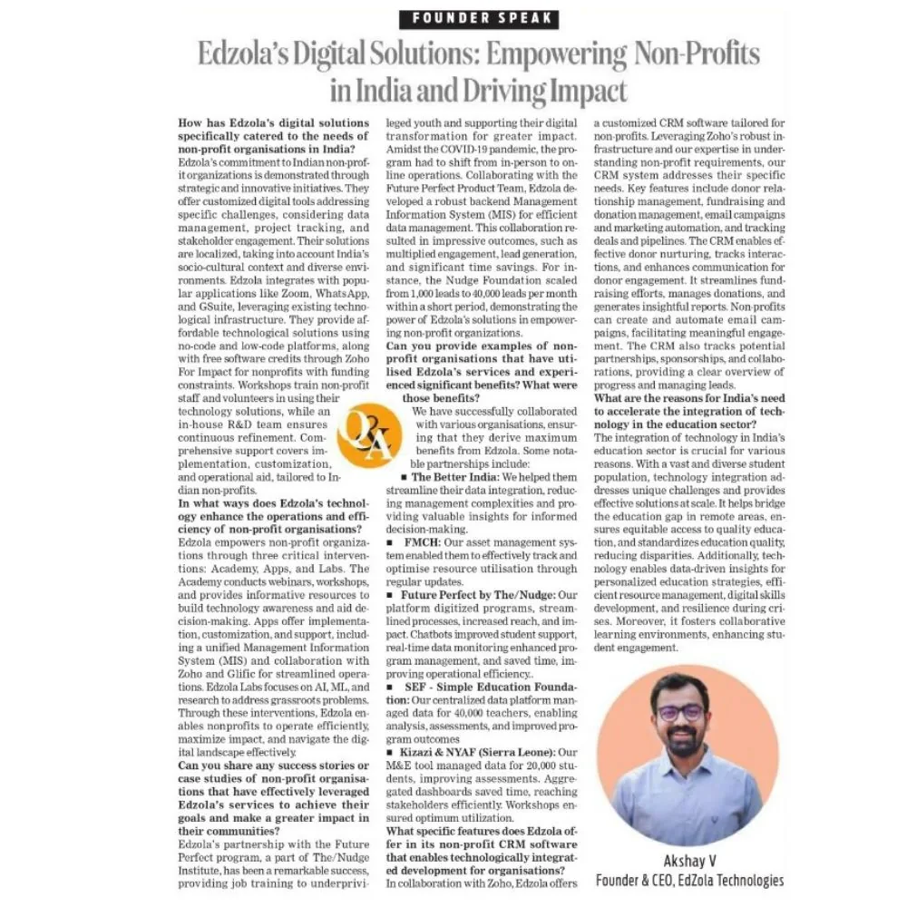
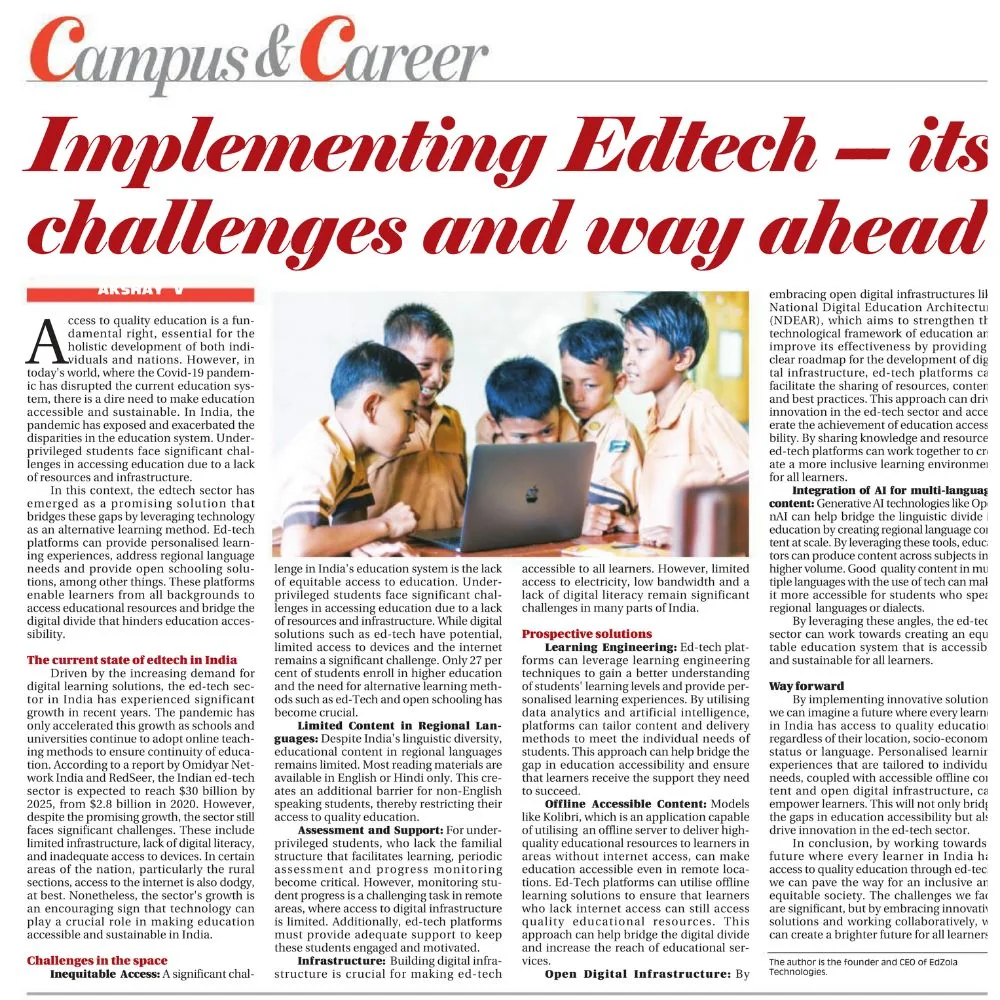
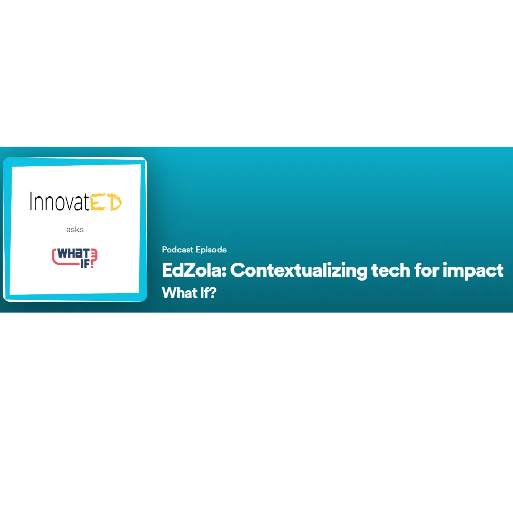

# In the Media

Leading the Way, Driving Impact!

 

Our thought leadership articles explore forward-thinking strategies that can empower nonprofits to make a significant impact in their communities. Discover actionable ideas and thought-provoking concepts that challenge conventional thinking and inspire you to take bold steps towards achieving your organization's mission

July 19, 2023

# The Hindustan Times

Delve into the power of Edtech in promoting diversity and inclusivity, as explored in Hindustan Times. Discover how innovative educational technologies are breaking barriers and fostering an inclusive learning environment.

[Learn more](https://www.linkedin.com/posts/edzola_ai-accessibility-inclusivity-activity-7089529715513847808--VMK?utm_source=share&utm_medium=member_android)

# The Hindustan Times

July 15, 2023

# The Times Of India

Read the insightful article published in Times of India, exploring the transformative potential of accessible technology for driving positive change.

[Learn more](https://timesofindia.indiatimes.com/blogs/voices/affordable-technological-solutions-a-way-ahead-for-indias-social-sector//)

# The Times Of India

July 13, 2023

# The Pioneer

Discover the potential to leverage technology in education for advancing the country's progress, showcased in Pioneer. Uncover how innovative educational technologies are driving positive change and shaping a brighter future for our nation.

[Learn more](https://www.linkedin.com/posts/edzola_education-techforgood-edtech-activity-7085836095585714176-cBNN?utm_source=share&utm_medium=member_android)

# The Pioneer

July 13, 2023

# The Daily Guardian

Read about the pressing need for technological acceleration in education, spanning both Non-Profit and Government sectors, as featured in The Daily Guardian. Gain insights into the transformative power of technology in advancing learning opportunities and shaping a brighter future for India.

[Learn more](https://epaper.thedailyguardian.com/view/318/13-jul-2023/14)

# The Daily Guardian

July 12, 2023

# The Statesman

Explore the significance of integrating technology to harness the potential of the booming nonprofit industry, as highlighted in The Statesman. Uncover the key reasons why embracing technology is crucial for driving efficiency, outreach, and impact in the nonprofit sector.

[Learn more](https://epaper.thestatesman.com/3732236/Delhi-The-Statesman/12-07-2023#page/11/1)

# The Statesman

June 18, 2023

# The Times Of India

Explore the article in Times of India on how digital empowerment is revolutionizing nonprofits through cutting-edge technology. Learn how tech-driven solutions are driving positive change and amplifying impact in the social sector.

[Learn more](https://timesofindia.indiatimes.com/blogs/voices/digital-empowerment-revolutionizing-nonprofits-through-technology/)

# The Times Of India

June 15, 2023

# Analytics India Magazine

Unlock the secret weapon safeguarding Indian Edtech firms' survival, as revealed in Analytics India Magazine. Discover the key strategies and technologies empowering Edtech companies to thrive in a competitive landscape.

[Learn more](https://analyticsindiamag.com/the-secret-weapon-for-indian-edtech-firms-survival-in-the-industry/)

# Analytics India Magazine

June 1, 2023

# The New India Express

Discover EdZola's transformative digital solutions, empowering Non-Profits across India for greater impact, as featured in The New Indian Express. Learn how Edzola's cutting-edge technologies are revolutionizing the social sector and driving positive change.

[Learn more](https://www.linkedin.com/feed/update/urn:li:activity:7070261489445597184)

# The New India Express

May 1, 2023

# The Statesman

Uncover the challenges and promising future of implementing Edtech, as highlighted in The Statesman. Gain insights into overcoming hurdles and paving the way for a transformative and effective education technology landscape.

[Learn more](https://epaper.thestatesman.com/3701046/Delhi-The-Statesman/09-05-2023#page/11/1)

# The Statesman

March, 2022

# InnovatEd

As humanity aims to become one with tech, are we pausing to contextualize it for meaningful impact? Join Akshay V, Founder of EdZola, who helps explore the power of distributive technology in the change and impact ecosystem

[Learn more](https://open.spotify.com/episode/6QXU83hTnzPz9LyiuIw7pF)

# InnovatEd
