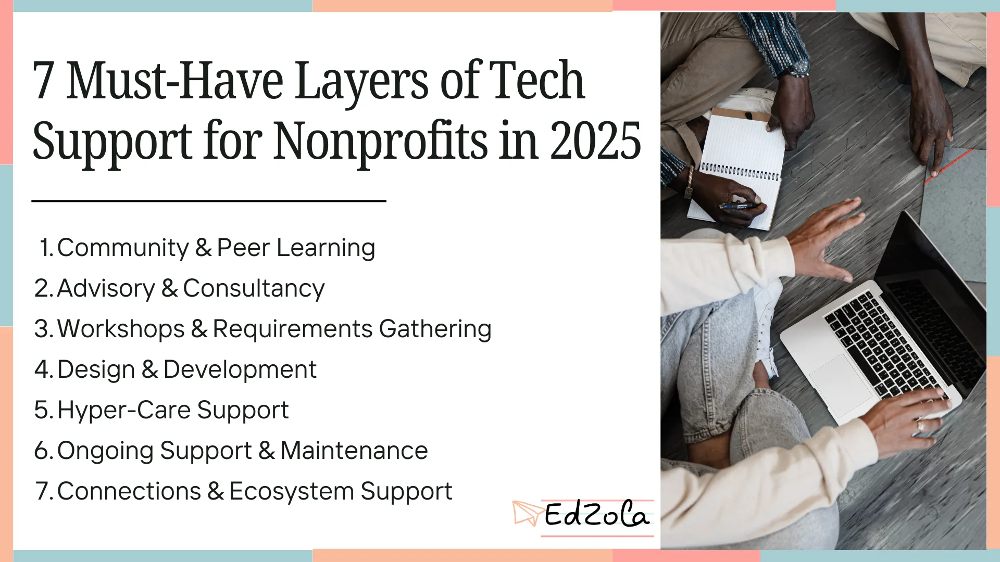
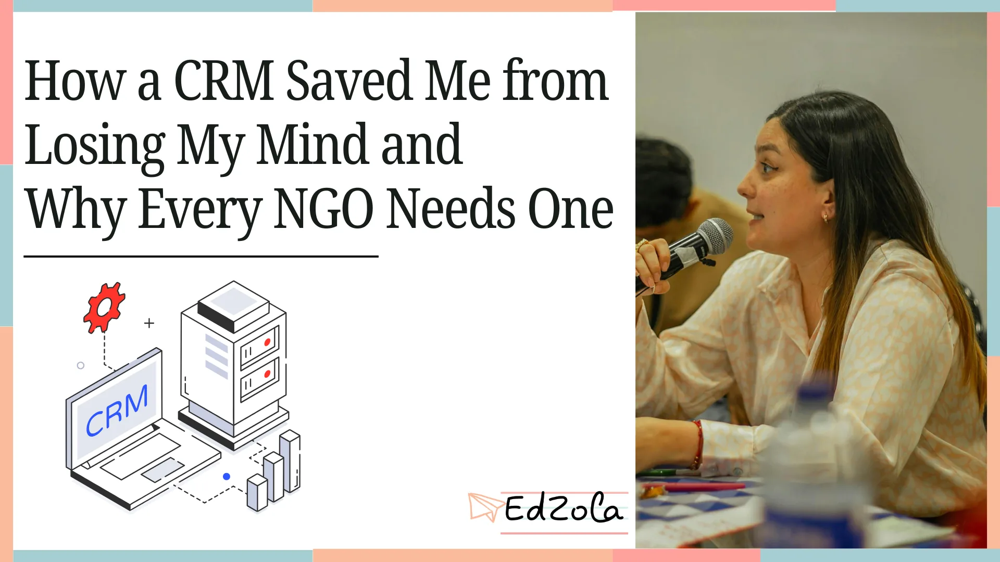
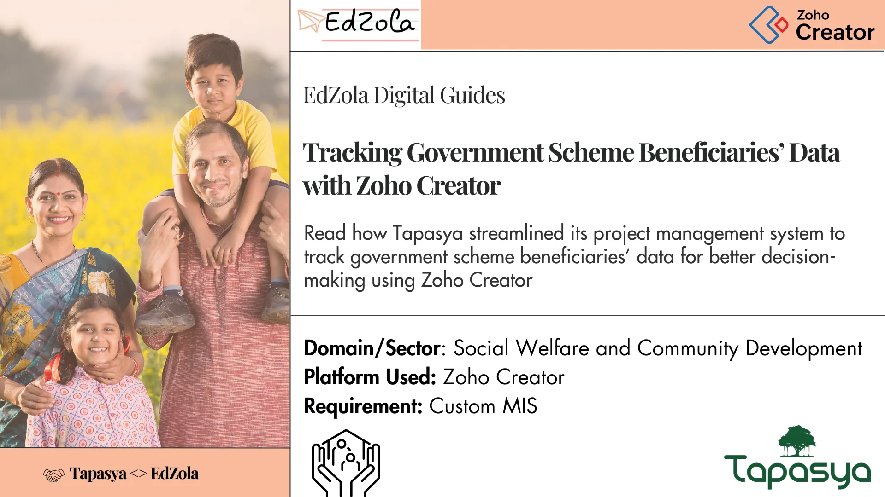

- [All Posts](https://www.edzola.com/blog)
- [EdZola Digital Guides](https://www.edzola.com/blog/categories/edzola-digital-guides)
- [Non-Profit data management & MIS](https://www.edzola.com/blog/categories/data-management)
- [Zoho Creator for NGOs](https://www.edzola.com/blog/categories/zoho-creator-for-ngos)
- [CRM & Fundraising](https://www.edzola.com/blog/categories/crm-fundraising)
- [Tech for Upskilling NGOs](https://www.edzola.com/blog/categories/tech-for-upskilling-ngos)
- [Zoho for NonProfits](https://www.edzola.com/blog/categories/zoho)
- [Data analytics - M&E](https://www.edzola.com/blog/categories/data-analytics-m-e-impact-measur)
- [AI for NGOs](https://www.edzola.com/blog/categories/ai-for-ngos)
- [Digital Transformation of NGOs](https://www.edzola.com/blog/categories/digital-transformation)
- [HRMS](https://www.edzola.com/blog/categories/hrms)
Search[## Let’s Listen to Everyone: Voice AI for the Social Sector](https://www.edzola.com/post/let-s-listen-to-everyone-voice-intelligence-for-the-social-sector)I want to tell you about Lakshmi. She has no formal schooling. She has never seen a web form, and she never will. But last quarter, she completed health survey in three minutes. On her own. In Telugu. Her phone rang. She picked up. She talked. That was it. That one call explains what we are building at zolabs.ai better than any pitch I could write. We call it voice intelligence but really, it is just an old idea done properly: if you want to know about people's lives, listenSep 173 min read[## This is how we think about AI. For whatever it's worth.](https://www.edzola.com/post/this-is-how-we-think-about-ai-for-whatever-it-s-worth)I've been having the same conversation with a lot of nonprofit leaders lately. Someone hears about what we've been doing with AI at EdZola, asks if I can share more, and I end up walking them through it. Not as a pitch, but as a genuine "here's what we tried, what worked, what didn't." What I've noticed is that the questions are almost always the same. And the anxiety is almost always the same too. So let me try to write down what I've actually learnt, from a year of buildingApr 226 min read[## What Is a Management Information System (MIS) for Nonprofits? The Complete 2026 Guide](https://www.edzola.com/post/what-is-a-management-information-system-mis-for-nonprofits-the-complete-2026-guide)A Management Information System (MIS) for nonprofits is a centralized digital platform that collects, stores, organizes, and reports on all the data your organization needs to deliver programs, manage donors, track outcomes, and report to funders from one connected system instead of dozens of disconnected spreadsheets. If you run a nonprofit or charity and your team spends more time hunting for data than acting on it, this guide is for you. We will walk through what an MIS acApr 76 min read[## EDG: Aria CFO Services – Enabling Effective Project Management and Team Collaboration with Zoho Projects](https://www.edzola.com/post/edg-aria-cfo-services-effective-project-management-and-team-collaboration-with-zoho-projects)Read how ARIA CFO Services streamlined their operations by implementing a project management system and enhanced team collaboration and delivery excellence with Zoho Projects. Key Information: Time taken: 2 months Result : They are managing their internal processes efficiently, leading to increased productivity. EdZola <> Aria Partnership Aria CFO Services partnered with EdZola in 2024 to set up a simpler, more organized way to manage their projects using Zoho Projects. EarFeb 236 min read[## Compass MIS: Transforming State-Wide Teacher Training with Tech](https://www.edzola.com/post/compass-mis-transforming-state-wide-teacher-training-with-tech)Key Indicators 1. Challenges of Indian Education Bodies 2. The Emerging Need and Willingness to Integrate Technology 3. Timeline of the Project 4. Solutions the MIS Offers 5. Results 6. Use Cases to highlight the benefits 7. Tips for Non-Profit or Other Practitioners (Collective) 8. What does Mainak Roy, Co-Founder & CEO of SEF, say about us? 9 . Key Learnings: Building Tech for Government at Scale 10. Next Steps: Expanding to More States 1. Challenges of Indian Education BoJan 611 min read[## Voice & Chat AI for NGO Data Collection in India: Bridging the Last-Mile Gap](https://www.edzola.com/post/voice-chat-ai-for-ngo-data-collection-in-india-bridging-the-last-mile-gap)Why last-mile data is hard and why voice changes the game Across health, livelihoods, education, and climate programs, NGOs struggle with low literacy, app fatigue, limited devices and patchy connectivity all of which lead to partial, delayed or biased data. India’s “AI for social impact” momentum is real, spanning healthcare, education, agriculture and the environment, but last-mile capture remains the bottleneck. Two India-scale examples show the promise of inclusive AI:Dec 9, 20253 min read[## 7 Must-Have Layers of Tech Support for Nonprofits in 2025](https://www.edzola.com/post/7-must-have-layers-of-tech-support-for-nonprofits-in-2025)For more than 5 years, EdZola has worked with nonprofits and charities of varying scale. Our biggest takeaway? Technology support is not one-size-fits-all; a small grassroots nonprofit has very different needs compared to a large foundation with multiple offices. However, we have some common patterns in how successful nonprofits think about their technology support, and the best way to do so is in layers. These layers are what truly make a difference in ensuring digital adopDec 5, 20253 min read[## How a CRM Saved Me from Losing My Mind and Why Every NGO Needs One](https://www.edzola.com/post/how-a-crm-saved-me-from-losing-my-mind-and-why-every-ngo-needs-one)Last month, I found myself in a situation that felt all too familiar to many of the NGO teams I work with. The Quarter was over, revenue planning was on bullet speed, and I was talking to nine different potential clients, each at different stages of the decision-making process. Some were reviewing proposals, others were “interested but needed time,” and then there were those waiting on specifications. I tried tracking them multiple times my colleague and I built an Excel sheNov 10, 20253 min read[## EDG: Tapasya – Tracking Government Scheme Beneficiaries’ Data with Zoho Creator](https://www.edzola.com/post/edg-tapasyatracking-government-scheme-beneficiaries-data-with-zoho-creator)Read how Tapasya streamlined its project management system to track government scheme beneficiaries’ data for better decision-making...Oct 7, 20255 min read
