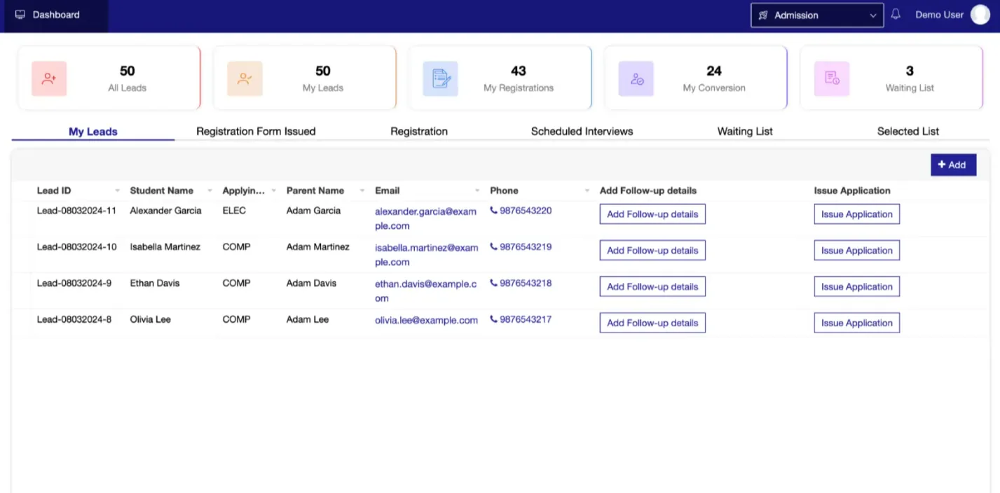
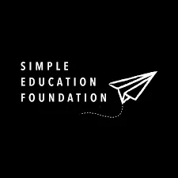
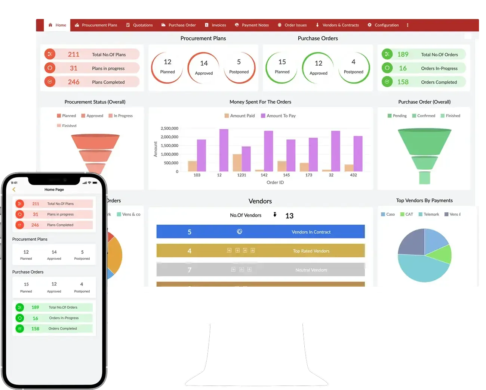

# Custom MIS for your Education Non-profit

Let technology take care of all the mundane tasks of managing data and processes, while you drive your Non-profit's educational initiatives forward to create a better tomorrow for the children!

Read how MukkaMaar streamlined their processes with custom Education MIS

[MukkaMaar Digital Guide](https://www.edzola.com/post/zohocreator-for-mukkamaar)

Source: Zoho Creator

# Trusted by

and many more...

# Streamline the entire student journey!

Admission managementAttendance managementAssessmentsEvent management

Optimize the process of tracking all admissions for your educational programs, from preschool initiatives to university scholarships. Efficiently manage applications, admissions data, and participant information to better serve your community.

Highly collaborative and ensures high quality product!

The team at EdZola is highly collaborative, seeks clarity towards ensuring high quality products that are contextual and are extremely responsive and prompt in their approach. Everyone was slightly blown away by what the portal can do and what potential it has. I can't explain how grateful I am to you all. Please be super proud of yourselves for what you have created!

Shinjinee Pal

SEF

## An end-to-end solution for Education focused NGOs

Bring all your stakeholders together to provide a truly unified and personalized user experience!

Beneficiaries

Partners

Program team

Field workers

Anganwadi

K-12 Education

Out of School Children

Government interventions

## Can be customized for all kinds of educational programs!

## Say goodbye to data siloes and manual works!

Let us help you build a custom MIS 10x faster than traditional methods using our low-code development expertise, deep domain knowledge, and thorough platform understanding

[Connect with us now](https://www.edzola.com/contact)

<!-- External embed block 1 -->

[Embedded content: https://player.vimeo.com/video/927897512?dnt=1&autopause=1&autoplay=1](https://player.vimeo.com/video/927897512?dnt=1&autopause=1&autoplay=1)
