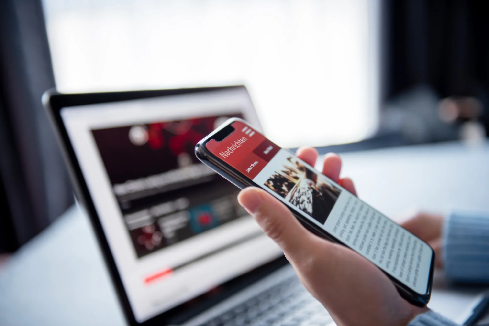
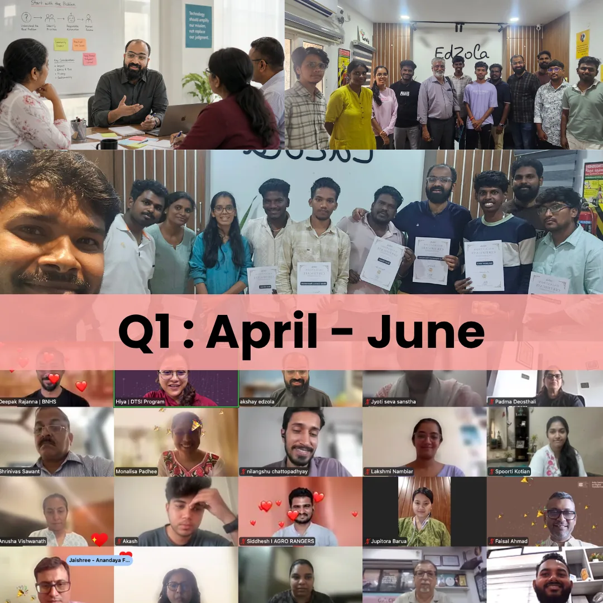
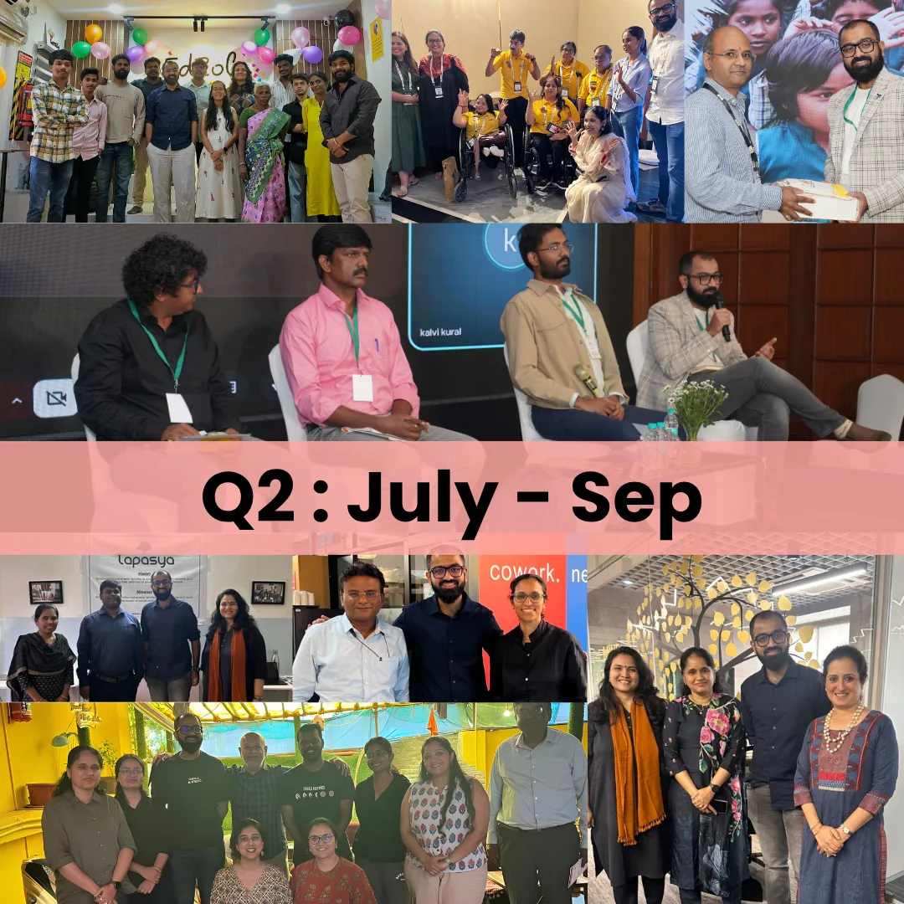

# The EdZola Chronicle

Read the latest updates, stories, and insights from EdZola on building better technology for nonprofits.
Subscribe to get every edition in your inbox.

## April - June 2026

This quarter has been an exciting one for all of us at EdZola. We’ve spent it listening, learning, and building alongside social impact organisations, strengthening the systems they rely on, exploring practical ways AI can support their work, and beginning new partnerships across the nonprofit sector. Here’s a glimpse of what we’ve been working on and the people who made it possible.

[Read Now](https://go.edzola.com/edzola-newsletter-Q1)

## July - Sep 2026

This quarter gave us a chance to pause, celebrate and look ahead.
We marked six years of EdZola, explored practical uses of AI and strengthened our work around data protection. We also made time for conversations with partners and the wider social-impact community.

[Read Now](https://go.edzola.com/EdZola-Newsletter-Q2)
