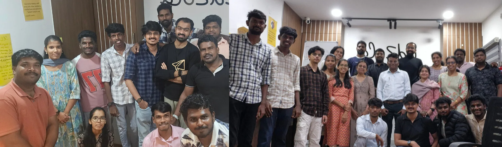
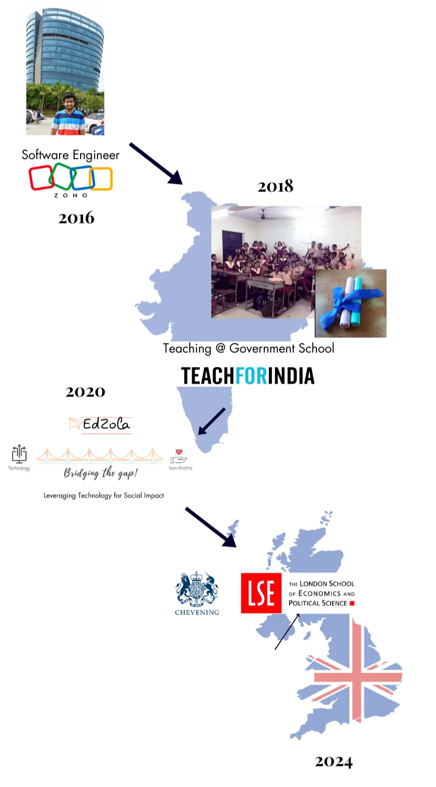
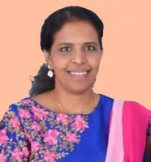
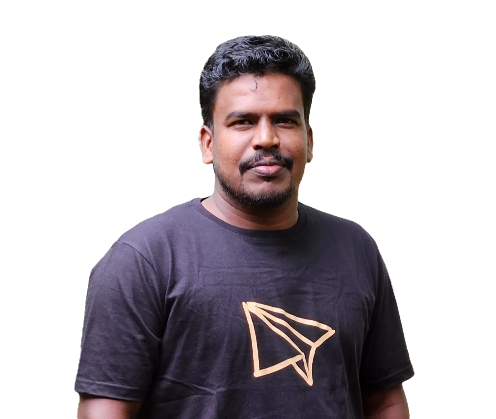
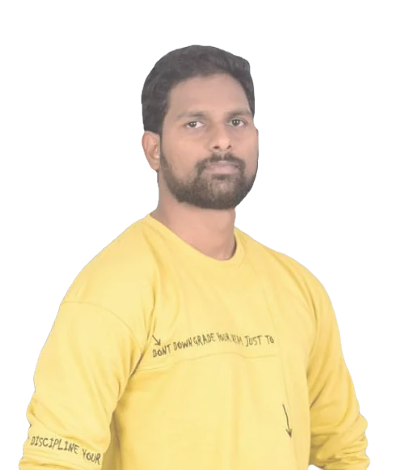
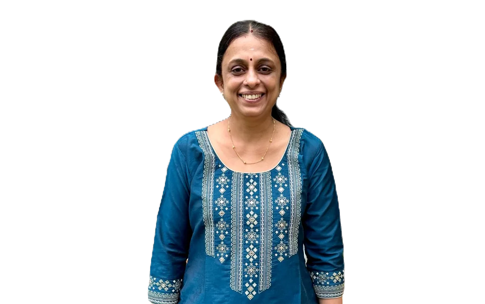
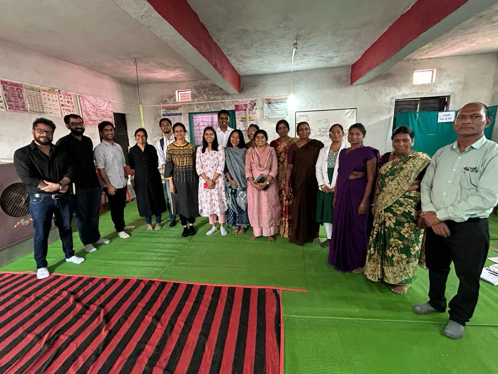

# Misfits on a Mission

Part technologists, part social sector practitioners.

Fully obsessed with building things that create an impact.

## How did all of this begin?

EdZola began with a simple realisation.

​

The organisations doing some of the hardest work in society were still running on spreadsheets, WhatsApp threads, and manual processes. The intent was strong. The infrastructure was not.

​

Our founder, Akshay's journey shaped that insight. In 2016, he was building software at Zoho, learning how scalable systems are designed and operated. In 2018, he joined Teach For India and taught in a government school, where he saw what happens when strong people are forced to work with weak systems. Teachers, nonprofits, and social enterprises were solving complex problems every day, but without the digital backbone they deserved.

​

In 2020, in the middle of the pandemic, EdZola was founded to bridge that gap. One of the first systems was built for Mitti Café, helping them continue operations even when more than 40 physical locations were shut. That experience reinforced the belief that resilient technology can protect and amplify impact.

Six years later, We are a 20+ person team that has built over 150+ digital systems for 100+ organisations across five countries. From program delivery and impact measurement to fundraising and operations, the focus remains the same: build systems that reduce chaos, create clarity, and help mission-driven teams scale. In 2024, Akshay received the Chevening Award for the work at EdZola and from then on we have started our journey to become a global social enterprise being based in India.

​

We are a proudly bootstrapped social enterprise. We have never taken external funding. We grow alongside our partners, and we measure our success by the strength and sustainability of the organisations we serve.

​

Technology. Field insight. Social impact.

That is how EdZola started, and that is what continues to guide us.

[Read our origin story here](https://www.akshayv.in/post/chapter-one-just-start)

## The team that makes all the difference

##### Abdullah Ahmad

##### Software Engineer

##### Akshay V

##### Founder & CEO

##### Aristo Raj

##### Sr. Software Engineer

##### Kavitha B

##### DPDP Advisory & Implementation Lead

##### Lakshmi

##### Consultant

##### Mahavir Kumar

##### Software Engineer

##### Manikandan

##### Solutions Delivery Lead

##### Monisha

##### Software Engineer

##### Niranjan

##### Software Engineer

##### Parthiban

##### Lead - AI Initiatives

##### Rajeev

##### Solutions Delivery Lead

##### Ramya

##### Consultant

##### Shubham

##### Growth & Partnership

## What brings us together

## Empathy

We understand nonprofit realities because we've lived them. We listen deeply, build with warmth, and never forget that behind every data point is a person.

## Social Impact First

Everything we build is in service of positive change. We exist to make impact organisations more effective, not to grow for growth's sake.

## Problem-Solving

We embrace challenges as opportunities. We don't sell tools — we find the simplest, smartest way to solve what's actually broken.

## Growth Mindset

We're committed to learning — as individuals and as a company. We embrace the power of "not yet" and keep getting better at what we do.

## Curiosity

We ask questions before we build. We explore new technologies, stay close to sector trends, and remain open to ideas from anywhere.

## Pursuit of Excellence

We take pride in our work but never settle. High standards in every sprint, every deployment, every support ticket.

# Moments of EdZolans

Pictures do capture the essence of the moments! So we'd love to share with you some pictures of our moments. Click the image to find out the story and memory they hold!

# Join Our Team

Lead

Learn

Grow

# We believe in mutual growth!

We need passionate and talented individuals who aspire to be a leader, to help non-profits achieve their social cause. Explore a rewarding career at EdZola where your learning and skill development never stops!

[Available Openings](http://go.edzola.com/hiring)Openings Join Team
