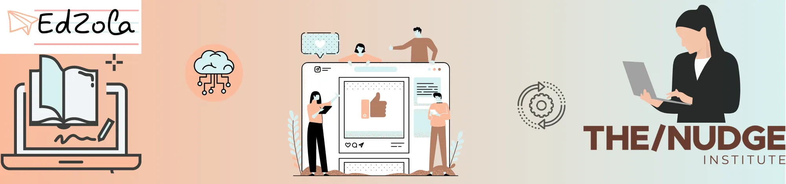

# Case Study - Digital Transformation of Future Perfect Program

It’s no wonder that terms like ‘Digital’ and ‘Online’ became so common and are often heard in the organisations post pandemic. According to the Finances online statistics, many organisations are adapting to technology.

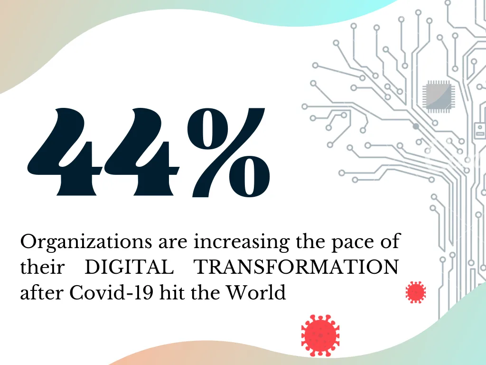

Technology has enabled numerous organisations to grow significantly in a lesser time when compared with traditional methods. Turbulence caused by Covid-19 Pandemic, highlighted the importance of technology for running operations uninterrupted.

Organisations, whether they’re huge or small can make greater impact with the aid of the tech tools customised to their requirements. With the right Tech partner, this complicated process of technology implementation will be an easy and

smooth task. Thus, they can ensure their spot in the fast-growing online market.

This article talks about the partnership between EdZola and Future Perfect Product team to manage the backend processes which in turn provides a strong online presence.

## About the Organization

The/Nudge Institute focuses on alleviating poverty and skill development, concerning the underprivileged youth and rural livelihoods.

Future Perfect program (part of The/Nudge Institute) is providing training for youth from lower-income communities to make them job-ready. Future Perfect Product Team has partnered with EdZola to utilise technology for greater impact.
 

Schools, colleges, universities and other financial institutions have been forced to shut their doors to students as the country has been in either a total or partial lockdown due to covid-19.

All organisations were required to go online to thrive and the Future Perfect program was no exception. Before 2020 March, the CSDE division of The/Nudge Institute was running the Future Program as an in-person setup. The pandemic made them realise the need for digitisation and to adapt to the  circumstances.
 

EdZola and Future Perfect product Team worked on building the backend Management Information System (MIS) to manage the entire data of the program.

## Solution Architecture

EdZola used Zoho Creator to build the entire platform as it requires little to no coding, thus quickly building efficient applications and systems. Uncertain times necessitated the Future Perfect Product team to innovate and experiment, which the platform handled smoothly. Thus, over 10+ data sources and Apps were integrated through Zoho creator as it allows freedom for customization to optimise the workflow and provide better customer satisfaction

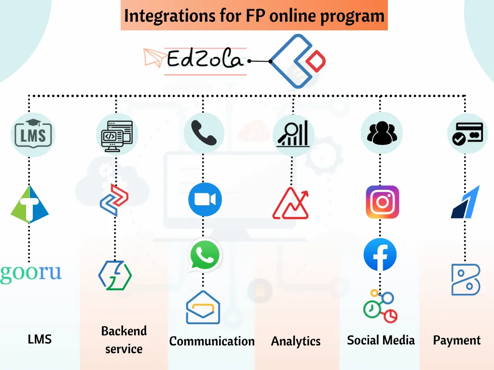

### Customised Data Profiles and Dashboards

Data is  valuable once it is gathered and personalised accordingly. EdZola worked on creating profiles on every user to understand them better. It also created customised dashboards for Trainers, Team Leads, Telecallers, Verifiers etc., to have easy access to the specific data that they need to manage the workflow.

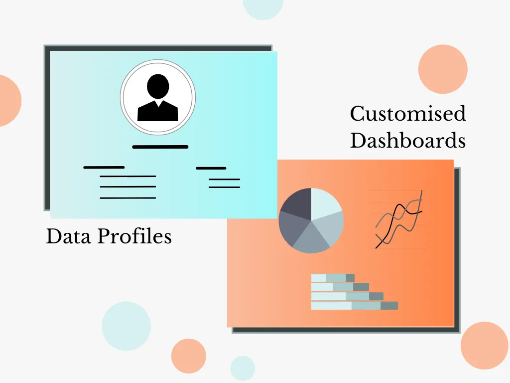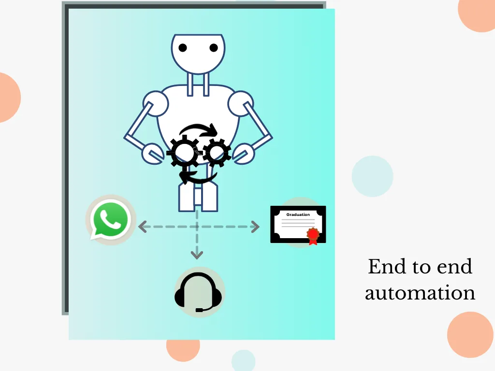

### End to end Automation

The best advantage of technology is that it helps us reduce the manual workload to have increased focus on things that matter the most. End to End technology implementation enabled Future Perfect to prioritise and manage their time effectively.

### Real time monitoring

It’s necessary to monitor everything that happens in an organisation in real time in this fast paced world, which helps in resolving problems the moment they happen. EdZola have enabled real time monitoring of many data such as attendance, student registration, payment process etc., 

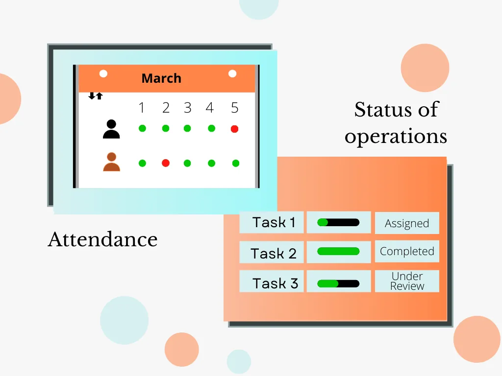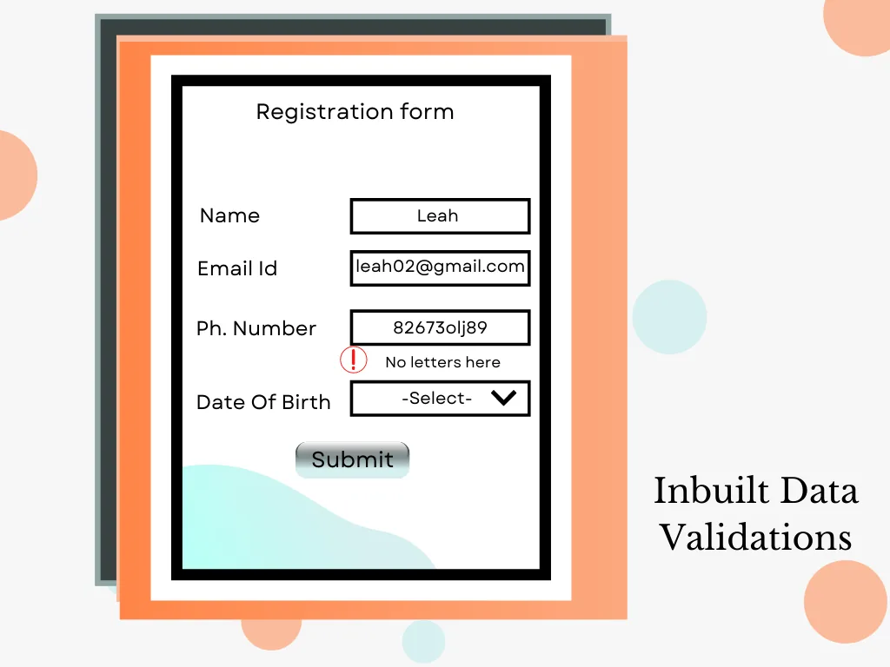

### Inbuilt Data Validations

Data Accuracy is crucial for organisations. This feature guarantees the reception of right data like collecting student’s details through a form.

Learn how we help organizations create impact with all these rewarding features using Zoho One

[Zoho for Nonprofits](https://www.edzola.com/zoho-for-nonprofits)

## A Student's Journey at Future Perfect

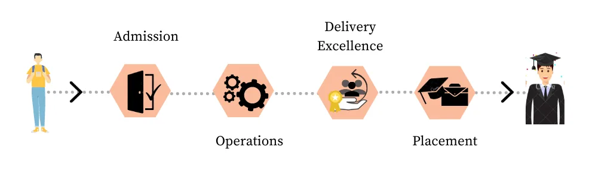

### Admission Processes

- The program is discovered through online campaigns in social media.

​

- With the help of automation, the data is then transferred to the admissions team who counsel and brief about the program and verify their details.

​

- 10 to 15-minute eligibility quizzes are given to students; batches and timings are selected following the quiz.

​

- Integrations are made to let students pay for the program and receive invoices. Requests for the refund process are also managed in the backend.

​

- Notifications and updates are sent via WhatsApp throughout the program.

​

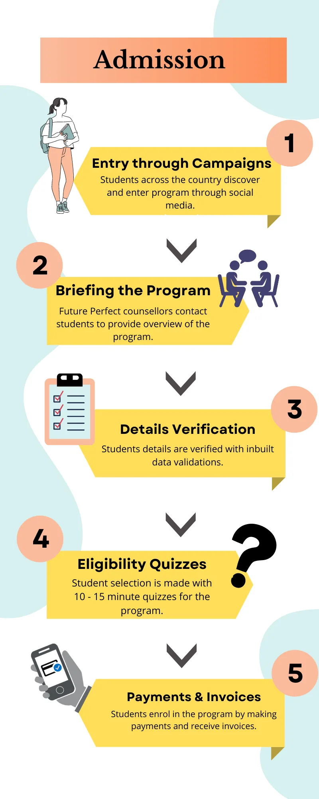

### Operations

- Integrations with Learning Management System (LMS) such as Gooru and Tribyte are done to manage varied operations.

​

- Demo programs are made available for students before opting for the entire training.

​

- Webinars with respective trainers are conducted using Zoom integration at scheduled time.

​

- Attendance, projects, assignments, tests and their assessment scores are monitored in real time.

​

- Customised dashboards are made for Trainers, Team Leads etc., to organise overwhelming data.
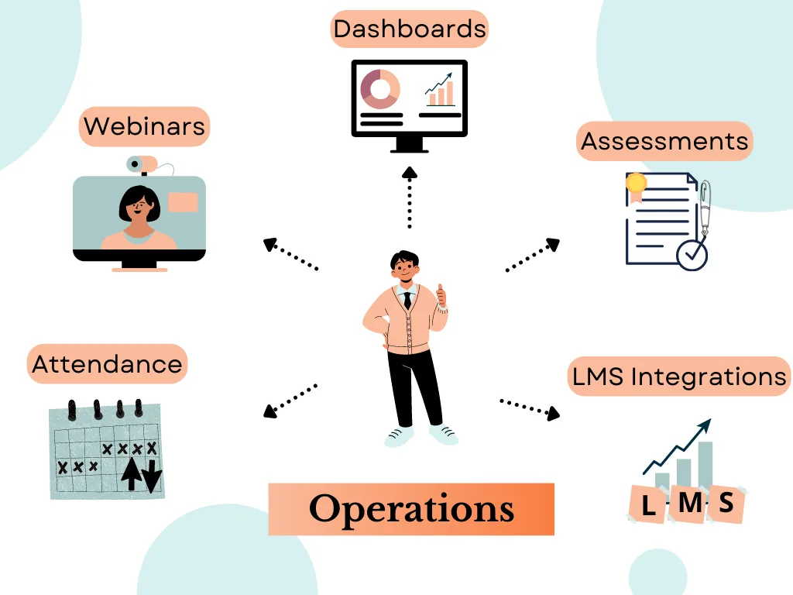

### Delivery Excellence

- Rubrics are designed for grading and tracking the performance of trainers and students.

​

- Learning and Development (L&D) is established to detect the skill gaps in trainers and train them accordingly.

​

- The class is observed and provided feedback by Team leaders to improve teaching practices of the trainer and increase student learning outcomes.
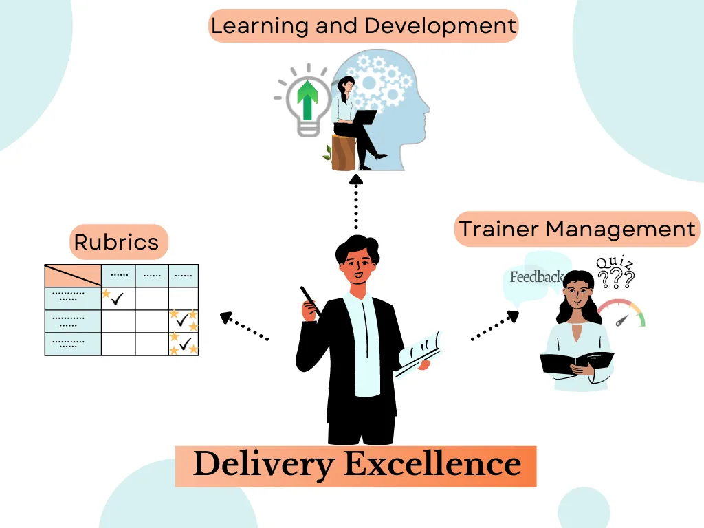

### Retention

- After graduation, students are assisted on the grounds of placements. Their profiles are directed to specific companies that best match their training.

​

- Customer support is provided by the helpdesk where queries can be clarified within stipulated time.
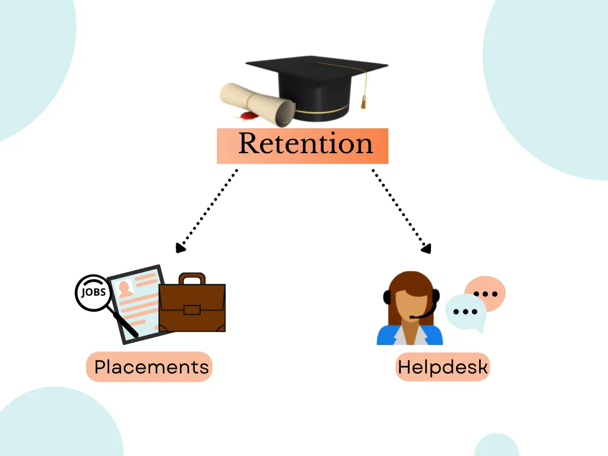

## Impact

The result of the year and a half long partnership between the EdZola team and the Future Perfect product team resulted in increased value and impact for future perfect in terms of multiplied engagement, lead generation and time saved.

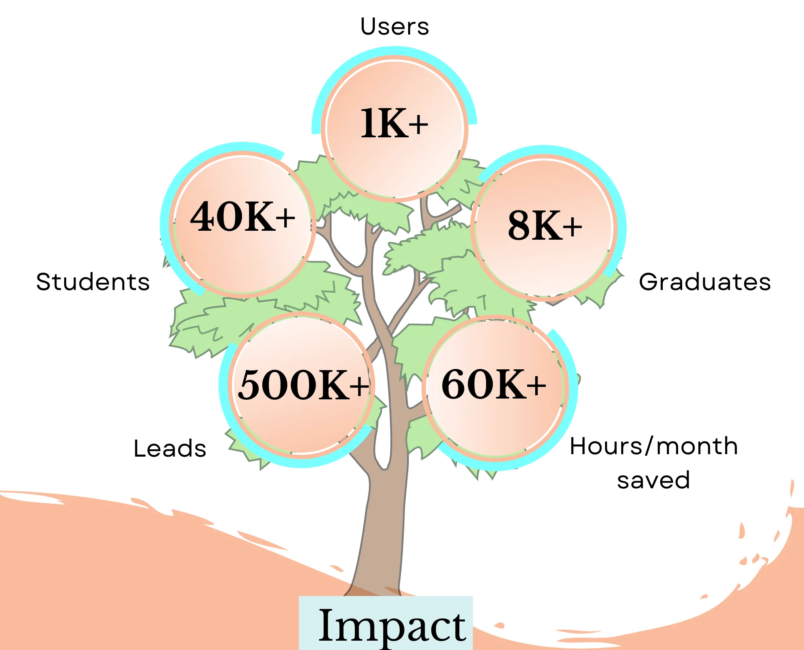

Ankitha from The/Nudge organisation says,

 

"It has been great to work with the EdZola team for our Future Perfect Application. The team goes the extra mile to deliver outcomes. Their expertise in all things Zoho and integrating Zoho with external applications has been the backbone to scaling our program. The team always thinks of the big picture and how each tiny feature change would affect the application as a whole and delivers quality outcomes even with fast paced timelines. It has been an absolute pleasure working with the team and would highly recommend this stellar group of people to be the ones helping any organisation's digital transformation journey"

## In Conclusion

Technology, with no doubt, has brought immeasurable changes in people’s life over the past few decades. This article is not intended just to be a case study, but to be an awareness article on how tech could help organisations have tremendous impact. It is also to give an overlook of how technology is a worthwhile investment for any organisations no matter the size. EdZola primarily aspires to help Nonprofits with technology to scale their impact.

​

​

 “Taking the leap is what your organisation has to do to accomplish your online goals”.

So, don't wait and take the leap to learn how technology can be leveraged to create Impact in your organisation!

[Contact Us](https://www.edzola.com/contact)
