# Helping nonprofits move from spreadsheets to real systems

Built for Impact helps nonprofits design and implement digital systems for programs, donors, finance, and reporting — with the workflows, training, and support needed for adoption.

[Apply for Built for Impact program](https://go.edzola.com/BFI-website-form-link)

It only takes 3 minutes

Free eligibility check

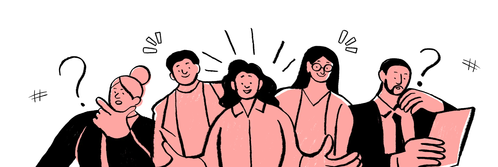

# What nonprofits usually come to us with

- Program data in spreadsheets and forms that don’t talk to each other
- Donor, beneficiary, and reporting workflows spread across multiple tools
- Manual reporting that takes days every month
- No clear path from “we need a system” to “this actually works”

# What you get with the Built for Impact Program

- Digital Systems Discovery
  Understand workflows, data needs, and reporting requirements.
- System Architecture Design
  Design a connected system for donors, programs, and reporting.
- Platform Implementation
  Setup, customization, and migration from spreadsheets.
- Access to Nonprofit Software Credits
  Eligible organizations may receive software credits through partner programs.
- Training and Adoption Support
  Hands-on onboarding to help teams actually use the system.
- Long-Term Digital Foundation
  A scalable infrastructure for managing impact and operations.
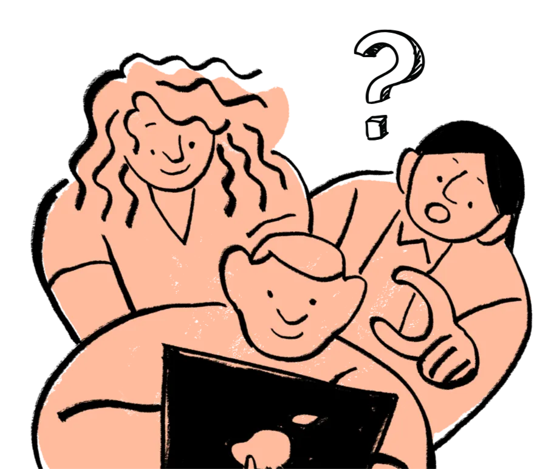

# Eligibility for free software credits

# 1

​Must be a registered Nonprofit Organization

# 2

Applicable to both new and existing Zoho customers

# 3

​Not availed free Zoho credits before.

# Note :

Please note that the NPO Credits are not offered by EdZola. They are part of the Zoho for Nonprofits Program, and the decision on which organizations receive these credits is entirely at the discretion of the Zoho for Nonprofits team.

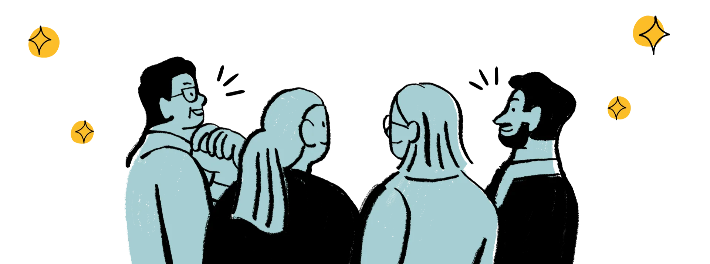

# Beneficiaries

To play, press and hold the enter key. To stop, release the enter key.

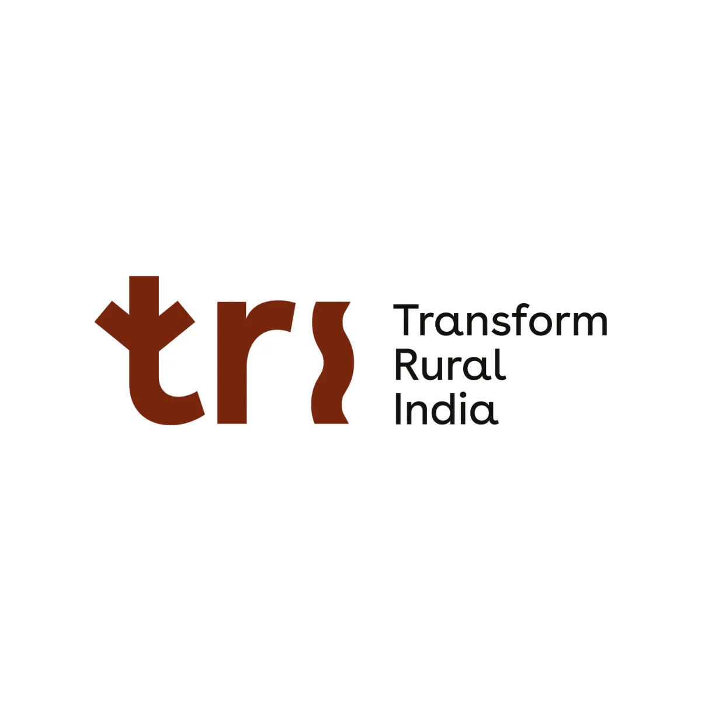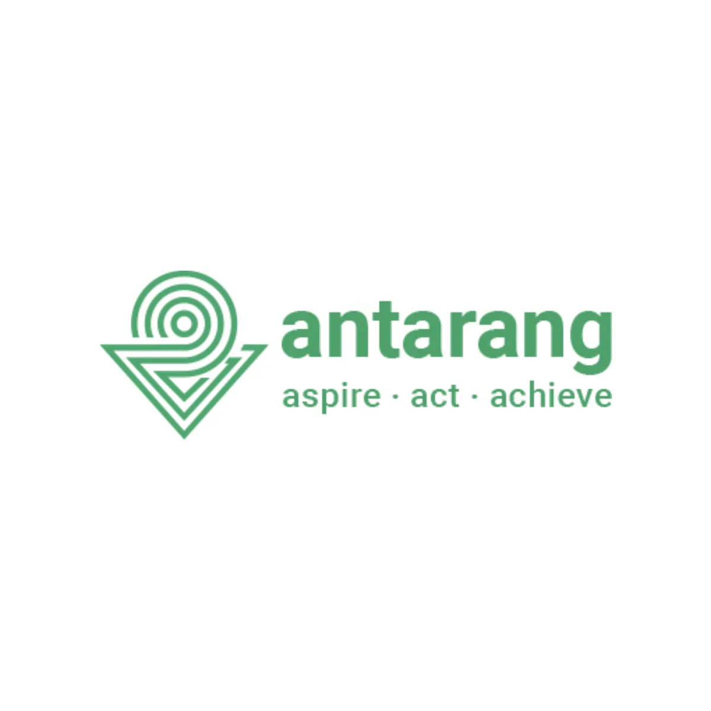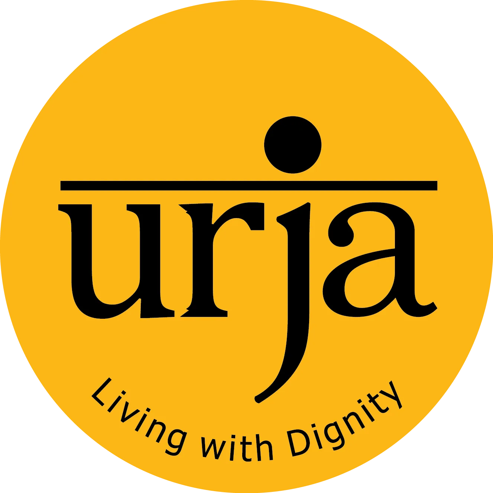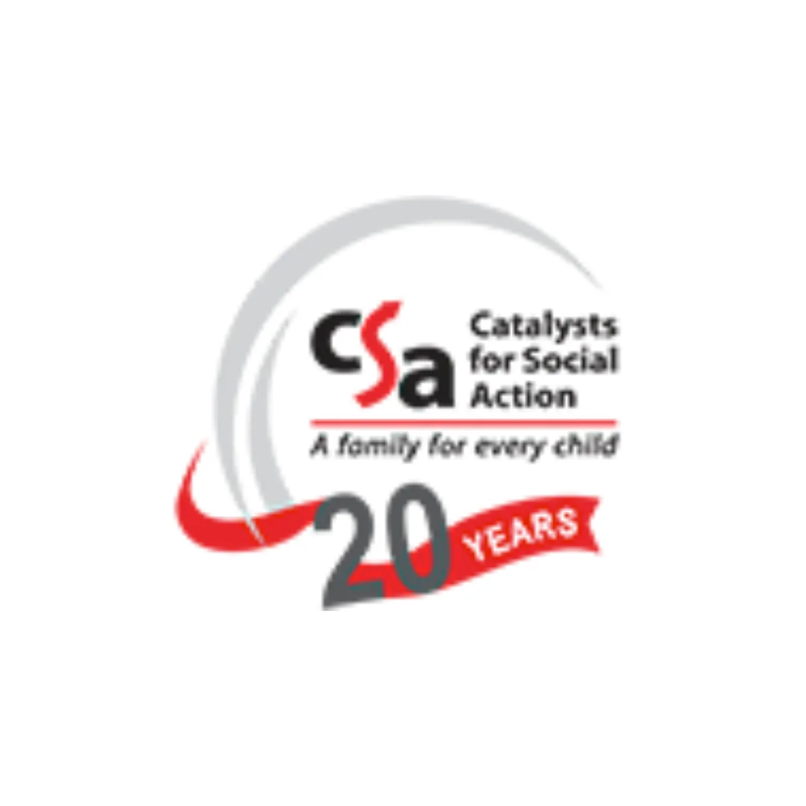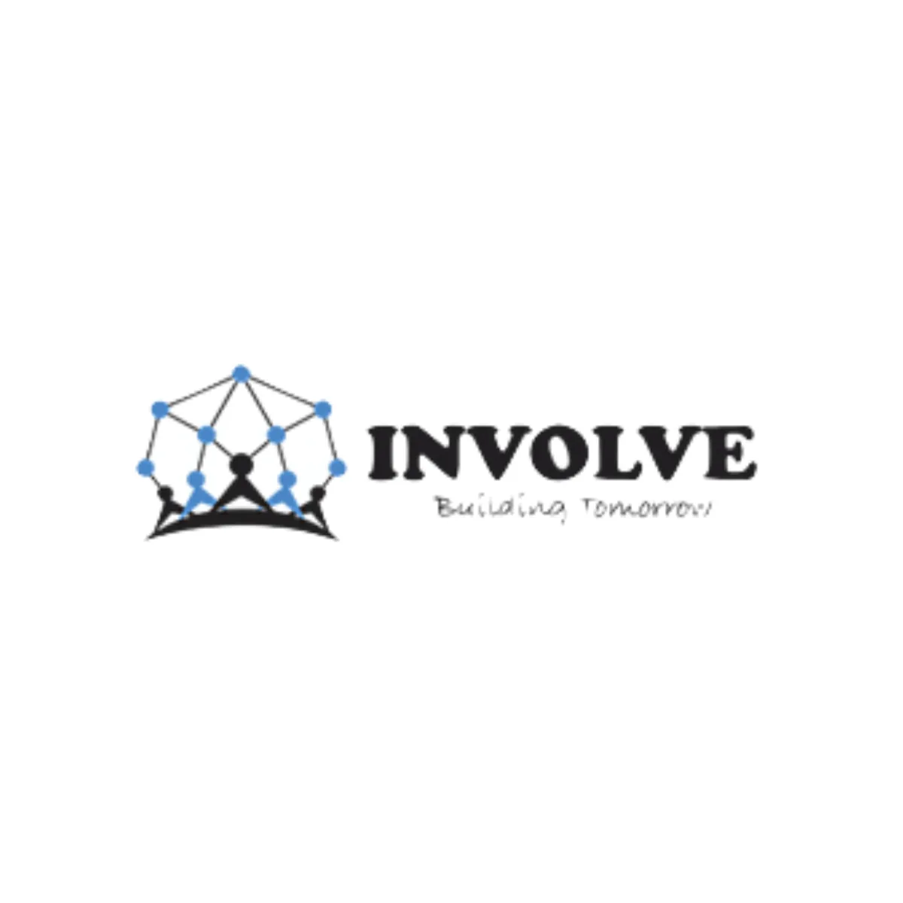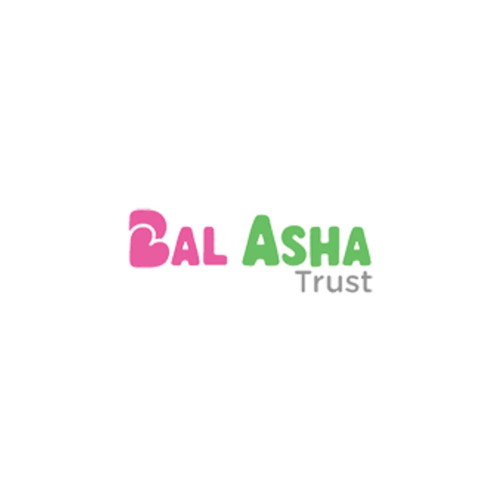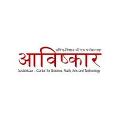[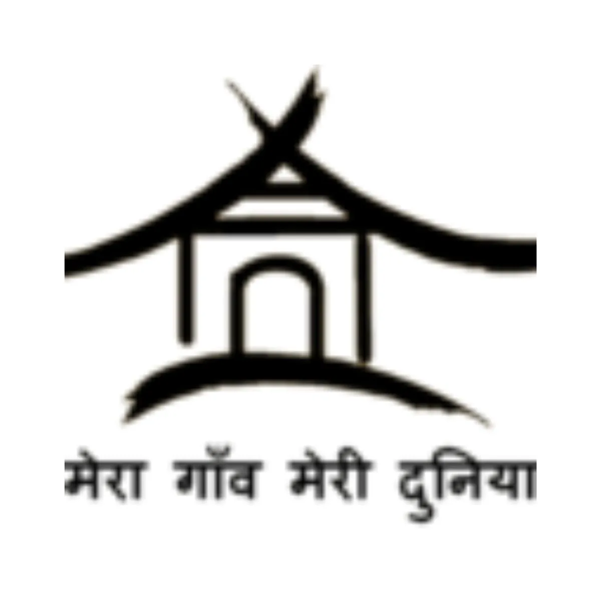](https://meragaonmeridunia.org/)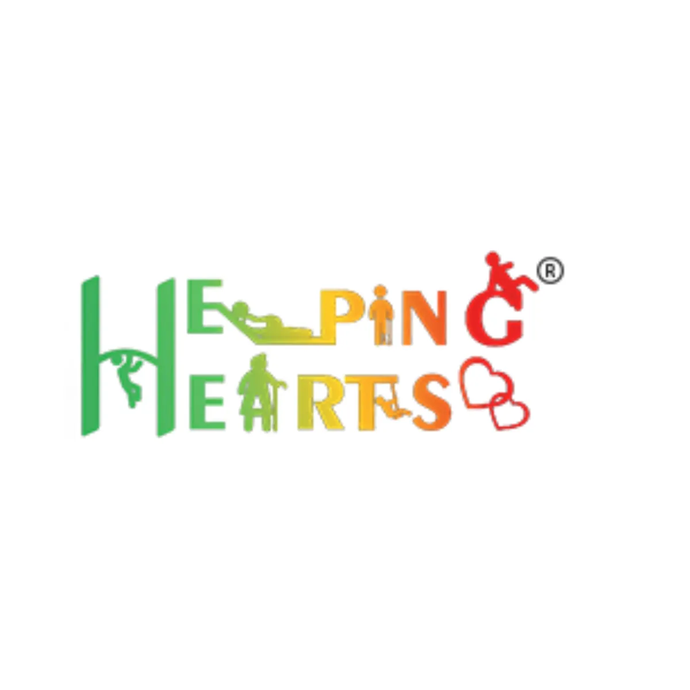[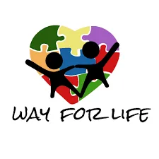](https://www.wayforlife.org/)

# Start your nonprofit’s digital transformation today

[Apply for the program](https://go.edzola.com/BFI-website-form-link)

Apply for the Built for Impact Program and start building a connected system for donor management, program tracking, and reporting, with implementation support from EdZola.

Contact Us

# How can we help you?

### Zoho Consultation

Navigate tech landscape the right way with us to save cost and time

​

### Custom Development

One size does not fit all.

Build the right software at the right time with the right people

### Maintenance & Support

Maximize functionality by ensuring proper app-user communication

​

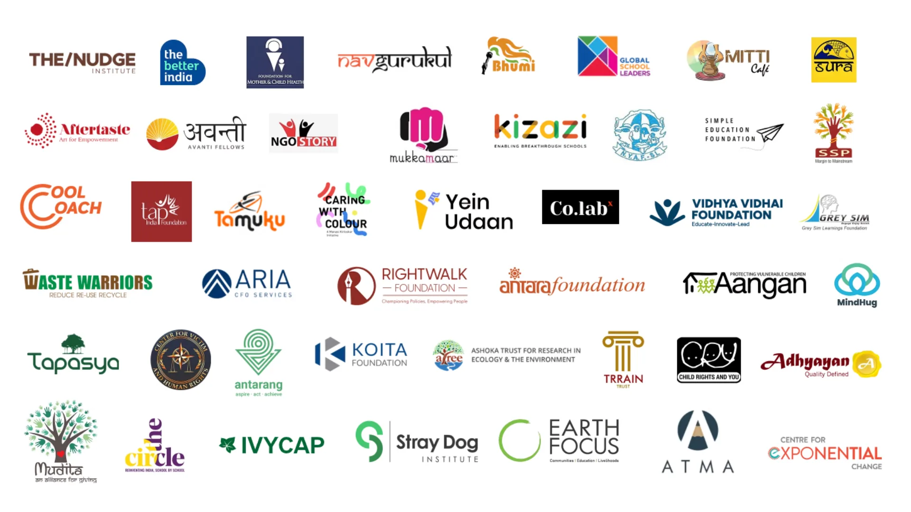

# Hear from our customers!

# FAQ

1. Who is eligible?

- Only registered nonprofit organizations that can produce the required proof documents are eligible.
- The program is one-time per organization/account.
- You’re not eligible if you’ve already received Zoho credits/discounts via another Zoho program (example: Zoho for Startups)
