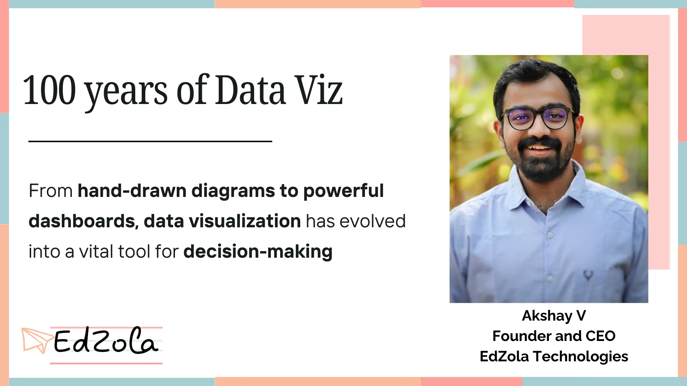
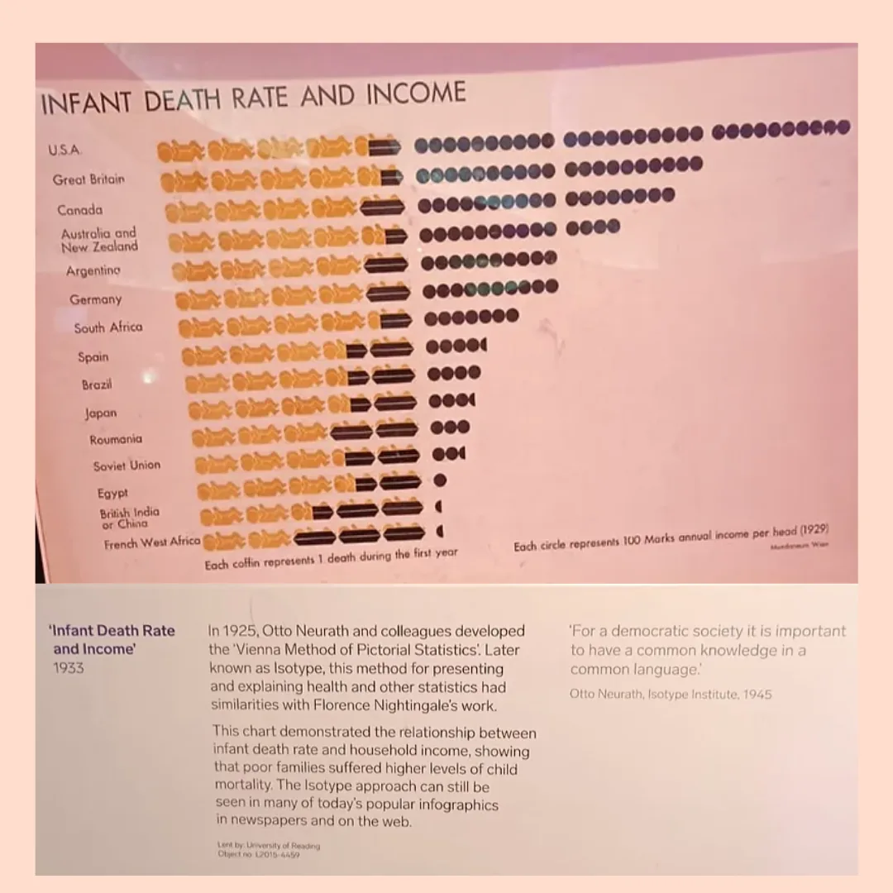
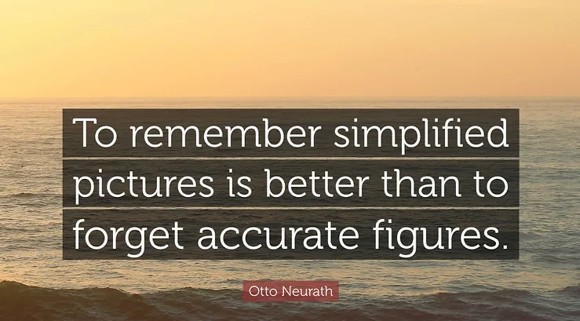
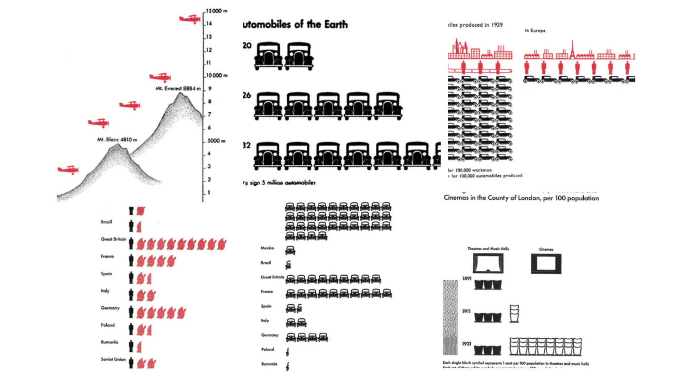

Data visualization has transformed dramatically over the past century, shaping how we understand complex information. In this insightful blog, our CEO, Akshay, explores the fascinating journey of data visualization—from early diagrams to today’s dynamic, interactive dashboards. Explore the milestones and innovations that have shaped data visualization over the years, helping organizations make informed, data-driven decisions.

Last week, during my visit to the Science Museum, a particular image caught my eye. It was a piece of data visualization dating back to 1925, where Otto Neurath depicted the relationship between income levels and infant mortality rates. The visualization clearly illustrated how families with lower income levels experienced higher rates of child mortality.

***It made me stop and think:***100 years later, we’re still searching for the best ways to visualize data and make it truly meaningful.

***This visualization brought me back to a core idea:*** Technology is merely a tool. It brings data to life, but it doesn’t give us conclusions. Technology itself is not the answer; it’s how we use it to understand, communicate, and act upon the stories that data reveals. Intrigued, I dived into Neurath’s work and discovered that he founded the Isotype Institute, which was dedicated to the pictorial representation of data.

What struck me, and what I find highly relevant to the social impact work we do today, is one of Neurath’s core beliefs: it’s easier **for people to remember a picture than to remember accurate data.** His work was built on the premise that images can communicate complex ideas quickly and effectively, making them accessible to broader audiences, even those with limited literacy.

***This got me thinking—can an image influence policymaking or drive social change?***

***History tells us it can.***

**Take this iconic image, for example:**

Lewis Hine used photography to expose the harsh realities of child labor, sneaking into factories and mills to document the plight of nearly 2 million children. His powerful images, like that of Sadie Pfeifer, helped raise public awareness and led to significant child labor reforms.**By 1920, these efforts had reduced the number of child workers by nearly half.**

Girl Working in a Cotton Mill

It all started with one image. That’s the power a single visual can hold. Now, as we continue to collect more and more data in today’s world, the question arises: How are we communicating the stories behind that data? How can we make it meaningful, understandable, and actionable?

In many of the projects we work on, especially in the social sector, data is primarily used for control—tracking inputs like student assessments, attendance, and event participation against pre-set goals. While important, these are often systems designed for compliance rather than empowerment. Santos refers to this as the “logic of control,” where data is used to ensure targets are met and systems remain compliant. However, there is also a “logic of empowerment”—where data becomes a tool for enabling better decisions, fostering autonomy, and driving social change.

**The challenge is this:**

- ***How do we shift from using data solely for control to using it for empowerment?***
- ***How do we leverage the data we collect to enable better decision-making and, ultimately, influence policy-level change?***

**Neurath’s work serves as a powerful reminder:** data is not just about numbers and charts. It’s about the stories those numbers can tell, the actions they can inspire, and the people they can uplift. His belief that data should foster common understanding resonates deeply with our work in the social impact space today:

> ***“For a democratic society, it is important to have a common knowledge in a common language.”*** ***– Otto Neurath, Isotype Institute, 1945***

So, as we navigate our own roles in using data, here are some questions for us to ponder:

***• How can we use data visualization to make the stories behind the data clearer and more compelling?***

***• How can we ensure the data we collect leads to meaningful action, not just compliance?***

***• Can the visuals we create from our data influence policymakers or spark a wider social movement?***

These are important considerations as we continue to collect and analyze data in our work. We need to move beyond just informing with data and focus on how we can inspire action.

Neurath’s vision of data visualization a century ago reminds us that we should strive for clarity, connection, and understanding. Let’s take this as a challenge to not just inform, but to inspire, using the power of data visualization for social good.

Thinking on these lines, can an image create or influence policy making or create social change?

Below are a few data visualisations from Neurath’s work that I found particularly resonant.

**To note : Most of them are atleast a century old!!**

Data visualization has come a long way, helping us make sense of information and make better decisions. As it continues to evolve, it remains essential in shaping how we use data to create positive change. Want to make data-driven decisions in your organization? We’re here to help!

[Let's Connect](https://www.edzola.com/contact)
