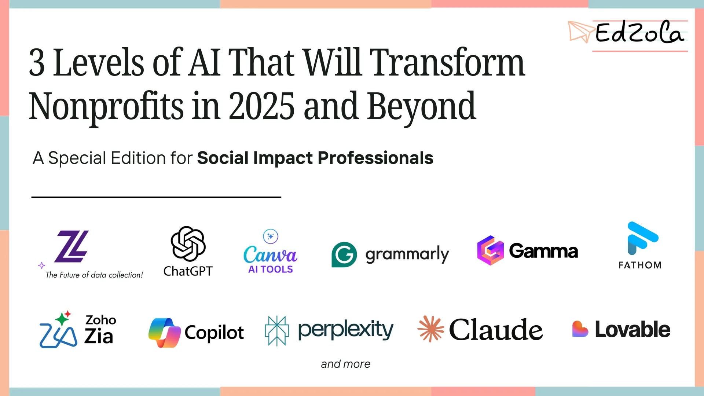
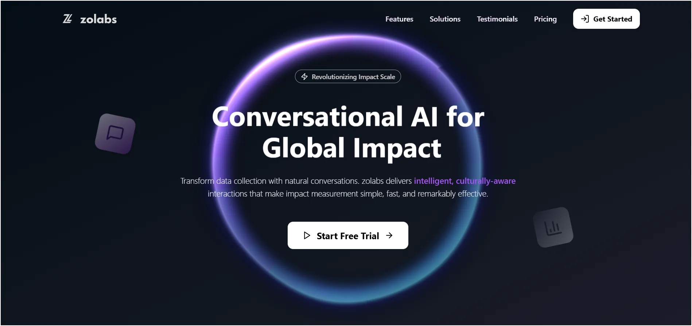

Many nonprofits and social impact teams ask the same question:

*“Where do we even begin with AI?”*

AI can feel confusing. There's too much jargon, too many tools, and it’s hard to know what’s really useful. That’s exactly why this blog exists **to help social impact professionals cut through the noise and understand how AI can actually support their work** in practical, realistic ways.

This guide draws from our experience working with nonprofits, foundations and grassroots teams across India and beyond. We're not promoting specific tools or paid partnerships; just sharing what’s worked, what hasn’t, and what’s worth exploring. No hype. No fluff. Just actionable insight.

And to keep things simple, we’re introducing a framework we often use in our tech consultations: **the 3 Levels of AI**. Understanding these levels will help you assess where your organization is today and what kind of AI tools or approaches might be a good next step.

## **Level 1: Ready-to-Use AI Tools**

Think of Level 1 AI like having an unpaid assistant or that new intern who just joined your team. They’re not here to reinvent your work. They’re here to make what you already do faster, easier and more efficient.

This is AI at its most accessible: tools you can start using right away without a steep learning curve. They work best when you connect them directly to your day-to-day tasks, whether it's writing emails, attending calls, conducting research, or designing presentations.

### **How This Plays Out in Real Life**

- Emails I used to type manually in 15 minutes now take 3–4 minutes using ChatGPT with voice-to-text.
- Research that once took an hour now takes 5–10 minutes with Perplexity or Claude.
- Every meeting I attend is automatically transcribed and summarized by Fathom, so I never lose important points or next steps.
- Our marketing team is using Canva AI and Gamma AI to create beautiful visuals, which helps us design faster.

### **Potential Applications for Level 1**

#### Writing & Communication

- [**ChatGPT**](https://chat.openai.com/) – My go-to for drafting emails, writing proposals, and voice-typing rough thoughts that I later polish.
- [**Grammarly**](https://www.grammarly.com/) – Helps keep writing clear, concise, and error-free—ideal for team comms, grant writing, and reports.

#### Research & Analysis

- [**Perplexity**](https://www.perplexity.ai/) – Perfect for quick, source-backed research without falling into a Google rabbit hole.
- [**Claude**](https://claude.ai/) – Great for writing, coding, and breaking down complex ideas with more nuance and context.
- [**Fathom AI**](https://fathom.video/) – AI-powered meeting note-taker. It records, transcribes, and summarizes meetings so I can focus on conversations.
- [**NotebookLM (by Google)**](https://notebooklm.google/) – Upload documents and explore them with AI. Great for deep dives, report analysis, or turning content into podcast-style explainers.

#### Creative & Visual

- [**Canva AI**](https://www.canva.com/ai-image-generator/) – From social posts to pitch decks, it’s a shortcut to professional-quality visuals in minutes.
- [**Gamma**](https://gamma.app/) – Turns rough bullet points into beautifully designed presentations, or documents instantly.

### **Pro Tips for Getting the Most Out of Level 1 AI**

- **Go paid if you can:**  The quality leap from free to paid models is significant. For instance, the difference between GPT-4 (paid) and GPT-3.5 (free) is night and day in terms of accuracy, reasoning, and responsiveness.
- **Be cautious with data:** If you’re handling confidential data (like student, donor, or beneficiary information), don’t paste it into AI tools unless you have consent and understand the risks.
- **Adjust privacy settings:** Tools like ChatGPT let you opt out of data being used for model training. It’s buried in settings, but worth enabling.
- **Give context:** Instead of saying “Explain AI,” try: 

  → *“Explain AI in the context of a nonprofit trying to improve donor engagement.”*
  → *“Teach me like I’m a program manager who’s new to this.”*

## **Level 2: No‑Code AI Builders**

If Level 1 is about *using* AI tools, Level 2 is about *creating* with them.

This is where things get exciting; you're no longer just consuming AI outputs; you’re building your own AI-powered solutions without having to write code. Think of it like upgrading from eating in a restaurant (Level 1) to running your own kitchen, where you can create recipes tailored to your needs.

These platforms give you drag‑and‑drop or visual interfaces to build chatbots, workflows, mockups, and more. 

- Need something specific to your work? Level 2
- Comfortable with visual interfaces? Level 2
- Have a few days to learn? Level 2

### **How This Plays Out in Real Life**

- At EdZola, we spend a lot of time understanding the digital needs of non-profits, often asking the same set of questions over and over. So we thought: *What if this was a chatbot on our website?* One that could talk to potential clients, categorize their needs, and even book a call with our team. We built [**WinAI**](https://www.edzola.com/home) using Zoho SalesIQ’s chatbot builder, integrated it with our website, and linked it to AI. From ideation to launch, it took less than a month.
- For UI design workshops, we use [**lovable.dev**](http://lovable.dev) to quickly turn ideas into UI mockups. This helps clients visualize concepts during requirement gathering and speeds up decision‑making.

We’ve even played around with AI video platforms to create AI avatars of our team members, with one giving a full explainer video. Our team still remembers it fondly!

### **Potential Applications for Level 2**

#### Top No‑Code AI Platforms for Social Impact

###

- [**Microsoft Copilot Studio**](https://www.microsoft.com/en-us/microsoft-copilot/for-individuals?form=MY02P9) – Create AI-powered chatbots that give personalized answers, pull live data from your systems, and scale beneficiary support without extra staff.
- [**Agent.ai**](http://Agent.ai) – Build multi-step, autonomous workflows or video agents that can handle queries, update databases, and follow up with users.
- [**Lovable.dev**](http://Lovable.dev) – Instantly turn text descriptions into working web/app prototypes, perfect for rapid testing with your stakeholders.
- [**Glide with AI**](https://www.glideapps.com/ai) – Build mobile/web apps that use AI to summarize, predict, or recommend content directly from your datasets.

#### Program management:

- [**Wotnot.io**](http://Wotnot.io) – Build AI-powered intake bots that categorize and route beneficiary cases automatically, reducing manual triage and improving response time.
- [**Kommunicate**](https://www.kommunicate.io/) – Process multilingual surveys with smart translation and response clustering, helping teams analyze feedback efficiently across regions.
- [**Giveffect**](https://www.giveffect.com/nonprofit-analytics?utm_source=chatgpt.com) – Automatically generate donor reports from project data with visual insights, enabling quick and professional stakeholder communication.
- [**Tars**](https://hellotars.com/) – Build multilingual chatbots that deliver accurate program information in local languages across web, WhatsApp, and other platforms. Great for driving engagement at scale. Tars Chatbot Builder
- [**ActiveCampaign**](https://www.activecampaign.com/solutions/nonprofit) – Automate AI-powered follow-up sequences based on user actions (email opens, clicks, responses), enabling personalized outreach and donor/participant nurturing. ActiveCampaign for Nonprofits
- [**Glide with AI**](https://www.glideapps.com/features/ai) – Create web/mobile apps that use AI to recommend relevant content or services to users based on behavior or profile data. Ideal for community resource matching.

#### Monitoring & Evaluation

- [**Microsoft Power BI**](https://www.microsoft.com/en-us/nonprofits/power-bi) – Connect to multiple data sources, clean and transform data, and visualize impact with dynamic dashboards that update in real time.
- [**Narrative BI**](https://www.narrative.bi/) – Automatically extract and summarize impact stories from raw beneficiary feedback using AI, helping you turn qualitative data into compelling narratives. Narrative BI
- [**Zoho Analytics**](https://www.zoho.com/analytics/nonprofits.html) – Build dashboards that summarize performance metrics using AI-driven insights and natural language queries. Ideal for program monitoring and stakeholder reporting.

**Pro Tips for Getting the Most Out of Level 1 AI**

- **Start Small, Solve One Pain Point:** Don’t try to automate everything at once. Pick a single, repetitive task (like requirement-gathering questions or weekly reports), build an AI flow for it, and expand only after it proves useful.
- **Blend Tools for Superpowers**: The magic happens when you connect no-code AI tools together. For example: a **chatbot** that qualifies leads → pushes data into **CRM** → auto-schedules a **calendar call**. Each tool does one job well; the combo delivers impact.
- **Measure and Iterate**: Always track how your AI build is performing—e.g., number of chats completed, donor reports generated, or time saved. Use this data to refine flows every 2–3 weeks. AI isn’t “set and forget”; it’s “build → test → tune.”

## **Level 3: Custom AI Development — Build AI That’s Fully Yours**

If Level 1 is about *using* AI and Level 2 is about *building* without code, then Level 3 is where you roll up your sleeves and create AI from the ground up with code, APIs, custom integrations, and full control over your data, logic, and infrastructure.

Think of it like going from running your own kitchen (Level 2) to designing the kitchen, inventing the recipes, and making the ingredients yourself.

This is the space of developers, data scientists, and AI engineers—ideal for organizations with unique needs, advanced tech maturity, or high data sensitivity.

**Why Go Custom?**

Level 3 is the right fit when:

- Off-the-shelf AI tools can’t capture the **complexity or nuance** of your mission
- You need **full control over data** due to privacy, compliance, or ethical reasons
- You’re integrating with **legacy systems** or custom-built platforms

You want to build for low-connectivity, multi-lingual, or field-based environments.

### **How This Plays Out in Real Life :** [**Zolabs.ai**](http://Zolabs.ai)

At EdZola, we built[**Zolabs.ai**](http://Zolabs.ai) to solve a critical challenge in the field:

How can NGOs collect rich, accurate, multi-lingual field data via voice, even in low-connectivity areas?

**Solution:**

We built a voice-based data collection system using:

- [**Twilio**](https://www.twilio.com/en-us) for scheduling phone calls to local field workers
- Open-source STT (Speech-to-Text) models for transcription
- Custom translation pipelines for local languages
- AI-driven classification to clean and organize inputs
- Integration with Zoho Creator dashboards for real-time monitoring

Result: - Report generation time dropped by weeks - Voice made data collection more

natural and inclusive - NGOs got centralized dashboards with cleaner, actionable data.

### **Potential Applications of Level 3 AI**

#### Program Management

[**TimeHero**](https://www.timehero.com) – Use AI-powered scheduling to automatically assign tasks and optimize team workloads based on availability, deadlines, and project dependencies. Perfect for managing complex programs. 

#### Community Engagement

[**Perspective API**](https://perspectiveapi.com) – Detects culturally inappropriate or toxic content in community forums using AI moderation tuned for different languages and norms, improving safety in online engagement spaces.

[**MonkeyLearn**](https://monkeylearn.com) – Run real-time sentiment analysis on open-ended participant feedback, surveys, and chat logs. Train custom models for context-aware emotion detection. 

#### Monitoring & Evaluation

[**Prodigy**](https://prodi.gy) – Label and train custom NLP models to detect themes and patterns from qualitative interviews, case studies, and textual reports. Great for research-heavy M&E teams.

[**Esri GeoAI**](https://www.esri.com/en-us/arcgis/products/geoai/overview)– Visualize program reach, dropout patterns, and regional hotspots using GIS-integrated AI models, ideal for data-driven impact mapping across geographies.

### Pro Tips for Level 3 Success

- **Start small.** Build a pilot or proof-of-concept before scaling.
- **Clean your data first.** Good data hygiene is 70% of the work—and the key to good results.
- **Blend open-source + commercial.** Use open-source for flexibility, commercial APIs for speed.
- **Document everything.** Your future team (and future self) will thank you.

### The Payoff: AI That Works Exactly for You

If Level 1 makes you faster, and Level 2 makes you smarter Level 3 gives you superpowers.

It’s your chance to build AI that:

- Aligns precisely with your mission
- Respects the unique realities of your community

Scales with your operations, and future-proofs your tech investments

## Ready to explore how AI can fit into your nonprofit’s journey?

You don’t need to be a tech expert to start using AI.

Use ready-made tools for quick wins. Try no-code platforms to build something your team needs. And when you’re ready, explore custom solutions to solve deeper challenges.

[Connect with us](https://www.edzola.com/contact)
