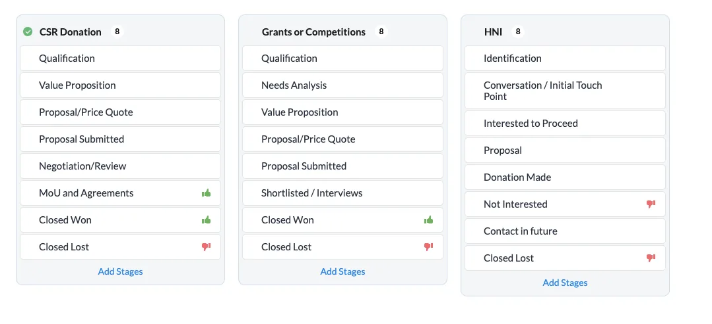
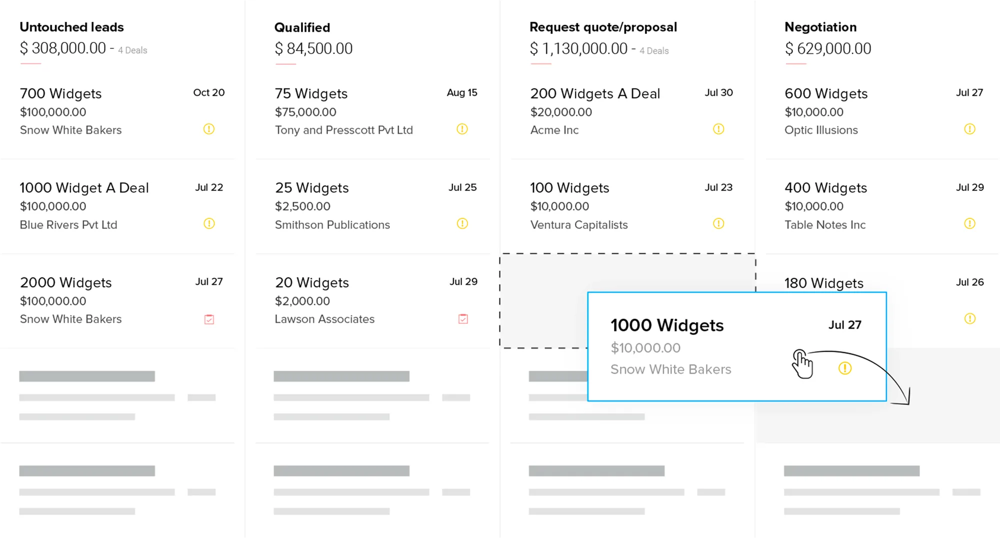
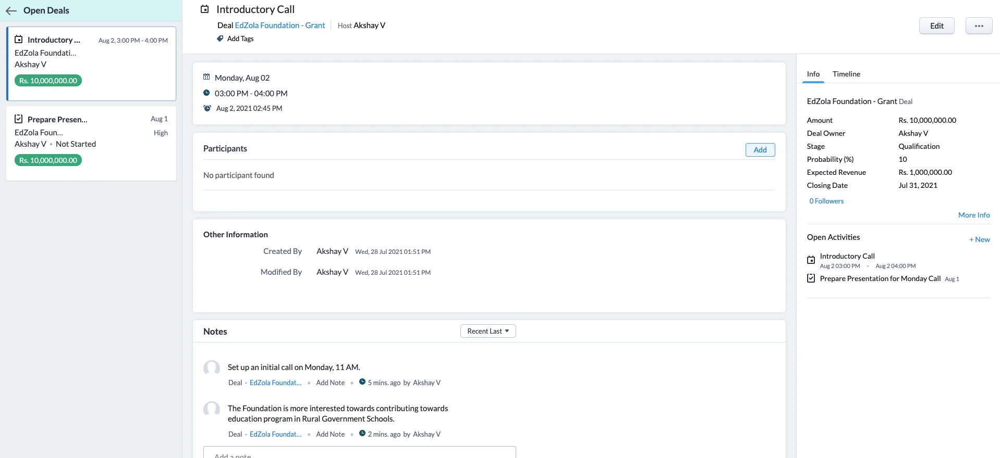
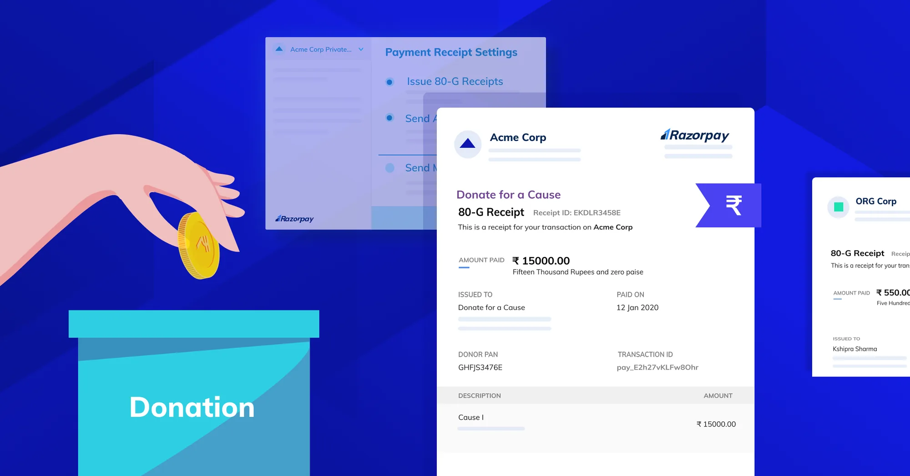
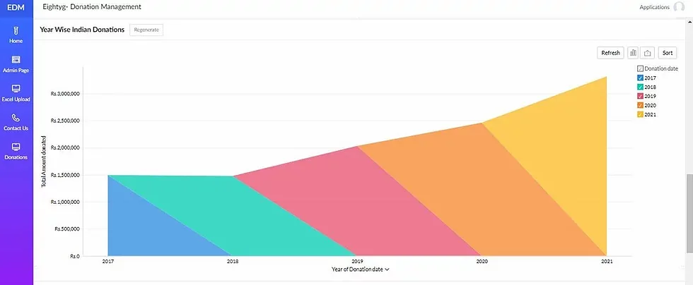
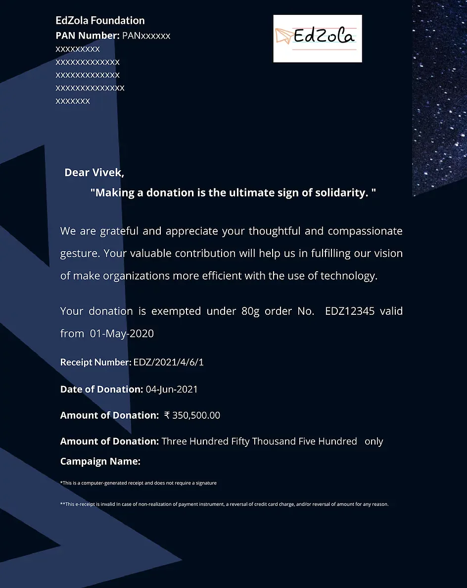
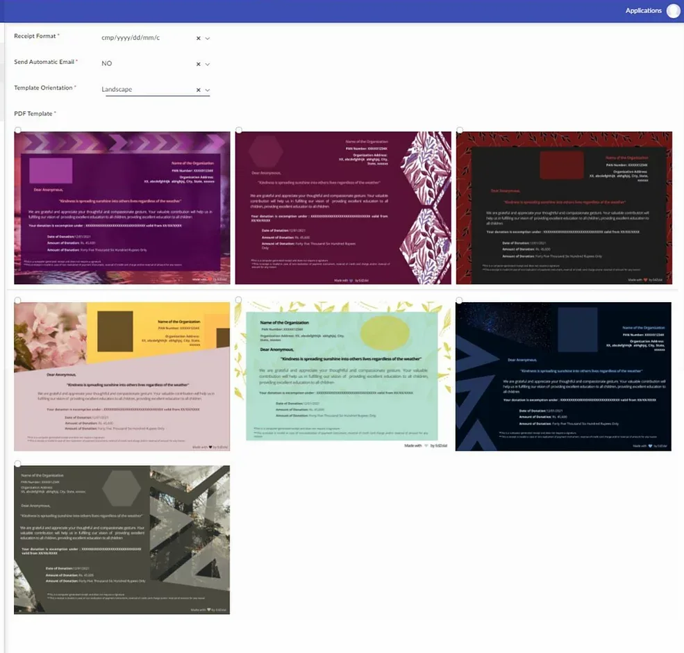

Every great cause or social movement needs money in order to survive and thrive. In a day and age where people are more and more agitated about their cause, it is imperative that your organization has a streamlined donation process.

## **Why streamline your donation process?**

Getting a donation should be quick and easy. But when it comes to donations, your donors will have a lot of questions — some of which might seem super strange. What is the best way to manage your donations on the go? Also the bigger the donation, the more questions and deliverables to track.

Example : Deadlines for Proposals, Stage of the Funding, MoUs and Agreements , Keeping Track of funds, Issuing Receipts etc.

Having a streamlined donation process also helps you get more donations because your donors won't have to wait so long to give.

Here are three ways you can streamline your donation process today.

## Tip 1 : Use a CRM Software

CRM is an acronym that stands **for customer relationship management**. Customer relationship management is any tool, strategy, or process that helps businesses better organize and access customer data. CRM Softwares are used by companies world-wide for sales , marketing and support, and **a customised version of a CRM can serve as a DRM (Donor Relationship Management) software for Non-Profits.**

The following are some of the top features you should look out for.

### Curate your own Donation Process

Not all donations are the same, and every type deserves a different process pipeline. A good CRM Software should give you the ability to carve your own process in the CRM Software.

### Keep track of every stage of donation

At every stage of fundraising, whether through charity, grant or corporate donations there needs to be a system in place for tracking and monitoring the project’s progress. With CRM Software, you will be able to track the stages at which each of your proposals is. This will help you **fast-track your process and meet deadlines more efficiently.** This is especially important when you consider the fact that a person’s time is more valuable than even money. There's nothing worse than having a gap in communication throughout the process; leading to confusion which can waste valuable time in the long run so by keeping track as everything progresses you'll reduce the likelihood of miscommunication and help bring your donation to a successful close!

Source : Zoho CRM

### Ability to capture information about the donor

It is important to track and record information pertaining to the donors so that they can be reached again for repeat donations or new ones. Notes and other tasks also need to be recorded so as to use this information in the future and for any future fundraising related work especially if you decide to spread your funding wings into different countries. You need to make sure that there's a way for you and all your employees to keep track of which details you've gathered about each donor. This will help your organisation reach out to a potential donor at a later point and will also help in the knowledge management of the qualitative processes in your fundraising process.

## Tip 2 : Use a Payment Gateway

Most organizations do not understand the importance of having a payment gateway for accepting donations. Having a payment gateway can give you an **opportunity** to raise funds by enabling users to contribute to specific campaigns **via different online channels like website, social media platforms and emails**. The added option of digital payments will also allow your followers to make contributions on site if they are willing and don't want to go through other networks..

With options like **RazorPay and PayPal** , collecting donations have never been easy. Part of making crowdfunding campaign successful is being able to make the donation process easy and speedy so your donor won't get frustrated! Now not only does this improve the user experience but it also helps you keep track of everything; each donation, sums, earnings and overall organization's growth as well.

##

## Tip 3 : Have a centralized donations database

##

Donations come in from various sources - direct, online, in the form of grants, CSRs, etc. But with the ongoing auditing and compliance regulations - it has become extremely important for your organization to have a centralized donations management system. An ideal tool should have

- Ability to upload bulk donations from Spreadsheets
- Manually add donations which are directly transferred.
- Link with the above CRM and Payment Gateways to capture donations automatically.
- Issue Donation Receipts and Provide you with the necessary analytics dashboards.
- Store Donor Information like PAN Card Number, Address etc.

We have built a custom donations management tool on Zoho with the above use cases just for organization like yours.

Let data do the talking.

Give your donors a brag-worthy donation receipt!

## In Conclusion

It's important to rethink your fundraising process and establish systems in place because it can save you both time and money, in the longer run.

Note: The screenshots used in this blog are customized versions of Zoho CRM, RazorPay and Zoho Creator. The capabilities and solutions showcased above are a result of extensive customization, which would have to be carried out by the users or through an authorized Zoho Partner like EdZola.

Interested in Zoho and these custom solutions?

[Contact Us](https://www.edzola.com/contact)
