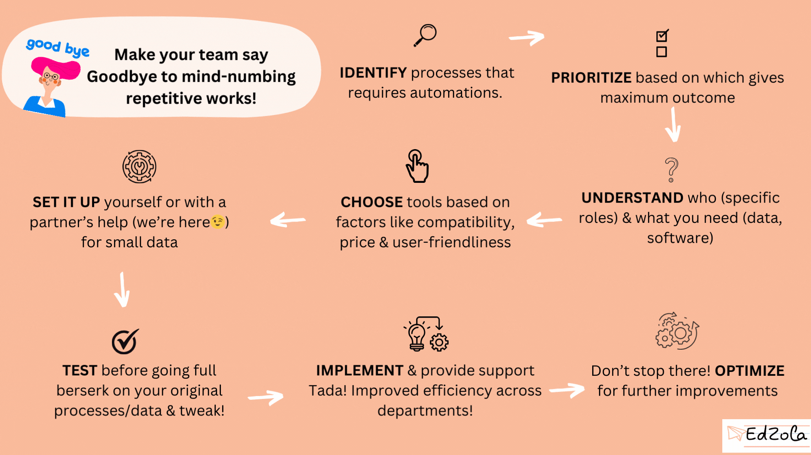

NGOs focused on upskilling students play a crucial role in empowering individuals and communities. To effectively support their mission, these organizations must streamline their student management systems. By doing so, they can optimize their operations, enhance communication, and make data-driven decisions. This article explores four strategies that NGOs can implement to streamline their student management systems and maximize their impact.

## **Understanding the Importance of Streamlining Student Management Systems**

Before delving into the strategies, it is important to understand the significance of streamlining student management systems in NGOs. Student management systems serve as the **backbone** of these organizations, enabling them to efficiently handle various tasks related to **student enrollment, progress monitoring, and resource allocation.** However, without proper streamlining, these systems can become complex and time-consuming, hindering the organization's ability to focus on their core mission of upskilling students.

According to a recent study by [**Higher Ed Dive**](https://www.highereddive.com/topic/leadership/), inefficient student management systems can lead to increased administrative burdens, decreased staff productivity, and a lack of data-driven insights. Therefore, it is crucial for NGOs to prioritize the streamlining of their student management systems to overcome these challenges and maximize their impact.

### The Role of Student Management Systems in NGOs

Student management systems play a vital role in NGOs focused on upskilling individuals. These systems help organizations **track student progress, manage curriculum, and streamline administrative tasks.** They also enable NGOs to effectively monitor student performance, identify areas of improvement, and allocate resources efficiently.

According to an article published by Forbes, student management systems in NGOs can significantly improve program outcomes by providing real-time access to student data, automating administrative tasks, and facilitating better communication between stakeholders. By streamlining these systems, NGOs can create a supportive and efficient environment for learners, ultimately enhancing the success of their upskilling programs.

### Why Streamlining is Essential for Upskilling NGOs?

Streamlining student management systems is essential for upskilling NGOs due to several reasons. Firstly, it allows organizations to optimize their resources and eliminate unnecessary administrative tasks. By automating manual processes, NGOs can allocate more time and resources towards supporting student learning and professional development.

In an article by Education World, it is noted that streamlining student management systems can also enhance the overall student experience. By simplifying enrollment processes, improving communication channels, and providing access to relevant information, NGOs can create an environment that fosters engagement and reduces barriers to learning.

Lastly, streamlining student management systems helps NGOs make data-driven decisions. By collecting and analyzing data on student progress, program effectiveness, and resource utilization, organizations can identify trends, measure impact, and continuously improve their upskilling initiatives. This data-driven approach is crucial for NGOs seeking to have a sustainable and long-term impact on student learning outcomes.

[Case study on how an upskilling NGO streamlined their programs](https://www.edzola.com/the-nudge-future-perfect)

**Jump to a strategy:**

[Strategy 1: Implementing Automation in Student Management](#viewer-qmj0p297506)

[Strategy 2: Enhancing Communication Channels](#viewer-dvsak114884)

[Strategy 3: Utilizing Data Analytics for Decision Making](#viewer-ch0ti114904)

[Strategy 4: Integrating Cloud-Based Solutions](#viewer-nx3rc114923)

## **Strategy 1: Implementing Automation in Student Management**

Automation plays a key role in streamlining student management systems for upskilling NGOs. By automating repetitive and time-consuming tasks, NGOs can **free up staff resources and ensure smoother operations.** The benefits of automation in student management are multifaceted.

### Benefits of Automation in Student Management

According to a comprehensive article by EdTech Magazine, implementing [automation in student management systems](https://edtechmagazine.com/higher/article/2016/08/automating-student-onboarding-can-enhance-safety-and-efficiency) can lead to increased efficiency, reduced errors, and improved data accuracy. By automating processes such as student enrollment, attendance tracking, and grade recording, NGOs can eliminate manual data entry, saving time and reducing the risk of human error.

Automation can also improve communication between stakeholders. With automated notifications and reminders, NGOs can keep students, teachers, and parents informed about important deadlines, events, and progress updates. This streamlined communication enhances engagement and strengthens the overall learning experience.

### Steps to Automate Your Student Management System

Implementing automation in student management systems involves several steps. Firstly, NGOs need to **assess their current processes and identify tasks** that can be automated. This may include student registration, attendance tracking, and exam scheduling.

Once the tasks are identified, NGOs can **explore software solutions** that offer automation features specifically tailored to student management. Popular options include Student Information Systems (SIS) and Learning Management Systems (LMS). These platforms often come with built-in automation tools and provide seamless integration with other educational technologies.

After selecting the appropriate software, NGOs can **begin the implementation process**. This involves configuring the system to align with the organization's specific needs, migrating data from existing systems, and **providing training to staff members**. Ongoing monitoring and evaluation of the automated processes are also crucial to ensure continuous improvement and maximize the benefits of automation.

Steps for automating any process

## **Strategy 2: Enhancing Communication Channels**

Effective communication is vital in student management systems for upskilling NGOs. It fosters collaboration, builds trust, and ensures that all stakeholders are aligned towards achieving educational goals. Enhancing communication channels can significantly streamline student management processes and enhance the learning experience.

### The Impact of Effective Communication in Student Management

A [forum in Education Week](https://www.edweek.org/events/k-12-essentials-forum/effective-communication-for-school-leaders-a-forum) emphasizes the importance of effective communication between NGOs, instructors, students, and parents. It highlights that clear and open communication channels improve student engagement, motivate learners, and foster a sense of belonging.

Through effective communication, NGOs can promptly address student concerns, provide feedback, and share relevant resources and information. It also allows instructors to collaborate with other educators, access professional development opportunities, and receive ongoing support from the organization.

Moreover, effective communication with parents and guardians enables NGOs to keep them informed about their child's progress, address any challenges, and involve them in the learning process. This collaboration enhances the overall support system for students and contributes to their success.

### Tools for Improving Communication in NGOs

**With and among students:**

There are several tools available to NGOs to improve communication within their student management systems. As chatbots are on the rise, [WA chatbots](https://glific.org/), AI trained chatbots can effectively manage the onboarding processes. Another popular tool is the use of **Learning Management Systems (LMS),** which provide features such as discussion boards, instant messaging, and announcement portals. These platforms facilitate seamless and efficient communication between instructors, students, and even parents.

**Teachers and Leaders:**

Additionally, collaboration tools, such as **Google Workspace or**[**Zoho**](https://www.zoho.com/one/applications/web.html) **Administration suite**, offer shared documents and real-time editing capabilities. These tools allow NGOs to streamline communication, enhance collaboration, and ensure that all stakeholders have access to necessary resources.

Furthermore, adopting integrated communication platforms, like Slack or Microsoft Teams, can centralize communication channels and minimize the need for multiple communication tools. These platforms enable instant messaging, file sharing, and video conferencing, fostering efficient collaboration between team members and stakeholders.

## **Strategy 3: Utilizing Data Analytics for Decision Making**

Data analytics has become an invaluable tool for organizations in various fields, including student management systems for upskilling NGOs. By harnessing the power of data, NGOs can make informed decisions, measure program effectiveness, and personalize student learning experiences.

### The Power of Data in Student Management

An article by EdSurge highlights that data analytics offer valuable insights into student performance, learning patterns, and program outcomes. By analyzing data on student progress, NGOs can identify areas of improvement, tailor interventions, and provide personalized support to learners.

Data analytics also enable NGOs to measure the impact of their upskilling programs. By tracking student outcomes, program completion rates, and success in post-program opportunities, organizations can assess the effectiveness of their initiatives and make data-driven adjustments to ensure continuous improvement.

And while dealing with huge number of rows of data, dashboards can be a powerful tool in harnessing the hidden value of the data.

[Compare: Spreadsheets vs Dashboards](https://www.edzola.com/post/dashboards-vs-spreadsheets)

### How to Incorporate Data Analytics in Your NGO

To incorporate data analytics in student management systems, NGOs need to establish a [**structured data collection**](https://humansofdata.atlan.com/2017/07/6-tips-planning-for-data-collection/)process and invest in the necessary tools and resources. Firstly, organizations should determine the key metrics they want to track, such as student attendance, assessment scores, and program completion rates.

NGOs can utilize Student Information Systems (SIS) or Learning Analytics Platforms (LAP) to collect and analyze data effectively. These platforms offer features like data visualization, predictive analytics, and student performance dashboards, enabling NGOs to derive meaningful insights from large datasets.

Once data is collected and analyzed, NGOs should regularly review the findings and use them to inform decision-making processes. This may include identifying areas of improvement, adjusting teaching strategies, or allocating resources based on student needs.

## **Strategy 4: Integrating Cloud-Based Solutions**

Cloud computing has revolutionized the way organizations manage their data and resources, and upskilling NGOs can greatly benefit from integrating cloud-based solutions into their student management systems.

### Advantages of Cloud-Based Student Management Systems

Cloud-based student management systems offer numerous advantages over traditional on-premises systems. Firstly, cloud solutions provide NGOs with the flexibility to access student data and resources from anywhere, at any time. This **flexibility** is particularly beneficial for NGOs that operate across multiple locations or work with remote learners.

Cloud-based systems also ensure the security and integrity of student data. Service providers implement robust security protocols, such as encryption and regular data backups, to safeguard sensitive information. This eliminates the need for NGOs to invest in expensive cybersecurity measures and enables them to focus on their core mission of upskilling students.

### Transitioning to a Cloud-Based System

Transitioning from an on-premises student management system to a cloud-based solution requires careful planning and execution. NGOs should start by assessing their current infrastructure, identifying data migration requirements, and selecting a **suitable cloud service provider.**

NGOs, should [**evaluate the features and offerings**](https://humansofdata.atlan.com/2017/07/6-tips-planning-for-data-collection/) of each provider to ensure compatibility with their specific needs and budget. Once a cloud service provider is selected, NGOs should work closely with their **IT teams/**[**partners**](http://www.edzola.com/contact) **or service providers** plan the migration process. This may involve transferring existing data, integrating with other educational systems, and training staff on how to navigate and utilize the cloud-based solution.

Throughout the transition, NGOs should regularly communicate with their staff, students, and other stakeholders to ensure a smooth migration process and address any concerns. Evaluating the success of the transition through feedback and assessing the impact on student management processes is also crucial to continuous improvement.

In conclusion, streamlining student management systems in upskilling NGOs is essential for maximizing their impact. Through strategies like implementing automation, enhancing communication channels, utilizing data analytics, and integrating cloud-based solutions, these organizations can optimize their operations, improve the learning experience, and make data-driven decisions. By streamlining their student management systems, upskilling NGOs can effectively support student success and contribute to building a better future.

[Let us help you streamline your student management processes](http://www.edzola.com/contact)
