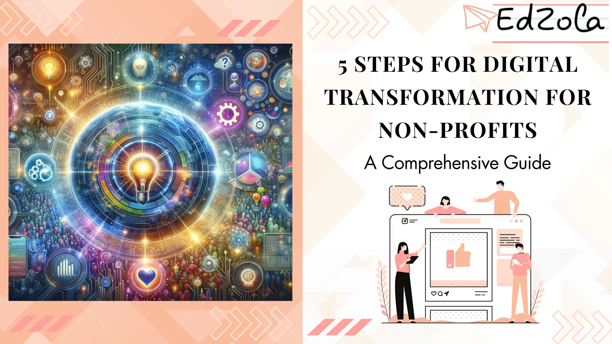
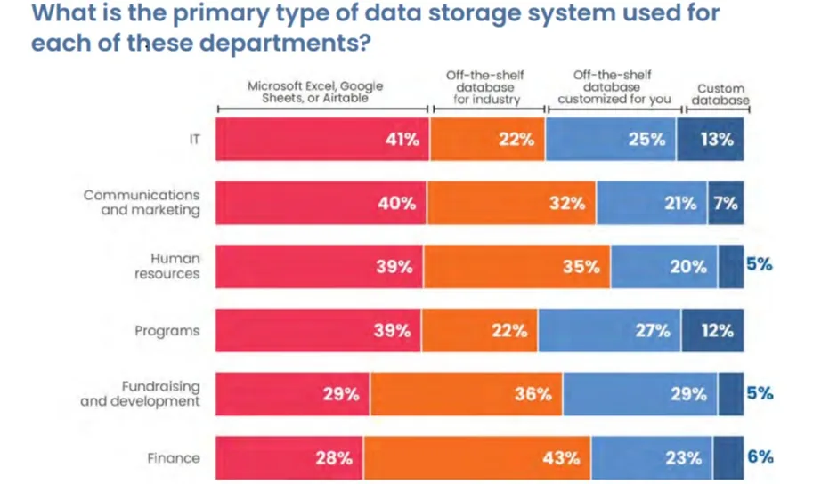

Digital transformation has become an essential journey for non-profit organizations seeking to enhance their operations, expand their reach, and make a greater impact in today's digital age. However, embarking on this path can be daunting without a clear roadmap. In this comprehensive guide, we will outline five essential steps to help non-profits navigate the process of digital transformation successfully.

## **Understanding Digital Transformation**

Before delving into the specific steps, it is crucial to grasp the concept of digital transformation. Digital transformation refers to the integration of digital technologies and strategies into all aspects of an organization, fundamentally changing how it operates and delivers value to its stakeholders. For non-profits and social enterprises, digital transformation offers immense opportunities to streamline processes, engage donors and beneficiaries more effectively, and amplify their impact.

***Dig Deeper:****Digital empowerment : Revolutionizing nonprofits through technology*

### The Importance of Digital Transformation for Non-Profits

Digital transformation is not merely a buzzword; it is a strategic imperative for non-profits. By embracing digital technologies, non-profits can enhance their operational efficiency, optimize resource allocation, and streamline communication with their audience. Moreover, **digital transformation empowers non-profits to leverage data to inform decision-making, measure impact, and demonstrate transparency** – factors that have become increasingly crucial in attracting funding and building trust.

### Key Components of Digital Transformation

Successful digital transformation requires a holistic approach that encompasses various components. These include:

- **Leadership commitment:** Establishing a vision for digital transformation and securing buy-in from key stakeholders.
- **Technology infrastructure:** Implementing the necessary hardware, software, and networking capabilities to support and enable digital initiatives.
- **Data-driven culture:** Fostering a culture that values data-driven decision-making and utilizes insights to drive organizational strategies.
- **Agile operations:** Embracing agile methodologies to adapt quickly to changing market conditions and stakeholders' needs.
- **Engaged workforce:** Empowering staff members with the necessary digital skills and providing ongoing training and support.

## **Step 1: Assessing Your Non-Profit's Digital Maturity**

Embarking on a digital transformation journey begins with a clear understanding of your non-profit's current digital capabilities and maturity level. This assessment serves as a baseline from which you can identify areas for improvement and prioritize transformation efforts.

### Identifying Your Current Digital Capabilities

Start by evaluating your non-profit's existing digital infrastructure, including hardware, software, and online platforms. Assess how effectively your organization is leveraging these technologies and identify any gaps or limitations that may hinder your digital transformation efforts. Engage with staff members across departments to gather insights and perspectives on existing digital processes and systems.

### Recognizing Areas for Improvement

During the assessment, identify pain points and bottlenecks in your current operations. Determine which areas could benefit most from digitalization, such as donor management, program delivery, or fundraising campaigns. Explore how digital solutions can enhance efficiency, streamline processes, and provide a better experience for both your team and your beneficiaries. Data management is an important key area that you need to improve in your nonprofit. For more insights about improving your nonprofit's data management, [*click here*](https://word.nten.org/wp-content/uploads/2023/05/2022-Data-Empowerment-Report_May-2023.pdf)*.*

## **Step 2: Defining Your Digital Transformation Goals**

Once you have a clear picture of your non-profit's digital maturity, it's time to define your digital transformation goals. Setting specific and measurable objectives will guide your organization towards success and help you align your efforts with your overall mission.

###

### Aligning Goals with Your Non-Profit's Mission

Consider your non-profit's unique mission and vision when formulating your digital transformation goals. How can digital technologies enable you to achieve your mission more effectively? For example, if your organization focuses on environmental conservation, your goal might be to leverage digital tools to improve data collection and analysis for better monitoring and reporting of environmental impact.

### Setting Measurable Objectives

Ensure your goals are well-defined and measurable. This will enable you to track progress and evaluate the success of your digital transformation initiatives. **Set key performance indicators (KPIs) that align with your objectives, such as increased website traffic, higher donor engagement rates, or reduced administrative costs.** Regularly monitor and assess these metrics to make data-informed decisions and adjust your strategy as needed.

## **Step 3: Developing a Digital Transformation Strategy**

With clear goals in place, it's time to develop a comprehensive digital transformation strategy. This strategy will outline the specific actions and initiatives necessary to achieve your desired outcomes.

**Analyze with a deeper dive:** [Non-Profit Tech Tips: Streamlining Operations with Digital Tools](https://www.edzola.com/post/non-profit-tech-tips-streamlining-operations-with-digital-tools)

### Choosing the Right Digital Tools and Platforms

Before incorporating new technologies, carefully evaluate your options and select tools and platforms that align with your goals and budget. Research existing solutions, consult with experts, and read case studies to understand how similar non-profits have leveraged digital tools successfully. Implementing a customer relationship management (CRM) system, for example, can streamline donor management and enable personalized engagement. One such platform is Zoho, a highly customizable and integration friendly platform.

[Explore Zoho Solutions](https://www.edzola.com/)

### Planning for Change Management

Digital transformation often involves significant organizational change, which can be met with resistance or reluctance. Develop a change management plan that addresses potential challenges and provides support to staff members throughout the process. Effective communication, training, and ongoing feedback can help foster a positive mindset and active engagement.

## **Step 4: Implementing Your Digital Transformation Plan**

With the strategy defined, it's time to put your digital transformation plan into action. This step involves executing your initiatives, training your staff, and closely monitoring progress.

### Training Staff on New Technologies

Equip your team with the necessary digital skills to fully leverage the implemented technologies. Invest in training programs, workshops, and ongoing professional development opportunities to ensure staff members have the knowledge and confidence to embrace digital tools and processes. Empowering your staff will boost their productivity, innovation, and overall satisfaction.

### Monitoring Progress and Adjusting as Needed

Regularly evaluate the performance of your digital transformation initiatives and adjust your strategy as needed. Analyze data, gather feedback from staff and beneficiaries, and make data-informed decisions to optimize your digital capabilities continually. Celebrate successes along the way and learn from any challenges or setbacks.

According to a recent [article in Forbes](https://www.forbes.com/sites/forbestechcouncil/2023/08/02/navigating-the-journey-of-digital-transformation-in-large-enterprises/?sh=6230b934305f), "Digital transformation is not a destination; it is a continuous journey of adaptation and evolution."

Remember that digital transformation is an ongoing process, and **technology will continue to evolve**. Embrace a mindset of continuous improvement and explore ways to leverage emerging technologies for maximum impact.

## **Conclusion**

Embarking on a digital transformation journey can be complex, but by following these five essential steps, non-profits and social enterprises can lay a solid foundation for success. Remember that digital transformation is not solely about technology; it is about empowering your organization to achieve its mission more effectively, engage stakeholders, and create long-lasting social impact. Embrace the opportunities that digital transformation offers, stay agile, and continuously adapt to the ever-changing digital landscape.

## Getting Started with EdZola

***"Digital transformation is not about doing the same things differently, but rather doing entirely new things that were previously thought impossible." - Satya Nadella***

This quote inspires us to embrace learning and innovation, pushing boundaries to achieve what was once deemed impossible. Recognizing your nonprofit's unique needs and building the right platform to fuel growth is paramount.

If you're ready to embark on a journey of digital transformation, Please feel free to reach us.

[Let's Connect](https://www.edzola.com/contact)
