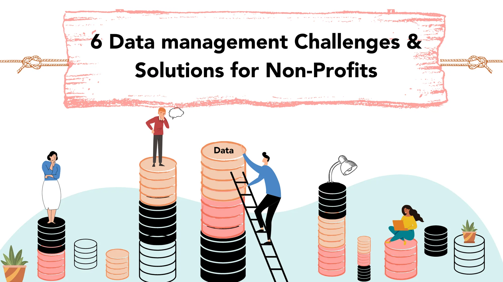
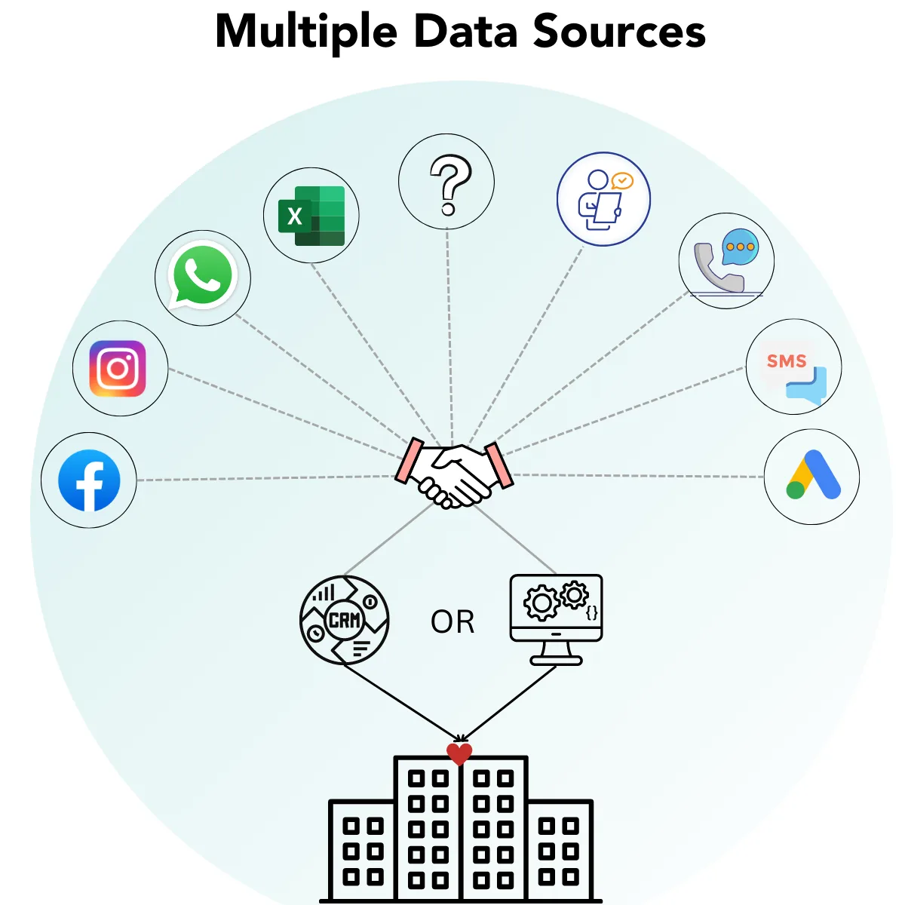

Looking to optimize data management for your Non-Profit and spend less time struggling with excel sheets? The “trick” is to integrate a framework for data collection and analytics!

We’ve helped our clients save 60,000 hours/month by building effective dashboards that visualize data from *100+ data sources and apps*. Based on our experience, we’ve compiled the common challenges that Non-Profits face with data and have provided a solution to them all.

**Jump to the challenge:**

- [Collecting from multiple data sources](#viewer-8pphf)
- [Searching through storage](#viewer-3mv9a)
- [Analyzing and reporting data](#viewer-1qj2q)
- [Translating data to goals](#viewer-11phs)
- [Stakeholder data management](#viewer-48epk)
- [Scaling impact with the right data usage](#viewer-3o00o)

## Challenge [#1](https://www.edzola.com/blog/hashtags/1): Collect from Multiple Data Sources

There is a good chance your organization is currently collecting data as you read this.

Maybe through a Google form or a SurveyMonkey questionnaire. Or you have an Instagram page that regularly promotes educational content and serves as a medium to draw workshop participants.

*The challenge with multiple sources of data collection is in evaluating the data itself.*

How is it being collected? **What purpose does it serve?** What other uses does it have?How reliable is the data? Is it more valuable at one particular point in time than as a redundant repository throughout time?

### Best Practices: Evaluate your Non-Profit’s Data Sources

To manage your data better means to understand what data you presently collect and what data you should collect.

*According to a study by NonProfitHub, 48 percent of Non-Profits are*[*not sure of all the ways that their organization is tracking data*](https://cdn2.hubspot.net/hubfs/433841/The_State_of_Data_in_The_Nonprofit_Sector.pdf)*.*

The first step is to know what you'll be using the data for; **you don't want to collect data that won't be used.**

## Challenge [#2](https://www.edzola.com/blog/hashtags/2): Search through Storage

Once the Non-Profit’s data is evaluated and collected, the next challenge is coordinating where it is stored and how it is stored.

*Most data assets are stored in* ***separate silos****.*

For example, you find yourself scrolling through thousands of emails to find that one email you desperately need. Or the data you need is scattered across emails from different accounts.

How much time do you waste linking numerous accounts into separate pages?

### Best Practices: Integrate Data Sources

It is possible to have your data sources flow with each other!

Data integration is the process of **merging data from numerous source systems** to create unified sets of information for both operational and analytical purposes.

Consider the above example. A clean solution would be a place where you can easily gather, manage, and organize all of your emails from several accounts. Especially one that can sync from several platforms - no longer necessary to waste time linking several accounts into distinct pages.

Integrating your data sources onto a single platform, from where you can access, analyze and track your data is a worthwhile, time-saving investment.

[The Better India](https://www.thebetterindia.com/), together with EdZola worked on these two issues. They had data coming from multiple platforms - social media, Google ads, etc., And as a result, they spent more than 40+ hours every month trying to collate it manually in spreadsheets. We set up Zoho Analytics which not only helped them save a lot of time but also visualized the data for analytical purposes; which brings us to the next ‘challenge and solution’.

## Challenge [#3](https://www.edzola.com/blog/hashtags/3): Analyze and Report Data Effectively

The collected data go through multiple levels of processing and analytics through open-source tools.

Non-profits, in particular, are likely to have people **accessing the same data through different lenses**. For example, a Program Manager may want to access data specific to their program. A State Lead, on the other hand, would want to see data aggregated to the entire state they lead.

How much time do you spend collecting and analyzing data?

*The challenge is to* ***find need-specific data*** *from aggregated summaries and scattered data points.*

### Best Practices: Big Data Visualization Tools

Analytics and reporting should be as easy as **dragging and dropping** field requirements, and making charts in the fast-paced digital world that we live in.

With various data visualization tools, this is feasible. You can better visualize your data with **analytics dashboards**, both of which will increase the impact of your organization.

*Organizations with Big Data analytics are* [*2x more likely to use data frequently when making decisions*](https://www.bain.com/insights/big_data_the_organizational_challenge)

More accessible data from analytics and reporting also encourage **data-driven decision-making.**

Want to know more about setting up Analytics Dashboards for your organization -

[Tell us your needs](https://www.edzola.com/contact)

## Challenge [#4](https://www.edzola.com/blog/hashtags/4): Translate Data to your Goals

All social enterprises, nonprofits, and small businesses grapple with a lack of time and money along with overworked employees. However, these challenges can be overcome with the use of the appropriate tools and a clear plan.

The tools and services that organizations employ to store, manage, and retrieve data are referred to as the "data stack." It involves different stages:

**Data Collection -> Data Storage -> Data Processing and Computations, aggregations -> Visualization and Analytics.**

*Your data stack* ***affects*** *your data team’s* ***speed of operations*** *and how easily your business can* ***adopt a full data-driven strategy****.*

Effective data management involves using a mix of technology tools and services.

###

### Best Practices: Choosing the right tool

Tools can enable the implementation of your data stack into infrastructure, ie. how each of your technologies and services connect.

**90% of organizations collect data, but just around half use it to its full potential.**

The main cause is the lack of a dedicated data analysis staff [or partnering with organizations that can provide technical support](https://www.edzola.com/zoho-for-impact)[.](https://www.edzola.com/zoho-for-impact) The data that nonprofits gather need to be used to its utmost extent.

## Challenge [#5](https://www.edzola.com/blog/hashtags/5): Stakeholder Data Management

Almost every non-profit that does not operate with an in-house data science team, spends too much time coordinating logistics. From updates and inputs that Field workers, Program Officers, Managers, and Program Leads bring in, until periodical check-ins with the Leadership Team, there is considerable work that needs to be done and structured to reach out to Funders.

*Amidst coordination, research, development and outreach, it is* ***hard to manage and reach all of your donors*** *or beneficiaries. ‘*

Reaching out to all of your stakeholders, keeping account of your spending, proposals, and donation receipts will support your objective. How is that done?

### Best Practices: Incorporate CRM Software/custom MIS solutions

The right CRM software acts as a storehouse of your relationship status with stakeholders and your mission.

To realize your big ideas as a non-profit, you require support in moving away from spreadsheets, automating your procedures, and building a fund management system that is just as effective as the one used by for-profit companies.

CRM software serves as a database for ever-growing data and manages inputs from multiple sources. Implementing custom-built solutions also helps in solving all the unique requirements of your Non-Profit. Low-code platforms like [Zoho Creator for Non-Profits](https://www.zoho.com/creator/industries/nonprofits-organization-management-software.html) can be leveraged to deploy tailored solutions in a short period.

Read how [The/Nudge Institute's Future Perfect program reaped the benefits of technology with Zoho Creator and EdZola](https://www.edzola.com/the-nudge-future-perfect).

## Challenge [#6](https://www.edzola.com/blog/hashtags/6): Scale your impact

The age-old questions remain - How does a non-profit scale for impact? How do you manage a growing team, maintain stakeholder relationships and deliver tangible impact to the communities you serve?

Utilizing technology to your advantage or partnering with tech service providers frees up the **time, space and energy to focus on impact and networking.**

Whether for-profit or non-profit, **adapting to change** is your biggest game changer. One of the biggest challenges for non-profit organizations is maintaining data and executing decisions that are backed by data analysis.

### Best Practices: Anticipate your Non-profit’s future needs

The most significant investment you can make in the growth and sustainability of your non-profit is software specifically built for your data needs (using platforms like Zoho Creator) or a well-managed CRM system that is regularly updated, maintained, and integrated with all the key technologies you use. Salesforce, Hubspot, and Zoho (a CRM built specifically for Non-Profits) are a few of those that offer CRM software.

**Remove manual work and get into the process of automation.**

If you are looking for technology solutions, then [**EdZola**](https://www.edzola.com/post/zoho-one-for-non-profits) is your partner.

EdZola helps Non-Profits by setting up systems that take care of the entire data stack, unifying all the data collection systems, automating workflows andNon-Profit's also providing insightful dashboards.

Steer your non-profit towards your cause.

[Let us take care of your technical setup!](https://www.edzola.com/contact)

Like to learn more about Streamlining your data stack? Want to use your collected data to make better decisions that help you achieve your mission?

Watch our webinar on "Streamlining your Non-Profit's Data Stack with Zoho Creator" here

[Video: https://www.youtube.com/watch?v=KgNaNAJ0KS4](https://www.youtube.com/watch?v=KgNaNAJ0KS4)
