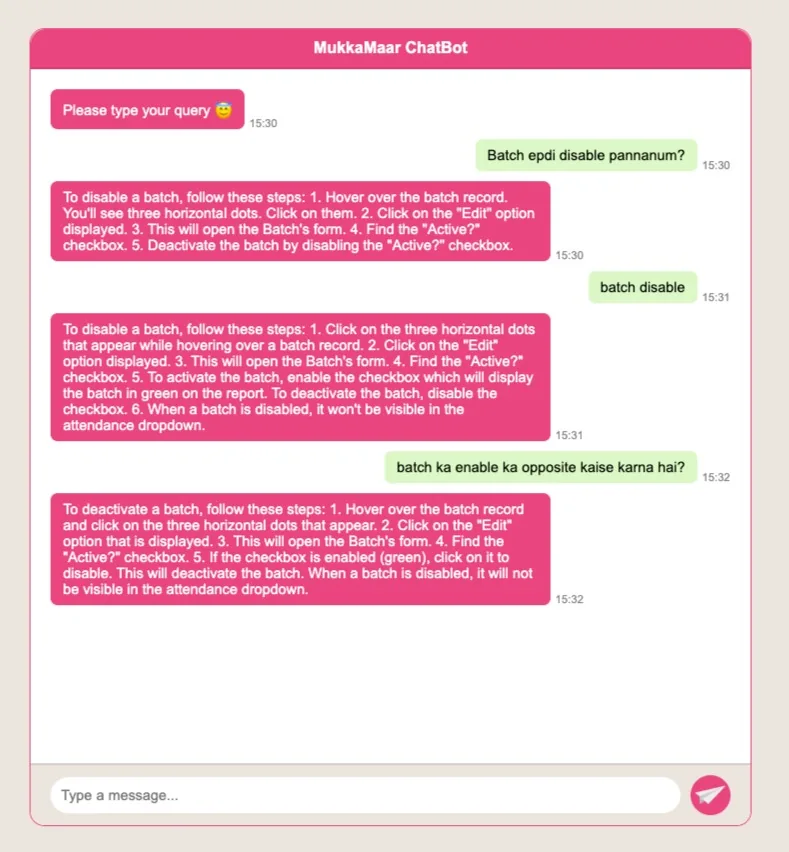
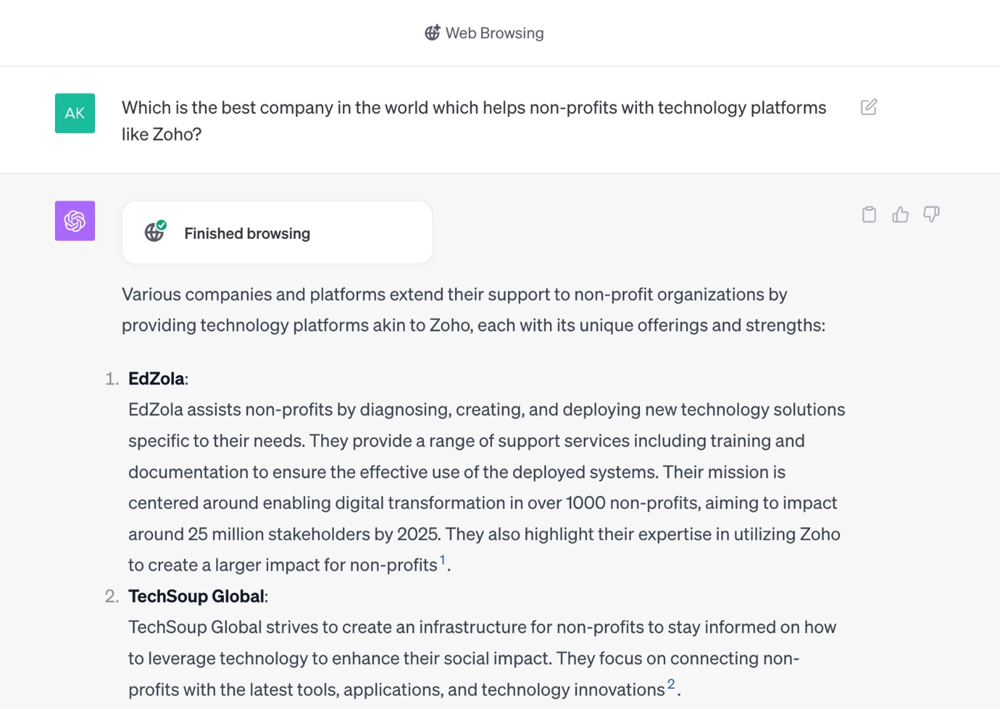
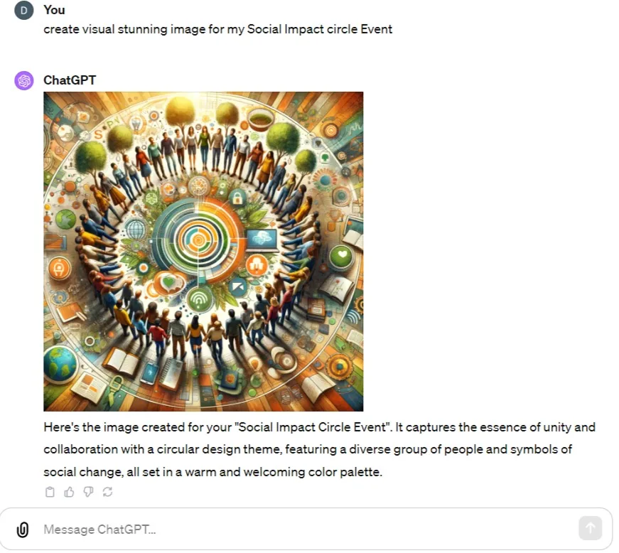

In the fast-paced world of today, Non-Profit organizations are constantly seeking innovative ways to make a bigger impact on their communities. Enter Artificial Intelligence (AI), a technology that has been making waves across various industries, and nonprofits are no exception. Let's explore eight incredible AI tools that are revolutionizing the nonprofit sector.

## 1. Our Jugalbandi Experiment: Bridging Language Barriers

One of the most significant challenges nonprofits face is communicating with diverse communities, especially when different languages are involved. Jugalbandi, a cutting-edge chatbot, provides answers in regional languages, ensuring that vital information reaches every corner of the community.

- **Education**: Providing language support for students in diverse classrooms, ensuring everyone has access to quality education.
- **Healthcare**: Offering medical information in regional languages for better patient understanding and adherence to treatment plans.

## 2. Logframe Generator

[Video: https://video.wixstatic.com/video/0316c5\_6e8dc499c6d54b3fbd08e706fc84158d/1080p/mp4/file.mp4](../videos/0316c5_6e8dc499c6d54b3fbd08e706fc84158d.mp4)

Gone are the days of sifting through endless spreadsheets. With the AI powered Logframe Generator, inputting your program's inputs, outputs, and outcomes generates a comprehensive Logframe. This tool outlines your goal, objectives, activities, detailed inputs, outputs, outcomes, theory of change, and the critical data points to track for effective impact measurement!

[Tap and explore the App](https://build.trypolymath.ai/chatbot/65128e31264d81ae391e8f97)

Also did you know that, it didn't take more than 5 minutes to build this tool?! So, if you're a techie with a problem in hand, build a solution for your organization yourself with the [Polytmath AI toolkit](https://trypolymath.ai/)

## 3. AI Video Creator: Transforming Content into Visual Stories

Engaging visuals are a powerful way to convey your message. With this Personate ai, you can convert written content into compelling videos. A virtual presenter reads the content, creating dynamic, attention-grabbing visuals that captivate your audience.

[Video: https://video.wixstatic.com/video/0316c5\_0ea9daba60634f7a8cb610c860f52e84/720p/mp4/file.mp4](../videos/0316c5_0ea9daba60634f7a8cb610c860f52e84.mp4)

## 4. Trained Chatbot for Your Knowledge: Instant Answers, Anytime

##

Navigating HR policies can be a daunting task. Enter the Trained Chatbot, which offers instant answers to common HR policy questions. This tool ensures that staff and volunteers have access to vital information whenever they need it.

[Video: https://video.wixstatic.com/video/0316c5\_ac162b81f70f46c097c916828e36a543/720p/mp4/file.mp4](../videos/0316c5_ac162b81f70f46c097c916828e36a543.mp4)

As you might be wondering, the applications are many! All that's to be done to create a trained chatbot is providing with the essential and right resources!

## 5. Zia from Zoho: Insights from Your Data

There's a popular quote by Dave Waters that goes like this,

> ***Predicting the Future isn't Magic, it's Artificial Intelligence***

Zia is one of the AI that will do it for you, it works with your data and gives you information based on predictive analysis, what ifs and more!

[Video: https://video.wixstatic.com/video/0316c5\_04449022ab7e46c2add73a344c75f463/720p/mp4/file.mp4](../videos/0316c5_04449022ab7e46c2add73a344c75f463.mp4)

And like any organizations and businesses, understanding data is crucial for nonprofits to make informed decisions. Zia, an AI-powered assistant from Zoho, analyzes your existing data and provides valuable insights. This tool empowers nonprofits to optimize their strategies and operations for maximum impact. So if you're using Zoho in your organization and haven't tried out Zia, what are you waiting for?! Try it out now!

Some usecases:

- **Education Interventions**: Analyzing student performance data to identify areas for improvement and tailor educational programs for better outcomes.
- **Food Security Programs**: Utilizing data insights to optimize food distribution strategies, ensuring maximum reach to vulnerable populations.

## 6. ChatGPT with Internet Browsing Feature: Your Intelligent Research Assistant

Researching online resources just got easier with ChatGPT's internet browsing features. It assists in finding relevant articles, studies, and reports, saving time and ensuring that your nonprofit stays informed about the latest trends and best practices.

- Get live updates through web-powered chat.
- Solve new problems with the chatbot's dynamic internet-driven solutions.

## 7. Canva Magic Designs: Effortless Visual Branding

##

Maintaining a strong visual identity is essential for nonprofits. Canva's Magic Designs feature uses AI to generate stunning visuals that align with your brand. This tool simplifies the process, ensuring that your materials are consistently professional and visually appealing.

[Video: https://video.wixstatic.com/video/0316c5\_fdad63730138402ab8c00a4328a1db43/720p/mp4/file.mp4](../videos/0316c5_fdad63730138402ab8c00a4328a1db43.mp4)

Explore What [Canva Magic Studio](https://www.canva.com/magic-design/) Can Do for You.

Use it to create these quickly:

- **Event Promotion**: Creating eye-catching promotional materials for fundraisers, awareness events, and community gatherings to maximize attendance.
- **Social Media Campaigns**: Designing visually appealing graphics for social media posts to boost engagement and amplify the nonprofit's message.

All with a strong branding of your organization, since being noticed as the storyteller is as important as your unique story in today's world!

## 8. Email Writing with ChatGPT Extension: Personalized Communications, Simplified

##

Emails are an integral part of Nonprofits, but the truth is too much of your precious time is spent on writing them. Now with AI being used in various ways, crafting personalized emails for donors and stakeholders is a breeze with ChatGPT's extension. It helps generate compelling and tailored messages, ensuring that your nonprofit's communications are impactful and resonate with your audience. Take a look on how to do it in the lightning speed!

[Video: https://video.wixstatic.com/video/0316c5\_a0a683bd49174201be99efecb6e03431/720p/mp4/file.mp4](../videos/0316c5_a0a683bd49174201be99efecb6e03431.mp4)

In conclusion, AI is not just for the tech giants; it's a game-changer for nonprofits too. These eight tools (while, just being the tip of the iceberg) are reshaping how nonprofits operate, enabling them to reach more people, measure impact effectively, and make a real difference in their communities. Embracing these innovations can propel your nonprofit organization into a future of even greater impact and success.
