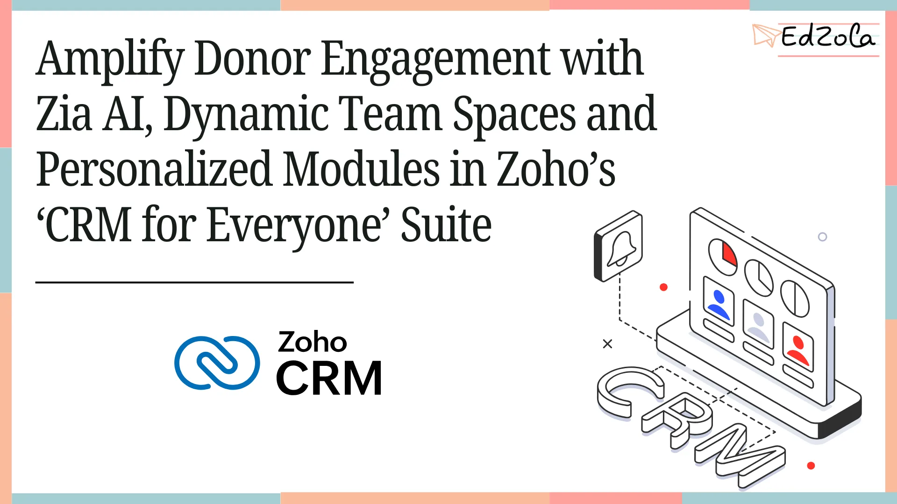
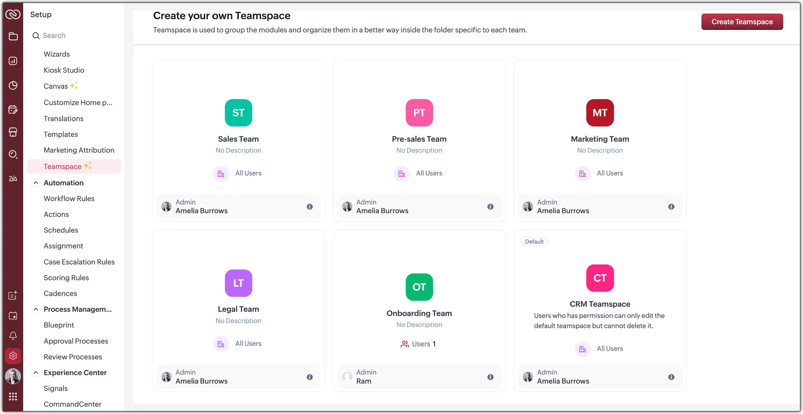
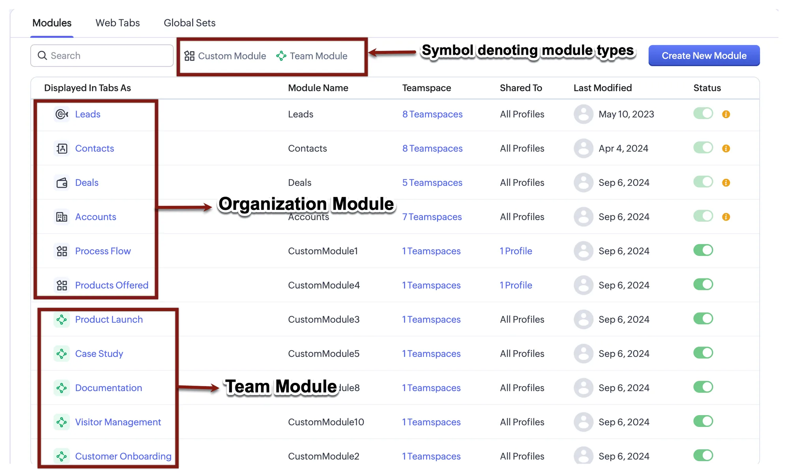
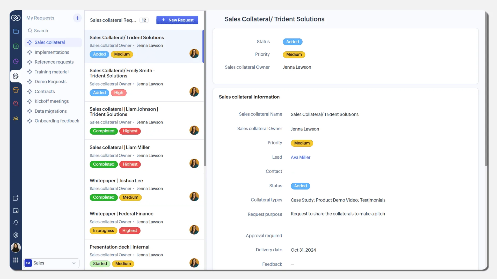
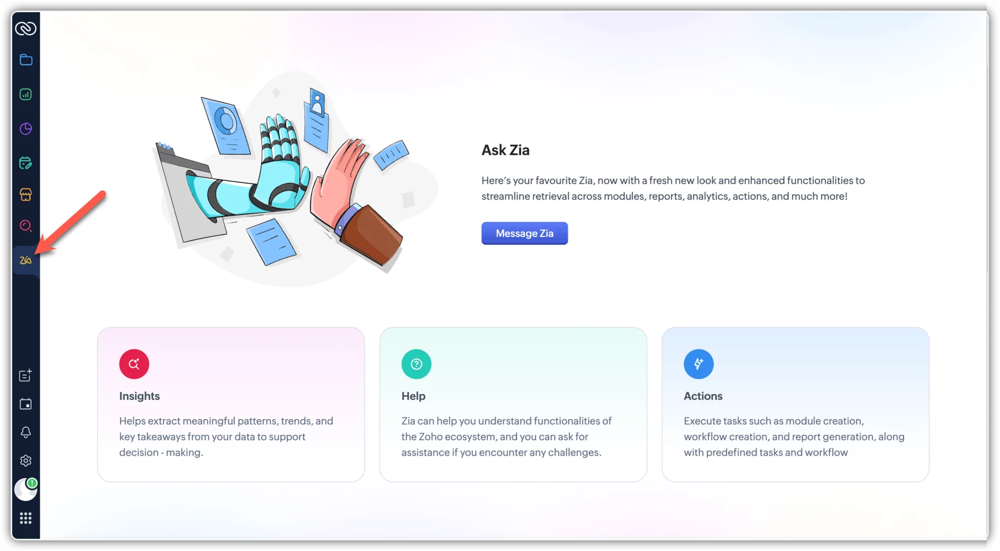

If you already have a CRM system in place, kudos — you're one step ahead in your digital transformation journey. But is it effectively supporting your day-to-day operations? The real question is: are you making the most of the tool, or are you spending more time figuring it out than benefiting from it?

Often, the challenge lies in managing the software itself — either it’s too complex to handle, or it simply doesn’t fit your organization's unique needs. Over time, this can lead to high customization costs and low adoption.

That’s why we believe it’s time to rethink the approach:[*Stop Chasing Tools. Start With the Human Need*](https://www.edzola.com/post/stop-chasing-tools-start-with-the-human-need)

In this blog, we explore the common bottlenecks nonprofit teams face with CRM systems and how Zoho CRM’s latest features are designed to address them — making your operations smoother and your team more productive.

## Identify and Eliminate the 6 Hidden Bottlenecks Slowing Down

Your NGO When we step into discovery calls with nonprofit CEO, CXO or decision makers, a common frustration surfaces quickly: 

*“Our CRM is too complex, not suited to our workflows and eats up valuable time.”*

They’re not looking for more tools — they’re looking for the right one that fits how they operate.

And for those who haven’t implemented a CRM yet, the hesitation is just as real: 

*“We’re still juggling spreadsheets — we’re unsure where to start or whether a CRM is worth the effort.”*

Here are some of the most common challenges nonprofit teams face — and chances are, you’ll resonate with them too.

### 1. Manual Data Entry Everywhere

Still issuing 80G receipts manually? Teams waste hours updating donor details, checking payment logs, and exporting lists to Excel for reports.

### 2. Generic Business CRMs

You’re not managing “deals” — you’re managing donations, grants, volunteers. Most CRMs force you into business templates that just don’t fit.

### 3. No Unified Donor View

Supporter data lives in different systems — Razorpay, Google Sheets, Zoho Books, emails. This blocks personalized outreach and weakens relationships.

### 4. Integration Gaps

WhatsApp is your main communication tool — but your CRM doesn’t sync it. Same goes for accounting, payment gateways, or Tally.

### 5. Zero Automation

Pledge follow-ups, recurring gift reminders, renewal nudges — all done manually. This drains team energy and causes missed opportunities.

### 6. Poor Audit Trail

Your compliance teams need logs, receipts, approval histories — but your current tools don’t offer traceability.

These challenges add up. In fact, lack of automation and organizational efficiency to be nonprofits’ top internal hurdle, with manual reporting and disconnected systems named as other key pain points. The truth is organizations are hungry for an all-in-one donor management platform that eliminates busywork and unifies data.

## Transform Your Donor Systems with Zoho CRM’s Smartest Features Yet

Many nonprofit organizations use different CRM systems—each with its own pros and cons. But the smartest move is choosing the right tech partner. The next step is to consult with that partner to select a tool that is budget-friendly, easy for non-tech teams to adopt, and adaptable for long-term use.

That’s why we always recommend Zoho CRM as the go-to choice for nonprofit teams. It checks most of the key boxes nonprofits look for, with essential features built-in and super-cool AI capabilities already integrated.

Zoho CRM’s latest 2025 enhancements—under the “CRM for Everyone” suite—are purposefully designed to address the needs of nonprofits, turning CRM systems from frustrating to freeing.

## Key Zoho CRM Features for Nonprofits in 2025

### Teamspaces: Personalized Workspaces for Each Department

You can create separate **Teamspaces** for each department—fundraising, finance, volunteer coordination, or program operations. ( Refer figure 1)

*Figure 1: Different team space view*

Each team gets their own workspace and modules. For example:

- Fundraising teams see **Donations** or **Grants** modules tailored to their outreach and follow-ups.
- Finance teams work in their own world—with **Budget** and **Invoice** modules, organized how they need it.

Everyone’s using the same CRM, but only seeing what’s relevant to them.

 And with **custom team modules**, you can create exactly what your nonprofit needs—**Pledges, Volunteer Projects, Sponsorships**—with permission control for privacy and clarity. It’s a clean break from the one-size-fits-all mess.(Refer figure 2)

*Figure 2 : Team module view*

### Simplify Internal requests and Approvals for Cut Follow-Up Delays

Tired of tracking approvals through emails, calls, and chat threads? Zoho CRM now lets teams **submit internal requests directly from the CRM**—and route them to the right people. (Refer figure 3)

Example: A program associate needs logistics support for an upcoming event. They open the CRM, submit a request, and it goes straight to the admin team. The admin team gets notified, checks the details, and marks it approved or completed.

*Figure 3 : sample request view*

### Automate Donor Follow-Ups with Zia: Your AI Fundraising Assistant

Zia, Zoho’s built-in AI assistant, might just become your team’s favorite co-worker.

Instead of complex configurations, Zia gives, in-the-moment insights that drive better decisions. (Refer figure 4)

*Figure 4: Zia Ai Assistant*

Example: Zia might tell your fundraising lead,

“This donor hasn’t been engaged in 90 days—schedule a follow-up?”

Or help your M&E team by:

- Predicting which beneficiaries might drop out based on attendance
- Summarizing long conversations with volunteers
- Alerting you if field reports are missing follow-up actions

### Design Custom Modules That Reflect Your Mission and Maximize Data Visibility

###

Zoho CRM no longer limits you to generic modules like “Leads” and “Deals.” With **Custom Modules**, you can create data structures that mirror your  operations.

 Example:

- A health nonprofit builds a **“Patient Care”** module with diagnosis, follow-ups, and referrals.
- An education org tracks **“Student Sponsorships”** with donor linkage, academic status, and need levels.
- A livelihood team uses **“Project Outcomes”** to monitor success stories across regions.

CRM stands out for its **cross-team flexibility, cost efficiency for the long.** The right choice depends on your organization’s size, budget and technical resources.

## Start Your Nonprofit CRM Transformation Today

If you’re looking for a CRM solution, Zoho CRM is the right choice — affordable, scalable and fully customizable to fit your needs.

**Interested in a free demo?**

[Contact Us](https://www.edzola.com/contact)

Our team will walk you through how Zoho CRM aligns perfectly with your needs.
