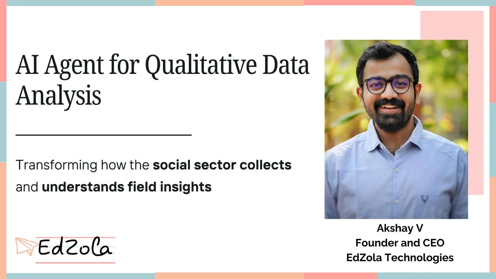

In the social impact and non-profit sectors, collecting and analyzing qualitative data is a critical step in evaluating programs, shaping policies, and measuring outcomes. However, traditional methods of qualitative data analysis—often involving in-person interviews, focus groups, and extensive surveys—can be expensive and time-consuming, especially when multiple beneficiaries in far-flung locations are involved. Enter the revolutionary concept of the **AI agent for qualitative data analysis**—an innovative approach that promises to reshape how NGOs, charities, and humanitarian organizations gather and interpret information on a large scale.

## Why Qualitative Data Analysis Matters in the Social Sector

### Importance of Qualitative Insights

###

Quantitative metrics such as numbers, charts, and statistics offer a high-level overview of program performance. But without the stories, experiences, and emotional responses of real people, you risk missing critical nuances that inform decision-making. Qualitative data captures the “why” and “how” behind the numbers, painting a more human-centric picture of social interventions.

### The Challenge of Scaling Up

For many non-profits, collecting extensive qualitative data can be cost-prohibitive. Field research typically requires experts trained in ethnographic methods, travel budgets, and scheduling complexities. When your organization must gather information from thousands—or even millions—of beneficiaries across different geographies, costs rise quickly, and staffing bottlenecks emerge. This is where **AI-driven data collection** steps in to automate and streamline the process.

## How AI Agents Are Revolutionizing Qualitative Data Analysis

### 1. Text, Audio, Video, and Multimodal Interactions

Modern AI agents can engage in **multimodal conversations**—via text, audio, and even video calls—making data collection more inclusive and accessible. Whether it’s a simple SMS conversation in a remote community or a video interview with local health workers, an AI agent can seamlessly adapt to the communication channel that works best for each beneficiary.

### 2. Empathy and Context Sensitivity

One major concern about using AI in the social sector is the fear of losing the human touch. However, **empathy-driven AI** can be trained with culturally relevant language models, empathetic conversation flows, and real-time context awareness. This ensures interactions remain compassionate, respectful, and aligned with the user’s background. Rather than feeling like they’re talking to a machine, beneficiaries experience a conversation that mirrors a human interviewer.

### 3. Cost-Effective and Scalable

Because these AI agents can operate 24/7 without the logistical hurdles of travel, lodging, or scheduling human interviewers, they present a **cost-effective solution** to data collection. Funds that would otherwise be spent on large field teams can be reallocated to program improvements, technology upgrades, and deeper research initiatives.

### 4. Faster and More Accurate Insights

AI-driven qualitative analysis tools don’t just collect data; they also **analyze responses in real time**. By applying natural language processing (NLP) algorithms, sentiment analysis, and topic modeling, these agents can quickly highlight emerging themes, identify possible red flags, and offer a structured summary of the collected information. You can make data-driven decisions in days rather than months.

## Key Considerations and Challenges

### 1. Data Privacy and Security

Handling sensitive beneficiary information requires robust data governance frameworks. Non-profits must ensure **ethical AI** usage, comply with data protection regulations, and maintain the trust of their communities.

### 2. Language and Cultural Nuances

Training AI agents to understand linguistic and cultural nuances is critical. While English might be a global lingua franca, many rural communities and refugee populations need technology in local languages and dialects.

### 3. Infrastructure and Connectivity

In regions with limited internet or mobile connectivity, deploying an AI solution can be challenging. Partnerships with local telecom providers and strategies for **offline data collection** can bridge these gaps.

### 4. Human Oversight

No AI system is infallible. **Human oversight** remains essential to interpret complex responses, address unexpected scenarios, and maintain quality assurance.

##

## **The Future of AI Agents in the Social Sector**

As AI technology advances, we can anticipate even more sophisticated applications of AI agents for qualitative research. Imagine hyper-personalized experiences where an agent not only speaks the local dialect but also references community-specific examples, tailoring its questions to maximize clarity and relevance. This new era of **AI-driven qualitative analysis** will empower organizations to collect more in-depth insights than ever before—at scale—without compromising on human empathy or contextual relevance.

Are you looking to transform the way you collect and analyze qualitative data in your organization? Our technology platform specializes in building **AI agents for qualitative data analysis** that are designed for the unique needs of the social sector. From empathetic interactions to cutting-edge NLP techniques, we offer an end-to-end solution that will help you gather actionable insights quickly and effectively.

> ***If you’re ready to explore the next frontier of qualitative research using AI agents, reach out to us now!***

[Connect with us](https://www.edzola.com/contact)

We’re here to support you in making data-driven decisions, amplifying your impact, and saving on valuable resources—so you can focus on what truly matters: creating positive social change.
