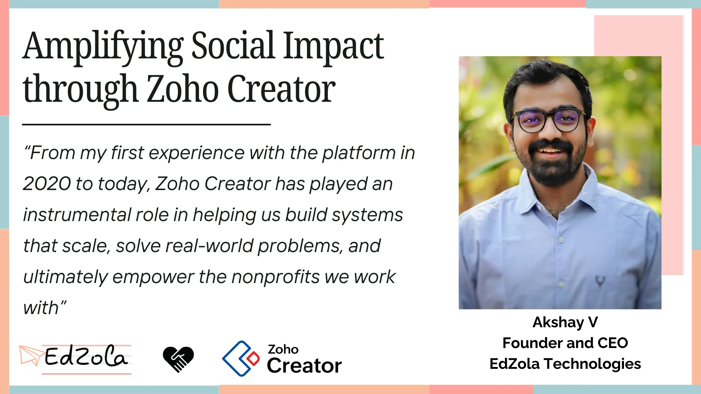

At EdZola Technologies, we use software development to drive impact in the development sector—leveraging innovation to tackle societal challenges. In many ways, we develop solutions that help develop the organizations we serve. This is the story of how [Zoho Creator](https://www.edzola.com/zoho-products/zoho-creator) has been instrumental in our mission to build impactful, scalable systems that empower over 40 social sector organizations.

> *As the Founder and CEO of EdZola Technologies, I’ve had the privilege of working closely with over 40 organizations, each striving to create a wider social impact. One of the key enablers for us in driving this change has been Zoho Creator. From my first experience with the platform in 2020 to today, Zoho Creator has played an instrumental role in helping us build systems that scale, solve real-world problems, and ultimately empower the nonprofits we work with.*

Our Zoho Creator journey began during a critical moment in 2020.[*The Nudge Foundation*](https://www.edzola.com/the-nudge-future-perfect) was running a program called Future Perfect, designed to equip youth with skills for employability. This was primarily an offline program, but due to the pandemic, there was an urgent need to transition it online. That’s when we started working with Zoho Creator. We had to develop a solution that could not only replicate the offline experience but also scale it to meet the growing needs of the program.

What stood out to me immediately was the agility and speed Zoho Creator brought to the table. In less than three months, we had built and launched the pilot version of the platform. Compared to a full-stack development environment, this timeline was a game-changer. With the help of Zoho Creator’s low-code platform, we were able to deploy a solution in a fraction of the time it would normally take. The result? The program scaled from 1,000 students to over 40,000, and we continued to add modules to the platform over the next two years.

One of the myths surrounding low-code platforms is that they’re only useful for quick prototypes or small-scale solutions. But in our experience, Zoho Creator has proven to be scalable, robust, and capable of handling millions of records and complex API integrations. We didn’t just use it to launch; we built a sustainable system that could grow with the program’s needs.

For any platform, there are three critical factors: cost, speed, and quality. Zoho Creator delivered on all three. It was cost-effective, which is vital when working with nonprofits that have limited resources. The speed at which we could build applications using its drag-and-drop interfaces was phenomenal – we could develop in a jiffy. And the quality of the platform was impressive, with minimal bugs and continuous innovations. I’ve seen Zoho Creator evolve through multiple versions – from Creator 4 to 8 – each version bringing in new functionalities that made our lives as developers easier and our applications more powerful.

As someone working with nonprofits, I’ve come to understand that a lot of our time goes into solving business problems and identifying what our partners really need. Zoho Creator makes it easy to convert those needs into reality. The form builder allows us to drag and drop fields and create forms quickly, while the reporting module helps us generate custom reports, often with features like pivot tables and conditional formatting that are invaluable to our users. The page builder, on the other hand, lets us create dashboards that offer leaders the insights they need to make informed decisions.

Another exciting trend we’ve witnessed is the rise of citizen development. Many of the organizations we work with have started building simple applications themselves using Zoho Creator. This empowers them to take ownership of their digital transformation journey while coming to us for more complex challenges. This wouldn’t have been possible on any other platform, and it’s sustainable in the long run because the organizations can maintain the platform themselves.

As part of Zoho Creator Developer Month, my hope is that more people take the first step towards citizen development. I believe that the biggest challenge is often the mental barrier – the belief that technology is too complex or out of reach. But once that first step is taken, everything else falls into place. This has been the story for over 40 organizations we’ve worked with, and I’ve seen how taking that leap can lead to profound transformations.

At EdZola, we’ve learned that technology doesn’t have to be overwhelming to be transformative. Zoho Creator has helped us **bridge the gap between vision and execution**, between grassroots realities and scalable systems.

The real power of low-code isn’t just in its features, it lies in **how quickly it can be adapted, co-owned, and evolved by the people closest to the problem**. Whether it’s a program manager configuring reports, or a nonprofit founder mapping impact workflows, Zoho Creator makes the journey more inclusive, faster, and more sustainable.

As more nonprofits step into this new digital chapter, we’re excited about what lies ahead—**systems that grow with you, data that empowers your decisions, and teams that are no longer held back by tech limitations**.

Here are a few truths that have guided us:

**Start with the problem, not the platform.** Every NGO has its unique DNA. Great tech solutions are born when you map tools to real needs, not the other way around.

**Build with your users, not just for them.** From field staff to M&E teams, involving end users in the design process ensures the solution is usable, owned, and adopted.

**Sustainability is digital too.** It’s not enough to go live with a system, you need one that grows with your programs, your people, and your purpose. That’s where low-code wins.

**Small wins create big momentum.** You don’t need to build everything at once. Start with one form, one dashboard, or one module. Let that success ripple outward.

If you’re reading this and are interested in seeing how Zoho Creator can help you overcome your digital challenges, feel free to reach out to me. Let’s explore how you can take that first step toward empowering your organization with technology.

[Explore Zoho Creator with a 15 - days free trial!](https://store.zoho.in/ResellerCustomerSignUp.do?id=7b02f2ab5c8f7eeb3bf04bad5f5f65ae)
