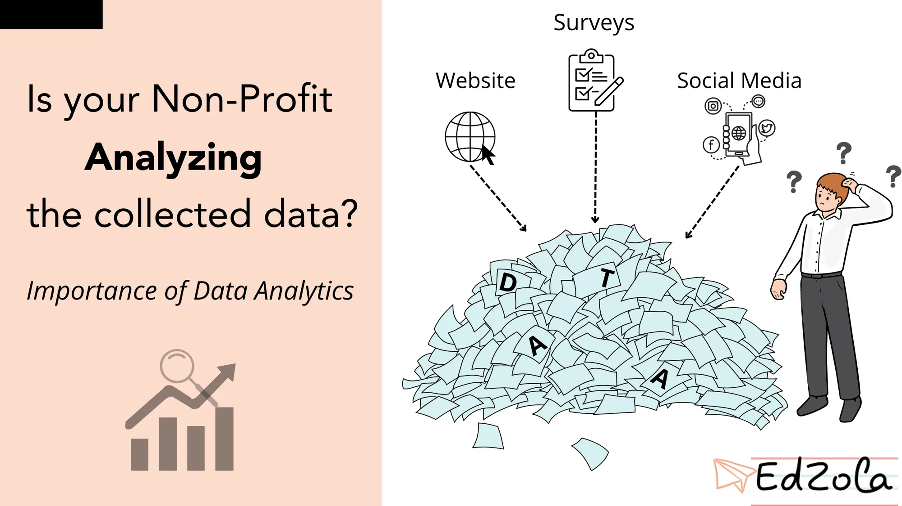
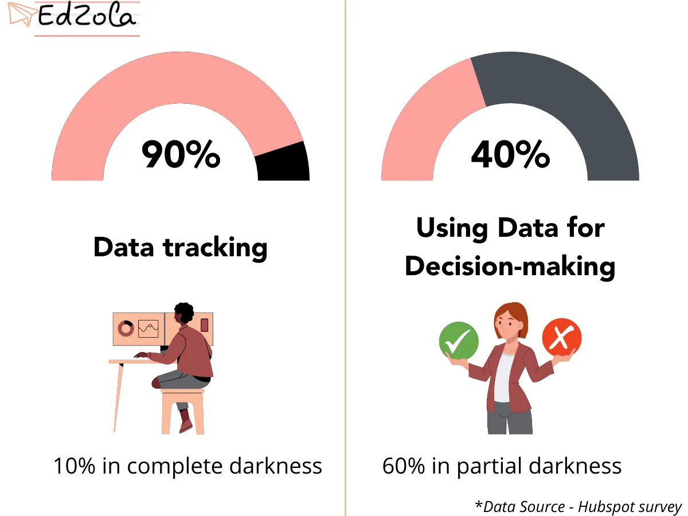
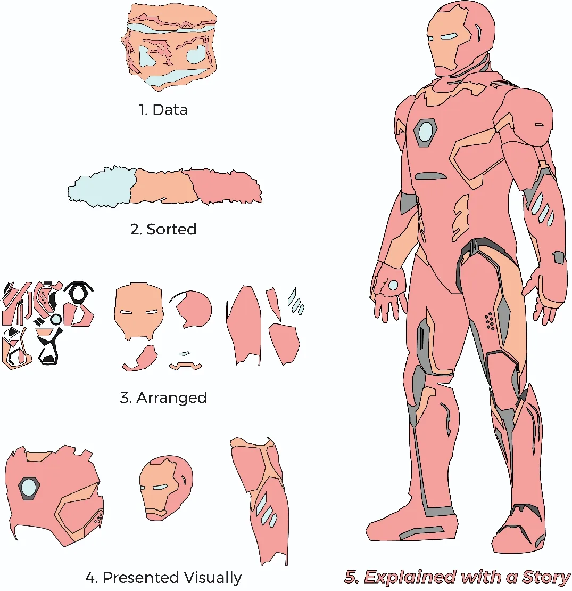

Did you love to show your report cards to your parents as a school student? Did you have moments where you tried to run away and not be found again? :D If you think about it, are mark sheets only to evaluate students? Is it not for helping the teacher as well to make better decisions?

Well, you might wonder what connects high school marks with the social sector. Well, it’s data! And the love/hate relationship with data starts right from our early days.

## The perception of data analysis in Non-Profits

A lot of people act because they are either asked to do so or they know what the action is going to bring down. Eventually, the time makes sense only if anyone could understand the whole context in a meaningful way. One such task which is often **overthought or underthought is data collection**.

Data collection is a method or a process, which *demands quality time from an individual to complete the task*. A lot of Non-Profit Organizations are involved in collecting data thinking that it might be useful to them in some way or that it is easy to store the records as it is. This article is not about the lack of data collection, but rather about **putting the collected data to use**. Realizing the potential that data can bring to an organization will lead to results that are changing, improving, and developing in any domain.

## The problems Non-Profits face due to lack of Data Analysis

According to [Hubspot's survey on Non-Profits](https://cdn2.hubspot.net/hubfs/433841/The_State_of_Data_in_The_Nonprofit_Sector.pdf), 90 percent of Non-Profits said they are tracking data, but only 40% are using data insights to make decisions!

Data usage in Non-Profits - Hubspot survey

Oftentimes, Non-profits miss the *point of collecting data i.e., analyzing them for insights.* Spending a lot of hours fishing through data and doing repetitive tasks manually can be tiring and mentally draining. In addition to this, it reduces the time spent focusing on vital concerns. Skipping this entire process causes more problems – e.g., decisions that are made without inputs from data will misalign and stray away from goals. So, try to get your Non-profit out of this desert quicksand as soon as you can.

Non-Profit Organizations being started for a social cause needs improvement and betterment in every scale. How can data be helpful in this regard? What is it that's required to provide useful information for your organization after collecting the data?

## How analyzing data is beneficial to non-profits?

**Simple statistics** is all that is needed to make a valuable decision that could bring significant results to the community. [Dashboards](https://www.edzola.com/post/dashboards-vs-spreadsheets) also play a vital role in this regard and help save a lot of time with valuable insights from visual data. These are a few examples of how analyzing data can help in creating more impact as you go.

- A simple data about the **track of a student’s education** can help monitor the *students’ performance over a course, help to improvise on subjects* he/she might be interested in and make him/her dedicate extra time to subjects that require more attention.

- Data on **youths and adults living in below poverty line households** can help organizations to decide on *training* to be allocated for the individual, appropriate to the age and level of study, to make them land a job that covers minimum basic needs for the family.

- The data on **child marriages** can help to identify the root cause of such happenings and try alleviating the percentage by providing solutions in terms of *education* or any other forms which would be considered appropriate by the authorities responsible.

- Sensitive issues like, data on **child labor,** the children involved in working for minimum wages before completing their education, can be sorted out to provide minimal education required to survive in the society without having to do odd/illegal jobs in nature. These help the governing or specified officials in making timely decisions of the problem.

- Data on **several female children** not able to pursue education, can assist in identifying the source and build solutions to abridge them.

- WHO, World Health Organization, the specialized agency of the United Nations responsible for international public health, works on data to **propose results to predict which might be the cause for the next pandemic**.

- After introducing a new syllabus, the previous performance data can be compared with the new data to check the effectiveness of the new one.

- When helping people with their health, the data on how frequent or how prevalent a disease occurs in a region can be monitored and right measures can be taken for the betterment.

- Climate Non-Profits are literally fighting for the whole world and an abstract thing. For example, they can use that data on pollutants in different natural resources and use it to create awareness and address the issue to the relevant authorities to create change.

- Since Disaster relief Non-Profits, not just work on immediate relief but also on long-term recovery, data can come in handy. They help in identifying patterns in disasters in accordance with the terrain and the time periods, which can help in a number of ways.

- Mental health Non-Profits can use surveys to identify the accessibility to mental health care, for people from a particular area or particular profession. This can be later analyzed for research purposes. Data on people who are under care and rehabilitation can be tracked and analyzed for helpful insights.

- WHO, the World Health Organization, the specialized agency of the United Nations responsible for international public health, works on data to propose results to predict what could cause pandemics in the future.

And there are several more which may have come to your mind as you’re reading this.

## How can data help solve all these problems and reach a solution?

> *"Data is part of the daily workflow and forms the basis for how decisions are made. Data-driven nonprofits embrace the use of information to accelerate change."*

*- says* [*Steve MacLaughlin*](https://www.linkedin.com/in/maclaughlin/) *in the blog* [*5*](https://www.huffpost.com/entry/5-secrets-of-data-driven-nonprofits_b_57c86554e4b06c750dd8ffb6) [secrets of data driven Non-profits](https://www.huffpost.com/entry/5-secrets-of-data-driven-nonprofits_b_57c86554e4b06c750dd8ffb6)*, the Author of* [*Data Driven Non-Profits*](http://www.datadrivennonprofits.com/)

So, to reach a solution via data, you should fit yourself in a mentality that data is not an additional support - it's the **basis**.

There are a lot of *statisticians, mathematicians, data scientists, data analysts, data engineers* and a lot more fancied titled across the board or *just a piece of technology* to help you find solutions using data. We have already talked on [how tech helps data management better than spreadsheets](https://www.edzola.com/post/top-3-reasons-your-non-profit-organisation-should-get-rid-of-spreadsheets) when Non-profits scale, and there's no doubt that tech can help data analysis efficiently if you choose the right software.

It might be as simple as ‘tracing a student’s record’ to ‘identifying a missing youth across the city’. The benefits of processing the data not only support working on important tasks but also in making **timely and informed decisions to act upon**.

## Data analysis - broken into simple steps

A simple illustration of how coordinating data together in an organized and efficient way could result in a useful solution.

First, the data is collected from sources. It is then sorted, arranged and manipulated to yield a solution for the problem statement. The results are represented visually to understand and make decisions based on that.

[***Learn: 6 Data Management challenges and solutions for Non-Profits***](https://www.edzola.com/post/6-data-management-challenges-and-solutions-for-non-profits)

*Finally,*

Analyzing and experimenting data is as important as data collection to arrive at any valuable conclusions that might result in betterment or improvement of a cause. Analyzing is what gives data and people who are involved in collecting it a purpose, so start analyzing and do it the right way with technology from the very start. It is time to get valuable insights from the large pile of data that has been accumulating in your organization and solve pressing questions with it.

There are a lot of organizations that offer solutions working with data. Let us know here if you want to know more about data analytics and how EdZola can help you with your data to get better insights and drive you towards your goals with the ever-growing technology.

To get the best out of your growing data pile

[Talk with us](https://www.edzola.com/contact)

**Want to learn more about the benefits of digitalizing the data?**

**Watch our webinar**

**"Streamlining your Non-Profits Data Stack with Zoho Creator"**

[Video: https://www.youtube.com/watch?v=KgNaNAJ0KS4](https://www.youtube.com/watch?v=KgNaNAJ0KS4)
