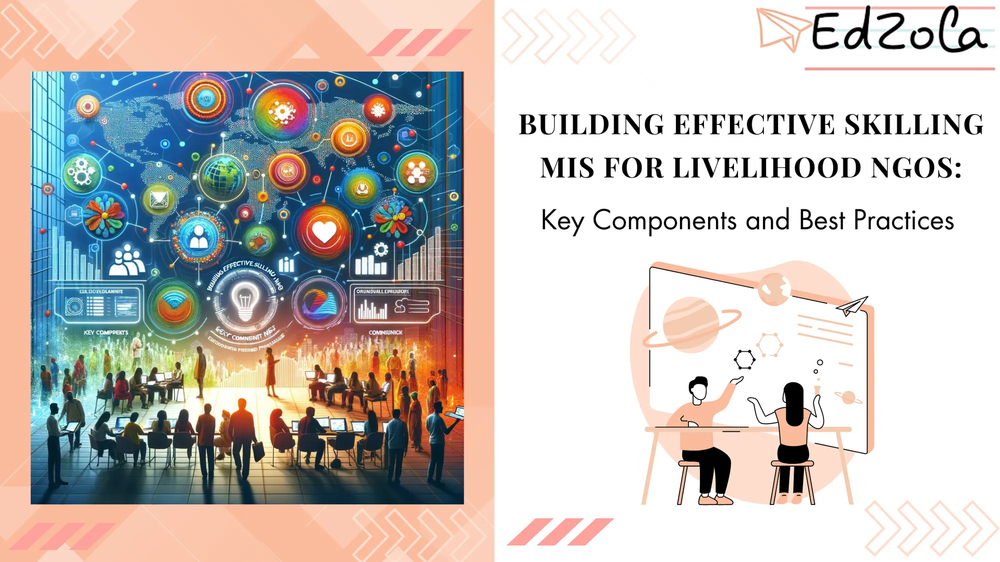

Livelihood NGOs play a crucial role in empowering individuals and communities by providing skilling programs. These programs aim to enhance employability, create job opportunities, and improve the overall socio-economic conditions of the beneficiaries. To effectively administer and monitor these skilling programs, the use of Management Information Systems (MIS) is essential. In this article, we will delve into the key components of an effective Skilling MIS and explore best practices for its implementation in Livelihood NGOs.

## Understanding the Importance of Skilling MIS in NGOs

Livelihood NGOs face unique challenges in managing and monitoring their skilling programs. The implementation of a Skilling MIS enables them to streamline their operations, improve decision-making, and drive greater impact. By harnessing the power of technology, **NGOs can achieve transparency, efficiency, and accountability in their Skilling initiatives.**

The utilization of a Skilling MIS empowers NGOs to establish stronger connections with stakeholders, including funders, partners, and beneficiaries. The detailed data and insights provided by the system not only enhance internal operations but also enable NGOs to showcase the impact of their skilling programs to external parties, fostering trust and support.

Probe Further: [Tech for Impact - Case Study on The Nudge Institute](https://www.edzola.com/post/tech-for-impact-case-study-fp)

### Defining Skilling MIS

Skilling MIS refers to the system that facilitates the collection, management, and analysis of data related to skilling programs. It enables NGOs to track and evaluate the progress, effectiveness, and outcomes of their programs in a structured and comprehensive manner.

> *The Skilling MIS serves as a foundation for evidence-based decision-making, allowing NGOs to continuously improve their programs and make informed strategic decisions.*

The data stored in the Skilling MIS can be utilized for research purposes, enabling NGOs to contribute valuable insights to the broader skilling ecosystem. By analyzing trends and patterns within the data, organizations can identify areas for innovation and collaboration, ultimately driving the advancement of skilling initiatives on a larger scale.

### Role of Skilling MIS in Livelihood NGOs

The Skilling MIS serves as the backbone of operations for Livelihood NGOs. It helps in managing various aspects such as candidate registration, training session scheduling, participant attendance tracking, skill assessment documentation, and certification issuance. Furthermore, it assists in tracking the placement and post-training progress of beneficiaries, thereby facilitating outcome monitoring and impact evaluation.

The Skilling MIS plays a crucial role in fostering a culture of learning and development within NGOs. By providing real-time data on program performance and participant feedback, the system enables organizations to adapt their strategies and training methodologies to better meet the evolving needs of beneficiaries, ensuring long-term success and sustainability.

Dig Deeper: [Building Efficient Non-Profits with MIS: A Starter Guide](https://www.edzola.com/post/building-efficient-non-profits-with-mis-a-starter-guide)

## Key Components of an Effective Skilling MIS

A comprehensive Skilling MIS should consist of several key components that ensure optimal functioning and deliver desired outcomes. Let's explore these components in detail:

### Data Collection and Management

The foundation of an effective Skilling MIS lies in the accurate and timely collection of data. Livelihood NGOs should d**evelop a systematic approach to gather relevant data points, including participant demographics, skill development progress, training feedback, and employment outcomes.** The data should be stored securely and managed in a structured format to ensure its accessibility and usability for analysis and reporting purposes.

Explore More: [Data-Driven Decision Making for Skilling NGOs: How MIS Can Transform Impact Measurement](https://www.edzola.com/post/data-driven-decision-making-for-skilling-ngos-how-mis-can-transform-impact-measurement)

### Reporting and Analysis

Reporting and analysis play a pivotal role in evaluating the impact and effectiveness of skilling programs. The Skilling MIS should enable NGOs to generate customizable reports and dashboards that provide insights into program performance, participant outcomes, and stakeholder engagement. Additionally, **data analysis tools and techniques can help identify trends, patterns, and areas for program improvement, facilitating evidence-based decision-making.**

### User Interface and Accessibility

An intuitive user interface is an essential component of an effective Skilling MIS. NGOs should prioritize the design and development of a user-friendly interface that simplifies data entry, retrieval, and navigation. Additionally, ensuring accessibility across devices and internet connectivity levels is crucial, considering the diverse operational contexts of Livelihood NGOs.

## Best Practices for Implementing Skilling MIS

Implementing a Skilling MIS requires careful planning, collaboration, and adherence to best practices. Here are some key considerations to ensure a successful implementation:

### Aligning with Organizational Goals

Before embarking on the implementation journey, NGOs must align the Skilling MIS with their organizational goals and objectives. The system should be designed to support and enhance existing processes while catering to the unique needs and requirements of the organization. This alignment helps in achieving synergy between the Skilling MIS and the overall mission and vision of the NGO.

### Ensuring Data Privacy and Security

Data privacy and security are paramount when it comes to implementing any information system, including a Skilling MIS. NGOs must establish robust data protection measures to safeguard sensitive information and comply with relevant data protection laws. **Implementing strict access controls, data encryption, regular backups, and periodic security audits are some of the best practices that NGOs should adopt.**

### Choosing the Right MIS

Once you have identified your organization's needs, it's time to select the right MIS solution. When selecting a MIS, consider factors such as scalability, ease of use, integration capabilities, and cost. Low-code tools like Zoho Creator have gained popularity among nonprofits due to their flexibility, cost-effectiveness, and ease of customization.

[Explore Zoho Creator](https://www.edzola.com/zoho-products/zoho-creator)

Implementing an MIS system successfully involves not only selecting the right technology but also training your team to use it effectively. Make sure to provide comprehensive training sessions that cover all aspects of the system, from data entry to advanced analytics.

### Continuous Training and Support

Effective implementation of a Skilling MIS requires a well-trained and knowledgeable team. NGOs should invest in comprehensive training programs to equip their staff with the necessary skills and competencies to utilize the system effectively. Additionally, providing ongoing support and troubleshooting facilities ensures that any issues or challenges faced by users are addressed promptly, enabling smooth operations.

## Overcoming Challenges in Skilling MIS Implementation

Implementing a Skilling MIS in Livelihood NGOs can be an intricate process, characterized by various challenges. However, with proper planning and mitigation strategies, these challenges can be overcome. Let's explore some common hurdles and ways to address them:

### Addressing Technical Issues

Technical issues such as system compatibility, connectivity constraints, or software glitches are common challenges in MIS implementation. **NGOs should collaborate with skilled IT professionals to ensure that the system is tailored to meet their specific requirements.** Conducting thorough system testing, pilot studies, and incremental deployments can help identify and resolve technical issues effectively.

### Managing Change Resistance

Implementing a Skilling MIS often entails a change in existing processes and workflows. Resistance to change, whether from staff members or beneficiaries, can hinder the successful adoption of the system. **Open communication, stakeholder engagement, and change management strategies should be employed to create awareness, address concerns, and demonstrate the benefits of the Skilling MIS to all stakeholders.**

### Ensuring Sustained Usage and Maintenance

Once implemented, sustaining the usage and maintenance of the Skilling MIS can pose challenges. **NGOs should prioritize regular system updates, bug fixes, and feature enhancements to ensure the system remains up to date and meets evolving needs.** Furthermore, investing in user feedback mechanisms and incorporating user suggestions into system improvements cultivates a sense of ownership and encourages sustained usage.

Building an effective Skilling MIS is crucial for Livelihood NGOs to track and enhance their skilling programs. By incorporating key components such as data collection, reporting, and user interface design, NGOs can optimize their operations and drive greater impact. Adhering to best practices, addressing implementation challenges, and ensuring sustained usage and maintenance will contribute to the success of the Skilling MIS, ultimately benefiting the beneficiaries and communities served by Livelihood NGOs.

## Getting Started with EdZola

> ***Let's innovate with purpose and use technology as a force for good.***

Every nonprofit is unique, and one size does not fit all when it comes to data solutions. At [EdZola](https://www.edzola.com/), we specialize in creating customized solutions that align with your organization’s specific goals and needs. Our team works closely with you to identify pain points, develop a tailored plan, and implement the right tools to maximize your impact.

[Let's Connect](https://www.edzola.com/contact)
