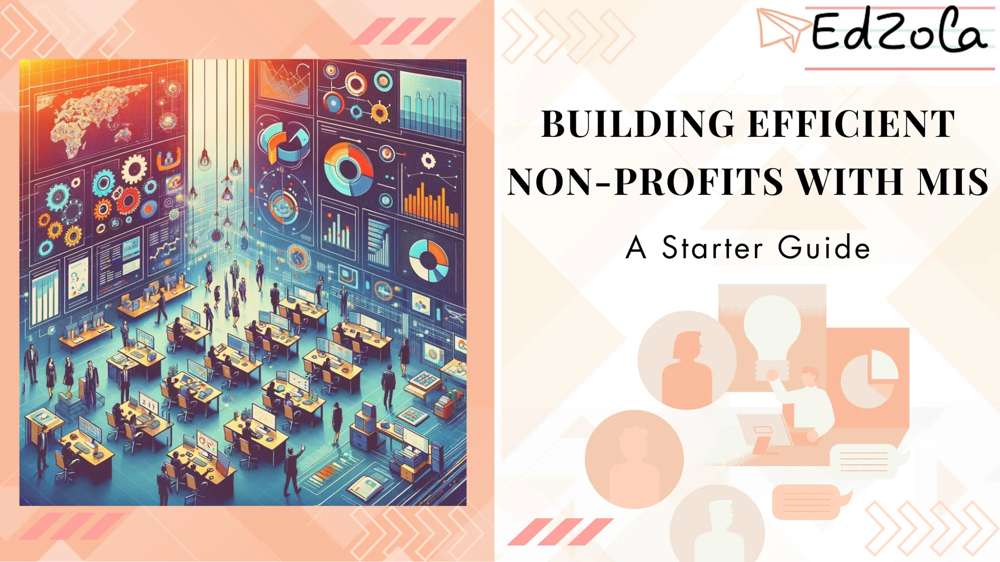

Running a non-profit organization requires dedication, resourcefulness, and a firm grasp of the organization's mission. However, many non-profits struggle with managing and utilizing the vast amount of data they generate on a daily basis. This is where Management Information Systems (MIS) can make a significant difference. In this article, we will explore the basics of MIS, its importance in non-profit organizations, and the steps to implement MIS successfully.

## **Understanding the Basics of MIS**

Before delving into the specifics, let's define MIS. MIS is a system that **integrates people, processes,** and **technology to collect, store, process,** and **analyze data for decision-making and organizational efficiency**. Simply put, it is a powerful tool that helps non-profits leverage data to achieve their goals more effectively.

### What is MIS?

MIS encompasses various components such as databases, software applications, hardware infrastructure, and skilled personnel. Together, these components form a comprehensive system that ensures the **efficient management** of information within an organization.

### Importance of MIS in Non-Profit Organizations

Primarily, MIS allows non-profits to collect and store information related to their operations, donors, beneficiaries, and impact data. By organizing and analyzing this data, non-profits can gain valuable insights into their programs' effectiveness, identify areas for improvement, and make informed decisions to maximize their impact.

One of the key benefits of MIS is its ability to **streamline communication** and **collaboration** between different teams within a non-profit organization. By providing a centralized platform for sharing information and coordinating activities, MIS **eliminates silos** and fosters greater teamwork and synergy among staff members.

## **Steps to Implement MIS in Your Non-Profit**

### Assessing Your Organization's Needs

Implementing MIS requires careful **planning and consideration** of your organization's unique requirements. Start by conducting a thorough assessment of your current processes and systems. Identify the pain points and areas where data management and analysis could be improved.

> ***Understanding your organization's specific needs will help you choose the right MIS solution that aligns with your goals and objectives.***

### Choosing the Right MIS

Once you have identified your organization's needs, it's time to select the right MIS solution. When selecting a MIS, consider factors such as scalability, ease of use, integration capabilities, and cost. Low-code tools like Zoho Creator have gained popularity among nonprofits due to their flexibility, cost-effectiveness, and ease of customization.

[Explore Zoho Creator](https://www.edzola.com/zoho-products/zoho-creator)

Implementing an MIS system successfully involves not only selecting the right technology but also training your team to use it effectively. Make sure to provide comprehensive training sessions that cover all aspects of the system, from data entry to advanced analytics.

> ***Training is an investment in your organization's success.***

It ensures that every staff member understands how to make the most of the new MIS system and empowers them to contribute to data-driven decision-making.

## **Optimizing Non-Profit Operations with MIS**

Once you have implemented MIS in your non-profit organization, you will start reaping the benefits of streamlined operations and enhanced decision-making.

### Streamlining Communication

Effective communication is vital for a non-profit's success. MIS facilitates seamless communication by providing a central platform for stakeholders to share information, collaborate on projects, and provide real-time updates.

### Enhancing Decision-Making

MIS empowers non-profits to make well-informed decisions based on accurate and timely data. By analyzing data trends and patterns, non-profits can **identify gaps, assess program impact**, and make data-driven decisions to optimize their resource allocation.

### Improving Resource Management

Non-profits often struggle with limited resources. MIS enables efficient resource management by providing insights into funding sources, program costs, and staff allocation. This helps non-profits optimize their budget allocation and ensure the highest possible impact.

## **Overcoming Challenges in MIS Implementation**

### Addressing Resistance to Change

Implementing MIS might encounter resistance from staff members due to unfamiliarity or fear of change. To address this, it is crucial to involve employees from the early stages of the implementation process. Engage your team through effective communication, training, and by highlighting the benefits of MIS. Encourage their feedback and address any concerns they may have.

### Ensuring Data Security

Data security is of utmost importance in non-profit organizations. You must ensure that the MIS system you choose has robust security measures in place to protect sensitive information.

Referencing a recent article by MIS Security Insights, implementing encryption, two-factor authentication, and regular data backups are essential for safeguarding your non-profit's data. Additionally, appointing a dedicated data security officer is highly recommended to manage and monitor data security protocols.

### Managing Implementation Costs

Implementing an MIS system can involve significant costs. To manage these costs effectively, consider creating a detailed budget that includes software licenses, hardware requirements, training expenses, and ongoing support and maintenance costs.

In conclusion, implementing MIS in non-profit organizations is a strategic step towards **operational efficiency and improved decision-making**. By carefully assessing your organization's needs, selecting the appropriate MIS solution, and mitigating challenges, you can unleash the full potential of MIS and drive your non-profit towards greater impact.

## Getting Started your journey with EdZola

> Where technology becomes a force for good, amplifying human potential and fostering global progress.

Every nonprofit is unique, and one size does not fit all when it comes to data solutions. At [EdZola](https://www.edzola.com/), we specialize in creating customized solutions that align with your organization’s specific goals and needs. Our team works closely with you to identify pain points, develop a tailored plan, and implement the right tools to maximize your impact.

[Let's Connect](https://www.edzola.com/contact)
