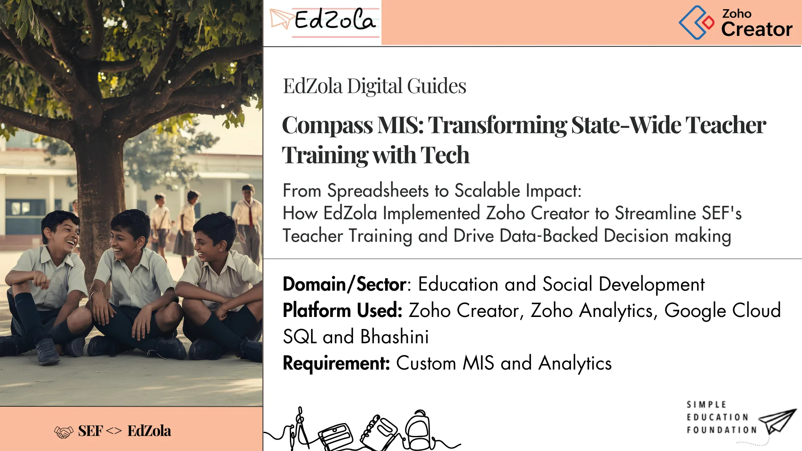

### Key Indicators

*1.* [*Challenges of Indian Education Bodies*](#viewer-s15ck55535)
*2.* [*The Emerging Need and Willingness to Integrate Technology*](#viewer-6amlg1362)
*3.* [*Timeline of the Project*](#viewer-00o5d1929)
*4.* [*Solutions the MIS Offers*](#viewer-oe9zu8176)
5. [*Results*](#viewer-f6b3n33364)
*6.* [*Use Cases to highlight the benefits*](#viewer-fdbyv121737)
*7.* [*Tips for Non-Profit or Other Practitioners (Collective)*](#viewer-8tygl45085)
8. [*What does Mainak Roy, Co-Founder & CEO of SEF, say about us?*](#viewer-9o9wm4461)
9*.* [*Key Learnings: Building Tech for Government at Scale*](#viewer-d87ox45549)

*10.* [*Next Steps: Expanding to More States*](#viewer-scbvm54742)

## 1. Challenges of Indian Education Bodies

### **A Data & Process Gap in Teacher Training**

Since 2022, **SEF and EdZola** have partnered to build **Compass MIS**, a large-scale **GovTech Management Information System (MIS)**. The platform was designed to **bridge major gaps in operations, monitoring, and evaluation** for **state-wide teacher training programs**.

India’s education policy mandates **fixed hours of teacher professional development training**, but state governments lack **impact-driven, meaningful data** beyond **basic checklist metrics** like attendance and hours completed. **Pen-and-paper processes** further **slowed planning and consumed significant resources** when executing training for **tens of thousands of teachers**.

### Major Gaps Observed by SEF

SEF faced several challenges in their original data collection and management processes:

- Inefficiencies in collecting data in spreadsheets
- Time consuming Manual data processing
- Fragmented data collection across multiple Google Forms and Data access issues across teams
- Version control and data quality risks

## **2. The Emerging Need and Willingness to Integrate Technology**

Without structured Monitoring and Evaluation (M&E):

- No visibility on training effectiveness and whether teachers are applying what they learn?
- Inefficient planning manual processes led to wasted time & resources.
- No real improvements in training quality resulting in weak student learning outcomes.

Hence, the **emerging need for a unified, scalable MIS** that would:

- Enable meaningful M&E
- Simplify planning and coordination

Offer real-time, state-wide insights for better decision-making

## **3. Timeline of the Project**

### EdZola’s Mission and Partnership with SEF

At EdZola, our mission is to **amplify the impact of non-profits through technology** by**thought partnering and co-creating affordable, purpose-driven solutions** that address key challenges in the social sector. By working closely with **NGOs, social enterprises, NPOs, philanthropic foundations, and funders,** we simplify operations to help make better data driven decisions.

In 2022, we joined hands with the [***Simple Education Foundation (SEF)***](https://www.simpleeducationfoundation.org/)**,** an organization working to improve the quality of education in government schools by co-designing and deploying large-scale teacher development programs. Together, we set out to build a technology-based foundation for teacher training programmes across several states in India. By closely engaging with their team, we built Compass MIS to address on-the-ground challenges such as **M&E for scale training, managing large amounts of data in spreadsheets, and handling day-to-day operations.**

Compass MIS enables better teacher training outcomes through public forms used by over 20,000 teachers, while the core system supports decision-making for the SEF team and the **State Council of Educational Research and Training (SCERT)** a government body driving educational reform and capacity-building in schools.

### **Outline of features developed over the years**

### 2022: Laying the Foundation with Prototype Development

Development of the project kicked off by mid-November 2022. During this time, we focused on building a strong base to support **Compass MIS**. One of the key milestones was creating a flexible and **easy-to-use form system called Dynamic Public Exit Forms that lets users add, edit, or remove questions without needing any technical support.**

For example, if the SEF team is conducting a teacher training program, they can use this form to quickly collect feedback from all participants, such as teachers and training observers making it easy to gather insights at scale. The system is built to efficiently handle thousands of responses at once, ensuring a smooth and reliable experience for both organizers and respondents.

### 2023: SEF Compass MIS - 1.0 Goes Live with Intelligent Batching

In 2023, we launched **SEF - Compass MIS 1.0.** One of the most impactful features was the **Batching Algorithm a smart tool that grouped participants such as teachers and training observers automatically, based on specific criteria like location or training needs.** This made it much easier for teams to organize and manage large groups of government school teachers efficiently.**It was actively used by SEF, SCERT Delhi (State Council of Educational Research and Training) and their strategic partners to support better planning and delivery.**

To aid in monitoring and learning, **visual dashboards were developed** across different parts of the program. The**Self-Reflection module** encouraged**facilitators to share their personal learning experiences, while Entry & Exit forms colle**

### 2024: Expanding SEF’s Capabilities

In 2024, SEF - Compass MIS continued to grow with the integration of AI. **Forms became smarter and easier to use, with AI-driven multilingual options that allow teachers to fill forms in their regional languages.** Access for different users was made flexible and secure, allowing everyone from field staff to administrators to manage their work with ease.

The teacher observation and reporting modules were improved. Field teams could capture clear and structured data during classroom visits, helping identify what worked well and where teachers needed additional support. This made it easier to strengthen teaching quality and respond efficiently to what was happening in the field.

Building on this progress, **Compass MIS 2.0 introduced features that enabled support across multiple states including Delhi, Haryana, Punjab, and Uttarakhand. The system was made easier to navigate, with a more user-friendly Interface.**

The ability to **recover deleted records** for**up to three months** gave teams a safety net in case of accidental data loss. Integration with Google’s cloud platform helped manage millions of records across different states each week, with speed and reliability.

### **Highlighted Features:**

1. Allowing teachers to select their preferred regional languages while using the forms. 
2. The form link is automatically converted into a QR code for easy access.

3. Restoring deleted records to mitigate manual deletion errors.

4. Teachers can visualise training levels (Cascade Levels)

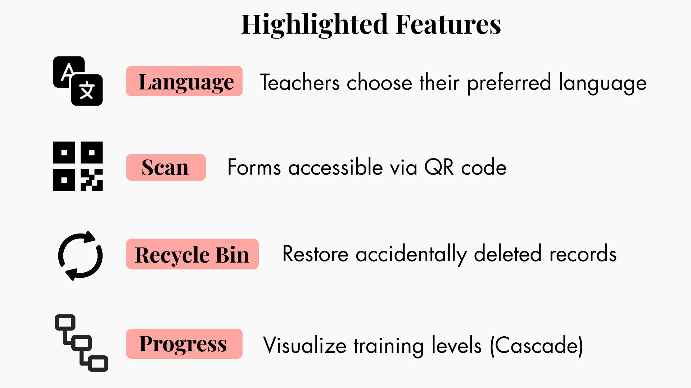

## **4. Solutions the MIS Offers**

### From Spreadsheets to Scalable Impact: How EdZola Implemented Zoho Creator to Streamline SEF's Teacher Training and Drive Data-Backed Decision making

###

#### Key information:

|  |
| --- |
| Domain/Sector: **Education and Social Development** Platform Used:**Zoho Creator, Zoho Analytics, Google Cloud SQL and Bhashini**  Tech requirement: **Custom MIS and Analytics**  Location:  **New Delhi**  Time taken for the project:**7.5 months** |

### Challenges Simple Education Foundation faced:

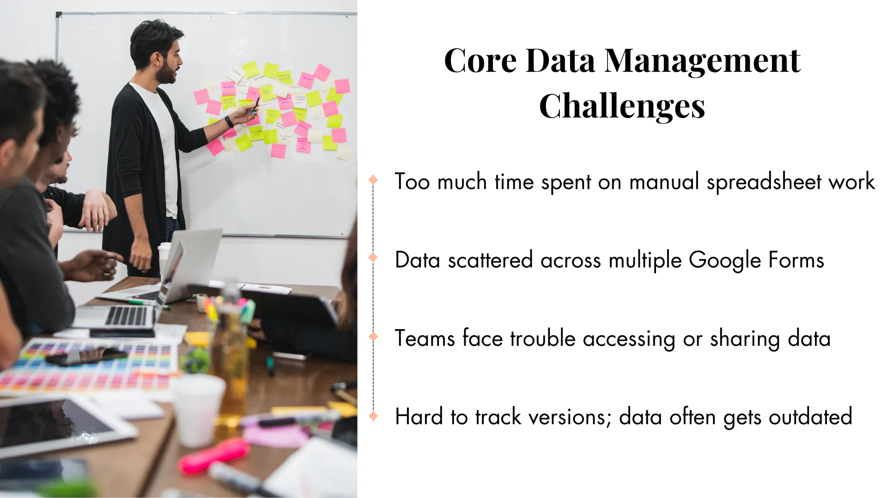

1. **Inefficiencies in collecting data in spreadsheets:** Managing large volumes of teacher training data in Google Sheets caused problems. Each state had its own set of data, which led to scattered and disorganised information. Keeping track of all this data became increasingly difficult, requiring constant updates and manual maintenance. This made it hard to get an accurate and complete view of the information needed for decision-making.
2. **Manual Data Processing:**Extracting valuable insights from the data stored in Google Sheets was a slow and error-prone process. Without automated tools, SEF relied on manual methods to process and analyze the data, which took a lot of time and effort. This manual approach also increased the risk of making mistakes and having inaccurate information, which could lead to poor decision-making.
3. **Data access issue with the team:**The team worked with multiple stakeholders like regional managers, trainers, and administrative staff, all of whom needed access to the same information. However, managing who could access the data and ensuring they were using the most up-to-date version was difficult. This lack of coordination led to problems with version control and made it hard to track changes and updates in the data effectively.
4. **Fragmented Data Collection:** They used Google Forms to collect data but ended up creating multiple forms for different purposes and regions. This led to scattered data, with information not all in one place. It was difficult to analyse and combine this scattered data, making it hard to get meaningful insights and track trends over time.

###

### Stages of User Journey:

State wise program management -> Teacher Training assessment->Real time form submitted summary->Training Observation->Classroom Observation->User Management-> Dashboards and reports.

### Solution Overview:

To overcome these challenges, we implemented ***Zoho Creator,***a low-code platform that allows users to build custom applications 10 times faster to meet their needs without extensive coding. 

### Here are few highlights of the Custom MiS implemented with Zoho Creator:

####

#### State-wise Program and Session Module:

This program module is used to track program details such as program name, state, level of intervention, and designations. Each program is linked to different sessions conducted in various states, including **Delhi, Haryana, Punjab, and Uttarakhand.** The facilitator and participant roles are managed at various levels under the cascade flow.

This will help the SEF team monitor all programs in a unified system (refer to image 1 and 2). Additionally, they can clone a program from one state to another, which will reduce time and manual effort.

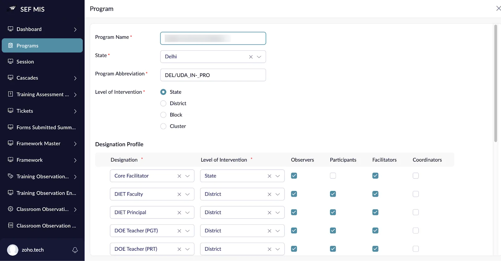

*Image 1: Overall program module*

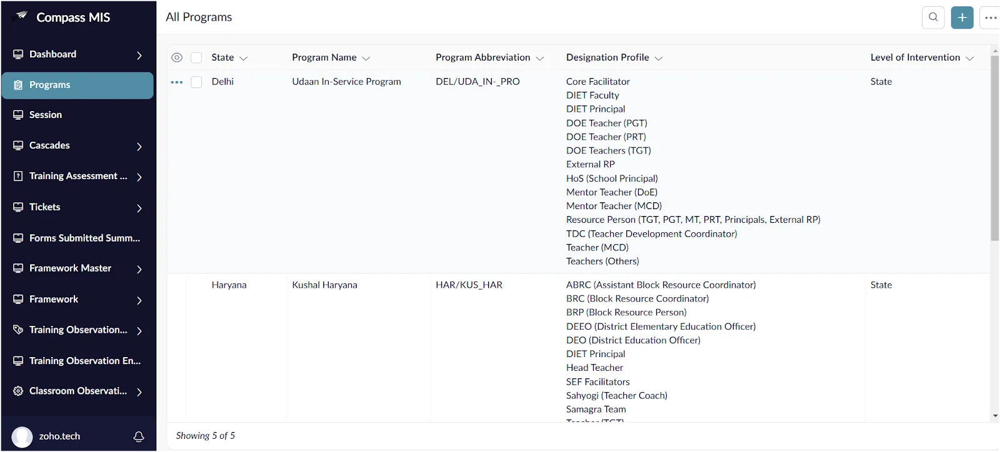

*Image 2: State-wise all programs data*

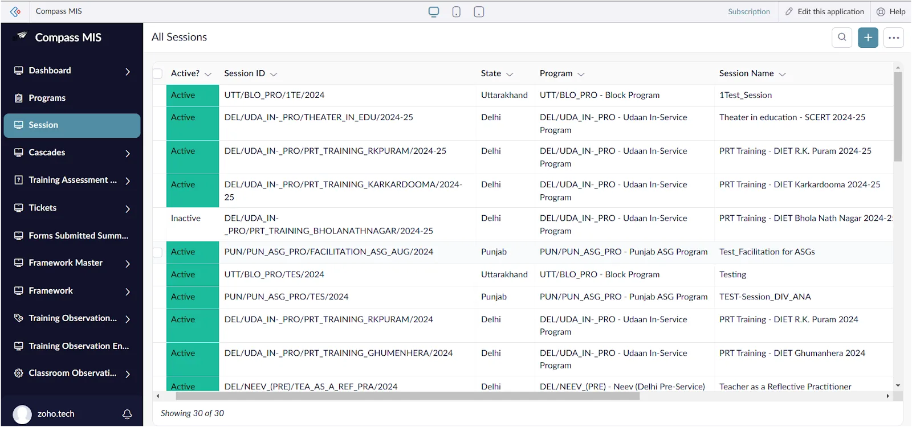

*Image 3: All session data*

**Cascading flow:** The MIS follows a step-by-step flow where senior trainers guide mid-level facilitators, who then train teachers on the ground. This clear structure helps SEF manage large-scale training smoothly and track progress at every level from state to school. Refer image 4 and 5)

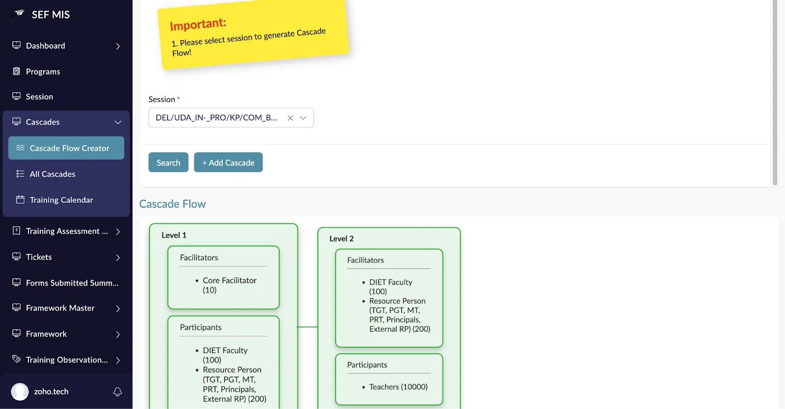

*Image 4: Cascade flow*

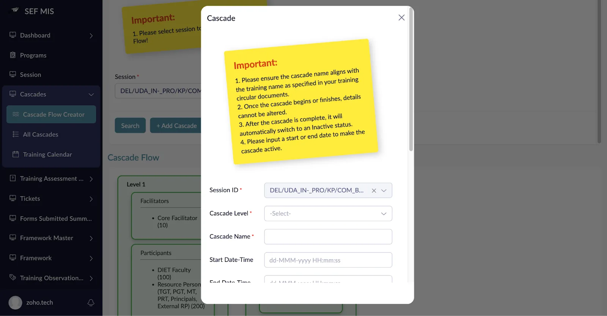

*Image 5: Cascade flow creator*

#### **Teacher Training Assessment:**

Once the training begins, facilitators will collect two key data points from teachers: one before the session, referred to as the "Entry Ticket," and one after the session, known as the "Exit Ticket"(image 6). These data points are captured through forms, allowing teachers to select their preferred regional language (image 7). The form is converted into a QR code for easy access (image 8), and facilitators can also configure a set of predefined questions.

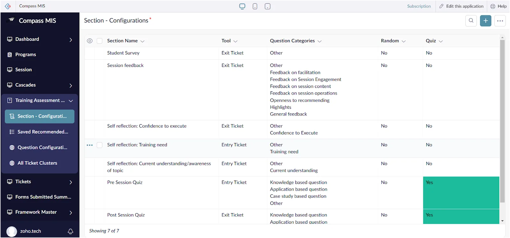

*Image 6: Teacher training assessment - entry ticket and exit ticket data*

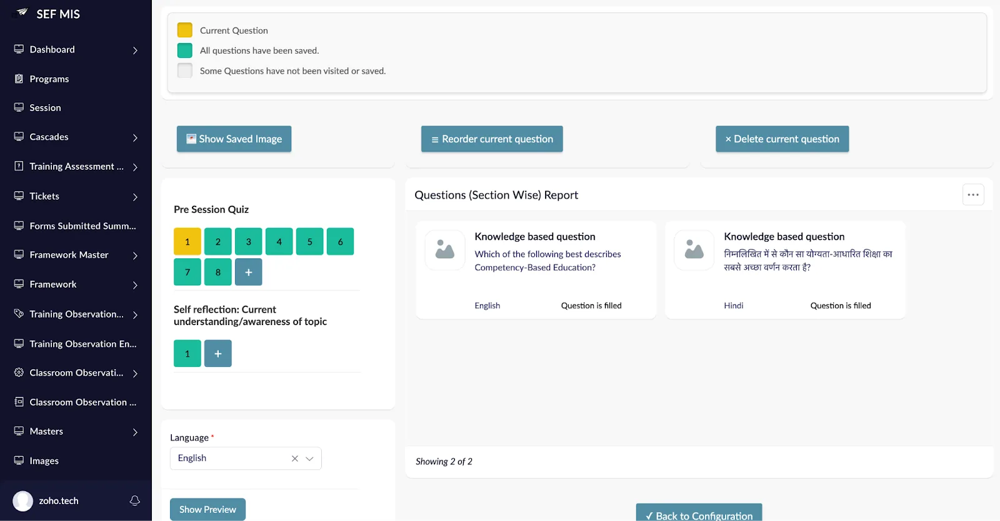

*Image 7 : Multiple language question configuration*

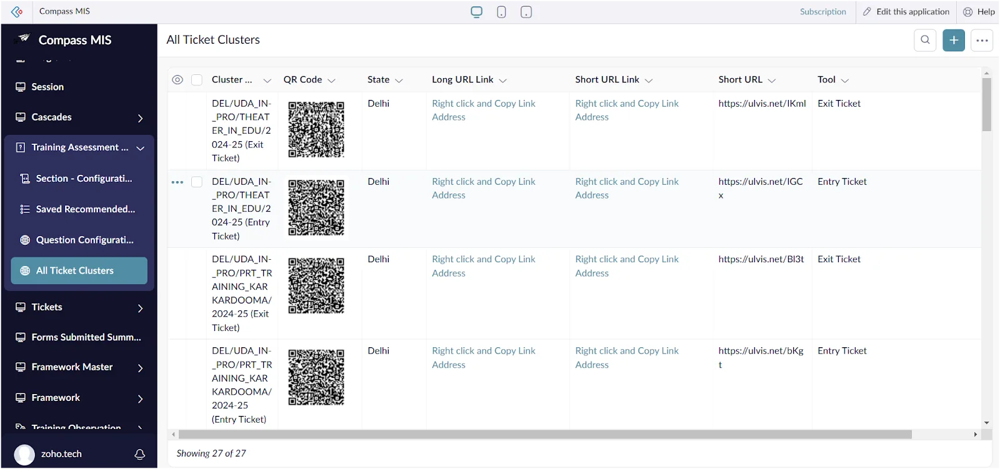

*Image 8: All tickets data*

#### Real Time Form Submission Summary:

Through this summary, we can track form entries through state, session date, and session ID. This feature allows users to monitor submissions that haven't been completed, ensuring data accuracy and completeness across all regions (image 9).

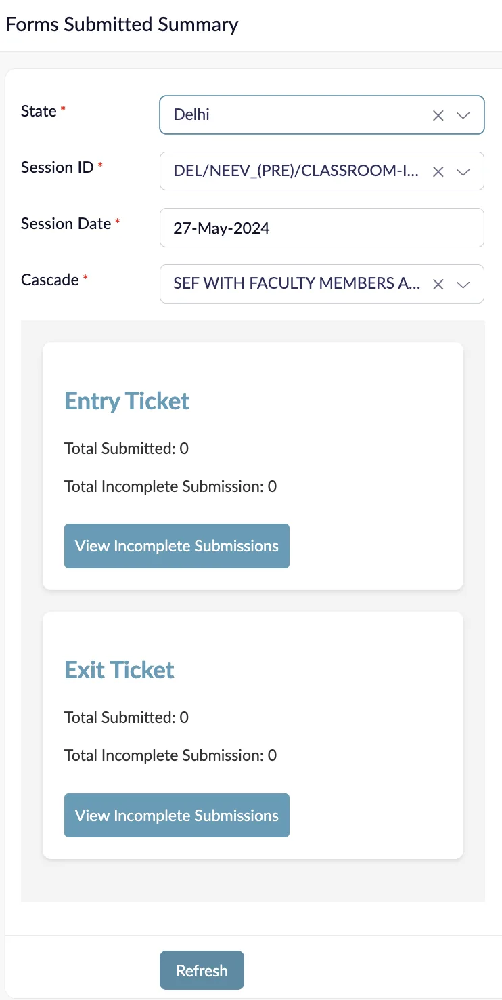

Image 9: Form submission summary data

#### Training Observation:

In this module, data is collected from facilitators and teachers regarding their overall experience of the session and summarised in a report to scale the program outcomes (image 10). Data collected includes program facilitation, session content, session operations, facilitator actions, and teachers engagement throughout the session.

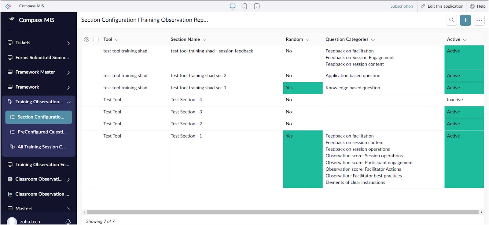

*Image 10: Training observation report*

#### **Classroom Observation:**

After the training is completed, the SEF team or respective government officials visit the schools to monitor how teachers effectively apply the strategies learned during the sessions. This includes observing how teachers assess students' conceptual understanding, clarify students' doubts and explain concepts using multiple and diverse methods. 

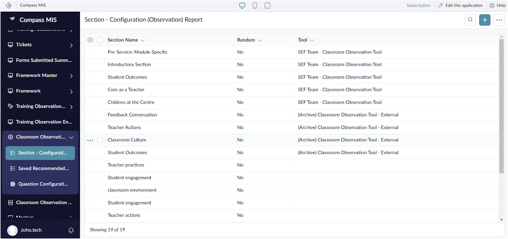

*Image 11: Classroom observation*

This data is collected on the platform to evaluate the overall performance of the facilitators, and teachers (image 11 and 12). This approach reduces manual data entry, minimizes errors, and ensures accurate data on program outcomes.

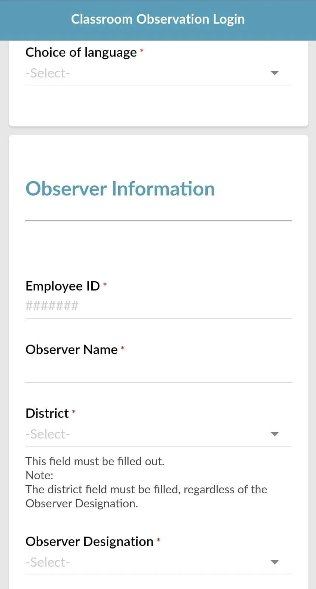

*Image 12: Mobile view of classroom observer module*

####

#### User Management:

Each program has multiple sessions, so accessing data for all programs is a big challenge. To overcome this, the user management module helps define a role-based approval process. In this process, roles are categorized under the Learning & Insights Team, Data Team (which manages data processing and analytics), Internal Team, and External Stakeholders (Government), ensuring secure data access across the team.

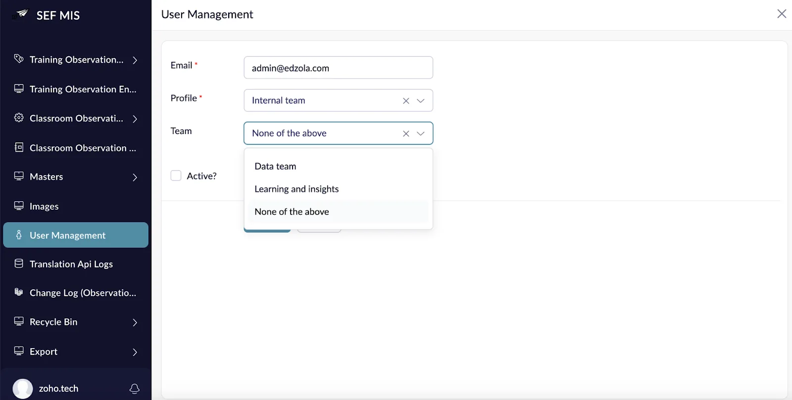

*Image 13: User management module*

#### **Log of Changes:**

The Change Log feature automatically tracks any changes made to form configurations, such as updates to fields or questions. It creates a clear record of changes, ensuring accountability and traceability. Teams can monitor these updates over time, helping maintain data accuracy and improve oversight during program management.

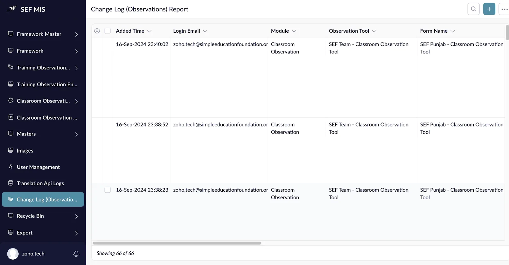

*Image 14: Log changes report*

#### **Recycle bin:**

The system includes a Recycle Bin functionality, allowing users to recover any deleted responses. This ensures data integrity by preventing the accidental loss of important information. With this feature, users can easily restore deleted data, providing an added layer of security and safeguarding against unintended deletions.

#### **Dashboards and Reports:**

The dashboard and report module helps track and view the overall status of each program at the state level, enabling better decision-making through real-time insights (images 15-19). Through these dashboards, government officials can identify the shortcomings of the training system and improve the quality of education.

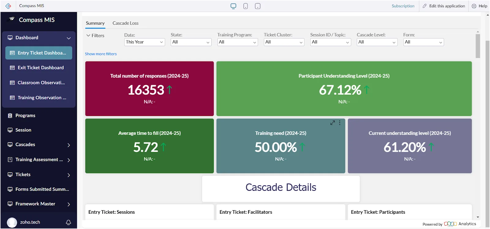

*Image 15: Overall entry ticket dashboards*

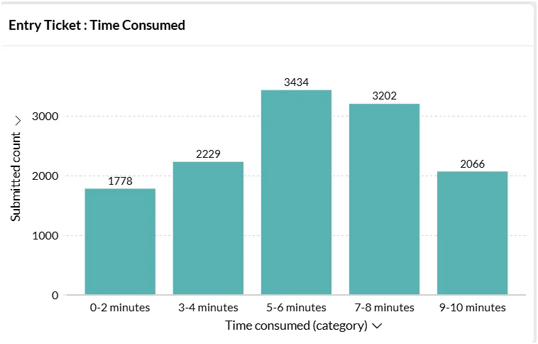

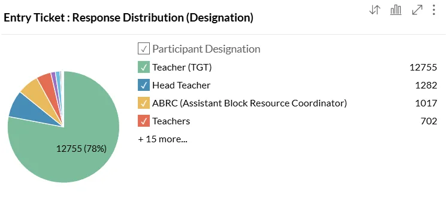

*Image 16: Overall time consumed for filling the form*

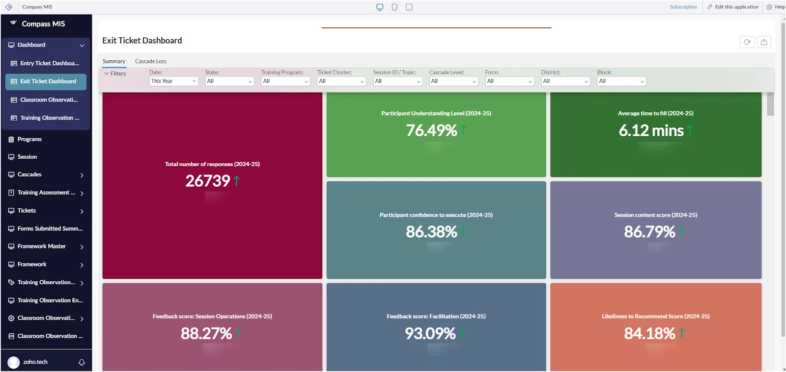

*Image 17: Overall exit ticket dashboard*

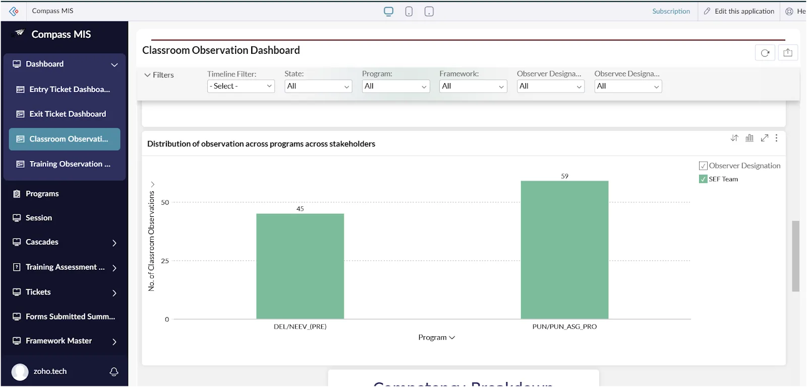

*Image 18: Overall classroom observation dashboard*

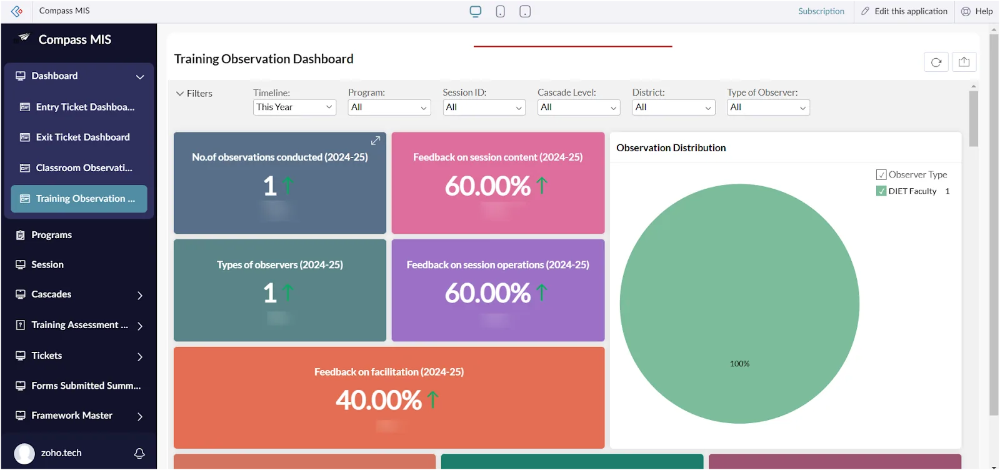

*Image 19: Overall training observation dashboard*

## 5.Results

|  |
| --- |
| **Teacher Training Impact:** The system **supported training for 20,000 teachers**, with over **2 million interactions within the first week** of piloting in new states.  **Efficiency Improvement:** The MIS increased operational efficiency by automating data management, making it **twice as efficient** as the previous setup using Google Sheets and Google Forms.  **Centralized Data Management:** The MIS created a single platform for all program data, making it **easier to access, manage, and analyze** for better decision-making.  **Scalability:** The system allowed **smooth expansion across multiple states**, helping SEF manage its large-scale program with real-time insights and automated workflows. |

## 6. Use Cases to highlight the benefits

#### 1. User-Level Insights

**Time saved on operational tasks**

Government teachers and field teams often spend long hours filling induction and training-related forms. With Compass MIS, this time has significantly reduced due to cleaner form logic, autofill features, and mobile-friendly design. Users can now complete essential processes quickly, allowing them to focus more on core academic work.

**Increased dashboard adoption by government users**

Simple, intuitive dashboards have encouraged higher usage among government stakeholders at district and state levels. Officials now rely on real-time insights such as attendance, training coverage, and performance trends to guide decisions, monitor progress, and plan next steps.

**High user engagement at scale**

Over the years, Compass MIS has supported some of the largest in-service training programmes, with thousands of teachers engaging through public forms. At peak periods, it has served the highest number of concurrent users across SEF programmes, demonstrating both the system’s reliability and acceptance among diverse user groups.

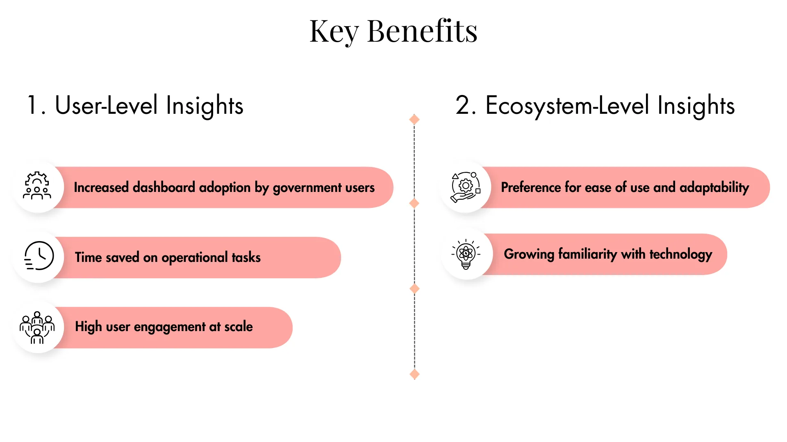

#### 2. Ecosystem-Level Insights

**Growing familiarity with technology**

Across states, users from teachers to SCERT officials have demonstrated increasing comfort with digital systems. Compass MIS has been particularly effective because it builds on this familiarity without assuming advanced technical skills.

**Preference for ease of use and adaptability**

The education ecosystem strongly values tools that are simple, stable, and adaptable. Compass MIS’s flexible form engine, multilingual access, and clean layouts have made it easier for programmes to scale without redesigning systems from scratch.

## 7. Tips for Non-Profit or Other Practitioners (Collective)

**1.** **Co-design, don’t outsource.**Treat your vendor as a design partner, not just a developer. Involve them early in understanding the problem and context, not only when the tech build begins.

**2.** **Align on intent before features.** Spend time agreeing on why the system is being built and what change it should enable. This helps prevent over-engineering and keeps the focus on outcomes, not outputs.

**3.** **Define roles and language clearly.**[Tech](http://clearly.Tech) and program teams often think differently. Establish a shared vocabulary, timelines, and review rhythm early to avoid confusion during build cycles.

**4.** **Design for use, not just function.**Prioritise the user’s journey how government partners, coaches, and teachers will actually use the system over technical sophistication. A simpler tool that’s used is better than a complex one that’s ignored.

**5.** **Build in feedback loops.**Set up short review cycles with users and the developer. Early, small feedback prevents late, large rework.

**6.** **Keep documentation live.**Maintain a running document of design decisions, assumptions, and dependencies. This becomes invaluable as teams or contexts change.

**7.** **Plan for evolution.**Accept that the first version will not be perfect. Design for modularity so new use-cases, data points, or states can be added without starting over.

## 8. What does Mainak Roy, Co-Founder & CEO of SEF, say about us?

[Video: EdZola - Zoho Creator | Simple Education Foundation case study!](https://youtu.be/H8rozxUrmmg)

## **9. Key Learnings: Building Tech for Government at Scale**

Through the design and deployment of Compass MIS, SEF and EdZola identified important lessons that can guide similar GovTech initiatives:

- **Deep system understanding is essential** Effective solutions are built by studying both official government structures and the realities of on-ground processes. Listening to field teams is just as important as aligning with policy.
- **Modular design enables scalability** A flexible, modular system allows different states to adapt features to their own governance structures without starting from scratch. This reduces development cycles and accelerates adoption.
- **GovTech adoption in India is accelerating** With governments increasingly open to digital solutions, there is immense potential for technology to transform teacher professional development and create lasting impact.

## 10. Next Steps: Expanding to More States

Looking ahead, SEF and EdZola are committed to expanding Compass MIS across India to strengthen teacher training and professional development nationwide. The upcoming priorities include:

- **Scaling to additional states** Extend Compass MIS to new geographies, enabling state governments to adopt structured monitoring and evaluation systems for their teacher training programs.
- **Empowering every teacher** Ensure that teachers across India have access to high-quality professional development, supported by data-driven insights and real-time feedback loops.

## Conclusion:

Behind every dashboard and form in Compass MIS is a teacher trying to improve their classroom, a facilitator learning to engage better, and a policymaker striving for better outcomes. The system brings all of them onto the same page, making training not just a requirement but a meaningful process. That’s the shift SEF and EdZola have created a shift from paperwork to purpose, from scattered data to collective impact.

[Connect with us](https://www.edzola.com/contact)

EDG Contributors :
*SEF : Vaibhav Mishra | Mainak Roy | Vidhi Bhardwaj | Abdul Razzaq |*
*EdZola : Rahul Singh | Vishwa Poojitha | Akshay V |*
