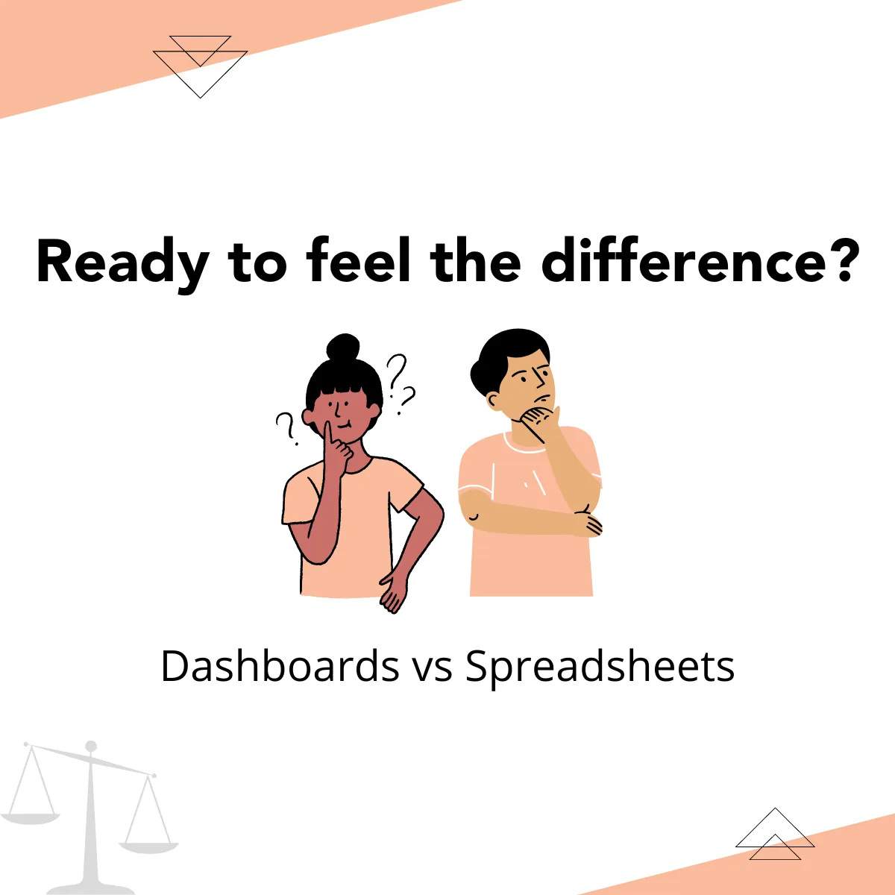
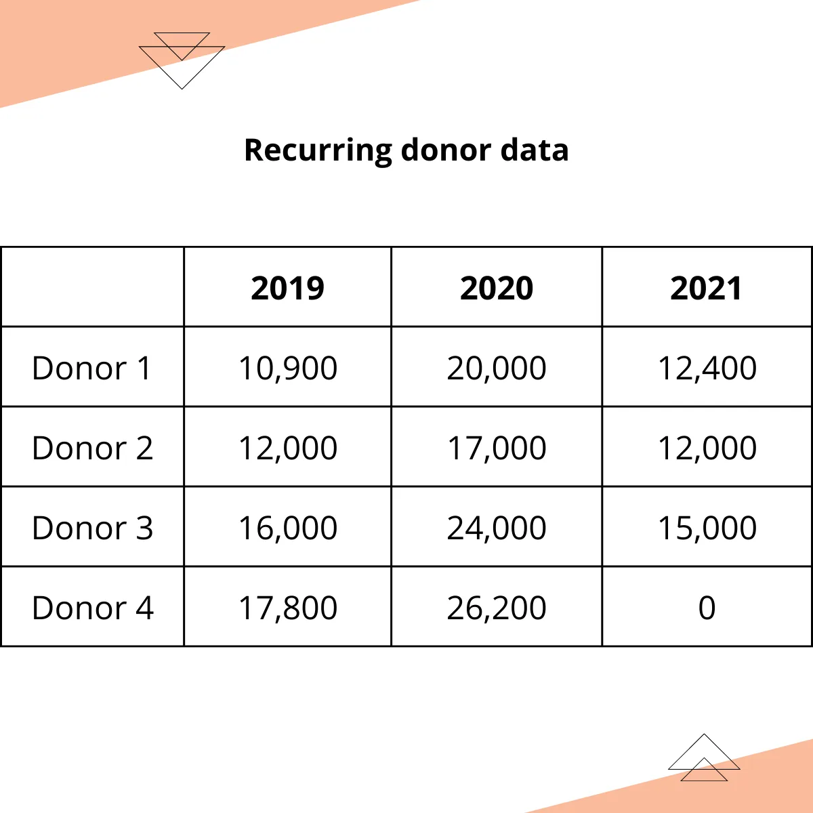
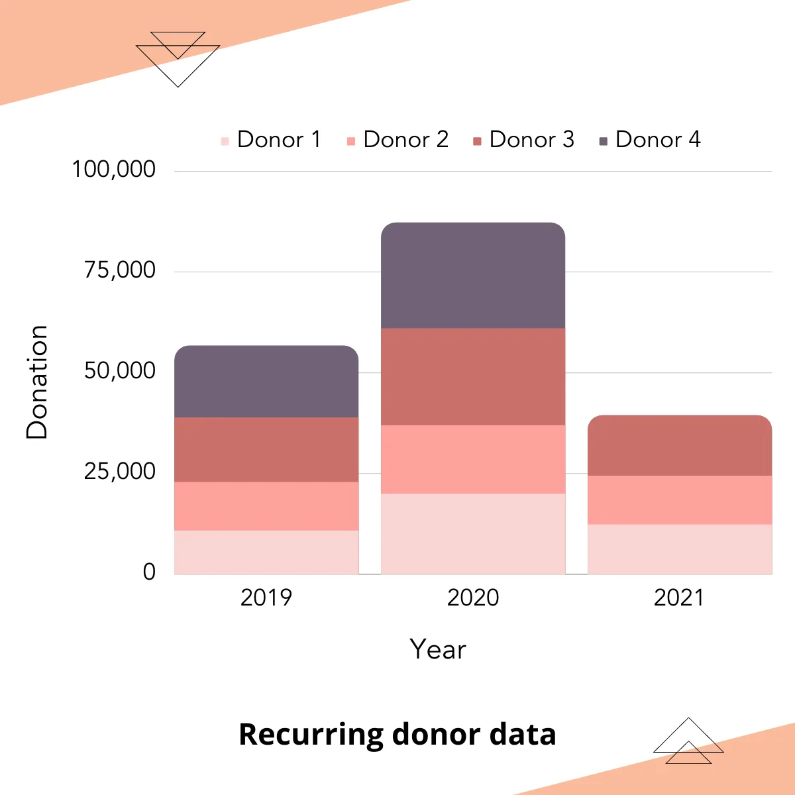
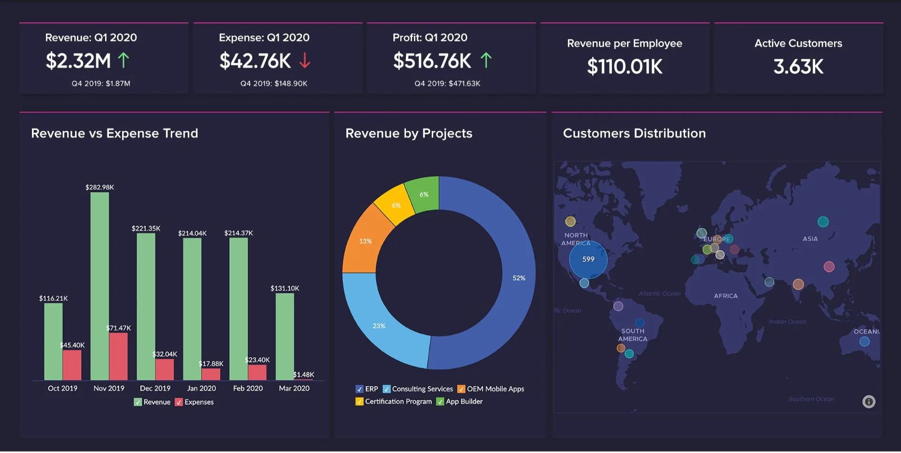
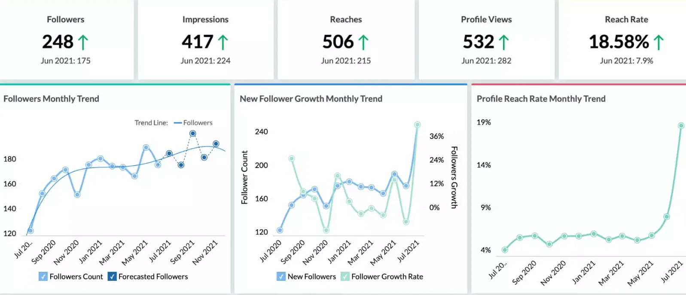
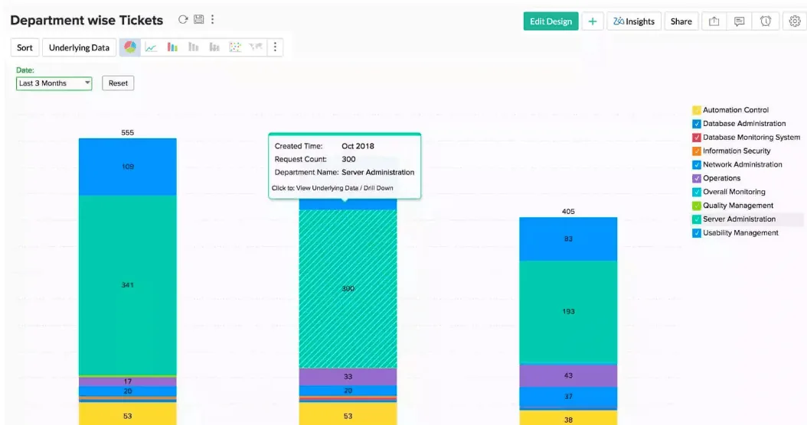
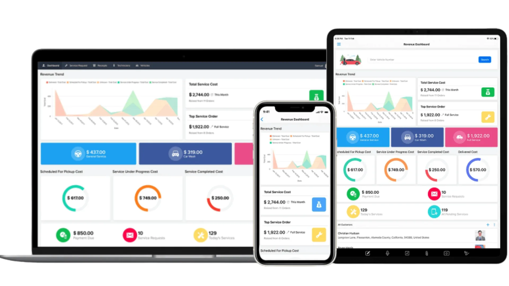
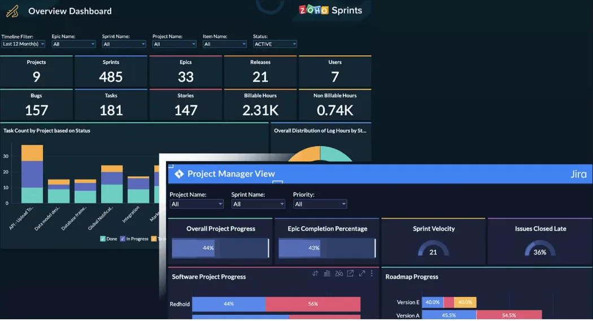

You all would have heard that dashboards can help you get insights from tremendous amounts of data and in turn, data-driven decisions can help you reach your goals faster. We want to make you feel, see and understand the difference that dashboards can make!

You can find below a really small set of data on 4 recurring donors for 3 years. But don’t judge this data by its size, the information that’s hidden under is huge!

Before we flush out the information, try to answer this easy question using both the table and bar graph. Which year has higher donation rates?

First, take a look at the table -

Scanned all cells to find out the answer? A bit difficult when compared to the below graph, isn't it?

Got the answer? It’s 2020. We’re sure you felt the difference, dashboards give you information without asking you to delve into the details. Just a glance is enough.

We’re sure this illustration is just a drop in the ocean of data. Your database will have 100s of rows with multiple columns! This is where visualization becomes inevitable for analysis. Imagine if you could not only view but also understand all those data in seconds!

**Let's just take the above data to reveal the hidden insights.**

- Let's start with the question that we asked - the relatively higher donation rates in 2020. It asks you to think whether it's due to external or internal factors.

If it’s because of internal factors such as your **new campaigns, new ways of marketing, or your new volunteers**, you can now understand what you did right. So, that action should be continued or done on an even greater scale to improve your Non-Profit growth.

- LYBUNT (Last Year But Unfortunately Not This Year) reports can show you lapsed donors and can help you take necessary actions.

For example, Donor 4 has stopped donating. This is a piece of alarming information and action should be taken ASAP.

They may have personal reasons, but you must check if the reason sprouts because of something from your side. As a result, you may **improve your communications, send reports to keep them motivated** or do anything to sort such issues out.

- Combining this dashboard’s data with the data on how you acquired these recurrent donors, you can also discover the popular source from which you got these recurring donors. And voila! That’s your most valuable source and you can concentrate your efforts there more to improve.

This is not all! With huge data sitting in your database, you can derive many more insights that could help you determine your next actions. For example, you can see

- Top 5 donors
- Top 5 recurring donors
- Campaign wise donations

So, the takeaway is that dashboards are truly effective when it comes to making data-driven decisions. There are many effective and helpful tools like Zoho Creator, Zoho Analytics, Power BI, Tableau, and more.

**Here are some beautiful dashboard samples from Zoho Analytics**

Great overview

Build dashboards for different sources (Eg. Social Media - Instagram)

Responsive, interactive and dynamic dashboards for more insights

Use it anywhere

Aggregate dashboards for different users

If you're ready to build and use specific dashboards for your Non-Profit, we can help you out

[Tell us your needs](https://www.edzola.com/contact)

But before implementing it, if you want to learn more, do watch our comprehensive webinar on data stack management for Non-Profits and learn more about dashboards!

[Video: https://www.youtube.com/watch?v=KgNaNAJ0KS4](https://www.youtube.com/watch?v=KgNaNAJ0KS4)
