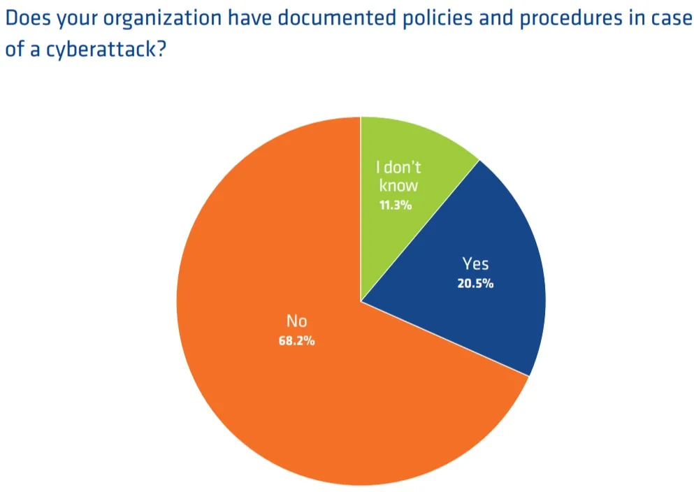

Nonprofits face unique challenges in managing data privacy and cybersecurity. Entrusted with sensitive information from donors, beneficiaries, and partners, these organizations must navigate a complex web of risks and responsibilities. Balancing the need to harness digital tools for greater impact, while safeguarding against data breaches and cyber threats, is no small feat. This Blog aims to shed light on these critical issues, offering insights and strategies to help nonprofits protect their data and maintain the trust of those they serve.

## Understanding NGOs and Their Data

NGOs organizations are unique in their mission-driven approach, often dealing with sensitive data like donor details, financial records, and confidential beneficiary information. This data is not just operational; it's the core of building trust and integrity in the NGO world. Understanding the type of data collected, how it's used, and why it's essential sets the stage for effective data management and protection strategies.

## **Effective Privacy Policies in Your Nonprofit**

Creating and implementing effective privacy policies is a cornerstone in managing a nonprofit’s data. This includes:

- **Donor Privacy:** Safeguarding donor information is critical. Transparency in how donor data is used and stored can bolster donor trust.
- **Data Security:** Implementing strong security measures to protect sensitive data from unauthorized access.
- **Building a Sustainable and Confident Reputation:** By respecting data privacy, nonprofits can enhance their reputation, which in turn, supports long-term donor relationships.
- **Mitigating Risks and Enhancing Security:** Regular risk assessments can help identify vulnerabilities, leading to stronger security measures.

## **Current State of Cybersecurity in Nonprofits**

Despite their reliance on data, many nonprofits lag in cybersecurity preparedness. According to [Nten](https://word.nten.org/wp-content/uploads/2018/11/Cybersecurityreport2018NTEN.pdf) [Survey 68% lacking documented cybersecurity procedures for breach events,](https://word.nten.org/wp-content/uploads/2018/11/Cybersecurityreport2018NTEN.pdf) these organizations face heightened risks of data breaches and the associated fallout.

## **Risks and Consequences of Cybersecurity Breaches**

Cybersecurity breaches can have far-reaching consequences:

- **Confidential Information Exposure:** Donors expect their data to be confidential. A breach could severely damage donor trust and relationships.
- **Financial Repercussions:** Breaches often come with significant financial losses, either through the breach itself or due to subsequent legal battles and fines.
- **Legal Consequences:** Nonprofits must comply with various data protection laws. Noncompliance can lead to legal challenges and penalties.

## **The Importance of Cybersecurity for NGOS**

Data protection is not just a legal obligation but a critical component of an organization's ethical responsibility. Effective cybersecurity safeguards the mission, protects beneficiaries, and upholds the nonprofit's integrity.

A breach can lead to loss of donor trust, financial damages, and jeopardized beneficiary privacy, undermining the NGO's mission and credibility. Therefore, investing in robust cybersecurity measures is not just a technical necessity, but a fundamental aspect of an NGO's responsibility to its stakeholders, ensuring the integrity and security of its digital presence and operations.

## **Outdated Systems**

The persistence of outdated systems is a significant cybersecurity concern. These systems often harbor unpatched vulnerabilities, making them easy targets for cyber attacks. Not only do they pose severe risks in terms of **data breaches, but they also often fall short of meeting modern data protection standards, leading to potential legal and compliance issues.** The inefficiency of outdated systems can hamper operational effectiveness, and ironically, the cost of maintaining these antiquated systems often exceeds the investment required for upgrades. The risk of data loss due to system failures is a constant threat, affecting both the organization’s operational capacity and the integrity of crucial donor and beneficiary information.

Explore More: [How to Overcome Legacy System Challenges with a Centralized Data Management Platform - Zoho Creator](https://www.edzola.com/post/how-to-overcome-legacy-system-challenges-with-a-centralized-data-management-platform-zoho-creator)

Addressing this challenge requires NGOs to conduct r**egular technology audits, prioritize essential system upgrades, and allocate budget specifically for technological enhancements.** Seeking partnerships and expertise from tech companies that offer programs or discounts to nonprofits can make these updates more feasible. Ultimately, upgrading technology infrastructure in nonprofits is not just about keeping pace with digital advancements; it’s a critical step in fortifying cybersecurity measures, ensuring compliance, and enhancing overall operational efficiency in serving their mission.

## **Lack of Training**

NGOs often overlook cybersecurity training, but it’s really important. Staff and volunteers might accidentally cause security problems if they’re not trained about things like suspicious emails and safe password habits. Since cyber-attacks are becoming more common and smarter, especially against groups like nonprofits, it’s crucial for everyone in the organization to understand cybersecurity.

NGOs should make cybersecurity training a key part of their plan. They need to teach everyone how to spot and handle online threats. Keeping everyone updated on new cyber threats is also important. Good training doesn’t just prevent problems; it makes everyone a part of keeping the organization’s data safe. This helps protect the nonprofit’s good name and the trust of the people they help and those who donate to them.

## **Improper Security Measures**

NGOs often have basic or old security measures, which can be a big problem. They might not have enough money or the right knowledge to get better security, and this makes it easier for hackers to attack them. These attacks can cause a lot of trouble, like losing important data, facing legal issues, or losing the trust of people who donate money. It’s really important for nonprofits to improve their cybersecurity.

They should use better security tools and keep updating their methods to stay safe. Sometimes, getting help from outside experts can make a big difference. Stronger security helps keep all the important information safe, ensures the nonprofit runs smoothly, and keeps the trust of the people who support them.

## **Steps Nonprofits Can Take to Improve Cybersecurity**

Nonprofits can bolster their cybersecurity through:

- **Regular Updates:** Keeping all systems and software updated to mitigate vulnerabilities.
- **Risk Assessment:** Regularly assessing the organization's vulnerability to cyber threats helps identify and mitigate risks before they become breaches.
- **Cybersecurity Awareness Training:** Providing regular training sessions to staff to ensure they are aware of the latest cybersecurity threats and best practices.
- **Implementing Strong Security Protocols**: This includes secure data storage and encryption, regular software updates, and strong password policies.
- **Developing a Response Plan:** Having a plan in place for cybersecurity incidents is crucial for a rapid and effective response.

## **Cybersecurity is a must for NGO's**

Cybersecurity transcends being a mere technological concern; it becomes a cornerstone of trust, credibility, and operational integrity for nonprofit organizations. Cyber threats are evolving and becoming more sophisticated, and nonprofits, with their unique vulnerabilities, cannot afford to overlook this critical aspect.

- **Protecting Sensitive Data:** NGOs often handle sensitive information, including donor details, financial records, and beneficiary information. A breach in cybersecurity can lead to unauthorized access to this data, compromising the privacy and security of those the organization serves.
- **Maintaining Donor Trust:** Donors entrust NGOs with not only their money but also their personal data. A breach can severely damage this trust, leading to a loss of donors, which in turn impacts the organization’s ability to operate and serve its mission.
- **Compliance and Legal Obligations:** Many countries have stringent data protection laws, such as the GDPR in the European Union or the CCPA in California. NGOs must comply with these regulations to avoid legal ramifications and hefty fines that could be devastating for organizations with limited resources.
- **Financial Stability and Reputation:** Cyber incidents often come with high costs - from addressing the breach itself to handling the aftermath in terms of legal fees, penalties, and lost donations. The damage to the organization’s reputation can be long-lasting and far more difficult to repair.
- **Dependency On Digital Tools:** With increasing reliance on digital tools for fundraising, communication, and operations, the risk of cyber threats naturally increases. The interconnectedness of these digital systems means that a breach in one area can quickly spread, impacting various facets of the nonprofit’s operations.

For NGOs, navigating the complexities of data privacy and cybersecurity is vital. It's not just about protecting data; it’s about upholding trust, integrity, and the very mission that defines the organization. By acknowledging the importance of cybersecurity and taking decisive steps to address it, nonprofits can continue to thrive in a digital world, free from the fear of data breaches and their consequences.

## Getting Started with EdZola

> ***Let's innovate with purpose and use technology as a force for good.***

Every nonprofit is unique, and one size does not fit all when it comes to solutions. At [EdZola](https://www.edzola.com/), we specialize in creating customized solutions that align with your organization’s specific goals and needs. Our team works closely with you to identify challenges, develop a tailored plan, and implement the right tools to maximize your impact.

[Let's Connect](https://www.edzola.com/contact)
