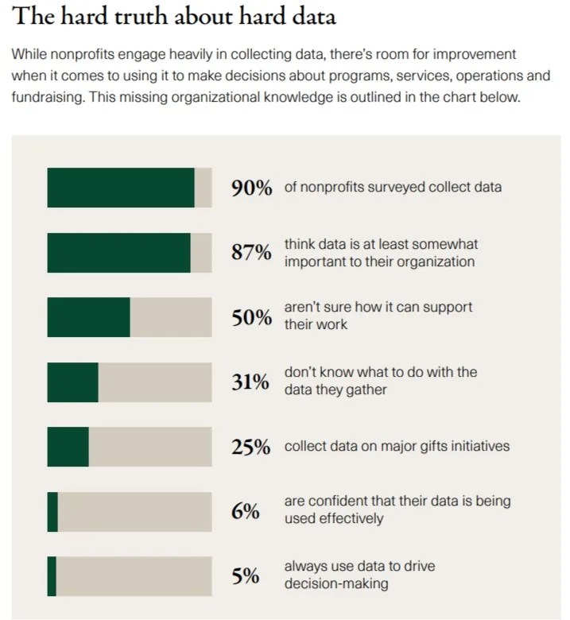

In the fast-paced world of nonprofit organizations, making informed decisions is crucial to ensuring effective impact measurement. Skilling NGOs, in particular, rely on data-driven decision making to drive their initiatives towards success. By harnessing the power of Management Information Systems (MIS), these organizations can transform their impact measurement strategies, ultimately delivering meaningful change to communities in need.

## **Understanding the Concept of Data-Driven Decision Making**

Before delving into the transformative potential of MIS for Skilling NGOs, let's first understand the concept of data-driven decision making. Simply put, data-driven decision making involves using objective data and analysis to inform and guide organizational strategies and actions. It enables NGOs to **move away from subjective decision-making** processes and instead rely on **concrete facts and evidenc**e to drive their initiatives forward.

### The Importance of Data in Decision Making

Data plays a vital role in decision making for Skilling NGOs. It provides the necessary insights for organizations to understand the impact of their programs, identify areas for improvement, and adapt their strategies accordingly. By relying on data, NGOs can make informed decisions that are aligned with their overarching goals and objectives.

### The Role of Data in NGOs

In addition to decision making, data plays a critical role in various aspects of NGO operations. For instance, data can help NGOs monitor and evaluate their programs, measure their success, and communicate their impact to stakeholders. It enables organizations to showcase their achievements, foster transparency and accountability, and attract crucial support from funders and donors.

Source: EveryAction and Nonprofit Hub

## **The Intersection of MIS and NGOs**

Now that we have established the importance of data in decision making, let's explore the intersection of MIS and NGOs. MIS, or Management Information Systems, are tools and processes that collect, store, and analyze data to support organizational decision making and performance monitoring.

**Uncover additional insights:** [**Building Efficient Non-Profits with MIS: A Starter Guide**](https://www.edzola.com/post/building-efficient-non-profits-with-mis-a-starter-guide)

### Defining MIS in the Context of NGOs

In the context of NGOs, MIS involves the implementation of information systems that streamline data collection, management, and analysis. These systems enable Skilling NGOs to gather valuable insights, track program outcomes, and evaluate their impact effectively. With MIS, NGOs can obtain real-time data, which improves their ability to make timely and informed decisions.

### The Potential of MIS for NGOs

The potential of MIS for NGOs is immense. These systems allow organizations to minimize manual data entry, reduce the risk of human error, and automate the generation of reports. This streamlined approach saves time and resources, empowering NGOs to dedicate more energy to their core mission - making a lasting difference in the lives of those they serve.

## **Transforming Impact Measurement through MIS**

Now, let's dive into how MIS can transform impact measurement for Skilling NGOs. The current state of impact measurement in NGOs often relies on time-consuming and resource-intensive processes. However, with the implementation of MIS, organizations can revolutionize their approach to measuring and evaluating the outcomes of their programs.

'Nonprofits have consistently been challenged with measuring their impact," mentioned Lauren Woodman, CEO of [NetHope](https://nethope.org/). And one of the widely implemented solution for this is implementing Information Management Systems.

### The Current State of Impact Measurement in NGOs

Currently, impact measurement in NGOs primarily relies on traditional evaluation methods, such as surveys and interviews. While these methods provide valuable insights, they are often limited in scope and can be subjective. MIS provides NGOs with the tools to collect comprehensive and objective data, allowing for a more holistic evaluation of their impact.

### The Future of Impact Measurement with MIS

The future of impact measurement lies in the integration of MIS into NGO operations. By harnessing the power of technology and data analytics, organizations can create a more comprehensive and accurate picture of their impact. Furthermore, MIS enables NGOs to adapt their strategies in real-time, based on emerging trends and changing community needs.

## **The Process of Implementing MIS in NGOs**

While the potential benefits of MIS for NGOs are clear, implementing these systems can pose challenges. Here, we will explore the steps to successfully integrate MIS into Skilling NGOs, along with common challenges and their solutions.

### Steps to Integrate MIS into NGO Operations

1. **Evaluate existing data systems and identify gaps:** Before implementing MIS, NGOs should assess their current data systems and identify areas for improvement.
2. **Define goals and objectives:** Clearly define the goals and objectives that the MIS implementation aims to achieve.
3. **Select and implement the right MIS tools:** Choose an MIS tool that best fits the organization's needs and implement it effectively.
4. **Train and educate staff:** Provide adequate training and education to staff members to ensure they can effectively use the MIS tool.
5. **Monitor and evaluate:** Continuously monitor and evaluate the performance of the MIS system to ensure its effectiveness and make necessary adjustments.

### Challenges and Solutions in MIS Implementation

Implementing MIS in NGOs may face challenges such as lack of technical expertise, resistance to change, and financial constraints. To overcome these challenges, NGOs can seek external support, provide training to staff, and gradually phase in the implementation to minimize disruption to day-to-day operations.

## **Evaluating the Effectiveness of Data-Driven Decision Making**

Once an MIS system is in place, evaluating the effectiveness of data-driven decision making becomes paramount. Key Performance Indicators (KPIs) play a crucial role in this evaluation process, as they provide measurable benchmarks for assessing the impact of decisions made based on data.

### Key Performance Indicators for Data-Driven Decisions

### Measuring the Success of MIS in NGOs

To measure the success of MIS implementation, NGOs can conduct surveys and gather feedback from stakeholders. Regular reporting and analysis of collected data can provide insights into the effectiveness of data-driven decision making and showcase the positive impact of MIS on transparency and accountability.

As the demand for transparency and accountability in the nonprofit sector grows, NGOs must adapt and embrace data-driven decision making. By implementing MIS and leveraging its potential, Skilling NGOs can transform their impact measurement strategies, engage stakeholders effectively, and ultimately make a lasting difference in the communities they serve.

## Getting Started with EdZola

> ***Let's innovate with purpose and use technology as a force for good.***

Every nonprofit is unique, and one size does not fit all when it comes to data solutions. At [EdZola](https://www.edzola.com/), we specialize in creating customized solutions that align with your organization’s specific goals and needs. Our team works closely with you to identify pain points, develop a tailored plan, and implement the right tools to maximize your impact.

[Let's Connect](https://www.edzola.com/contact)
