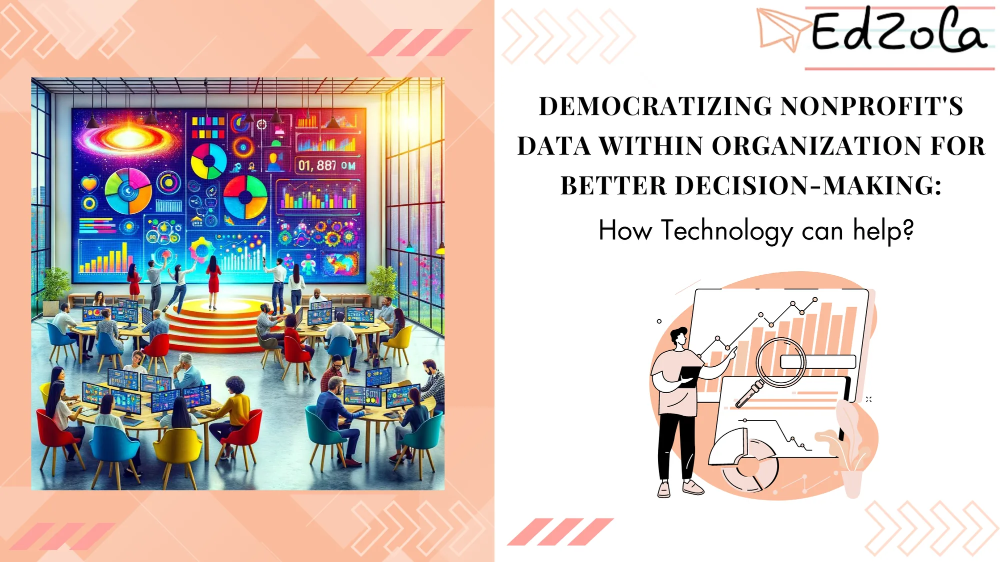

In a landscape where effective use of data is key to success, nonprofit organizations face unique challenges. Nonprofits often find themselves navigating through a maze of unstructured data, grappling with limited resources. Enter the hero of our story: Technology. Imagine a world where data within a nonprofit isn't just numbers in a spreadsheet but a beacon guiding every decision, big and small. In this blog, we'll embark on an enlightening journey to uncover how technology is not just a tool but a catalyst in democratizing data within nonprofits.

## Understanding the Concept of Data Democratization

Data democratization refers to the process of making data accessible and usable by all individuals within an organization. In the context of nonprofits, this means **ensuring that all staff members, volunteers, and stakeholders have the ability to access, analyze, and interpret data to inform decision-making and drive organizational growth.**

### The Importance of Data Democratization in Nonprofits

In the realm of nonprofits, data democratization plays a crucial role in facilitating effective decision-making and achieving the organization's goals. By making data readily available to all individuals involved in the organization, nonprofits ensure that everyone is equipped with the necessary information to make informed decisions and drive positive change.

> Data democratization fosters a culture of transparency, collaboration, and accountability within nonprofits.

When all stakeholders have access to data, it promotes open dialogue, encourages knowledge sharing, and enables collective problem-solving.

### Key Principles of Data Democratization

Implementing data democratization requires adhering to a set of key principles:

1. **Promoting Accessibility:** Nonprofits must ensure that data is easily accessible to all stakeholders, regardless of their role or level of technical expertise.
2. **Encouraging Data Literacy:** Organizations should invest in training and development programs to enhance the data literacy skills of their staff members, empowering them to effectively analyze and interpret data.
3. **Fostering Collaboration:** Nonprofits should create a collaborative environment where individuals are encouraged to share insights and leverage collective intelligence.
4. **Ensuring Data Governance:** Organizations must establish robust data governance policies to ensure data quality, security, and compliance.

One of the key benefits of data democratization in nonprofits is the ability to identify trends and patterns that can inform strategic decision-making. When data is accessible to all individuals, it allows for a more comprehensive analysis of the organization's operations, programs, and impact. This enables nonprofits to identify areas of improvement, optimize resource allocation, and align their efforts with their mission and goals.

Data democratization also empowers staff members and volunteers to take ownership of their work and contribute to the organization's success. When individuals have access to data and are encouraged to analyze and interpret it, they become active participants in the decision-making process. This not only enhances their sense of engagement and fulfillment but also leads to more effective and impactful outcomes for the organization.

## The Role of Technology in Data Democratization

Technology plays a pivotal role in democratizing data within nonprofit organizations. By **leveraging technological tools and solutions, nonprofits can empower their teams to access, analyze, and interpret data more effectively, ultimately driving informed decision-making and strategic planning.**

Dig Deeper: [Leveraging Zoho for Non-Profit Success: An Overview of Tools and Use Cases](https://www.edzola.com/post/leveraging-zoho-for-non-profit-success-an-overview-of-tools-and-use-cases)

In addition to facilitating data access and analysis, technology also enhances data security and privacy within nonprofit organizations. Advanced encryption methods and secure data storage solutions help safeguard sensitive information, ensuring compliance with data protection regulations and maintaining the trust of stakeholders.

### How Technology Facilitates Data Access

Let's delve deeper into each of these technological solutions and how they are changing the game for nonprofit organizations:

### 1. Cloud Computing: **Expanding Access and Collaboration**

Advancements in technology, such as **cloud computing and online data platforms, have made it easier for nonprofits to store and access large volumes of data.** These technologies eliminate the need for physical data storage and enable remote access, ensuring that data is accessible anytime, anywhere.

- **Scalability:** Cloud services can grow with the organization. As data needs increase, nonprofits can scale up their cloud storage without the need for expensive hardware upgrades.
- **Cost-Effectiveness:** Cloud computing reduces the need for physical servers and IT maintenance staff, cutting down on overhead costs.
- **Collaboration and Transparency:** Cloud platforms enable multiple users to access and work on data simultaneously. This collaborative environment fosters transparency within the organization, as stakeholders at different levels can view and understand the data in real time.

### 2. Data Analytics Tools: Turning Data into Actionable Insights

Data analytics tools are essential for interpreting complex datasets. These tools transform raw data into clear, actionable insights, guiding nonprofits in making evidence-based decisions.

- **Customizable Dashboards:** Many analytics tools offer dashboards that can be customized to show key metrics relevant to the nonprofit’s goals.
- **Data Visualization:** Tools like Tableau and Power BI help in visualizing data through charts and graphs, making it easier to understand trends and patterns.
- **Predictive Analysis:** Some advanced tools offer predictive analytics, using historical data to forecast future trends, which can be invaluable in planning and resource allocation.
- **User-Friendly Interfaces:** Modern data analytics tools are designed to be user-friendly, allowing staff with varying levels of tech-savviness to engage with the data effectively.

### 3. Artificial Intelligence (AI):

Enhancing Efficiency and Strategic Planning AI is a powerful tool in analyzing data, automating routine tasks, and providing predictive insights, which can be transformative for nonprofits.

- **Automation of Routine Tasks:** AI can automate data entry and basic analysis tasks, freeing up staff to focus on more strategic activities.
- **Advanced Data Analysis:** Machine learning algorithms can analyze large datasets more quickly and accurately than humans, uncovering hidden patterns and insights.
- **Predictive Modeling:** AI can predict outcomes based on data trends, helping nonprofits in strategic planning and decision-making. For example, AI can forecast fundraising trends or the impact of certain programs.
- **Personalization:** AI can also help in personalizing communication with donors by analyzing donor data and tailoring messages to individual preferences.

### The Impact of Technology on Data Analysis and Interpretation

Technological advancements, such as artificial intelligence and machine learning, have revolutionized data analysis and interpretation within nonprofits. These technologies can process vast amounts of data, identify patterns, and generate actionable insights, enabling organizations to make data-driven decisions with greater precision and efficiency.

Explore More: [Is your Non-profit analyzing the collected data?](https://www.edzola.com/post/analyze-collected-data)

**Predictive analytics tools enable nonprofits to forecast trends and outcomes based on historical data, helping them anticipate challenges and opportunities proactively.** By harnessing the power of predictive modeling, organizations can optimize resource allocation, improve program effectiveness, and enhance overall impact on their mission-driven initiatives

## Overcoming Challenges in Data Democratization

While data democratization offers a multitude of benefits, it also poses several challenges that nonprofits must address.

### Addressing Data Privacy and Security Concerns

As nonprofits handle sensitive data, such as donor information and beneficiaries' personal details, ensuring data privacy and security is paramount. **Organizations must implement robust security measures, such as encryption and access controls, to safeguard data from unauthorized access or breaches.**

### Ensuring Data Quality and Consistency

Poor data quality can hinder effective decision-making. **Nonprofits must establish data validation processes, conduct regular data audits, and invest in data cleansing tools to ensure the accuracy, reliability, and consistency of their data.**

## Implementing Data Democratization in Nonprofits

To successfully implement data democratization within nonprofits, organizations must follow a structured approach.

### Steps to Promote Data Accessibility

Nonprofits should invest in user-friendly data platforms and provide comprehensive training to staff members, ensuring that everyone can access and navigate the data easily. Additionally, organizations should establish clear data access policies and guidelines to ensure responsible and ethical data usage.

### Leveraging Technology for Effective Data Governance

Deploying technology-based solutions, such as data management systems and automated data workflows, can streamline data governance processes. These tools assist in data standardization, data classification, and auditing, ensuring that data governance remains efficient and effective.

[Explore Zoho Creator](https://www.edzola.com/zoho-products/zoho-creator)

## Measuring the Impact of Data Democratization on Decision-Making

Nonprofits must measure the impact of data democratization to evaluate its effectiveness and make informed adjustments.

### Evaluating the Effectiveness of Data-Driven Decisions

Nonprofit organizations should analyze the outcomes of [data-driven decisions](https://www.edzola.com/post/mastering-non-profit-data-management-for-better-outcomes-the-power-of-data-driven-decisions) and assess their alignment with the organization's goals. By measuring the impact of these decisions, nonprofits can refine their data democratization strategies and optimize future decision-making processes.

### The Long-Term Benefits of Data Democratization for Nonprofits

Data democratization provides nonprofits with numerous long-term benefits, such as:

- Improved decision-making based on data-driven insights
- Enhanced collaboration and knowledge sharing
- Increased transparency and accountability
- Greater organizational agility and adaptability

In conclusion, data democratization is an essential aspect of nonprofit organizations' journey towards better decision-making and organizational growth. By embracing technology, addressing challenges, and implementing data-driven strategies, nonprofits can harness the power of data to maximize their impact and drive positive change in society.

## Getting Started with EdZola

> ***Let's innovate with purpose and use technology as a force for good.***

Every nonprofit is unique, and one size does not fit all when it comes to data solutions. At [EdZola](https://www.edzola.com/), we specialize in creating customized solutions that align with your organization’s specific goals and needs. Our team works closely with you to identify pain points, develop a tailored plan, and implement the right tools to maximize your impact.

[Let's Connect](https://www.edzola.com/contact)
