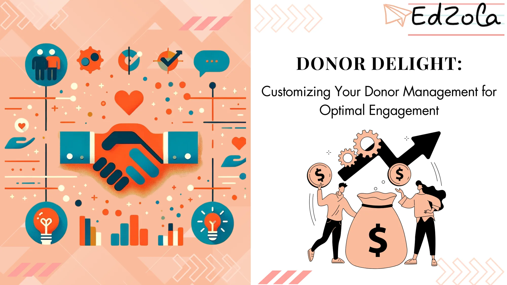

In today's competitive fundraising landscape, donor engagement is critical for nonprofit organizations to thrive and make a lasting impact. With the right donor management strategy in place, nonprofits can cultivate strong relationships, increase donations, and achieve their missions more effectively. In this article, we will explore the importance of donor management, the art of customizing your approach, strategies for enhancing donor engagement, and measuring success in donor management.

## **Understanding the Importance of Donor Management**

Effective donor management is the backbone of any successful fundraising campaign. Nonprofit organizations rely on the generosity of their donors to fund their programs and services. By implementing a robust donor management system, nonprofits can streamline their operations, track donor activity, and personalize interactions. This level of organization and customization allows nonprofits to better engage donors, understand their preferences, and ultimately build stronger relationships.

### The Role of Donor Management in Non-Profit Organizations

Donor management plays a vital role in the day-to-day operations of nonprofit organizations. It encompasses various activities, including donor acquisition, cultivation, and stewardship. **Donor management software serves as a central database that stores donor information, tracks interactions, and generates reports for analysis and decision-making.** By utilizing a comprehensive donor management solution, **nonprofits can efficiently manage their fundraising efforts**, saving time and resources while maximizing impact.

Probe further: [Funding Frustrations: Strategies to Overcome Insufficient Funding Challenges](https://www.edzola.com/post/funding-frustrations-strategies-to-overcome-insufficient-funding-challenges)

### Key Benefits of Effective Supporter Engagement

Implementing an effective donor management strategy offers several benefits for nonprofit organizations. Firstly, it allows nonprofits to gain a deeper understanding of their donors, including their preferences, interests, and giving patterns. This knowledge enables nonprofits to tailor their communication and fundraising appeals, increasing the likelihood of donor engagement and donations. Additionally, donor management enhances collaboration within the organization by providing a centralized platform for team members to access donor information, track progress, and coordinate efforts. Lastly, effective donor management empowers nonprofits to measure the success of their fundraising campaigns, identify areas for improvement, and implement data-driven strategies to optimize donor engagement.

Furthermore, an effective donor management system enables nonprofits to segment their donor base and target specific groups with personalized messages and appeals. By categorizing donors based on factors such as giving history, interests, or demographics, nonprofits can create tailored campaigns that resonate with each group. This level of personalization not only increases donor engagement but also strengthens the bond between the organization and its supporters. In addition to segmentation, **donor management software also allows nonprofits to track and analyze donor behavior. By monitoring donor interactions, such as website visits, event attendance, or social media engagement, nonprofits can gain valuable insights into donor preferences and interests.** This information can then be used to create targeted fundraising campaigns and cultivate long-term relationships with donors.

Moreover, effective donor management goes beyond just tracking and analyzing donor data. It also includes the cultivation and stewardship of donors. **Nonprofits can use their donor management system to schedule and automate personalized communication, such as thank-you emails, newsletters, or updates on the impact of donations.** By consistently engaging with donors and expressing gratitude for their support, nonprofits can foster a sense of loyalty and commitment among their donor community.

Dig Deeper: [Maximizing Donor Retention: CRM Strategies That Work for Nonprofit](https://www.edzola.com/post/maximizing-donor-retention-crm-strategies-that-work-for-non-profits)

## **The Art of Customizing Donor Management**

Every donor is unique, with their own motivations, interests, and giving capacities. To truly engage donors and foster long-term relationships, nonprofits must tailor their approach accordingly.

### Tailoring Your Approach to Different Contributors

Donors come in various forms, including individual donors, corporate sponsors, and grant-making organizations. Each donor type requires a different approach and level of engagement. For **individual donors, personalization is key; sending personalized acknowledgments, updates, and thank-you notes can go a long way in nurturing donor relationships.** Corporate sponsors may value partnerships and recognition opportunities. In contrast, grant-making organizations may require detailed proposal submissions. Understanding these differences and customizing your donor management strategy accordingly will help you maximize engagement and foster loyalty.

Probe Further: [3 tips to streamline your Donation Process today!](https://www.edzola.com/post/3-tips-to-streamline-your-donation-process-today)

### Utilizing Technology and Customization

Leveraging technology plays a pivotal role in customizing donor management. Fundraising CRM (Customer Relationship Management) software empowers nonprofits to track and analyze donor data, segment donors based on specific criteria, and automate personalized communication. With the right fundraising CRM, nonprofits can send tailored emails, create personalized donation pages, and even customize events to cater to different donor segments. By harnessing the power of technology, organizations can take their donor management to the next level and achieve optimal engagement.

[Explore Zoho CRM with a 15-Day free trial!](https://edzola.com/zoho-products/zoho-crm)

## **Strategies for Enhancing Donor Engagement**

Once nonprofits have customized their donor management approach, it's essential to implement strategies that strengthen donor engagement and involvement.

### Communication Techniques for Increased supporter Involvement

Communication is at the heart of donor engagement. Regularly updating donors on the impact of their contributions, sharing success stories, and demonstrating transparency builds trust and encourages continued support. Utilize various communication channels, such as [email marketing automation](https://www.edzola.com/post/introduction-to-email-marketing-automations-for-nonprofits), newsletters, social media platforms, and direct mail, to reach donors and keep them informed. Moreover, incorporating storytelling techniques into your communications can create emotional connections, inspiring donors to become even more involved.

### Building Stronger Relationships with program partners

Strong relationships are the cornerstone of successful donor engageme. Nonprofits should aim to nurture these relationships by creating opportunities for donors to engage with their cause beyond making donations. **Offering volunteer opportunities, hosting donor appreciation events, and fostering donor communities can help deepen connections and foster a sense of belonging.** Investing in meaningful donor interactions not only creates loyal supporters but also may lead to increased donations and donor advocacy.

## **Measuring the Success of Your Donor Management Strategy**

Assessing the effectiveness of your [donor management strategy](https://neonone.com/resources/blog/nonprofit-donor-engagement-strategies/) is essential to continually improve and optimize engagement opportunities.

### Key Performance Indicators

Tracking key performance indicators (KPIs) provides valuable insight into the success of your donor management efforts. **KPIs may include donor retention rates, average donation amounts, donor acquisition costs, and campaign-specific metrics.** Regularly monitoring and analyzing these metrics enables nonprofits to identify trends, spot areas for improvement, and refine their strategies accordingly. By setting realistic goals and continually measuring progress, organizations can enhance their donor management and achieve long-term success.

### Continuous Improvement Tracking

Donor engagement is a continual process, one that requires ongoing evaluation and refinement. Regularly seeking donor feedback, conducting surveys, and listening to their suggestions will help nonprofits identify areas for improvement and adapt to changing donor expectations. Embracing a culture of continuous improvement ensures organizations remain responsive to donor needs and evolving trends, allowing them to strengthen donor relationships and achieve optimal engagement.

In conclusion, donor management is an integral part of successful [nonprofit fundraising](https://www.edzola.com/post/transforming-fundraising-strategies-for-non-profits-how-technology-makes-a-difference). By customizing your approach, utilizing technology, and implementing effective strategies, you can elevate your donor management strategy and maximize donor engagement. Remember, donors are the lifeblood of your organization, and by delighting them with tailored solutions, you can build lasting relationships that make a significant impact for years to come.

## Getting Started with EdZola

> ***Where technology becomes a force for good, amplifying human potential and fostering global progress.***

Every nonprofit is unique, and one size does not fit all when it comes to data solutions. At [EdZola](https://www.edzola.com/), we specialize in creating customized solutions that align with your organization’s specific goals and needs. Our team works closely with you to identify pain points, develop a tailored plan, and implement the right tools to maximize your impact.

[Let's Connect](https://www.edzola.com/contact)
