## Read how Aangan Trust simplified their HR management system for their employees with Zoho People.

|  |
| --- |
| **Key Information:**  Time taken: **4 months**  Result: They are managing more than 100 employees data and the number is growing |

## EdZola <> Aangan Partnership

Aangan Trust, a leading child protection NGO in India, needed a more efficient way to manage employee data across growing teams and multiple locations. By partnering with us, they implemented Zoho People an HR software built for nonprofits. In just four months, this collaboration brought structure, visibility and automation to their HR operations.

## Key Indicators

- [Challenges Aangan faced](#viewer-91q2e9184)
- [What problems did it cause?](#viewer-qev1418915)
- [Solution overview: Highlights of the HR Management System implemented with Zoho People](#viewer-ncfs823610)

  - [Employee Data Management](#viewer-52npi25679)

  - [Configuring Permission Roles for Employees](#viewer-q905930986)

  - [Employee attendance Module](#viewer-5s8ah33350)

  - [Setting Up Leave Policies through leave tracker module](#viewer-e9duy36991)

  - [Document Management with the File Module](#viewer-1eovc38317)

  - [Employee Journey](#viewer-zrqbw39962)
   - [Dashboards and Reporting](#viewer-wij4u42053)
   - [Employees profile dashboards](#viewer-xxlrh45647)
- [Tips for NGOs who are looking to implement similar solutions](#viewer-q178q47944)
- [Impact metrics they track](#viewer-8fko954074)

## **Challenges Aangan faced:**

For Aangan, managing employee data was a bit inefficient. The HR team was using spreadsheets to track attendance, onboarding details, and leave requests. As the team grew, they recognized the need to adopt an HRMS to better organize their data and manage HR processes more efficiently.

### 1.Manual Data Collection and Maintenance in Spreadsheets:

Employee data is collected and maintained using spreadsheets during onboarding. This includes basic employee information, assets provided by the company, and legal document details. Post-onboarding, attendance is tracked manually using spreadsheets, requiring extensive effort to calculate paid and unpaid leave. Leave policies are also managed manually.

### 2.Scattered Data Collection:

There is difficulty in consolidating employee information across various sources, such as attendance, leave, and performance modules. This scattered approach makes it challenging to obtain a comprehensive view of employee data.

### **3.Better Organization of Employee Data:**

Aangan wanted a simpler way to manage employee records. They were already using Google Drive and Sheets to store information, but as the team grew, moving to an HR system would help them keep everything in one place and make it easier to access when needed.

### 4.Limited Workflow Automation:

Processes like attendance tracking, leave updates and reporting are heavily dependent on manual updates. 

### 5.**Lack of Visibility and Centralized Reporting**:

There are no consolidated dashboards or automated reports to monitor employee information and performance. This limits visibility into critical HR metrics and hinders data-driven decision-making.

### 6.**Data Access Issues**:

Managing employee data manually creates dependency and access challenges. There is no role-based access or permissions for secure and organized employee data management.

## What problems did it cause?

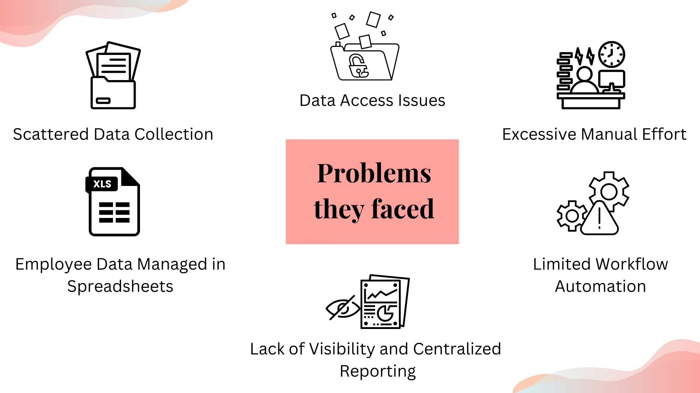

## Solution overview: Highlights of the HR Management System implemented with Zoho People

###

To tackle HR-related challenges, we implemented an HRMS for Aangan using Zoho People, starting with core features like employee data and leave management. This brought essential HR information into one place and simplified day-to-day tasks through automation. 

### Process Flow:

Employee Data Management -> Configuring Permission Roles for Employees -> Managing the Employee Attendance Module -> Setting Up Leave Policies -> Employee Document Management with the File Module -> Dashboards and Reporting

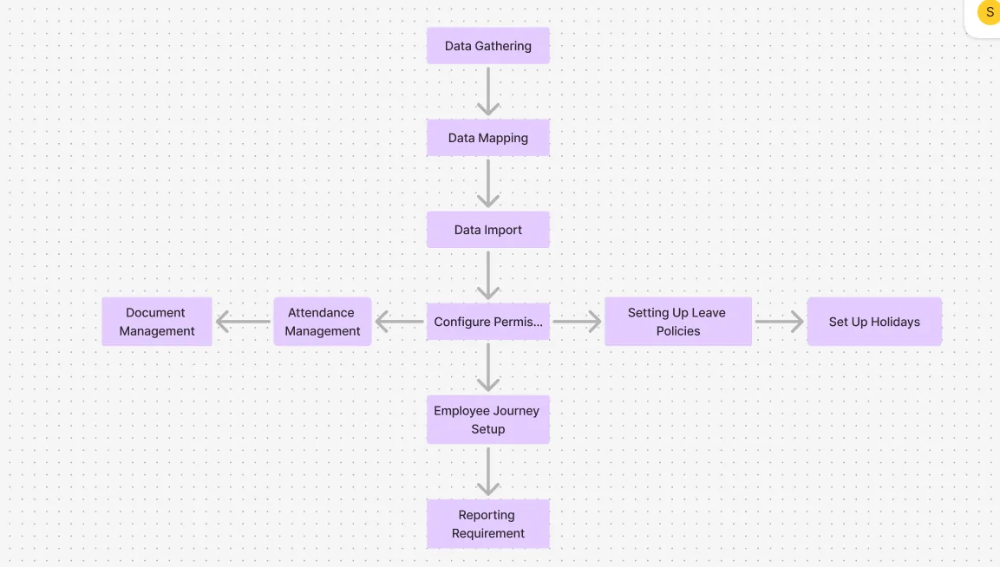

### 1.Employee Data Management:

We gathered the existing employee data maintained in spreadsheets, consolidated it, and imported it into the Zoho People employee information module. In this module, we mapped required fields such as employee name, email, address, contact number, and job role.  Once all data was imported into the system, we could view all employee data in this single module. Refer image 1

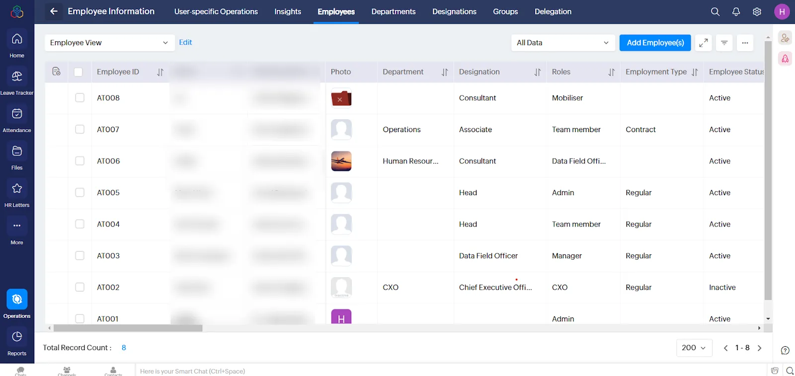

*Image 1- Employee information module*

### **2.Configuring Permission Roles for Employees:**

Once the employee data was imported into the system, roles and permissions were configured according to their hierarchical structure. This included setting permissions for view, edit, delete, or add data. Roles such as manager, head, team lead, and assistant were defined, with permissions delegated for employees on extended leave. The system automatically generated an employee tree for clear organizational understanding. Additionally, approval workflows for attendance and leave were set up.

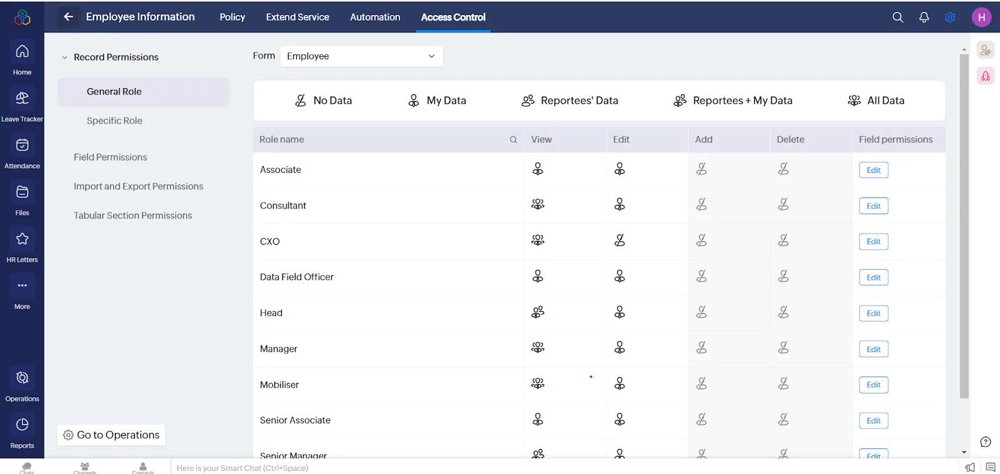

*Image 2 - Employees access control*

### 3.Employee attendance Module:

In the attendance module, the team used the default present option; all employees are marked present by default unless they apply for leave. Those who are on leave submit a request through the system, which once approved, updates their attendance status accordingly. This setup ensures that real-time attendance metrics are always up to date shown in Image 3—giving managers an accurate view without manual adjustments.

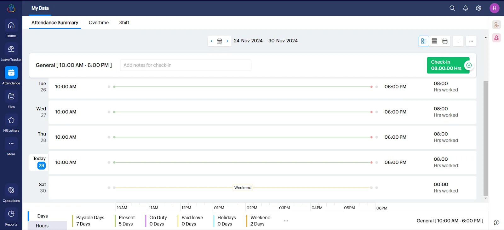

*Image 3: Attendance module*

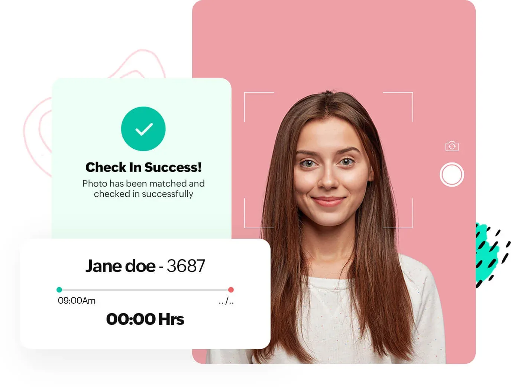

*Note: additional feature in Zoho People - facial recognition*

### **4.Setting Up Leave Policies through leave tracker module:**

Using the leave tracker module, we configured required leave types such as casual leave, maternity leave, and sick leave. After defining the leave accruals and carry-forward policies, automated workflows were created to manage leave policies. A holiday calendar was set up for 7 states with different festivals, and automated workflows triggered email notifications, allowing employees to view their upcoming holidays in their profiles.

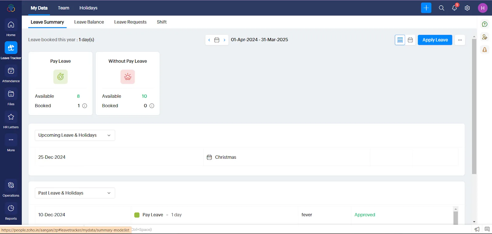

*Image 6: Different leave policies*

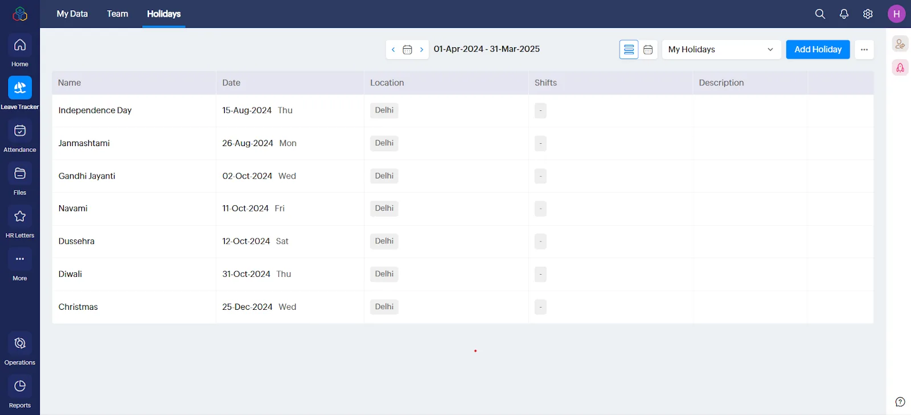

*Image 7: Holiday calendar*

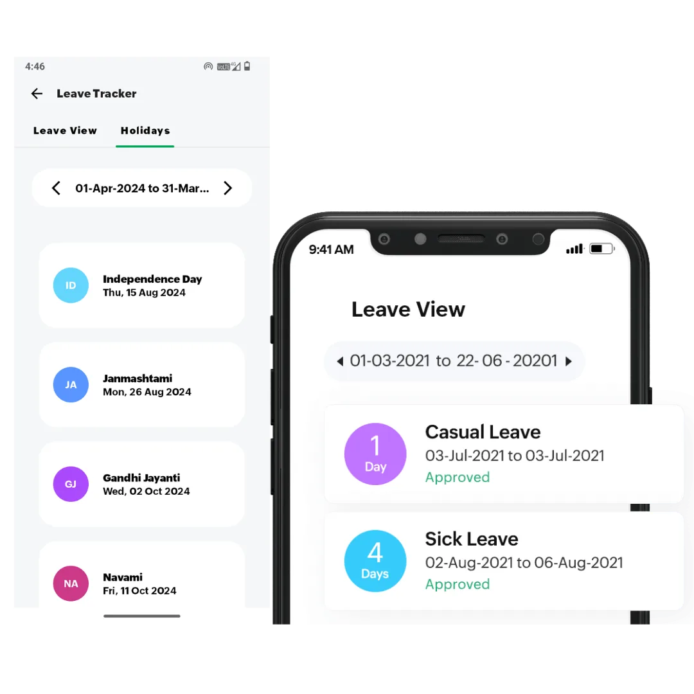

*Image 8: Mobile view*

### **5.Document Management with the File Module**:

Using the file module, each employee can maintain their legal documents such as offer letters, ID proofs, and other relevant papers. Additionally, we configured expiration reminders for time-sensitive documents like ID renewals, ensuring that employees stay informed about upcoming renewals and maintain document compliance.

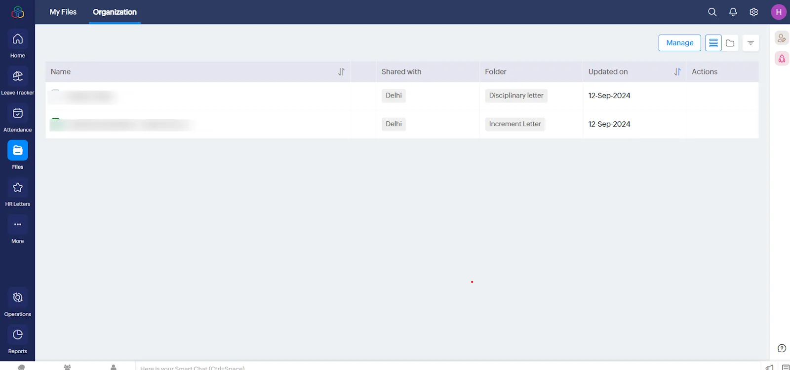

*Image 9: File module for managing documents in single place*

### **6.Employee Journey:**

In this module, we configured the employee journey to track their performance, promotions, and salary structures over time. This helps analyze how employees have evolved and supports their growth within the organization.

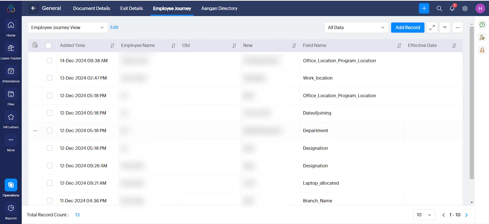

*Image 11: Employee journey view*

### 7.Dashboards and Reporting

The Reports Module helps organizations to analyze HR data and track employee journey. It allows for the generation of detailed, customizable reports and dashboards that help make informed decisions. Users can monitor attendance, manage leave policies, track employee records, and gain insights into workforce trends, all from a centralized location.

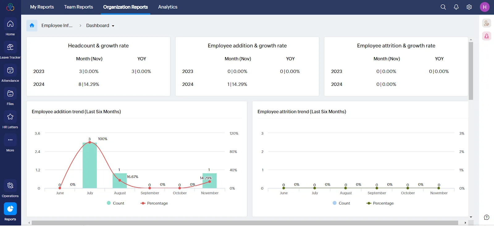

*Image 10: Overall employee growth rate and employee addition trends*

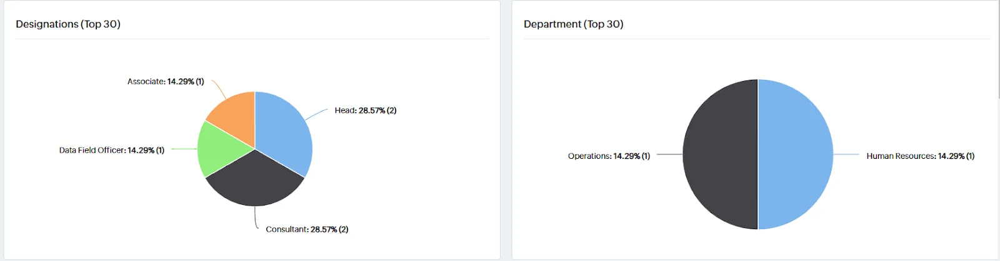

*Image 11: Over all department wise employee count and role wise count*

### **8.Employees profile dashboards**

In the employee profile dashboards, each employee can view their own profile which includes coworker birthdays, attendance records, leave balances, status of request approvals, and upcoming holidays. This consolidated view provides a quick and easy way for employees to stay informed about important workplace details and manage their work-life efficiently.

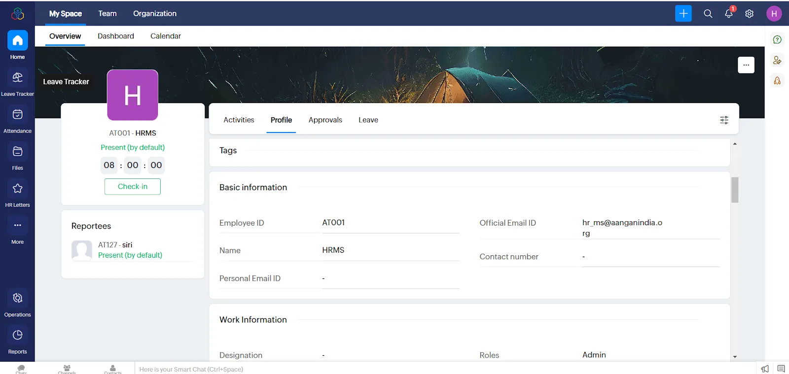

*Image 13: Employee profile view*

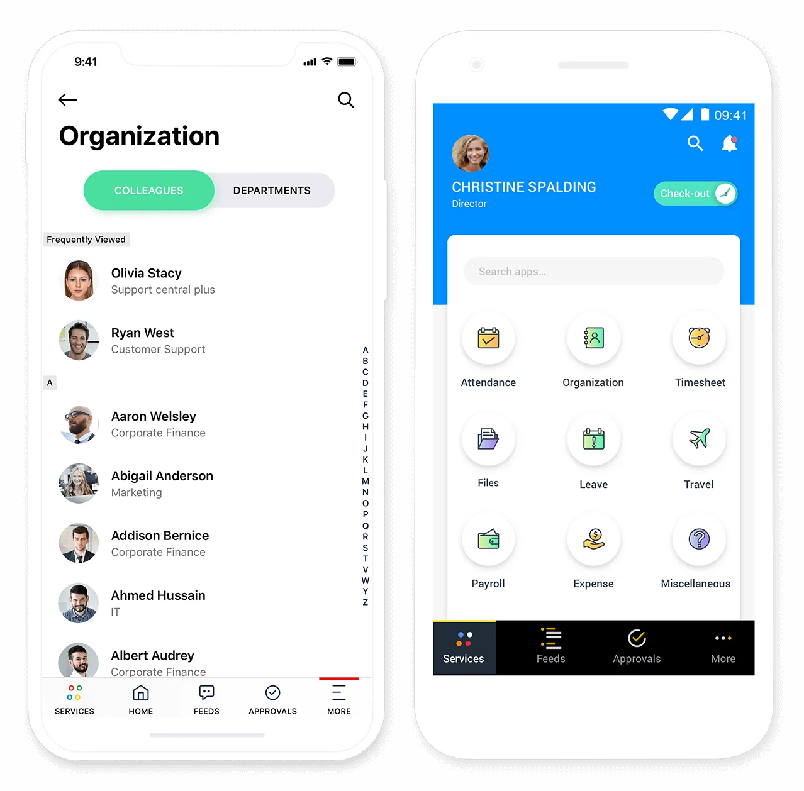

*Image 14: Mobile view*

## Tips for NGOs who are looking to implement similar solutions:

- Before implementation, map your HR processes, communicate the ‘why’ behind digitization, and plan for adequate training and support so teams feel comfortable with the change
- Digitizing HR isn’t just about efficiency it frees up your people to focus more on impact, not paperwork

### Pitfalls that they might encounter and how to overcome them

Moving from simple emails to an app can feel like extra work at first staff may resist. Consistently reinforcing the importance of proper records, documentation, and compliance helps drive adoption. Technical glitches are another reality; having responsive external support makes the transition smoother.

### **Impact metrics they track**

|  |  |  |  |
| --- | --- | --- | --- |
| **KPI** | **Before** | **After** | **Impact / Improvements** |
| % of Employees Actively Using Zoho People | No system | 70%+ | Recorded, real time management of leave |
| Time to Process Leave Requests | Consolidated once in a month | Real time updation and consolidation | - |
| Time Spent on Attendance Tracking | About 6 manhours per month | About 2 manhours per month | This can further reduce. At present, we are also checking the validity and completion of data on Zoho. Once smoothly transitioned, this may reduce to less than 1 hour per month |
| Manual HR/Admin Tasks Time | Real time to 24 hours | More than 1 day | This has slowed down a bit. Earlier, a simple approval on email was sufficient and efficient. Now, managers take time to login to Zoho and approve leave. |
| Attendance Accuracy Rate | Had chances of human error | 5% | Improved efficiency |

## What does Mansi Kanv, Lead – Human Resources at Aangan, say about us?

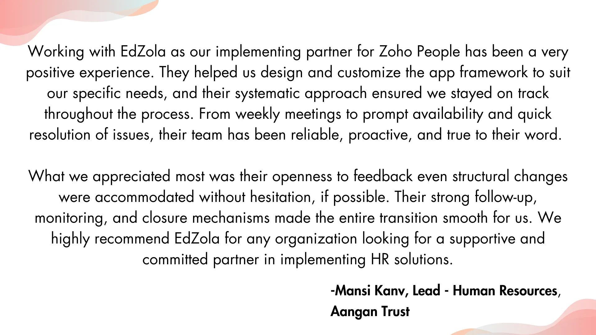

### More about the organization

[**Aangan Trust**](https://www.aanganindia.org/) is a nonprofit organization focused on child protection in India, working to prevent harm and abuse through community mobilization, government partnerships, and civil society collaborations. Their approach integrates child safety into various systems and sectors, aiming to provide children with a secure environment for learning and growth. For more information

Are you facing similar challenge and would like to implement a similar solution for your organization?

[Connect with us](https://www.edzola.com/contact)
