## Read how ARIA CFO Services streamlined their operations by implementing a project management system and enhanced team collaboration and delivery excellence with Zoho Projects.

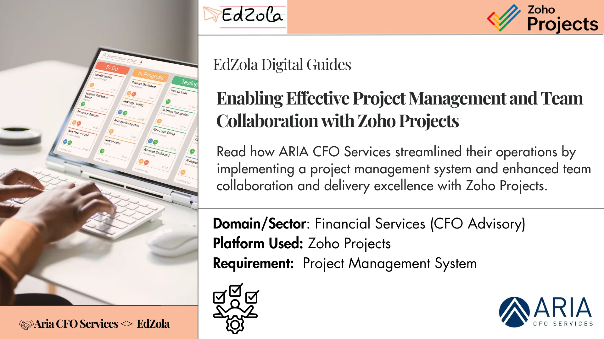

|  |
| --- |
| **Key Information:**  Time taken: **2 months**  Result: They are managing their internal processes efficiently, leading to increased productivity. |

## EdZola <> Aria Partnership

Aria CFO Services partnered with EdZola in 2024 to set up a simpler, more organized way to manage their projects using Zoho Projects. Earlier, their team used Excel sheets and emails to track tasks, which often led to confusion about who was doing what and missed deadlines. EdZola stepped in to build a solution that fit Aria’s daily work like setting up ready-to-use project templates, adding clear to-do lists with owners and deadlines, and creating easy-to-understand dashboards to see what’s on track or delayed. This helped Aria effectively manage their projects , share work more evenly among team members and give clients timely, better-quality support.

## Key Indicators

- [*Challenges Aria faced*](#viewer-91q2e9184)
- [*What problems did it cause?*](#viewer-qev1418915)
- [*Solution overview: Highlights of the Solution Built with Zoho Projects*](#viewer-uxvoa12304)

  *-* [*Simplifying Project Creation and Setup*](#viewer-52npi25679)
   *-* [*Team collaboration through task tracking, resource allocation, and timeline monitoring*](#viewer-yn0i87924)
   *-* [*Automation to Save Time and Avoid Errors*](#viewer-kutqh50654)
   *-* [*Better Communication and Document Sharing*](#viewer-e9duy36991)

  *-* [*Organized and Centralized Project Dashboard*](#viewer-1eovc38317)
   *-* [*Mobile Accessibility*](#viewer-5zr4c44842)
- [*Tips for NGOs who are looking to implement similar solutions*](#viewer-q178q47944)
- [*Impact metrics they track*](#viewer-lpoa914723)

## **Challenges Aria faced:**

When identifying families eligible for various schemes, data is collected through forms and entered into Excel sheets. The status of applications is tracked manually by the ***'Sakhi'*** who provide assistance. There is no aggregated data available, which makes it difficult to make informed decisions about how many people are benefiting from the program.

### **Data Silos and Fragmented Communication**

Aria was managing projects through multiple Excel sheets across different teams, which made it difficult to maintain consistency and stay organized. Without a centralized system, key updates were often missed or delayed, leading to miscommunication and overlapping efforts. In some cases, one team would proceed with outdated information while another was still waiting on inputs resulting in duplicated work and project delays. The lack of a unified communication and tracking space created confusion and made it challenging to meet deadlines efficiently.

### **Task Clarity and Prioritization Challenges**

Since all project updates were tracked manually, it was difficult for managers to see real-time progress. They couldn’t easily tell what was done or what still needed attention. On top of that, without a proper system to prioritize tasks, team members were often unclear on what to focus on first causing delays and affecting overall productivity.

### **Barriers to Effective Resource Planning**

Assigning tasks and managing workloads manually often led to an uneven distribution—some team members were overwhelmed with multiple responsibilities, while others had little to contribute. In project cycles with tight deadlines, key tasks piled up on a few individuals, leading to burnout and missed timelines, while available capacity in the team remained untapped. This lack of visibility into who was doing what made it difficult to plan ahead, resulting in delays, added costs and inefficient use of the team's overall potential.

## What problems did it cause?

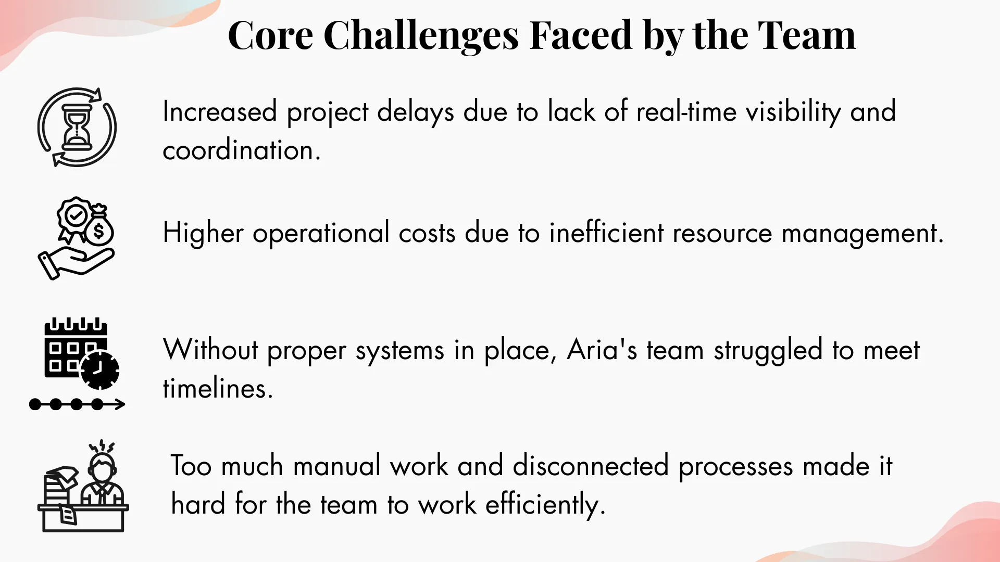

## Solution overview: **Highlights of the Solution Built with Zoho Projects**

To overcome these challenges, we implemented Zoho Projects, a simple yet powerful project management tool that helps teams plan, track and collaborate effectively. With features like task lists, timelines, dashboards and built-in communication, Zoho Projects made it easier for Aria to manage their work in one place and stay organized from start to finish.

### Process Flow:

Project Planning → Task Assignment & Prioritization → Team Collaboration →                          Progress Tracking → Resource Allocation → Timeline Monitoring → Client Deliverables → Dashboards & Reports.

### 1.**Simplifying Project Creation and Setup**

Earlier, starting a new project meant building task lists from scratch often leading to missed steps and delays. Now, with Zoho Projects, every new engagement is created with predefined timelines, goals and milestones, making it easier to kick off and manage work efficiently. This structured approach has already helped Aria **create over 100 projects, with 12 successfully completed** saving time and ensuring nothing falls through the cracks.(Refer pic 1.1 &1.2)

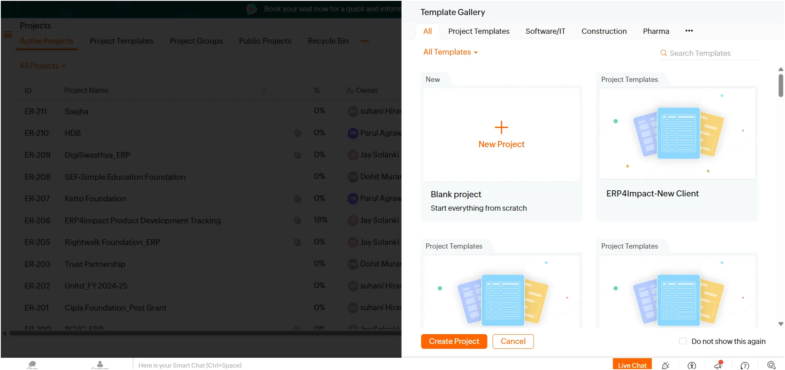

*Picture 1.1: New project template gallery*

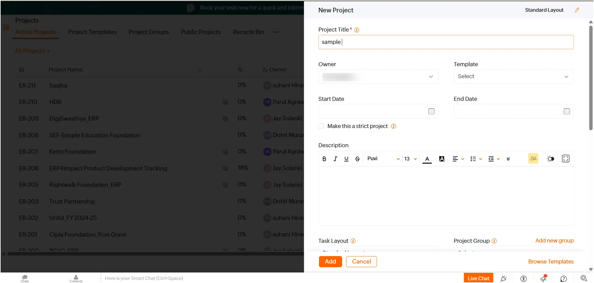

Picture 1.2 : Project setup

### [**2.Team**](http://2.Team) **collaboration through task tracking, resource allocation, and timeline monitoring**

In this task management module where every task and subtask is assigned a clear owner, along with a set priority and deadline. So far, **over 2,000 tasks** have been managed through this system.(Refer pic 1.3 & 1.4) This makes it easy for everyone to know what to work on, when it’s due and who’s responsible—avoiding confusion and last-minute follow-ups and allocating resources through timeline monitoring.(Refer pic 1.5) This ensures everyone knows what they’re responsible for, avoids overlaps and keeps the project on track from start to finish.

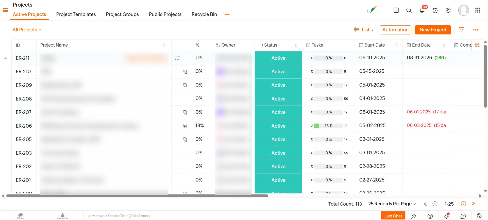

*Picture 1.3: Project  ownership view*

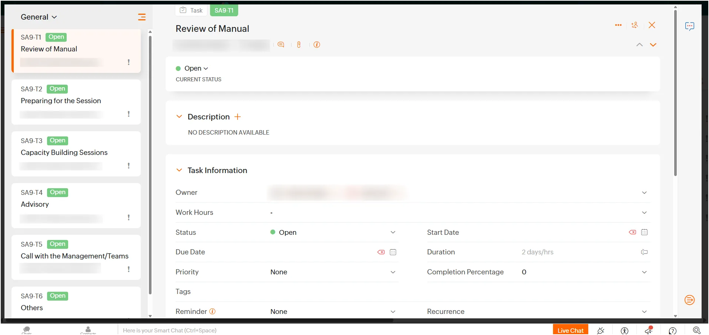

*Picture 1.4: Task Alignment with Clear Ownership, Priority and Deadlines*

###

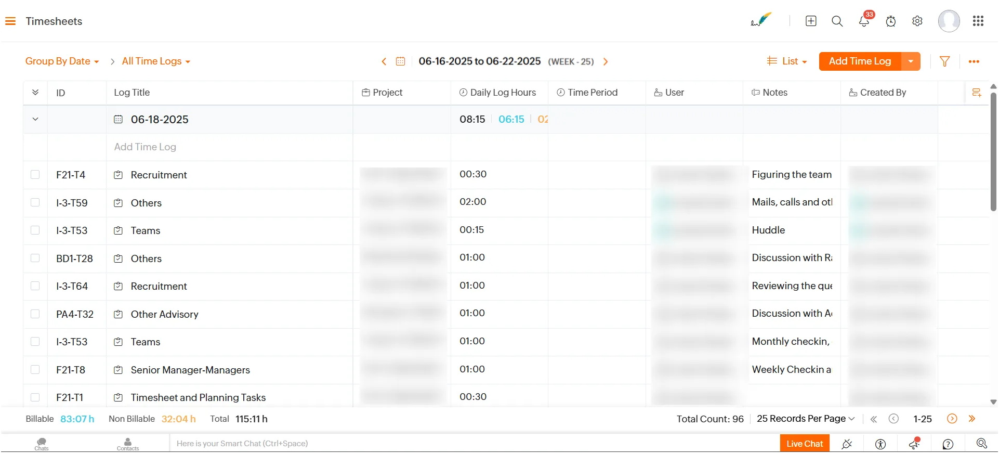

*Picture 1.5 : Timesheets and time log view*

### 3.**Automation to Save Time and Avoid Errors**

To reduce manual work, we’ve enabled automation in Zoho Projects using deadline alerts, status reminders and**8 pre-defined project templates.**(Refer pic 1.6) These templates apply task checklists automatically when a new project is created. Team members are instantly notified of deadlines and updates, keeping everyone aligned and projects on track with less follow-up. This keeps everyone aligned, reduces back-and-forth and ensures that projects follow a consistent flow without the need for constant follow-ups or manual tracking.

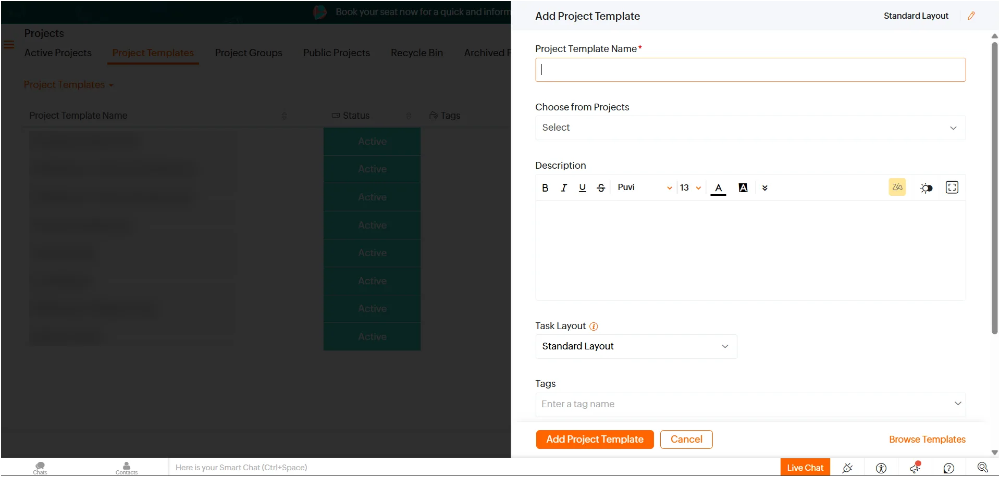

*Picture 1.6: Pre- defined Project templates creation*

### **4.Better Communication and Document Sharing**

The project's module was configured to support task-level discussions, allowing team members to leave comments, ask questions and share updates directly within each task. This helped reduce scattered communication and made it easier to stay aligned. During ongoing client work, quick updates or clarifications now happen right where the task is being tracked. Important documents like financial statements or working drafts are added as attachments within the task itself, so everyone has easy access to the latest version without searching through emails or folders.(Refer pic 1.7)

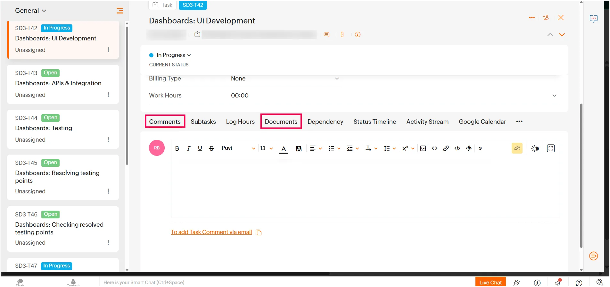

*Picture 1.7: Project comments and document sharing within tasks for easy communication*

### **5.Organized and Centralized Project Dashboard**

A centralized dashboard gives project managers real-time visibility into task progress, deadlines and overall project health. Visual indicators highlight what’s on track and what needs attention eliminating the need to sift through emails or spreadsheets. This enables timely intervention and smoother project execution. This kind of visibility makes it easier to step in early, avoid delays and keep things moving smoothly.(Refer Pic 1.8))

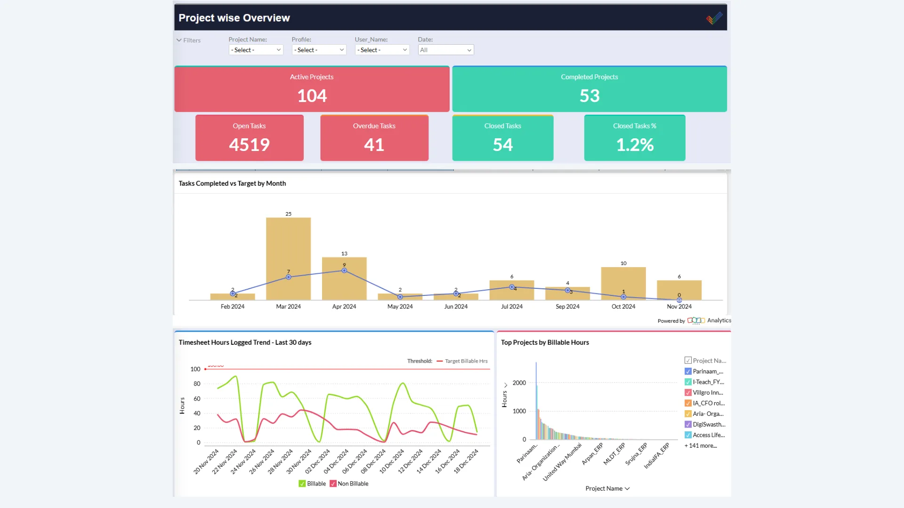

*Picture 1.8 : Overall dashboards for task status and timesheet*

### 6.Mobile Accessibility

Enabled remote project updates and task management via the Zoho Projects mobile app.

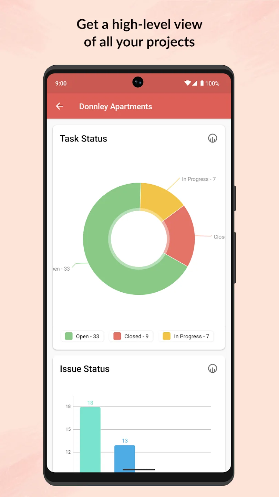

*Picture 1.9: Mobile View*

## Tips for NGOs who are looking to implement similar solutions:

- **Start Small, Then Scale**
  Begin with a pilot project and a small group of users before rolling out firm-wide. This helps iron out process gaps and build internal champions.
- **Invest in Training and Change Management**
  Tools alone won’t solve challenges people need to be comfortable using them. Break training into small, focused modules and revisit them periodically, especially as teams evolve.
- **Align the Tool with Your Existing Workflows**
  Don’t overcomplicate. Customize only what is necessary and keep the system intuitive, so it feels like an enabler, not an additional burden.
- **Make Values Part of the System**
  Use features like task ownership, comments, and dashboards to reinforce collaboration and transparency. Encourage teams to document decisions and discussions within the system instead of email trails.
- **Integrate with Accountability Systems**
  Timesheets and task tracking should not be “compliance checks” alone. Connect them with performance feedback, capacity building, and team well-being. This ensures people see the value in updating their work regularly.
- **Prioritize Data Hygiene from Day 1**
  Agree on simple naming conventions, document upload practices, and task closure protocols. Consistency at the start prevents confusion later.
- **Use Dashboards for Conversations, Not Policing**
  Dashboards should spark proactive conversations about workload, bottlenecks, and support—rather than being used only for monitoring.
- **Balance Structure with Flexibility**
  Templates save time, but every NGO/client project is unique. Leave space for customization so the system works for real-world complexity

## Impact Metrics they track:

They are managing their internal processes efficiently, leading to increased productivity.

### What Does Suhani Hirawat, Team Lead at Aria CFO Services, Say About Us?

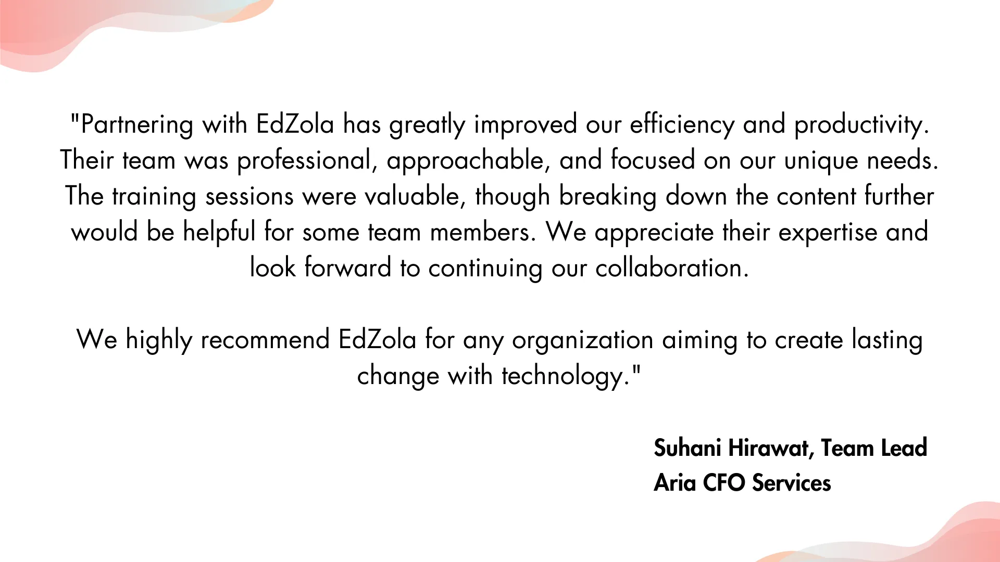

###

### More about the organization

[Aria CFO Services](https://www.ariaadvisory.in/) strive to be the financial, legal, compliance, and accounts management firm that philanthropists, incubators and charities come to when they are looking for transparency, governance and streamlining processes. We develop practical, customized insights that our NGO partners can benefit from.

Monitoring finance is one of the primary aspects to be taken care of in any concern. Aria is involved in providing niche services to the development sector. What makes us unique is the presence of our 'homegrown' leadership team who have diverse experience in fieldwork for NGOs. We have a vision to channelize our team’s finance and accounting expertise into something meaningful and valuable for the sector.

Are you facing similar challenge and would like to implement a similar solution for your organization?

[Connect with us](https://www.edzola.com/contact)
