## Read how Tapasya streamlined its project management system to track government scheme beneficiaries’ data for better decision-making using Zoho Creator

|  |
| --- |
| **Key Information:**  Time taken: **4 months**  Result: They are managing more than **5,000 families, impacting 20,000 individuals at present** and the number is still growing. |

## EdZola <> Tapasya Partnership

**Tapasya Foundation**, working to ensure access to government schemes for underserved families, faced challenges with fragmented data and manual processes. By partnering with **EdZola**, they adopted Zoho Creator to build a custom Beneficiary Management System. This low-code solution enabled field teams to track families, map them to schemes and manage applications all in one place.

## Key Indicators

- [Challenges Tapasya faced](#viewer-91q2e9184)
- [What problems did it cause?](#viewer-qev1418915)
- [Solution overview: Highlights of the Beneficiaries’ Data Management System Implemented with Zoho Creator](#viewer-ncfs823610)

  - [Project Assigning to Sakhi](#viewer-52npi25679)

  - [Onboarding Families into the System](#viewer-yn0i87924)

  - [Automatically mapping families to eligible schemes by Rule Engine method](#viewer-5s8ah33350)

  - [Tracking and Updating Application Status via Helpline management](#viewer-e9duy36991)

  - [Aggregated dashboards and reports for better decision making](#viewer-1eovc38317)
- [Tips for NGOs who are looking to implement similar solutions](#viewer-q178q47944)
- [Impact metrics they track](#viewer-lpoa914723)

## **Challenges Tapasya faced:**

When identifying families eligible for various schemes, data is collected through forms and entered into Excel sheets. The status of applications is tracked manually by the ***'Sakhi'*** who provide assistance. There is no aggregated data available, which makes it difficult to make informed decisions about how many people are benefiting from the program.

### Four stages they follow

- **Community-level** Awareness of various welfare schemes and their benefits and processes.

- **Identification** of eligible families and the required documents for each scheme they can apply for.
- **Document readiness:** Helping families ensure all required documents are ready.

- **Application support:** Supporting families to apply for all the eligible schemes and get their final benefits.

### 1.**Project mapping issues**

Sakhi's allocated to only one project may lead to data misalignment and access issues if they map to another project.

### 2.**Inefficient Data Entry and Retrieval**

Sakhi's needed to maintain separate sheets for family IDs, complicating follow-up visits and data updates due to the unavailability of an integrated system for tracking and retrieving family data efficiently.

### **3.Manual Scheme-Family Mapping**

The process required Sakhi's to manually identify and map eligible families to relevant schemes, which was prone to human error and highly inefficient.

### 4.**Fragmented Data Submission and Proof Management**

Post-camp data capturing and proof submissions were managed manually using Excel, causing delays and potential errors in tracking the status of applications and benefits.

### 5.Lack of Real-Time Reporting and Tracking

The inability to track real-time data and updates made it challenging to assess the impact of the project accurately, complicating strategic decisions and resource allocation.

## What problems did it cause?

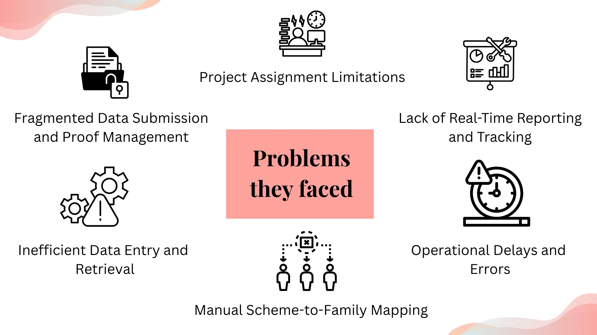

## Solution overview: Highlights of the Beneficiaries’ Data Management System Implemented with Zoho Creator

###

To address these issues, they need a better data management system to assign projects to Sakhi's, track and update beneficiary data for better decision-making.

We suggested the low-code application development platform [**Zoho Creator,**](https://store.zoho.in/ResellerCustomerSignUp.do?id=7b02f2ab5c8f7eeb3bf04bad5f5f65ae)which is **cost-efficient** and offers a **10x faster** turnaround than traditional development methods. The platform was intended to be the one-stop solution for all the challenges they faced.

### Process Flow:

Project Assigning to Sakhi's -> Onboarding Families into the System -> Automatically Mapping Families to Eligible Schemes -> Tracking and Updating Application Status via Helpline management -> Reports and Dashboards

### 1.**Project Assigning to Sakhi**

The first level of the process begins with assigning projects to the Sakhi's. In their existing system, they have multiple projects for different locations. To manage all these projects, we implemented a project management system using Zoho Creator for assigning projects to Sakhi's. In the***"Assign Projects"***module (Refer image 1), they can view the project name, project lead name, project status, and Sakhi's information. Additionally, Sakhi's can assign projects to themselves, giving them the flexibility to take ownership of their work and respond swiftly to project needs. In the *“Projects”* module, they can view all project reports, including which Sakhi is assigned to which project, along with donor details and project lead details.(Refer image 2)

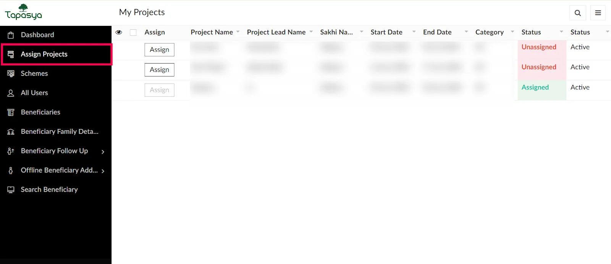

*Image 1 : Assigning projects to Sakhi portal view*

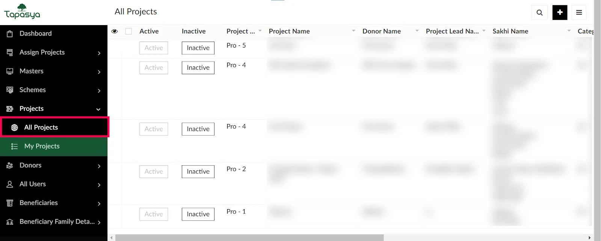

*Image 2 : Detailed reports on project management*

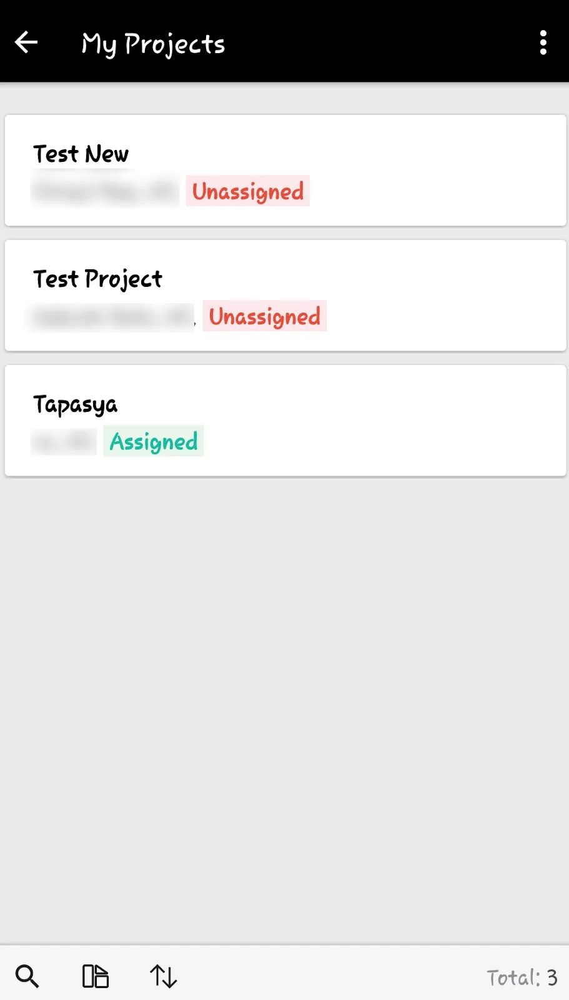

*Image 3 : Project view on mobile*

###

### **2.Onboarding Families into the System**

Once the project is assigned to the Sakhi's, they go to the designated areas and start onboarding family details into the system using the ***"Beneficiaries"*** module. In this module, they can add new members to the family, modify family details, and track the document readiness status of each family (refer to image 3). By using the existing family members' details, they can group two family members into a new family using the ***"Add as New Family"*** option (refer to image 4).

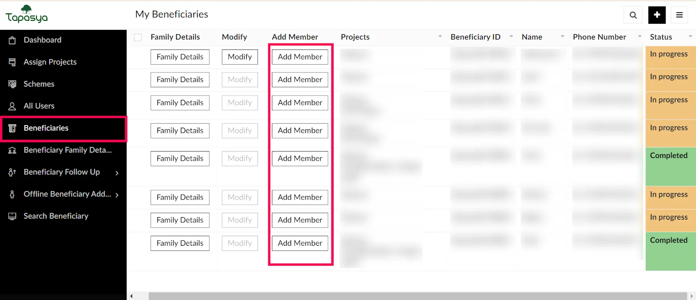

*Image 4 : To add new member to family*

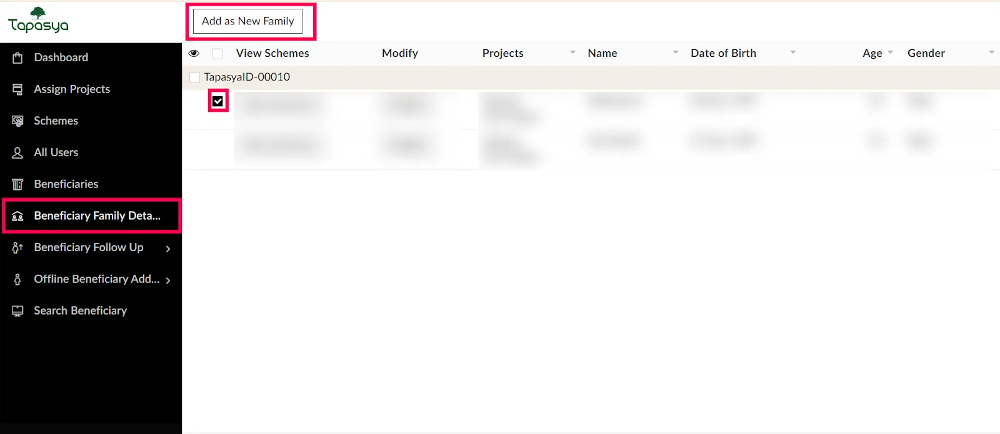

*Image 5 : New family conversion view*

### 3.**Automatically mapping families to eligible schemes by Rule Engine method**

After onboarding families into the system, schemes are automatically populated based on the beneficiaries' eligibility criteria, such as age and gender. To achieve this, we used the Rule Engine method to match the beneficiaries' data with appropriate schemes. We created a module called the ***"Master"*** module (Refer Image 5 )where all government schemes are uploaded and mapped with eligibility criteria. The master module serves as the central repository for all scheme-related information, ensuring that data is organized and accessible.

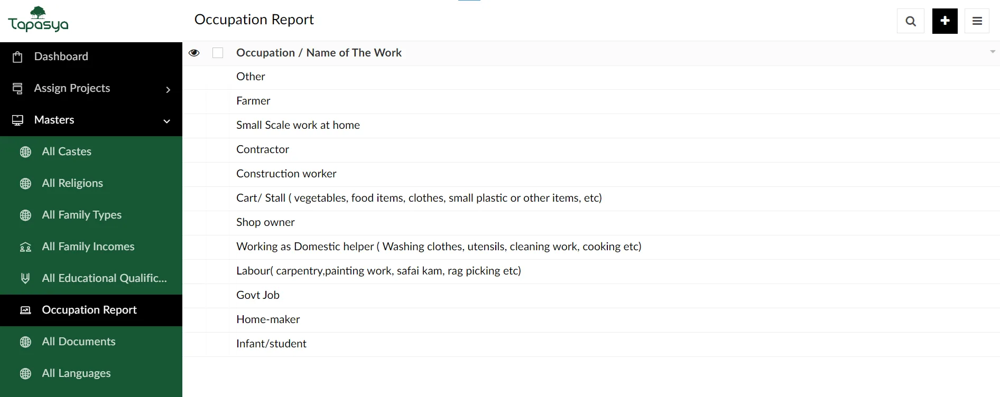

*Image 6 : Master module for all scheme-related information*

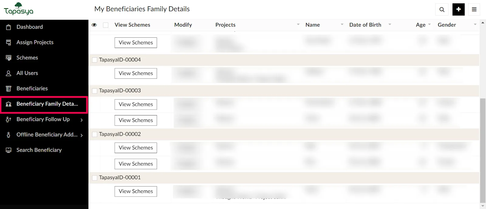

*Image 7 : Overall Beneficiary Family Details*

By implementing an intelligent rule engine, the system can analyze the beneficiary data in real-time, applying a set of predefined rules and criteria to determine the eligibility of beneficiaries for various schemes.(Refer image 6 & 7) This not only streamlines the process of matching beneficiaries to schemes but also enhances the accuracy and efficiency of the entire operation and significantly reduces the time needed to configure the eligible scheme for each member.

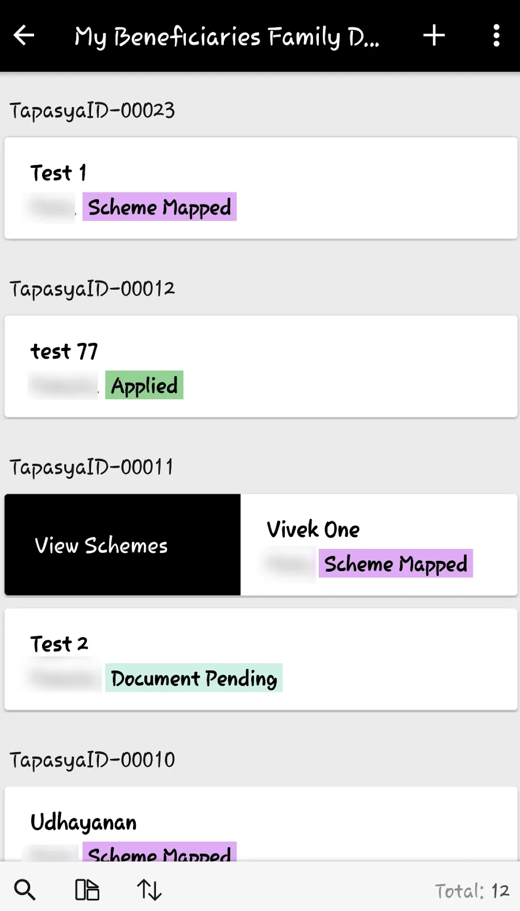

*Image 8 : Beneficiary Details on Mobile View*

### **4.Tracking and Updating Application Status via Helpline management**

To track the application status, the Sakhi visits the project area and updates the status as **"Applied," "In Progress,"** or **"Complete,"** based on the documents provided by beneficiaries (Refer to Image 8). Once the family data is entered into the system, telecallers are automatically assigned to the beneficiaries. Initially, they verify the captured data, including family information, address, and contact details, and ensure that proof documents are correctly uploaded into the system. The second level of verification confirms whether the beneficiaries have received the schemes. Additionally, telecallers provide support to beneficiaries for any queries or additional details needed about the schemes.(Refer image 9)

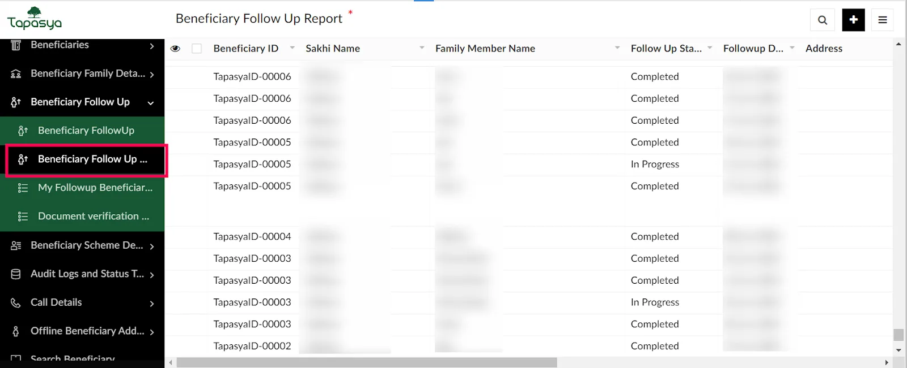

*Image 9 : Beneficiary Follow Up Report*

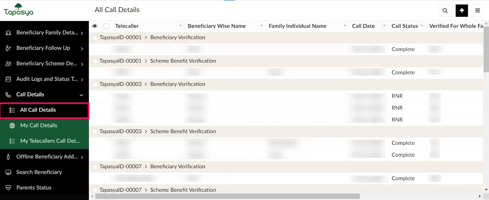

*Image 10 : Overall Call Details with Beneficiaries*

### **5.Aggregated dashboards and reports for better decision making**

By using aggregated dashboards and reports for each module, they can easily monitor and evaluate program efficiency. This feature allows for data-driven decisions, enabling them to identify areas for improvement and analyze the impact they are creating.

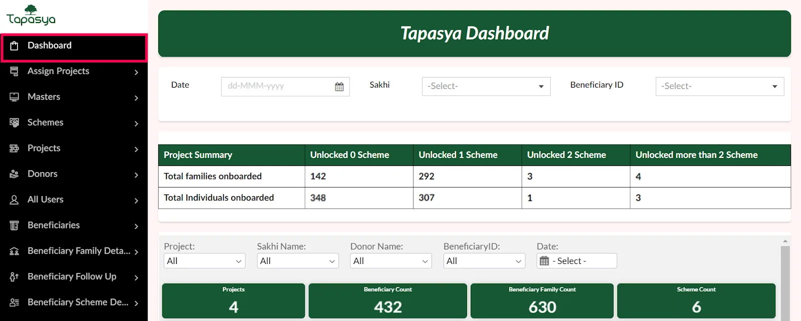

*Image 11 : Overall beneficiaries dashboards*

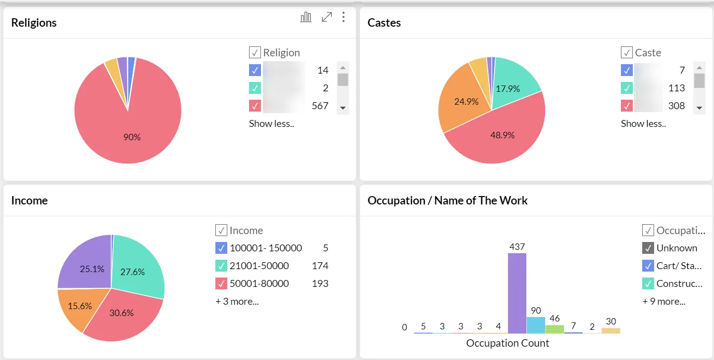

## Tips for NGOs who are looking to implement similar solutions:

- when your operation is completely dependent on data and the chances of error by any human being during work is high, which can be replaced by automation, its better to have an automated system to manage the operations.
- I can see the impact and work progress in real-time on a daily basis without much efforts. Isn't it amazing?

## Impact Metrics they track:

They are managing more than **5,000 families, impacting 20,000 individuals at present** and the number is still growing.

## What does Tapas, Co-Founder & CEO at Tapasya, say about us?

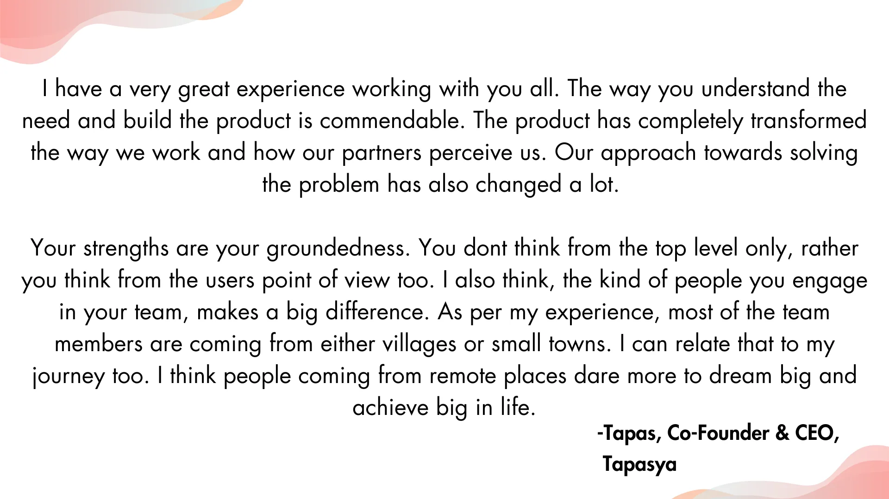

### More about the organization

[**Tapasya**](https://www.tapasya.xyz/) supports families from economically and socially disadvantaged backgrounds who often lack support and awareness of welfare schemes, leading to unmet developmental needs and underutilized benefits. The organization addresses these gaps with a holistic, multi-sectoral approach, leveraging best practices to enhance health and education support for marginalized communities through Behavioral Change Communication and multiple welfare scheme programs under a project called Sakhi.

Are you facing similar challenge and would like to implement a similar solution for your organization?

[Connect with us](https://www.edzola.com/contact)
