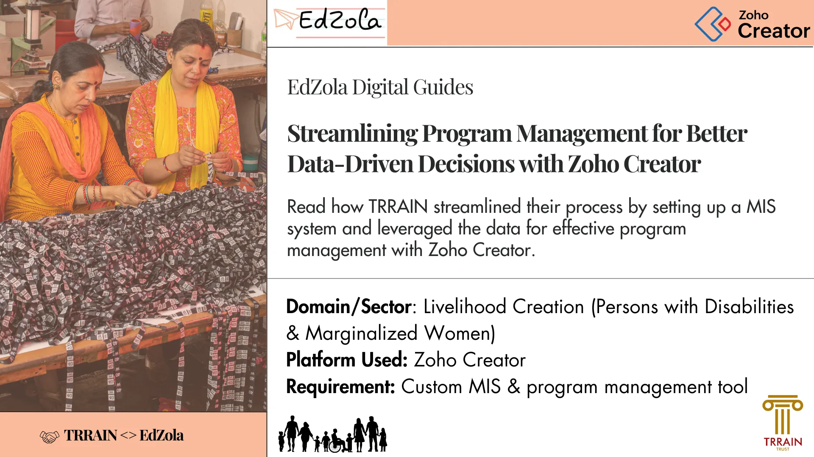
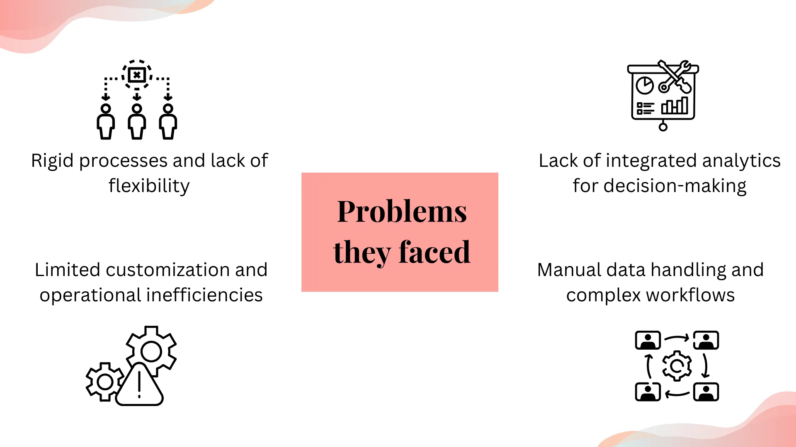
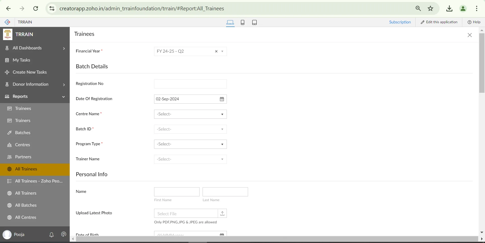
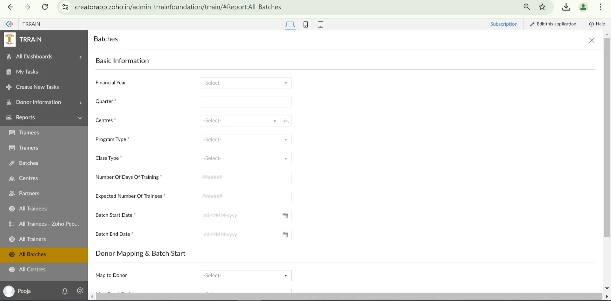
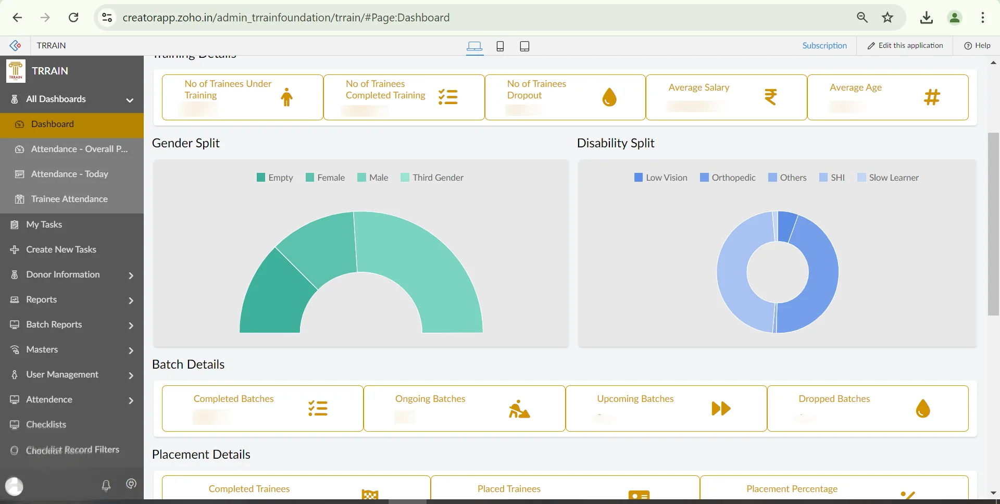
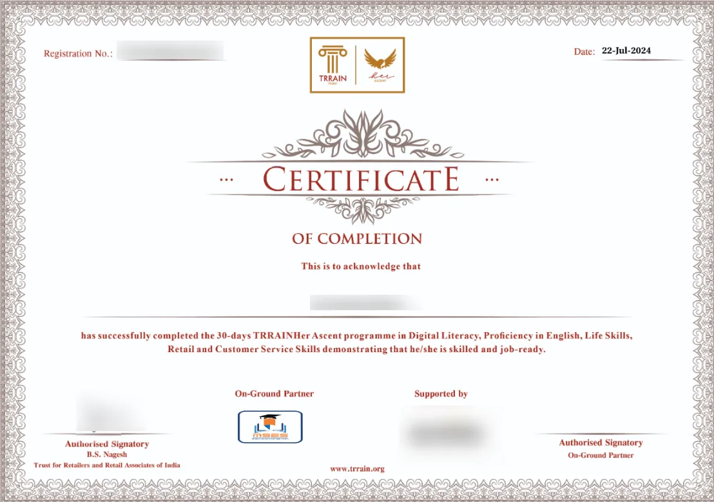
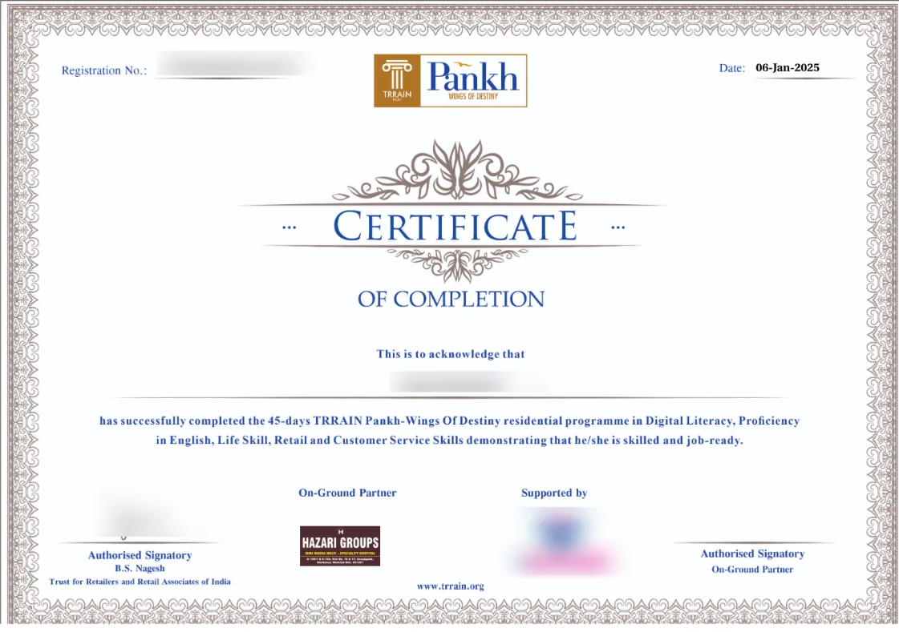
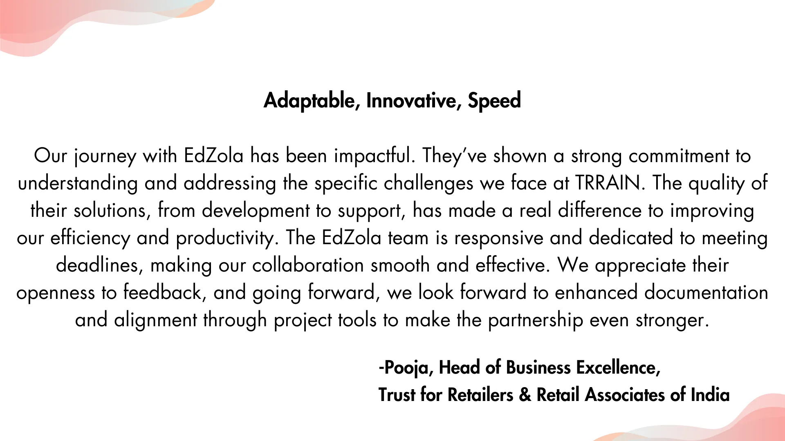

## **Read how TRRAIN streamlined their process by setting up a  MIS system and leveraged the data for effective program management with Zoho Creator**

|  |
| --- |
| **Key Information**  Time taken for the project - 4 months  Results - They are managing more than 10,000+ trainee'sannually and the number is growing |

## Key indicators

- [Challenges TRRAIN faced](#viewer-5982y114)
- [What problems did it cause?](#viewer-bzgwd167)
- [Solution overview:](#viewer-gdfu2185) [Highlights of the](#viewer-gdfu2185) [program management system](#viewer-gdfu2185)[build with Zoho](#viewer-gdfu2185) Creator
    [-](#viewer-w0q44204) [Simplifying user management with geographical mapping](#viewer-w0q44204)
    [-](#viewer-4psav227) [Managing centers and partners with approval workflows](#viewer-4psav227)

  [-](#viewer-pqy1f256) [Centralized trainee tracking and validation process](#viewer-pqy1f256)
   [- Tracking trainee journeys through batch reports](#viewer-kwfb2267)

  - [Placement approval process](#viewer-14tu4208125)

  - [Aggregated](#viewer-q4oen210770) [dashboards and reports for better data driven decision](#viewer-q4oen210770)

  [- Program Completion Certificates](#viewer-kwioq216432)
- [Tips for NGOs who are looking to implement similar solutions](#viewer-ihi0s307)
- [Impact metrics they track](#viewer-4zrbv60458)

## Challenges TRRAIN faced

- **Limited Customization and Feature Constraints:** The TRRAIN team was previously using a platform, which was a product designed for multiple organisations. As a result, the features offered by the platform were fixed and not customizable to the specific needs of TRRAIN. Any requests for new features had to go through the development cycle, which meant significant delays and the same features being released to all organisations using the platform. This lack of customization and delayed implementation of necessary features posed a challenge for TRRAIN.

- **Platform Shutdown and Legacy Data Migration :** The erstwhile platform was being shut down, which created an urgent need for TRRAIN to migrate their processes and legacy data to a new tech solution. The sudden closure of the platform left TRRAIN with little time to find an alternative, implement it, and ensure continuity for their program and users. The time constraint and the reliance on the platform for their tech needs made this a major challenge for TRRAIN.

## What problems did it cause?

- **Rigid Processes and Lack of Flexibility:** The TRRAIN team was forced to fully adapt to the processes defined by the erstwhile platform, which limited their ability to implement or modify processes according to their needs. Even if they identified the need for a new process, the platform's fixed nature prevented them from making many of those changes.
- **Limited Customization and Operational Inefficiency:** Due to the lack of customization options on the platform, the TRRAIN team had to work within the confines of the existing processes. This led to operational inefficiencies, such as needing to open multiple reports and documents in separate tabs, complicating the workflow, and making the approval process cumbersome.
- **Manual Data Handling and Lack of Integrated Analytics:** The platform did not offer built-in data analytics capabilities. Predefined dashboards restricted analytical capabilities load.

## Solution overview: Highlights of the program management system build with Zoho Creator

To overcome these challenges, we implemented Zoho Creator, a low-code platform that allows users to build custom applications 10 times faster to meet their needs without extensive coding. 

### The Process:

> ***Requirement Analysis → Platform Evaluation → License Purchase → Solution Architecture → User Management → Approval Workflows → Trainee Tracking → Batch Reports → Placement Approval → Dashboards & Reports***

### **1.**[Simplifying user management with geographical mapping](#viewer-w0q44204)

The system maps all data based on a hierarchical structure:

**Zone → State → Partner → Centre → Batch → Trainee**

This hierarchy allows for organized data management, ensuring that each level is accurately linked to the next. Zones contain multiple states, each state has assigned partners, partners manage specific centres, centres run multiple batches, and each batch consists of trainees. This structured approach enables seamless tracking, monitoring, and reporting of trainee progress at every level within the system.

### **2.**[Managing centres and partners with approval workflows](#viewer-4psav227)

We created In this system, we collect the basic information of the centre, as well as the agreement for the centres, which then goes through an approval process. The documents are verified, and can either be approved or rejected by the concerned roles. Additionally, we collect the partner's basic details and necessary documents, which also go through an approval process.

### **3.**[Centralized trainee tracking and validation process](#viewer-pqy1f256)

The system collects all trainee details in one place for a specific centre using a form called the "Trainees." These details are collected by partners who are assigned to different centres. Once trainees are onboarded into the system, they move to an approval stage managed by the MIS team.

The system gathers all trainee details in one place for a specific centre using a form called the "Trainees Form." Partners assigned to different centre are responsible for collecting these details. Once trainees are onboarded into the system, they proceed to an approval stage managed by the MIS Manager. This centralized approach ensures that all data is readily available in one place for thorough checking and validation.

*Image 1: Trainees form view*

### **4.**[Tracking trainee journeys through batch reports](#viewer-kwfb2267)

In this system, we collect basic information about the batch such as the batch name, start date, and end date. Each batch typically consists of 20 to 25 trainees and runs for 1 to 2 months. Once the MIS manager approves the trainees, they can be assigned to a specific batch. All basic details of the trainees and their progress stages can be viewed in the Batch Reports, providing a comprehensive overview of each trainee's journey within the batch.

*Image 2: Batches form view*

### **5.**[Placement approval process](#viewer-14tu4208125)

We operate with a system where each batch of candidates undergoes a training. Once a batch completes the program, we initiate the placement process for the candidates. However, placements are not automatic; they are subject to an approval process. This means that even after a candidate is matched with a potential job opportunity, the placement will only be finalised and implemented once it receives the necessary approval. This ensures that all placements align with our standards and the specific needs of both the candidates and the employers.

### **6.**[Aggregated dashboards and reports for better data driven decision](#viewer-q4oen210770)

We have a comprehensive dashboard designed to provide an easy-to-understand and informative overview of the application. The dashboard includes various filters that allow users to refine and view data according to specific criteria. By applying these filters, users can quickly and efficiently access the relevant information, making data analysis and decision-making more straightforward and effective.

By using aggregated dashboards and reports for each module, they can easily monitor and evaluate program efficiency. This feature allows for data-driven decisions, enabling them to identify areas for improvement and analyze the impact they are creating.

*Image 3: Overall dashboard view*

### **7.**Program completion certificates

After the batch is completed, we generate the certificates the next day using a scheduler. The certificates are generated based on the program type, with two different formats: one for Pankh and one for TRRAIN Her. We can also add the donor and partner logos to the certificates.

*Image 4: TRRAIN Her certificate*

*Image 4: Pankh certificate*

## Tips for NGOs who are looking to implement similar solutions:

- Plan your processes and workflows clearly before starting the implementation to avoid any confusion.
- Think about both your immediate and future needs to ensure the solution can grow with your organization.

## Impact metrics they track

Supporting over 10,000 trainees annually, and growing each year.

## What does Pooja, Head of Business Excellence, say about us?

## More about the organization

[**TRRAIN (Trust for Retailers and Retail Associates of India)**](https://trrain.org/) is an organization committed to the betterment of the retail sector, particularly focusing on the people who work in the industry -  the retail associates. The organization runs multiple initiatives aimed at enhancing the livelihoods and dignity of individuals within this sector.

One of its key programs, Pankh, which is dedicated to empowering differently-abled individuals by providing them with skill training and employment opportunities in retail. This project aims to create a more inclusive workforce by ensuring that people with disabilities have the resources and support they need to succeed.

Another significant initiative is TRRAIN Her, a program designed to empower women by providing them with skills, resources, and opportunities to craft meaningful careers in retail. The program focuses on promoting gender equality and creating a supportive environment for women to thrive in the retail industry.

TRRAIN's purpose is to create an inclusive and equitable society by empowering people through retail and improving the quality of life for those in the retail sector.

Are you facing similar challenge and would like to implement a similar solution for your organization?

[Connect with us](https://www.edzola.com/contact)
