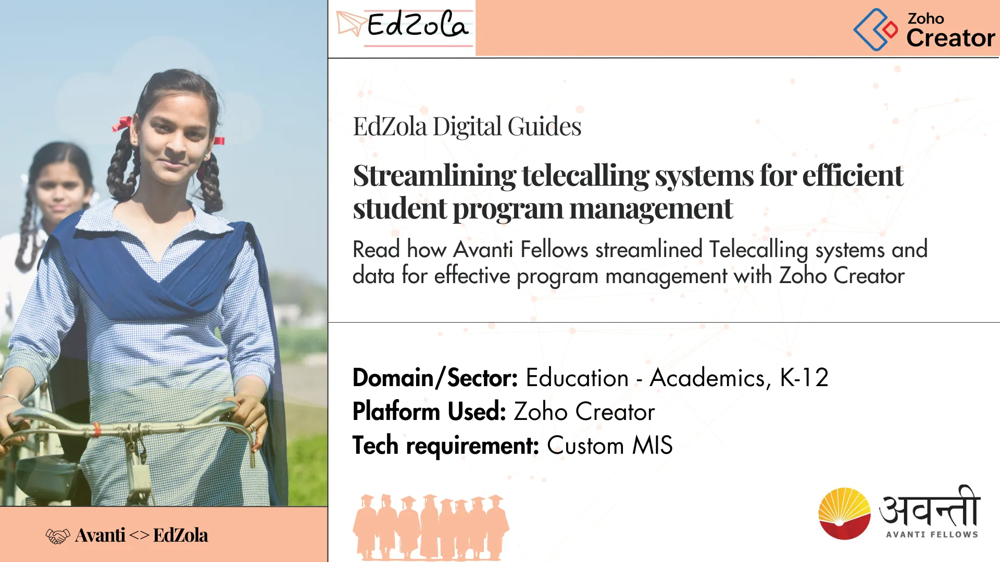
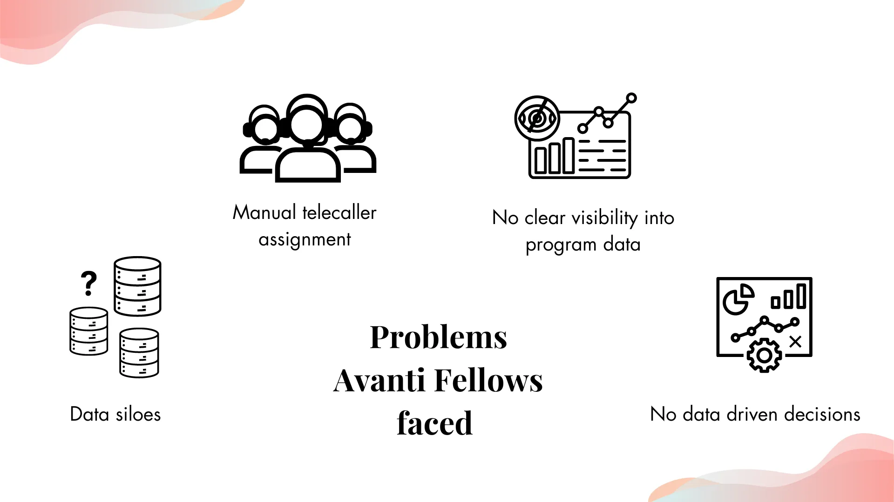
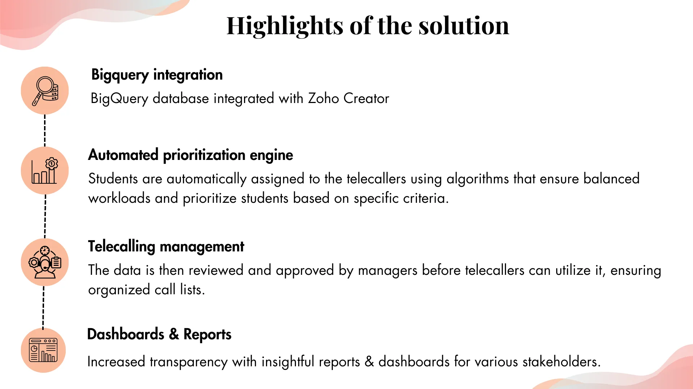
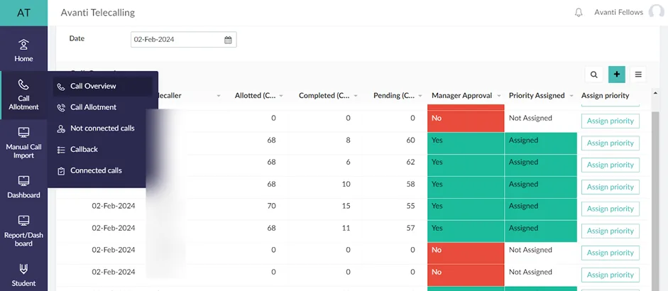
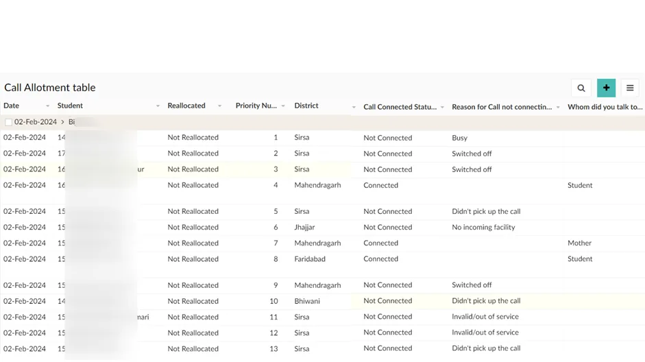
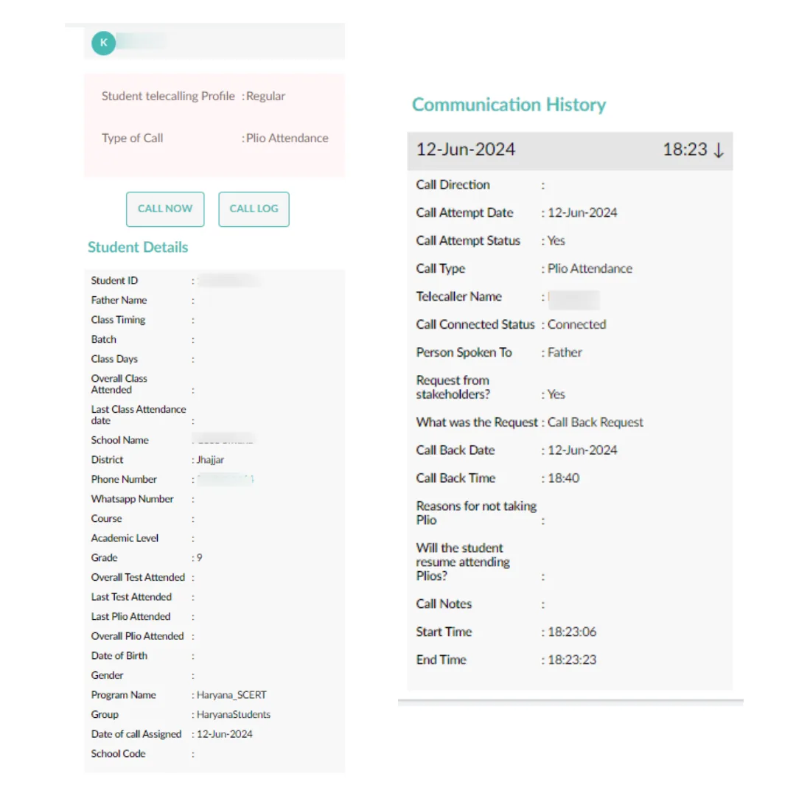
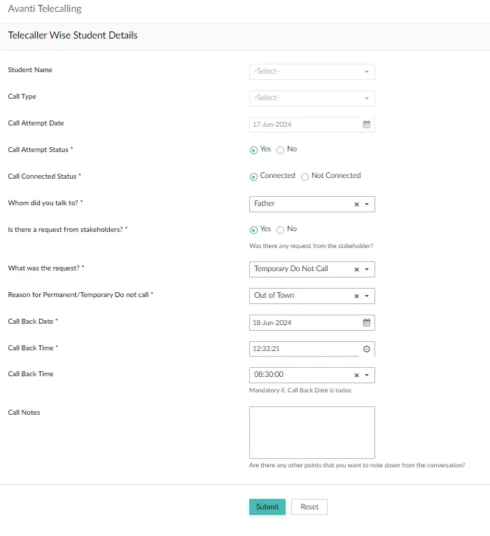
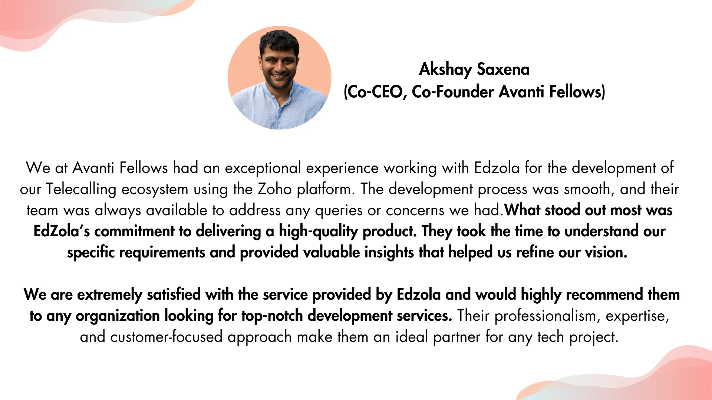

## Read how Avanti Fellows streamlined their process by setting up telecalling systems and leveraged the data for effective program management with Zoho Creator

|  |
| --- |
| **Key information**  Time taken for the project - 4 months  Results - They are managing nearly *8K students*and the number is growing |

##

## Key indicators

- [Challenges Avanti Fellows faced](#viewer-0ewc353674)
- [What problem did it cause?](#viewer-lde1r53698)
- [Solution overview: Highlights of the telecalling Management System built with Zoho Creator](#viewer-y3vyp53723)
   - [Bigquery integration](#viewer-laccf53732)
   - [Workflows for automated prioritization - Who should the telecallers prioritize?](#viewer-xpz0s53750)
   - [Telecalling Management](#viewer-byry356614)
   - [App usage tracking for increased transparency for external stakeholders](#viewer-k7mnm53823)
- [Tips for NGOs who are looking to implement similar solutions](#viewer-78a8f31391)
- [Impact metrics they track](#viewer-ogz4x32327)

## Challenges Avanti Fellows faced

Their primary concern was to maintain the students’ engagement throughout their program. In order to achieve that, they had a telecalling process with 10 - 15 telecallers. Each day the telecallers had to be manually assigned the students, which kept consuming a lot of their team’s time.

*The major issues that they faced were related with:*

- Difficulty in collating data from Big Query database
- Lack of a streamlined telecalling system which ended up making them do a lot of manual work
- Lack of workflows resulted in manual assignments
- No aggregated reports or dashboards on required parameters.

## What problems did it cause?

- Too many disconnected forms and isolated storage methods which resulted in difficulty in setting up reports.
- Telecallers had to do a lot of**manual work** switching between different systems for different purposes such as calling, entering details, etc.,
- Inability to have **clear visibility into program data** for the decision-makers
- No comprehensive reports or dashboards to help the team define new methodologies and strategies.

## Solution overview: **Highlights of the Telecalling Management System built with Zoho Creator**

## 1.Bigquery integration

Avanti Fellows leveraged Bigquery as their data warehouse. So in order to get relevant data to streamline the telecalling process, we connected their BigQuery database with Creator, where the telecaller management is to be done.The data is automatically pulled from the BigQuery database and is used to assign students to telecallers.

### The flow of the data is as follows:

> ***BQ -> Student Data Pull*** ***→*** ***Assigning students to Telecallers*** ***→*** ***Telecaller calls and fills the call log form which serves as a database to identify gaps*** ***→*** ***Data is then pushed to BQ***

A failsafe feature is also provided! If the auto pull fails from BQ for any reason, data can be manually imported into Creator. And with just uploading the students data the system will take care of the whole assigning processes!

## 2.Workflows for automated prioritization - Who should the telecallers prioritize?

Once the data reaches Zoho Creator, then the process of assigning students to telecallers begins.

And the workflows built catered to two kinds of needs:

- Logically, there should be a right balance in the number of students assigned to each of the telecallers. To achieve that, a cap limit was set and that algorithm helped in automatically assigning students to telecallers equally, so that telecallers have a fair and realistic distribution of calls to make.

- Another algorithm was built to assign priority to a student based on variables like gender, grade, course, batch timings, attendance condition etc., So when a telecaller is assigned a total of 60 students, all 60 students are marked from 1 to 60 based on the above criteria. This helped telecallers prioritize the calls they have to make in a day and reduced manual interventions in deciding who to prioritize.

## 3.Telecalling management

Following that, the students data is now assigned to telecallers and is waiting to be utilized by their team. And this is where approval systems come in. The managers will be approving the lists of calls for telecallers assigned to them.

There’s a dedicated module for calls allotment for telecallers and managers separately.

### For Managers:

- Manager will be able to view and approve all the assigned calls to telecallers (Refer Image:1). In addition to that, all the data entered in the logs by telecallers, will be visible to the manager for further analysis. (Image:2)

*Image 1: A Manager’s view of calls assigned to telecallers*

*Image 2: Detailed reports on each student’s status*

### For telecallers:

- Telecaller will be able to view **who to contact** and have a detailed view of **every individual student** (Refer Image:3). Each telecaller is provided with their own login details to view and call the students. Once the telecaller is done with the call, they will fill the information they received from the call in a form for further follow ups. (Refer Image:4). This is where the purpose of this application comes into light, this data will later be used by their program team to understand their beneficiaries and make a decision about the necessary changes that should be made in the program design.

*Image 3: A telecaller’s individual view of the student they need to contact*

*Image 4: Call log details to be filled after each call*

## 4. App usage tracking for increased transparency for external stakeholders

Along with the reports and dashboards for the Avanti Fellows team, they also had reporting needs for external stakeholders. There could be many cases where the tech project is funded by a funder organization or by other forms of supporters. And they usually need specific data to understand the success of the project and to know whether they’re getting ROI for their investment in terms of impact. This required a set of dashboards with selected essential data including the app usage statistics. The funders also receive periodical reports with consolidated data for better insights with zero manual intervention.

## Tips for NGOs who are looking to implement similar solutions:

### Pitfalls that they might encounter and how to overcome them

For all the NGOs who are looking for similar solutions, from our own experience, we can confidently say that **today's technological solutions significantly reduce the amount of manual work required, thereby saving time and boosting productivity.** In our case, the entire telecalling process involved a lot of manual effort, and as a result we struggled to obtain the necessary accurate measurable data. However, technology provided us with the essential data points we needed to take data driven decision making.

It's very important to clearly define the problem set, unnecessary features can disturb the basic process - Unclear requirements, poor execution planning, underestimating complexity, and failure to adapt are common pitfalls. To overcome these, effective communication, sufficient documentation, user feedback, and thorough internal testing are essential.

The way we approached this was to build the app in phases where we catered to only certain use cases and then iterating it over time to make it better and then extend and expand to other use cases. 

***- Avanti Fellows team***

## Impact metrics they track

|  |  |  |  |  |
| --- | --- | --- | --- | --- |
| **Metric** | **Definition / How to measure** | **Impact by tele-calling** | **Target** | **Frequency of Monitoring** |
| Student Regularity | # and % of regular students (students who have attended more than 50% classes cumulatively) | Indirect | Increase | Weekly |
| Student call frequency | Average # of times a student has been reached out to | Direct | Decrease | Monthly |
| Conversion ratio | % of [# of students who completed call purpose action / # students who said they will complete call purpose action] | Direct | Increase | Monthly |

## What does Akshay Saxena, Co- CEO & Co Founder of Avanti Fellows say about us?

##

## More about the organization

[**Avanti Fellows**](https://www.avantifellows.org/)provides high-school students free test preparation programs, mentorship and career services that help them get placed into top-tier Science and Technology colleges across India. Their students (more than) double their household income on graduating and escape the cycle of intergenerational poverty!

They have three different programs focusing on

1. Foundational learning for 9th and 10th grades
2. Girls Leadership
3. Test Preparation for 11th and 12th grades (NEET / JEE)

Are you facing similar challenge and would like to implement a similar solution for your organization?

[Connect with us](https://www.edzola.com/contact)
