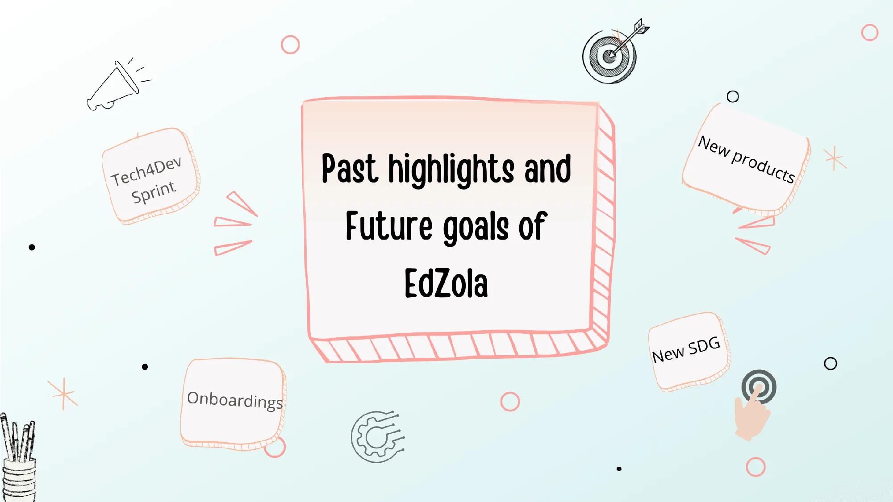
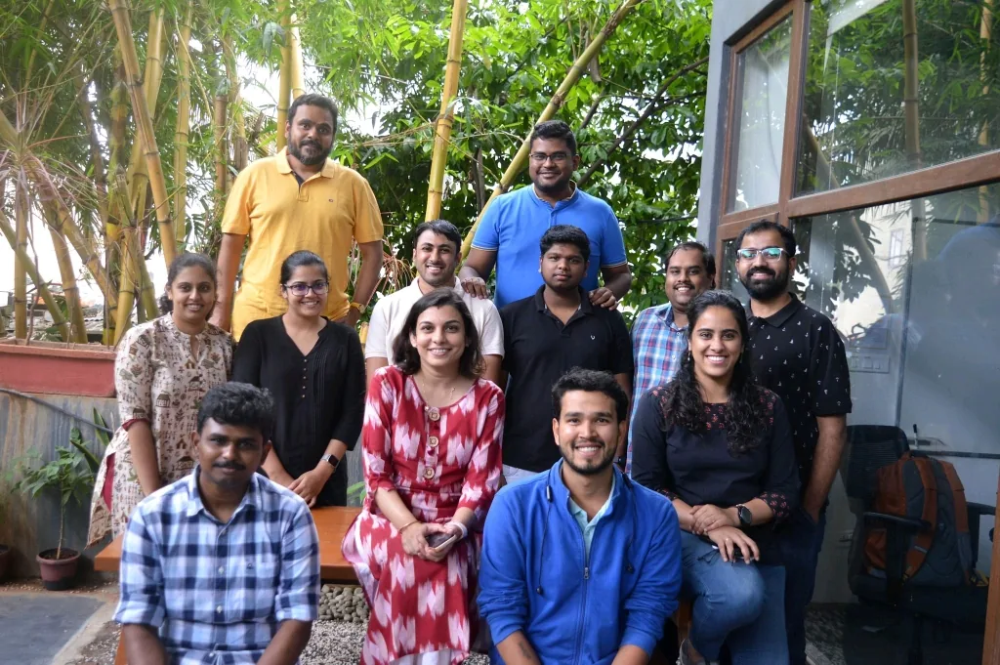
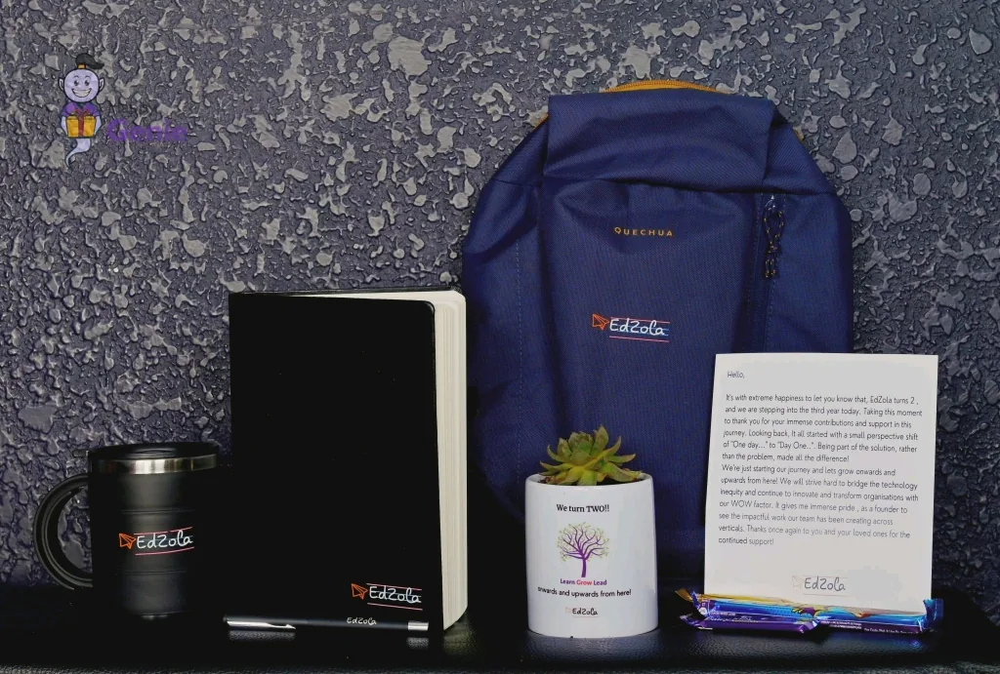

Hello all, we'd like to post here the highlights of the past quarter - Q2 (July would like to squeeze in) and what we are up to in the coming two quarters.

## Overview

There were a lot of new experiences and learnings during these 4 months, and also we got opportunities to amplify the impact of more organizations with technology and onboarded new people. For the future, we have a bunch of plans such as expanding our tech stack, launching new products, focusing on more SDGs and so much more!

## Highlights

- Our team got a chance to visit one of our partner organisations, The/Nudge Institute in Bengaluru. It was great to listen to on-ground stories on how [their program](https://fp.thenudge.org/) enabled learning in almost 40K students during the pandemic and also helped them get better jobs. It was great to see the [impact we are creating indirectly](https://www.edzola.com/the-nudge-future-perfect) through our partner organisations.

- We **turned 2 years** old this month and took a moment to reflect on the journey over the last two years on how far we have come.

- We upgraded our legal structure to a **Pvt Ltd Company** (for 2 years, we were a Proprietary Firm- which had its own limitations)
- We launched an updated version of our [website](https://www.edzola.com/) and are also trying to convert it to a lead generation engine (based on the Customer Map we prepared last month)
- We onboarded **3 new organisations** this quarter - [Bhumi](https://bhumi.ngo/) , [Global School Leaders](https://www.globalschoolleaders.org/) and [CSI](https://csi.thenudge.org/).
- I had gotten a chance to represent EdZola at [**Tech4Dev Sprint @ Pune**](https://chintugudiya.org/blog/learnings-from-tech4dev-sprint-at-garudmaachi/) last month. Tech4Dev is an initiative by Chintu Gudiya Foundation which enables the technology ecosystem for Non-Profits. It was a [great learning](https://www.edzola.com/post/learnings-from-tech4dev-sprint-garudmaachi) experience to listen to Non-Profits on how they are leveraging tech and exposure to different tech platforms as well. Our current expertise is limited to Zoho, maybe its time for us to build a broader tech muscle.

Representing EdZola at Tech4Dev Sprint

- We **onboarded 4 people** which includes Software Developers, and 2 people for People Ops and Content Marketing. We are looking to expand our team and serve more organisations in need.

## What's next for EdZola? - Goals and initiatives

- We are planning to **expand our technology stack** by exploring open source platforms like Kobo Toolbox, Avni, Glific and Frappe. Also explore OpenAI GPT3 Frameworks and other AI based Assessment frameworks. Primary objective is to see if we can benefit a wider set of organisations with these tools and also will broaden our horizon.
- We want to launch **Two products** as an experimental pilot - one to manage donations and another to manage programs (for Ed-based NGOs) and see if there's traction with organisations to adopt products over bespoke solutions.
- We want to onboard 1-2 new organisations every month, to ensure we keep growing. Goal is to onboard at least **10 new organisations** by this year.
- Along with the existing **SDGs** that we focus on (education, skilling, women empowerment) we plan to have additional focus on **Environment, Sustainability and Climate Action** as well this quarter.

If you'd like to read more, check out our [blog posts here.](https://www.edzola.com/blog)

Like what we’re doing? Would you like EdZola to work with your organisation as well? Do write to [support@edzola.com](mailto:support@edzola.com) with your queries.
