For NGOs in today’s fast-paced world, efficiency isn't just a luxury; it's essential for success. Zoho Creator has emerged as a powerful ally in this context, offering low-code solutions that transform the way NGOs operate. This innovative platform automates routine tasks, from managing emails and approvals to processing data, enabling NGOs to focus more on their core mission and less on administrative workload.

As the demand for agility and control in NGO management grows, tools like Zoho Creator play a crucial role. This platform is especially beneficial for NGOs due to its simplicity and power, offering easy-to-use visual tools for those with limited programming expertise. Let's dive into how Zoho Creator is revolutionizing NGO operations, making them more efficient and responsive to changing demands and trends.

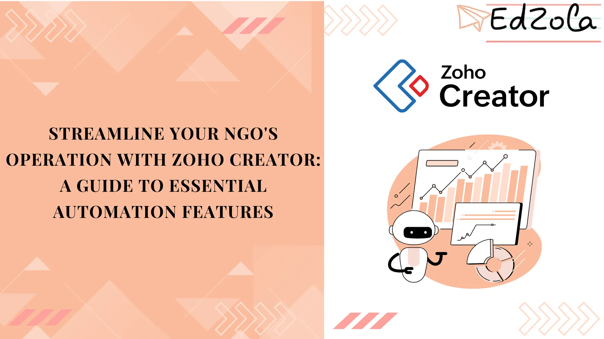

## The Shift to Automation with Zoho Creator

Traditional NGO operations often involve a high degree of manual effort – from sending emails and waiting for approvals to manipulating data and generating reports. These tasks, while necessary, can be time-consuming and prone to errors. Zoho Creator steps in as a solution, offering a range of automation tools that transform these processes, allowing your NGO to focus on what truly matters: your mission.

## Why Low-Code Automation Is a Game-Changer for NGOs

The world of NGO management is evolving rapidly, with a growing need for control and agility. Low-code platforms like Zoho Creator are at the forefront of this transformation. They combine **simplicity with power, providing various visual tools and components that are accessible even to those with minimal programming skills. This enables NGOs to swiftly adapt their processes in response to changing business demands and market trends.**

[Explore Zoho Creator](https://www.edzola.com/zoho-products/zoho-creator)

## 1. Elevating Productivity with Workflow Automation

Zoho Creator offers a spectrum of workflow automation tools that significantly boost NGO productivity:

- **Engage with Donors:** Automate responses to donor interactions.
- **Event Scheduling:** Automate event actions based on specific dates and times.
- **Approval Flows:** Streamline the approval process.
- **Personalized Communication:** Send customized thank-you emails for donations.
- **Task Execution:** Utilize custom functions to efficiently manage NGO tasks.

### Diverse Workflows for Routine Task Automation

From form workflows and payment processes to custom buttons and approval workflows, Zoho Creator offers a diverse range of options to automate and streamline routine NGO tasks.

### Keeping Up-To-Date with Automated Notifications

Create workflows that automatically dispatch emails, SMSs, and mobile notifications to keep everyone informed. With these tools, updates and important information are relayed instantly, maintaining continuous engagement with your events and activities.

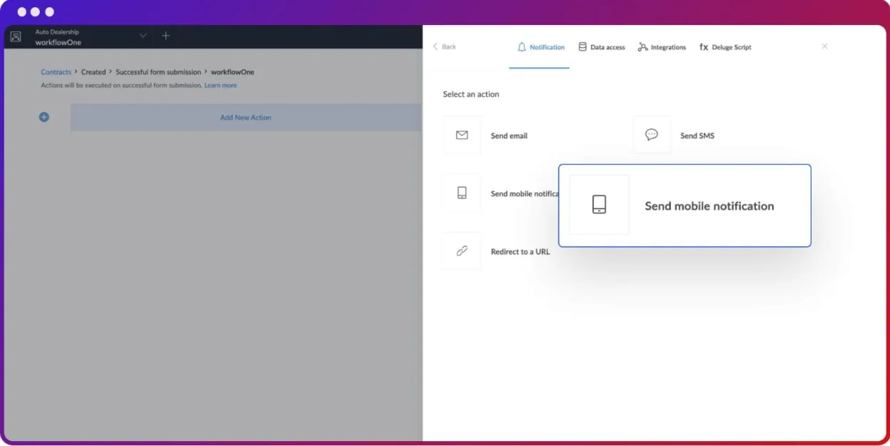

### Data Management through Workflows

Manage volunteer and donor data effectively with workflows that add, update, or delete records in your apps, ensuring your information is always current and accurate.

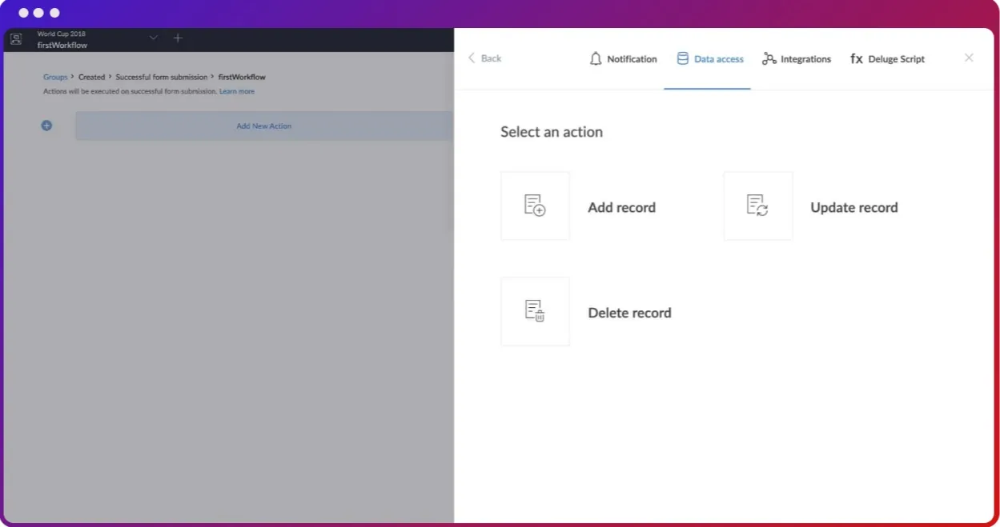

### Integration with Third-Party Apps

Manage volunteer and donor data effectively with workflows that add, update, or delete records in your apps, ensuring your information is always current and accurate.

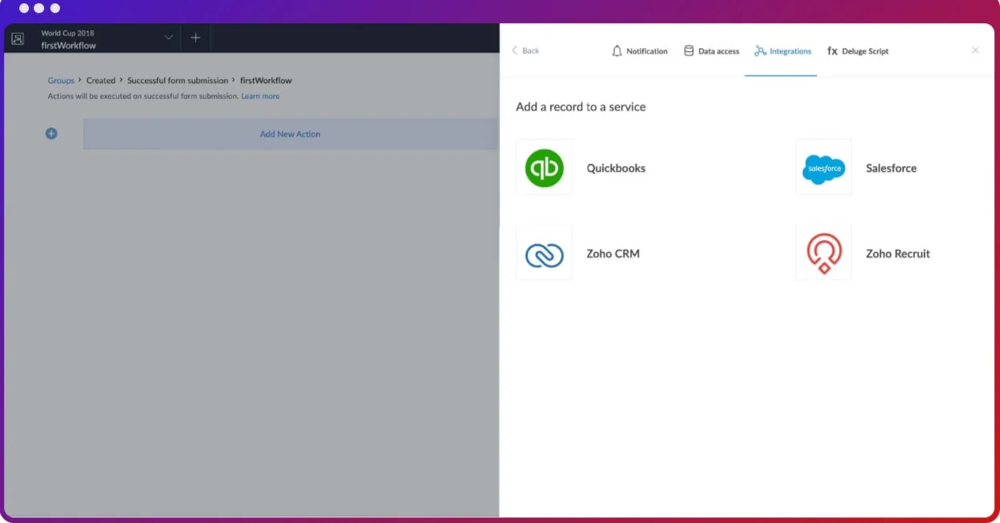

## 2. How Visual Blueprints Elevate NGO Operations with Zoho Creator

For NGOs, managing complex processes efficiently is critical to success. Zoho Creator offers an innovative solution to this challenge through visual blueprints. These blueprints are more than just a tool; they are a roadmap to achieving end-to-end process excellence in your NGO.

### Visual Mapping: Simplifying Complex Processes

The power of **visual blueprints lies in their ability to make complex workflows understandable and manageable. Zoho Creator's drag-and-drop blueprint builder allows NGOs to create detailed process maps, ensuring clarity and ease of use.** This feature is particularly beneficial when onboarding new team members, allowing them to quickly grasp their roles and responsibilities within the organization.

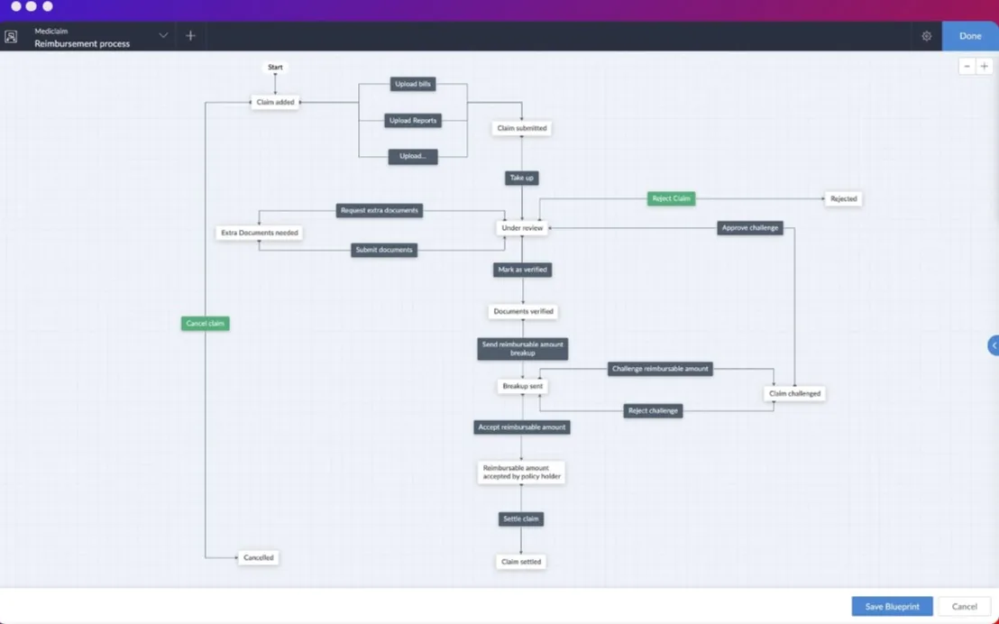

### Establishing Clear Accountability

One of the key challenges in process management is ensuring accountability. Zoho Creator's blueprints address this by clearly defining who is responsible for each action and when it should be performed. This clarity eliminates confusion and ensures that everyone knows their part, thus reducing the likelihood of "blame games"

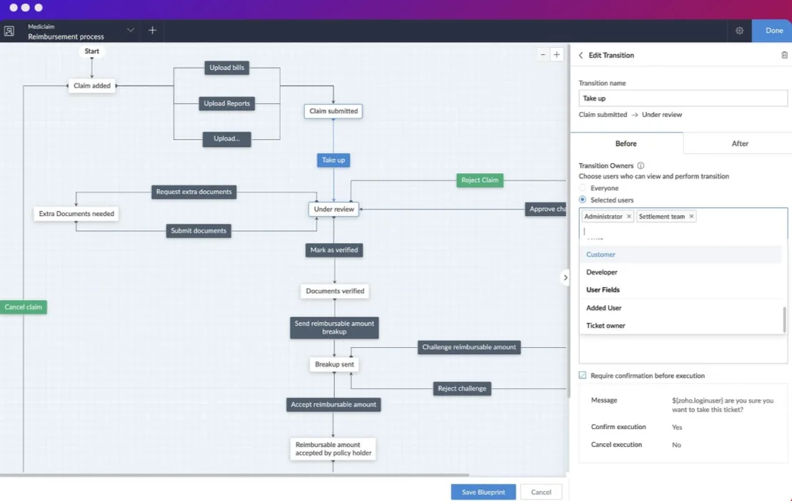

###

### Efficient Information Gathering

Information is the lifeblood of any NGO. Blueprints in Zoho Creator allow for the dynamic collection of information. Volunteers can easily attach documents, add notes, and provide vital data throughout the process, ensuring that all necessary information is at hand when needed.

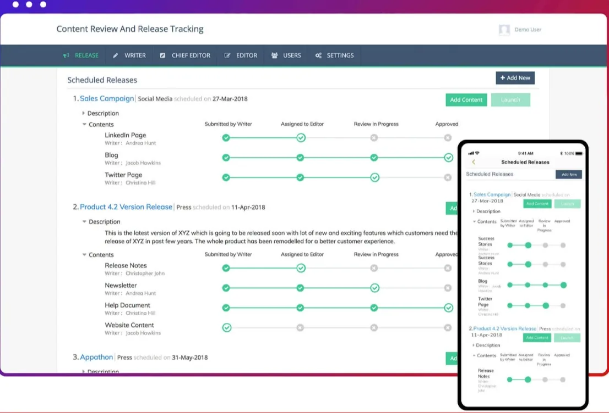

###

### Accelerating the Approval Process

In the world of NGOs, time is often of the essence, especially when it comes to approvals. Zoho Creator facilitates this by enabling the configuration of multilevel approvals. **NGOs can set conditions, add approvers, and customize approval emails, streamlining the process and ensuring that decisions are made swiftly and effectively.**

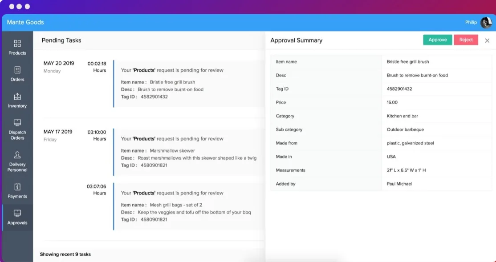

### Enhancing Communication

Effective communication is critical to keeping processes running smoothly. Zoho Creator's blueprints allow NGOs to set up and send relevant notifications, ensuring that team members are always aware of what needs to be done and by when, thereby reducing delays and enhancing overall efficiency.

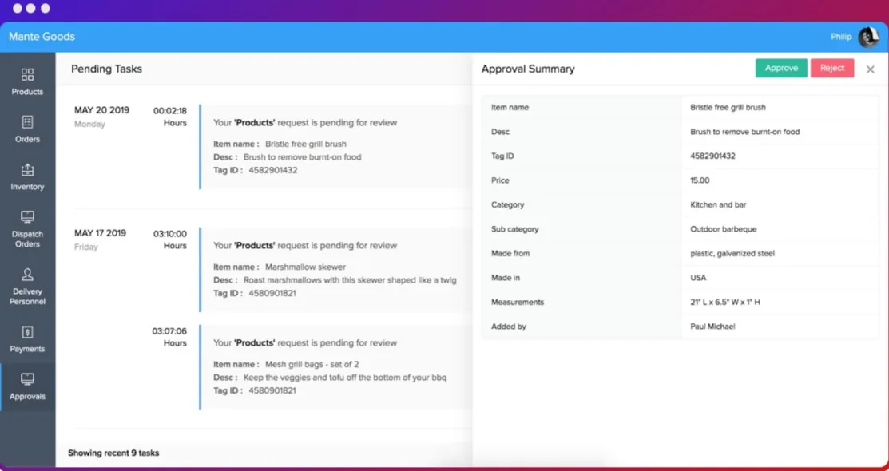

###

### Automating Post-Stage Actions

The journey doesn’t end with the completion of a stage. Zoho Creator allows for the automation of post-stage actions such as sending email notifications, updating data, and integrating with other apps. This feature, coupled with the ability to run custom Deluge scripts, ensures that the momentum of your processes is maintained.

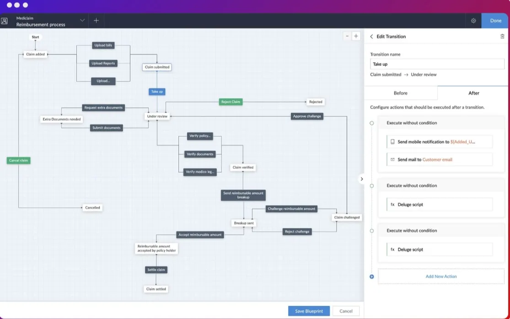

##

## 3. Streamlining NGO Operations with Automated Schedules and Notification

Implementing automated scheduling and notifications in Zoho Creator is a strategic step towards enhancing the efficiency and effectiveness of your NGO. These features not only save time and reduce manual effort but also ensure that your organization stays connected and responsive to the needs of your community and stakeholders.

### Automating for Impact: Schedules in Zoho Creator

Time-sensitive actions are a constant in the NGO sector, from organizing events to tracking project deadlines. **Zoho Creator’s scheduling feature allows NGOs to set up workflows that automatically trigger actions at predefined times.** This automation means that your NGO can stay ahead of the curve, acting proactively rather than reactively.

- **Automated Task Execution:** Set up actions to automatically execute at specific dates and times, ensuring crucial tasks are never overlooked.
- **Proactive Project Management:** Keep your projects on track with automated deadline reminders, maintaining momentum and accountability.
- **Seamless Data Integration:** Automatically fetch information from external services and integrate with other software, keeping your data synchronized and up-to-date.

### Notifications: Keeping Your Team Informed and Engaged

Staying connected with your volunteers and stakeholders is essential for any NGO. Zoho Creator enhances this connection through instant notifications.

- **Diverse Notification Options:** Utilize email, SMS, and mobile notifications to keep your volunteers abreast of app activities and updates.
- **Tailored Communication:** Customize your notifications to deliver the right message at the right time, whether it’s a success message or a redirect to a specific URL.
- **Meeting Reminders:** Send timely reminders for meetings with donors, ensuring punctuality and preparedness.
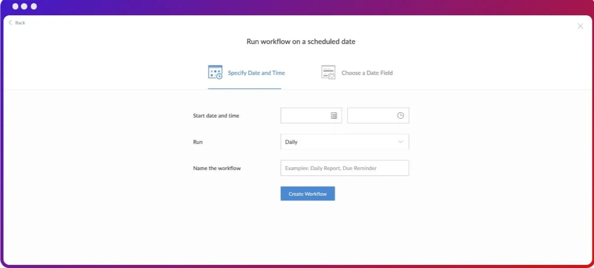

###

### Scheduling Based on Data Triggers

Zoho Creator goes beyond static schedules. You can trigger workflows based on data within your forms. This feature is particularly useful for events or activities tied to specific dates, like donor meetings or volunteer activities.

Dynamic Workflow Triggers: Execute workflows based on the value of a date field in your forms, allowing for more dynamic and responsive scheduling.

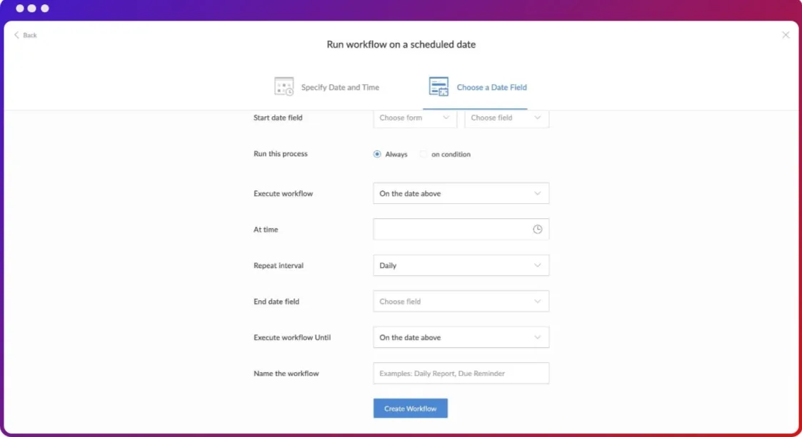

## 4. Improve process efficiency with approval workflow automate

For NGOs, managing approvals efficiently is not just about saving time; it's about enhancing transparency and staying on top of critical deadlines. Zoho Creator's automated approval workflows offer a transformative solution, enabling NGOs to streamline their approval processes seamlessly.

### Understanding Approval Process Automation

Approval process automation is an essential feature for managing various organizational documents and communications, like invoices, legal documents, and crucial market communications. By automating the approval process, Zoho Creator helps NGOs ensure that every step, from initiation to completion, is streamlined and error-free.

### Real-Time Approvals for Dynamic NGO Environments

In the fast-paced NGO sector, decision-making needs to be quick and efficient. Zoho Creator's cloud-based platform provides real-time approval processes, perfectly integrated with your NGO’s workflows, ensuring timely and effective decision-making.

### Seamless API Integration

One of the key strengths of Zoho Creator is its ability to seamlessly integrate with existing products via its API. This integration allows NGOs to utilize data effortlessly, bridging any gaps in the approval workflow and maintaining a cohesive process flow.

### Managing Multi-Tier Hierarchies

NGOs often operate within complex organizational structures. Zoho Creator accommodates this by enabling the creation of multi-tier, role-based approval processes that mirror the NGO’s hierarchical structure, ensuring that every decision goes through the appropriate channels.

### Instant Notifications for Efficient Task Management

Stay updated with instant notifications via email, SMS, or mobile alerts. This feature ensures that relevant personnel in your NGO are immediately informed about approvals, facilitating quick action and task completion.

### Omnichannel Accessibility

Zoho Creator's cloud-based nature means that your NGO's approval processes are accessible from anywhere, at any time. This omnichannel solution ensures that approval times are minimized, enhancing the overall efficiency of your NGO's operations.

In Conclusion, Zoho Creator offers a powerful solution for NGOs to streamline their processes, save time, and focus on their primary goals. By automating tasks, managing data, and simplifying approvals, NGOs can operate more efficiently and respond more quickly to the needs of their communities. This tool is not just about doing things faster; it's about working smarter and making a bigger impact with the resources available. For NGOs looking to enhance their operations and extend their reach, Zoho Creator is a valuable ally.

## Getting Started with EdZola

> ***Where technology becomes a force for good, amplifying human potential and fostering global progress.***

Nonprofits need customized solutions to meet their specific requirements, particularly in areas of data and automation. At [EdZola](https://www.edzola.com/), we specialize in creating customized solutions that align with your organization’s specific goals and needs. Our team works closely with you to identify pain points, develop a tailored plan, and implement the right tools to maximize your impact.

[Let's Connect](https://www.edzola.com/contact)

###
