In NGOs, where resources are often limited and the need to maximize impact is crucial, technology can play a transformative role. Zoho Creator stands out as a powerful ally for NGOs, offering a suite of ready-to-use apps that streamline operations, enhance data management, and boost productivity. Designed to be easy to use and quick to deploy, these apps enable NGOs to focus more on their core mission—be it education, Donor management, or community development—while efficiently managing their day-to-day administrative tasks. In this article we explore how Zoho Creator’s apps are specifically tailored to meet the unique needs of the nonprofit sector, helping these organizations leverage technology to make a greater difference in the communities they serve.

## Why Ready-to-Use Apps for Nonprofits?

Ready-to-use apps are vital for nonprofits for several reasons:

**Reduced Implementation Time:** These apps are pre-designed, eliminating the need for lengthy development processes.

**Ease of Building and Operations:** With user-friendly interfaces, these apps require minimal technical knowledge, allowing staff to focus more on mission-critical tasks.

**Empowerment of NGO Missions:** By automating routine tasks, these apps free up resources, allowing nonprofits to concentrate on strategic objectives.

## Educational Platforms

### 1. Admission Management for NGOs

Utilize our comprehensive software designed for managing student admissions and enrollment seamlessly. This platform enables NGOs to engage with prospective students, allowing admission staff to handle the entire process digitally. By adopting this software, **NGOs can eliminate paperwork, prevent data loss, and access records instantly, setting high standards in admission practices.**

Zoho Creator enables NGOs to streamline their admissions processes with **automated workflows that capture prospective students' details from online forms or social media, directly transferring this data to the admissions team's dashboard in real-time.** This reduces manual data entry errors and speeds up operations, allowing for personalized counseling based on the information collected. Candidates then complete customizable, mobile-friendly quizzes to assess their eligibility, with results instantly processed and stored for swift decision-making. Following the quiz, candidates can select their preferred batch and timings through a dynamic scheduling module that updates in real-time, ensuring a seamless and conflict-free enrollment process, thus significantly enhancing the overall user experience and efficiency of the program admissions.

### 2. Assignment Tracker for NGOs

Simplify the way your organization handles educational assignments with our specialized assignment tracker software. This application is designed to support NGOs in **tracking both student progress and instructional efficacy, making the process of assigning, submitting, and grading work straightforward and efficient.**

### Key Features Tailored for NGOs

**Centralized Information Access**

- Store and access all details related to students, teachers, and courses in one place via cloud storage.
- Easily retrieve information anywhere, anytime, whether on web or mobile platforms, enhancing accessibility for teachers and students in remote areas.
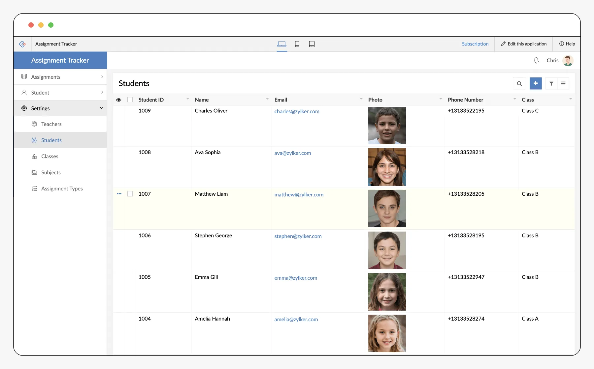

**Flexible Assignment Distribution**

- Distribute assignments to individual students or groups, tailoring the distribution based on educational needs or project goals.
- Set and manage due dates and priorities to keep all participants aligned and on track.
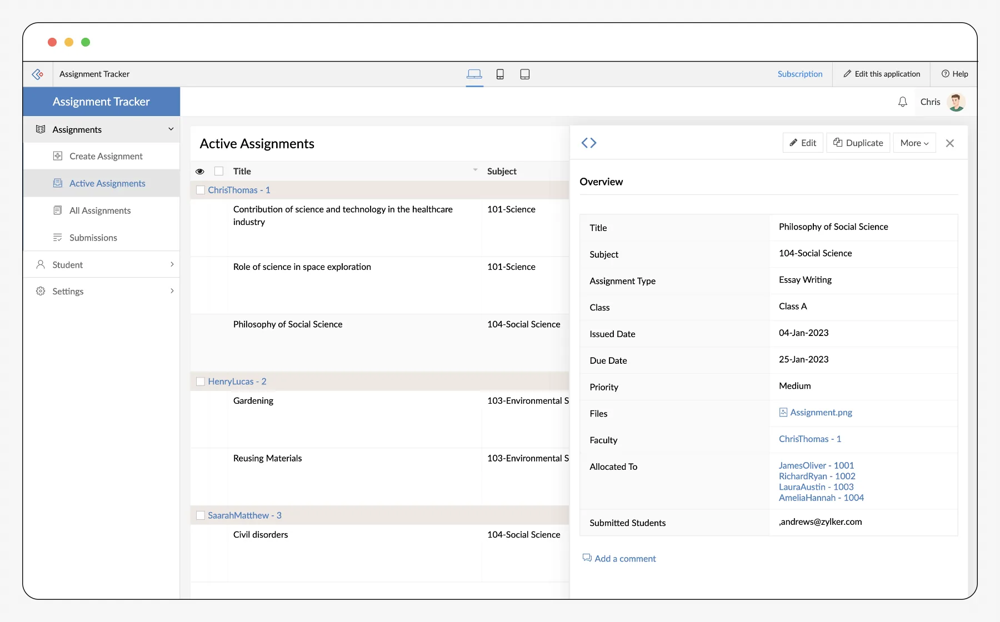

**Automated and Interactive Reporting**

- Assignments can be activated or deactivated with a simple click, with reports being automatically generated upon deactivation.
- Teachers can swiftly review and grade submissions within the platform, incorporating feedback directly into the generated reports.

**Online Submission Encouragement**

- Encourage students to submit their assignments online through an intuitive interface, making the process as simple as typing and uploading their responses.
- Students can easily track their pending and completed assignments, view detailed submission logs, and check their grades, fostering a transparent and motivating learning environment.
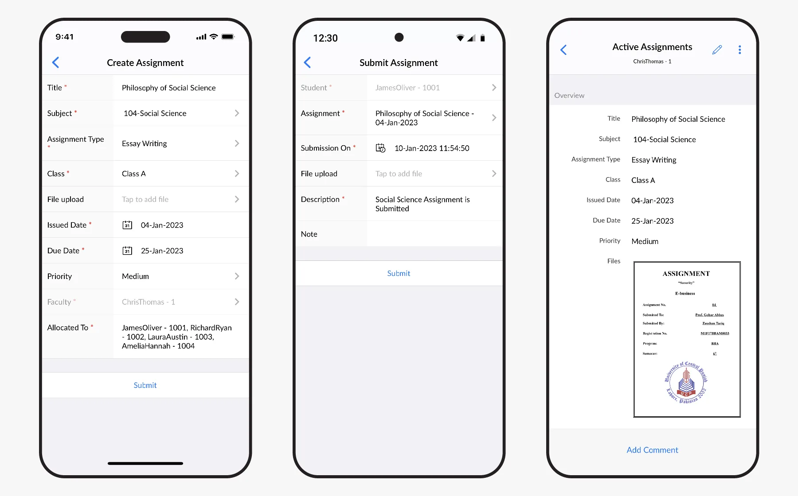

Create, Submit and View your student status

This tailored assignment management Zoho Creator can help NGOs to better manage educational content, facilitate effective teaching, and monitor student progress, all while reducing the administrative burden on educators and administrators.

### 3. Attendance Tracker for NGOs

Digital solution to manage attendance that eliminates common errors associated with traditional methods. Attendance tracker software is designed to simplify and enhance how NGOs monitor **attendance for students, volunteers, and staff across various programs.**

### Key Features Tailored for NGOs

**Error-Free Attendance Recording**

- Utilize digital calendars and pre-populated name lists to eliminate manual input errors.
- Easily add or import participant details from existing databases with just a click, ensuring accuracy and efficiency.
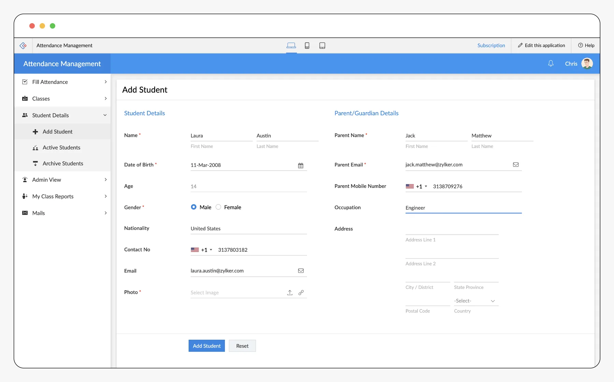

**Flexible Attendance Updates**

- Conveniently update attendance for past dates without hassle, allowing for adjustments whenever necessary.
- This feature is particularly useful for managing irregular attendance patterns common in NGO settings, such as in community education programs.

**Instant Communication**

- Keep participants informed about daily activities and important events with automated in-app notifications via email and SMS.
- Automatically notify parents or guardians about their child's absence, ensuring they are aware and can follow up if needed.

**Detailed Attendance Reporting**

- Generate comprehensive monthly attendance reports that can be filtered by classes, groups, or sessions and by roles such as teachers, trainers, or facilitators.
- Customize reports to provide detailed insights to stakeholders or donors about participation levels in various programs.
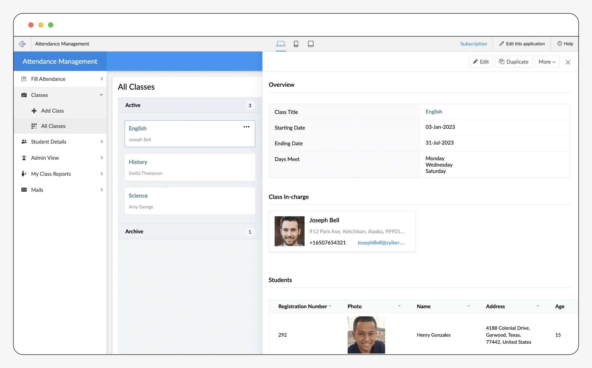

This specialized attendance tracker can help **NGOs efficiently manage their educational and developmental programs by ensuring that attendance data is accurate, accessible, and analyzable.** Such a tool not only aids in operational efficiency but also supports better planning and evaluation of program effectiveness, crucial for the ongoing success of NGO initiatives.

## Nonprofit Organization

### 1. Donor Management for NGOs

**Zoho Creator** customizable donor management software is engineered to **consolidate all your fundraising activities into a single, streamlined application.** This software is ideal for NGOs looking to enhance their donor outreach, manage campaigns more effectively, and significantly boost the impact of their efforts.

### Key Features Tailored for NGOs

**Comprehensive Campaign Management**

- Create, schedule, and manage multiple fundraising campaigns with varied purposes and goals from one central location.
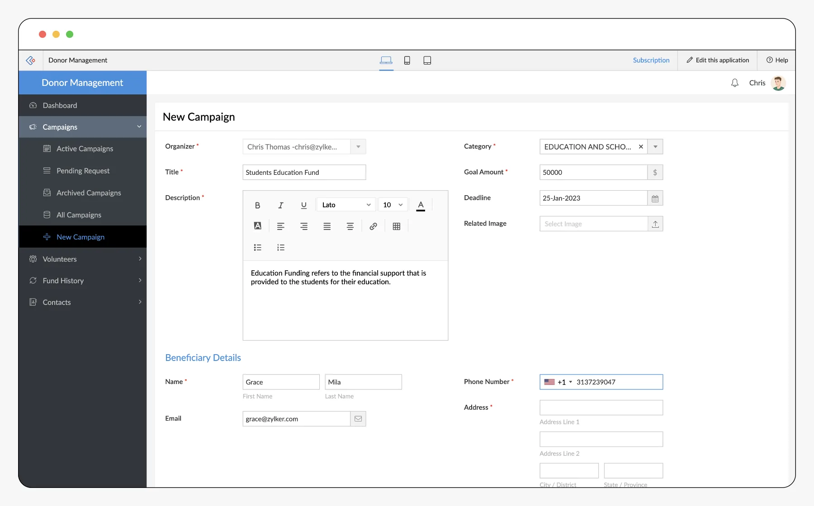

- Track the progress of each campaign with customized reports, adjusting strategies as needed to meet your objectives.
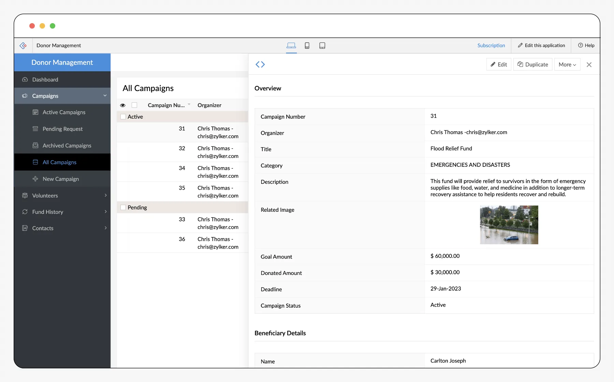

**Enhanced Donor Engagement**

- Maintain detailed profiles for each donor, accessible instantly, allowing for deeper insights into donor behaviors and preferences.
- Engage effectively with donors to foster loyalty and encourage recurring contributions to your cause.

**Real-Time Reporting and Analytics**

- Monitor the performance of fundraising efforts through interactive reports and dashboards.
- Utilize advanced filters and search options to quickly assess campaign data and make informed decisions swiftly
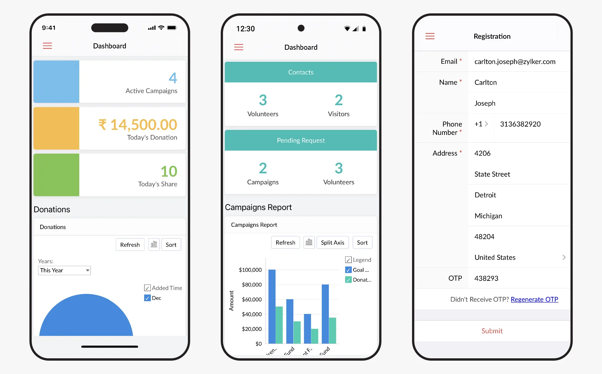

**Automated Communication Tools**

- Segment your contacts into donors, volunteers, and members for targeted communication.
- Set up automated triggers for campaign announcements and personalized acknowledgments to enhance donor experience and engagement.

**Customizable Fundraising Pages**

- Easily create and tailor fundraising pages to match the theme and goals of your campaigns.
- Include essential elements like your NGO’s logo, campaign images, and clear calls-to-action, ensuring each page resonates with potential donors.

By adopting this specialized donor management software, **NGOs can not only streamline their fundraising efforts but also cultivate a stronger relationship with their supporters, ultimately leading to more successful campaigns** and a greater impact on their mission.

### 2. Event Management for NGOs

Zoho Creator event planning management software is designed to be intuitive, customizable, and perfect for NGOs looking to streamline their event organization. From **initial planning to post-event follow-up, this tool ensures every aspect of your event is handled smoothly and professionally.**

### Key Features Tailored for NGOs

**Customized Invitations**

- Create new event or Easily import contacts from popular email services like Gmail, Yahoo, or Outlook.
- Send personalized invitations that resonate with your mission and encourage high participation rates among potential attendees.
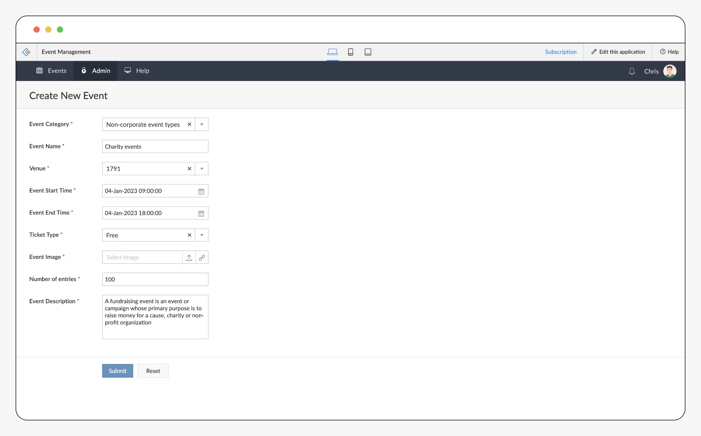

**Event Promotion Tools**

- Showcase upcoming events on your website or blog with an integrated calendar display.
- Add titles, descriptions, and professional images to each event listing to attract attention and provide essential information at a glance.
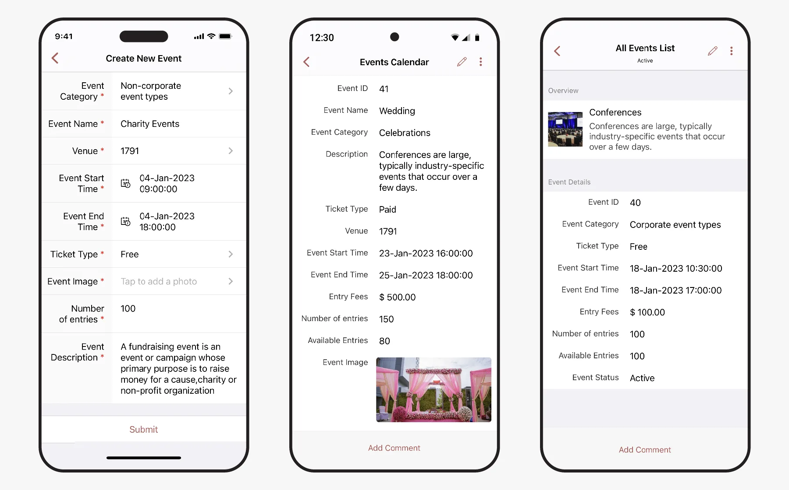

**Streamlined Ticket Sales**

- Offer a secure and straightforward ticket purchasing experience through PayPal integration.
- Enable both free and paid registration options, include discount codes, and accept payments via credit or debit cards to accommodate a wide range of attendees.

**Real-Time Event Updates**

- Move away from cumbersome spreadsheets and manage all event details in real-time through our software.
- Whether on-site or on the go, keep your team informed and coordinated on what actions are needed with up-to-the-minute updates.

**Data Management and Export**

- Compile essential event data such as attendee lists, budgets, and task assignments.
- Export this information in various formats like spreadsheets or PDFs for easy access and sharing among your team.
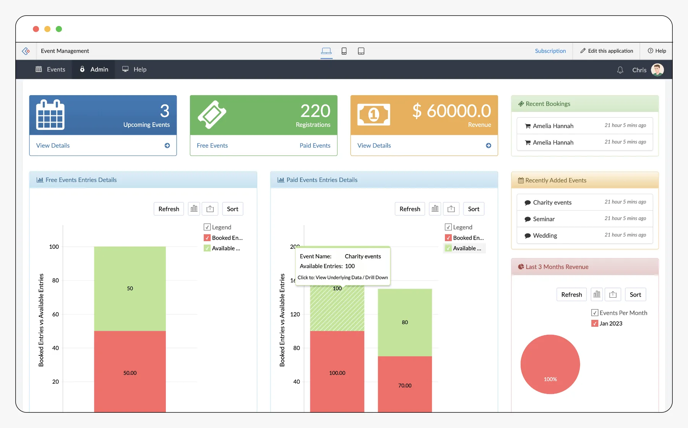

**Efficient Attendee Management**

- Use the software on both iOS and Android devices to scan QR codes for quick attendee check-in and badge printing, minimizing wait times and improving the attendee experience.

This event management software can help **NGOs efficiently organize, promote, and execute their events, ensuring they can focus more on their goals and less on the logistics.**

### 3. Volunteer Management for NGOs

Zoho Creator volunteer management software is designed to help **NGOs efficiently manage their volunteer workforce, from initial recruitment to ongoing engagement and recognition.** This application **simplifies the coordination of events and enhances the overall volunteer experience, ensuring that volunteers are well-informed, appreciated, and motivated to continue their invaluable work.**

### Key Features Tailored for NGOs

**Event Creation and Management**

- Quickly create and manage events with a user-friendly interface. Input details such as venue, time, and additional descriptions to automatically populate a dynamic calendar.
- Customize your calendar displays with event-specific colors and descriptions to make it visually appealing and informative for volunteers.
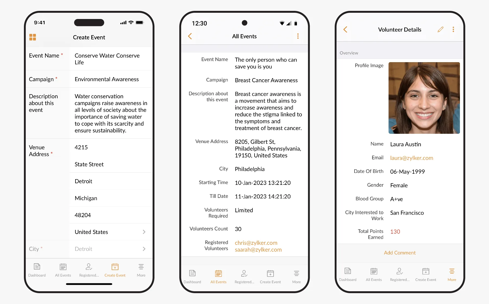

**Volunteer Profiles and Grouping**

- Collect and manage detailed profiles of your volunteers, including their skills, experiences, availability, and interests.
- Strategically group volunteers based on their preferences and qualifications to assign them to events where they can be most effective and satisfied.

**Automated Communication Tools**

- Set up automated emails for confirmations, reminders, and thank-you messages to maintain clear and consistent communication with your volunteers.
- Ensure volunteers are always aware of upcoming commitments and appreciate their contributions post-event.

**Easy Registration and Accessibility**

- Enable volunteers to register for events directly through published calendars accessible on any web-enabled device, facilitating an easy sign-up process.
- This feature is particularly useful for reaching a broader audience and filling volunteer slots more efficiently.

**Real-Time Updates and Feedback**

- Stay updated with live feeds that show who has volunteered for upcoming events and any last-minute changes.
- This feature helps NGOs react promptly to adjustments and keeps all team members informed in real-time.

**Volunteer Rewards and Recognition**

- Implement a point-based system to recognize volunteer hours and achievements.
- Celebrate milestones with certificates or other forms of recognition to encourage ongoing participation and to show gratitude for their dedication.
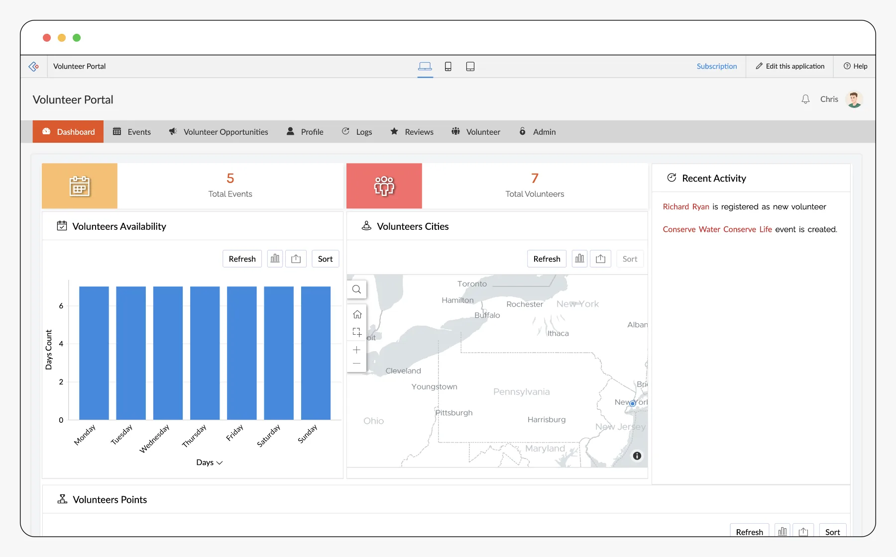

This tailored volunteer management software not only makes managing volunteers easier for NGOs but also enhances the volunteer experience, fostering a committed and enthusiastic community ready to support your NGO’s cause.

Explore More: [Customize Zoho Creator's Pre-Built apps](https://www.zoho.com/creator/apps/education.html)

By implementing a financial management software, NGOs can not only streamline their accounting practices but also ensure greater accuracy and accountability in their financial reporting. This leads to better managed resources, making it easier for NGOs to focus on their core mission and objectives while securing trust and continued support from their benefactors.

[Explore Zoho Creator with a 15-day free trial!](https://www.edzola.com/zoho-products/zoho-creator)

In Conclusion, By leveraging Zoho Creator's suite of ready-to-use applications, NGOs, especially those in the education sector, Donor management, Financial platforms can significantly enhance their operational effectiveness. These specialized tools automate and streamline essential processes such as student admissions, assignment tracking, financial management, and volunteer coordination. With Zoho Creator, NGOs can centralize data management, reduce administrative burdens, and focus more intently on their core missions. This strategic utilization of technology empowers nonprofits to operate more efficiently, enabling them to allocate more resources towards impactful activities and achieve sustainable success in their endeavors to make a meaningful difference.

## Getting Started with EdZola

> ***Let's innovate with purpose and use technology as a force for good.***

Every nonprofit is unique, and one size does not fit all when it comes to solutions. At [EdZola](https://www.edzola.com/), we specialize in creating customized solutions that align with your organization’s specific goals and needs. Our team works closely with you to identify challenges, develop a tailored plan, and implement the right tools to maximize your impact.

[Let's Connect](https://www.edzola.com/contact)
