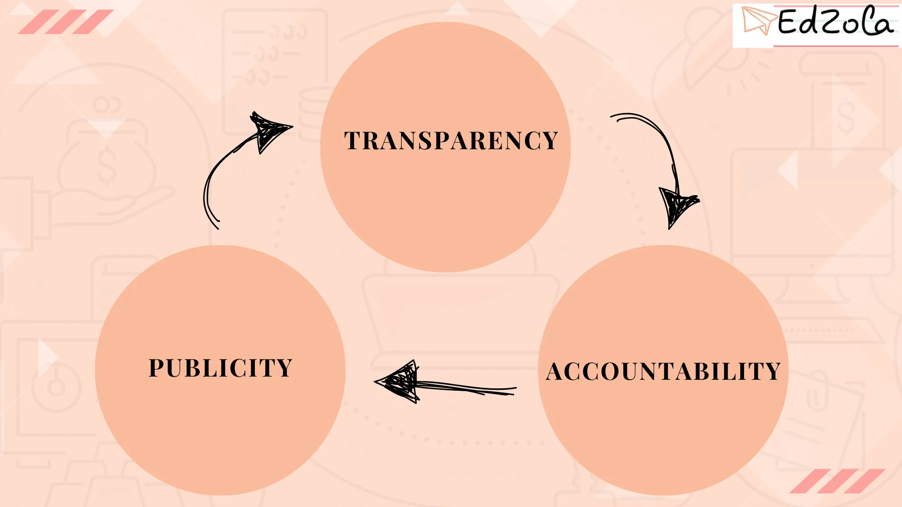

In the dynamic world of social enterprises and non-profit organizations, accountability is of paramount importance. It ensures transparency, builds trust among stakeholders, and ultimately enhances the organization's impact. One powerful tool that can greatly contribute to accountability is Management Information System (MIS) reporting.

## **Understanding the Importance of Accountability in Non-Profit Organizations**

Before diving into the world of MIS reporting, it is crucial to grasp the significance of [accountability in the non-profit sector.](https://tickthoseboxes.com.au/accountability-in-non-profit-why-it-matters-and-how-to-implement-it/) Accountability is much more than just a buzzword; it is a fundamental principle that guides the actions and decisions of organizations that aim to bring about positive change.

### Defining Accountability in the Non-Profit Sector

Accountability in the non-profit sector refers to the responsibility of organizations to be answerable for their actions, use of resources, and the impact they create. I**t encompasses not only financial transparency but also ethical conduct, stakeholder engagement, and delivering on the organization's mission.**

### The Role of Accountability in Non-Profit Success

Accountability is not only a moral obligation; it is also crucial for the success and sustainability of non-profit organizations. When non-profits are accountable, they build trust and credibility with their stakeholders, including donors, volunteers, beneficiaries, and the wider community. This, in turn, leads to increased support, more strategic partnerships, and a positive reputation. One of the key aspects of accountability in non-profit organizations is **financial transparency.** Donors and other stakeholders want to know how their contributions are being used and the impact they are making. By providing clear and detailed financial reports, non-profits can demonstrate their commitment to accountability and gain the trust of their supporters.

In addition to financial transparency, ethical conduct is another crucial element of accountability. **Non-profit organizations must adhere to high ethical standards in their operations, ensuring that their actions align with their mission and values.** This includes being honest and transparent in their communication, treating all stakeholders with respect and fairness, and making decisions that prioritize the best interests of the communities they serve.

Stakeholder engagement is also an essential part of **accountability** in non-profit organizations. By actively involving stakeholders in decision-making processes, non-profits can ensure that their actions are aligned with the needs and expectations of the communities they serve. This can be done through regular communication, feedback mechanisms, and involving stakeholders in the planning and evaluation of programs and initiatives.

Lastly, delivering on the organization's mission is a crucial aspect of accountability. Non-profit organizations exist to create positive change and address societal issues. By setting clear goals, monitoring progress, and regularly evaluating the impact of their programs, non-profits can demonstrate their commitment to accountability and ensure that they are making a meaningful difference in the lives of those they serve.

## **The Concept of MIS Reporting**

Now that we have established the importance of accountability, let's explore the concept of MIS reporting and how it can contribute to enhancing transparency in non-profit organizations.

### What is MIS Reporting?

MIS reporting is a systematic process of gathering, analyzing, and presenting data to inform decision-making and monitor organizational performance. It involves the collection of relevant data points, their transformation into meaningful information, and the presentation of insights in a clear and concise format. [Building an efficient MIS system](https://www.edzola.com/post/building-efficient-non-profits-with-mis-a-starter-guide) in your non-profit helps you make better decisions.

### Key Components of Effective MIS Reporting

Effective MIS reporting incorporates several key components to ensure its usefulness and relevance to stakeholders. These components include:

1. **Identifying and prioritizing relevant data points:** It is crucial to determine which data points are most important for measuring the organization's impact and accountability.
2. **Clear data collection and management processes:** Implementing robust data collection and management processes is essential to ensure the accuracy and reliability of the information being reported.
3. **Analysis and interpretation:** Transforming raw data into meaningful insights requires effective analysis and interpretation techniques.
4. **Visual presentation:** Presenting data in a visual format, such as charts and graphs, enhances comprehension and facilitates decision-making.
5. **Regular reporting cycles:** Establishing regular reporting cycles ensures that stakeholders have up-to-date information and can track progress over time.
6. **Accessible and user-friendly reporting platforms:** Non-profits should ensure that their MIS reporting platforms are easily accessible and user-friendly for stakeholders.
7. **Data security and privacy:** Given the sensitive nature of some data, non-profits must prioritize data security and privacy to maintain stakeholder trust.

## **The Intersection of Non-Profit Accountability and MIS Reporting**

Now, let's explore how MIS reporting enhances non-profit accountability and the challenges organizations may face in implementing this powerful tool.

### How MIS Reporting Enhances Accountability

MIS reporting plays a crucial role in enhancing non-profit accountability by providing stakeholders with accurate, timely, and relevant information about the organization's performance and impact. Transparency through data reporting allows stakeholders to assess the organization's alignment with its mission and the effective utilization of resources.

> ***MIS reporting enables non-profit organizations to present evidence of their impact and progress, giving stakeholders confidence in the organization's work.***

By sharing data and insights, non-profits can foster meaningful conversations and collaboration with stakeholders, including donors, board members, employees, and beneficiaries. This engagement leads to increased trust, stronger partnerships, and informed decision-making.

**Analyze with a deeper dive :** [**Accountable Reporting For Nonprofit Organizations**](https://thephilanthropist.ca/2012/05/accountable-reporting-for-nonprof-it-organizations/)

### Challenges in Implementing MIS Reporting in Non-Profits

Implementing effective MIS reporting in non-profit organizations is not without its challenges. Limited resources, lack of data management expertise, and resistance to change are among the hurdles organizations may encounter.

## **Strategies for Effective MIS Reporting in Non-Profits**

While implementing MIS reporting may present challenges, there are strategies that non-profit organizations can adopt to ensure its effectiveness and success.

### Adopting the Right MIS Reporting Tools

Choosing the right MIS reporting tools is crucial for gathering, analyzing, and presenting data effectively. Non-profit organizations should consider their specific needs, budget, and technical capacities when selecting a reporting tool. Conducting thorough research, seeking recommendations from industry peers, and consulting with experts can help organizations make informed decisions. Best tool for**insightful data visualization**, with a **15-day free trial****.**

[Explore Zoho Analytics](https://www.edzola.com/zoho-products/zoho-analytics-)

### Training and Capacity Building for MIS Reporting

Providing adequate training and capacity building opportunities to staff members is essential to maximize the potential of MIS reporting. Non-profits should invest in training programs that enhance data literacy and analytical skills among their teams.

## **Evaluating the Impact of MIS Reporting on Non-Profit Accountability**

Measuring the impact of MIS reporting is crucial to evaluate its effectiveness and identify areas for improvement.

### Measuring the Success of MIS Reporting

Non-profit organizations can measure the success of MIS reporting by assessing the following key indicators:

1. Improved stakeholder engagement and satisfaction
2. Increased financial transparency
3. Enhanced decision-making and organizational performance
4. Greater alignment with the organization's mission
5. Strengthened partnerships and collaboration
6. Positive impact on resource utilization and efficiency
7. Enhanced credibility and reputation

### Continuous Improvement and Adaptation in MIS Reporting

MIS reporting is not a one-time activity; it requires continuous improvement and adaptation to address evolving needs and challenges. **Non-profit organizations should actively seek feedback from stakeholders, monitor emerging trends in data reporting, and incorporate new and relevant data points to stay accountable and transparent.**

In conclusion, effective MIS reporting is a powerful tool that can enhance non-profit accountability by providing stakeholders with transparent, credible, and actionable information. By leveraging the right MIS reporting tools, investing in staff training, and continuously improving the reporting process, non-profit organizations can build trust, foster collaboration, and maximize their impact in the communities they serve.

## Getting Started with EdZola

> ***Let's innovate with purpose and use technology as a force for good.***

Every nonprofit is unique, and one size does not fit all when it comes to data solutions. At [EdZola](https://www.edzola.com/), we specialize in creating customized solutions that align with your organization’s specific goals and needs. Our team works closely with you to identify pain points, develop a tailored plan, and implement the right tools to maximize your impact.

[Let's Connect](https://www.edzola.com/contact)
