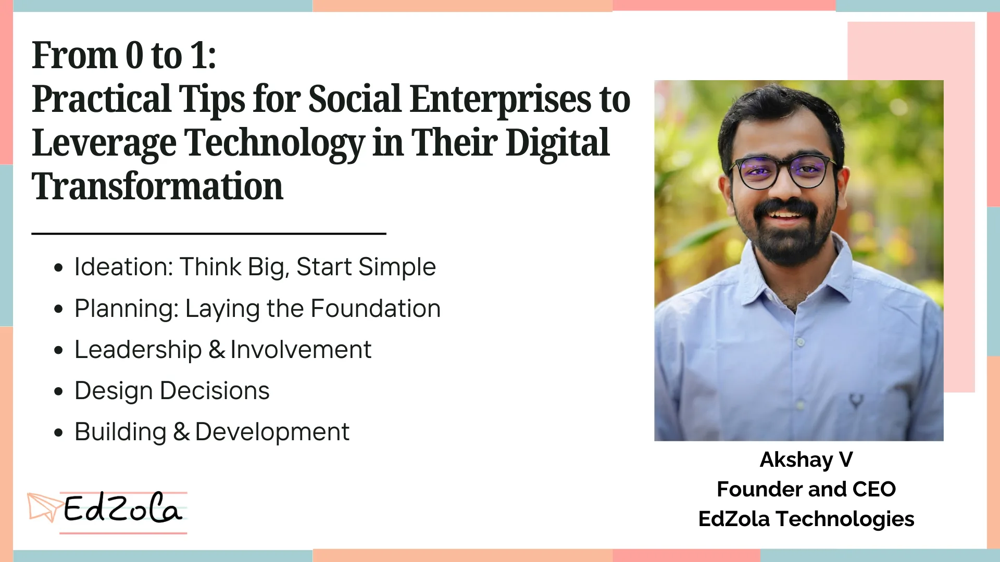

Over the last four-plus years, working closely with nonprofits, We’ve come to realize that standard digital transformation frameworks don’t always fit in the nonprofit sector. Nonprofits have unique contextual needs, and many traditional approaches need adjustment to make meaningful progress in this space. Through our work at [***EdZola Technologies***](https://www.edzola.com/) , we’ve learned a few key things, and we are grateful to all our partners for making these insights possible. This is version one of our tips for nonprofits undergoing digital transformation, and it will keep evolving as we continue to grow.

## 1. Ideation: Think Big, Start Simple

In the ideation phase, always begin with the user in mind.

Ask yourself:

- Who are your stakeholders?
- Where are they struggling?
- What is the significant change you want to see in them?
- Can tech play a role here? (Think about experience, efficiency, access, or impact)

## 2. Planning: Laying the Foundation

- Start simple — Streamline your processes using easy-to-adopt tools like Google Forms and Sheets. Complexity can come later.
- Set clear expectations — Having a proper vision from the start helps avoid confusion and saves both time and money in the long run.
- Time spent planning saves hours later — Every additional minute spent on planning or optimizing your processes will save hundreds of hours down the line.
- Focus on People, Processes, then Technology — Nonprofits often start with technology, but real change comes when you focus first on your people and processes.
- Technology amplifies human effort — It doesn’t replace it. Machines and systems can’t drive social change—people do.
- Technology addresses existing pain points — It won’t solve problems that don’t exist. Focus on areas where inefficiencies are already felt.

## 3. Leadership & Involvement: The Backbone of Transformation

- Leadership buy-in is crucial — Without it, technology won’t take root.
- Ensure internal ownership — Assign someone to dedicate 30-40% of their time to leading the initiative internally.
- Have a Single Point of Contact (PoC) — A dedicated PoC for tech-related initiatives helps nonprofits stay on track.
- The deeper the involvement, the better the outcomes — The more engaged you are with the digital process, the more success you’ll achieve.

## 4. Design Decisions: Maximize Efficiency with Smart Choices

- Automation magnifies efficiency (or inefficiency) — Automate only the processes that are already efficient.
- Leverage existing platforms — Most nonprofits can meet 90% of their needs with existing tools and platforms, reducing the need for custom systems.
- Allocate 7-10% of your budget to technology — Investing in tech is critical to growth.
- Use free or existing software for back-office tasks — Many great solutions exist for HR, project management, and other operations.
- Nonprofits are the product owners — While tech partners can offer guidance, your organization makes the final call on decisions.

## 5. Building & Development: Fast, Flexible, Functional

- Start with an MVP — Build a Minimum Viable Product to test with users and gather insights before scaling.
- Function over form — Prioritize getting things to work well before worrying about aesthetics.
- Go live fast, iterate, and refine — Don’t wait for perfection. Launch, learn, and improve based on real-world feedback.
- Use an Agile approach — If requirements are unclear, start with small sprints or an MVP to accelerate clarity.
- Expect evolving needs — After users interact with your solution, new pain points will emerge, so flexibility is essential.

The key takeaway is to think big but start simple, plan diligently, involve the right people, and remain open to change. The tips shared here form version one of our ongoing learning process at EdZola Technologies. As we continue to grow and partner with more organizations, we will refine and expand these strategies, driving impactful change across the nonprofit landscape.

> ***Digital transformation is a journey, not a destination—embrace it with an open mind and a willingness to evolve.***

Start your nonprofit's [digital transformation](https://www.edzola.com/post/tech-trends-keeping-your-nonprofit-ahead-in-the-digital-transformation-race) with EdZola Technologies. Let's work together to simplify processes and create meaningful change.

[Let's Connect](https://www.edzola.com/contact)
