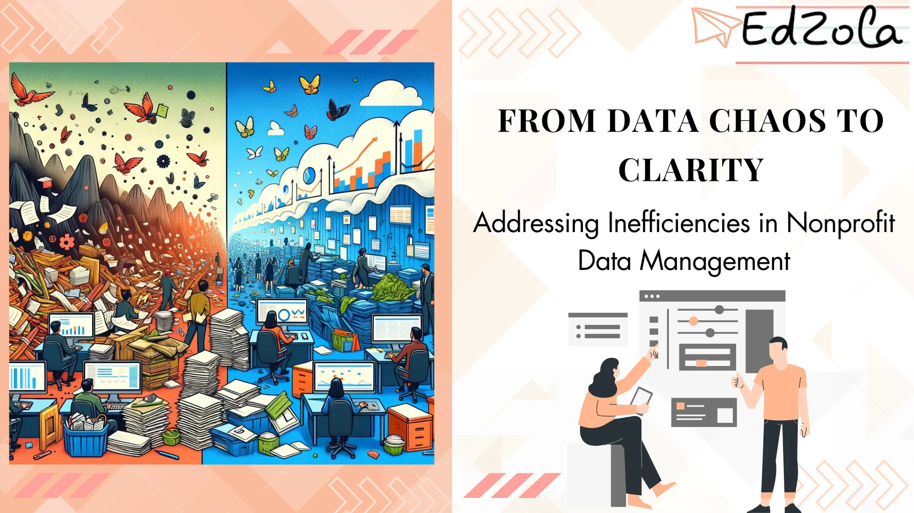

In the sprawling world of nonprofit organizations, data is the lifeblood that keeps the operations running smoothly. From managing donor outreach and fundraising campaigns to tracking program outcomes and impact, data is invaluable for driving decision-making and measuring success. However, many nonprofits struggle with the chaos that accompanies data management, leading to inefficiencies and missed opportunities. In this article, we will delve into the intricacies of nonprofit data management, identify common challenges, and explore strategies to transform data chaos into clarity.

## **Understanding the Importance of Efficient Data Management in Nonprofits**

> ***Data is the new gold.***

This quote, oft-repeated in articles and seminars, underscores the immense value and potential that data holds for nonprofits. **Effective data management enables nonprofits to gain insights, make informed decisions, and maximize their impact**. Whether it's tracking donor contributions, analyzing program outcomes, or evaluating the success of fundraising campaigns, efficient data management is crucial for driving transparency, accountability, and organizational growth. In the nonprofit sector, data management helps achieve [better outcomes and informed, data-driven decisions.](https://www.edzola.com/post/mastering-non-profit-data-management-for-better-outcomes-the-power-of-data-driven-decisions)

### The Role of Data in Nonprofit Organizations

In today's digital age, nonprofits are drowning in a sea of data. Every interaction, every dollar raised, every programmatic activity generates a wealth of information. However, data is only effective when it is harnessed and transformed into actionable insights.

At its core, data in nonprofit organizations serves several essential functions:

1. **Measuring Impact:** Reliable and well-managed data allows nonprofits to track their progress, measure impact, and demonstrate accountability to stakeholders.
2. **Informed Decision-Making:** Access to accurate and up-to-date data empowers nonprofits to make strategic decisions based on evidence rather than guesswork.
3. **Donor Management:** A robust data management system enables nonprofits to effectively engage and cultivate relationships with their supporters, ensuring consistent donor stewardship and retention.
4. **Fundraising Insights:** By analyzing data, nonprofits can identify trends, preferences, and opportunities to optimize their fundraising efforts and maximize contributions.
5. **Program Evaluation:** Data plays a vital role in evaluating program effectiveness, identifying areas for improvement, and demonstrating the value of nonprofit initiatives.

### Common Challenges in Nonprofit Data Management

Despite recognizing the importance of data, nonprofit organizations often face significant challenges in managing it efficiently. These challenges can manifest in various ways, resulting in bottlenecks, inconsistencies, and missed opportunities.

**Analyze with a deeper dive:** [**6 Data Management Challenges and Solutions for Non-Profits**](https://www.edzola.com/post/6-data-management-challenges-and-solutions-for-non-profits)

Some common challenges in nonprofit data management include:

- **Lack of Standardization:** In a fast-paced nonprofit environment, data is often collected and stored in disparate systems, making it difficult to consolidate and extract meaningful insights.
- **Poor Data Quality:** Inaccurate, outdated, or incomplete data can lead to skewed analysis, erroneous reporting, and misguided decision-making.
- **Inefficient Processes:** Manual data entry, redundant workflows, and a lack of automation can consume valuable time and resources, hindering productivity and limiting organizational growth.
- **Data Silos:** Departments and teams working in isolation with limited data sharing can lead to fragmented insights and missed opportunities for collaboration.
- **Limited Data Literacy:** Nonprofit staff may lack the necessary skills and training to effectively manage and leverage data for their day-to-day operations.
- **Security and Privacy Concerns:** Nonprofits, like any organization, must prioritize data security to safeguard donor information and maintain donor trust.

## **Identifying Inefficiencies in Your Nonprofit's Data Management**

Like a detective on the trail of clues, identifying inefficiencies in your nonprofit's data management requires a keen eye and a systematic approach. By recognizing the signs of inefficient data management, you can take proactive steps towards improving your organization's data practices and achieving clarity.

### Signs of Inefficient Data Management

It's time to put on your rose-colored glasses and examine your nonprofit's data management processes with a critical eye. Here are some common signs that suggest inefficiencies:

1. **Duplicate Data:** If you find yourself drowning in duplicate records or redundant data, it's a clear indication that your data management system needs attention.
2. **Slow Response Times:** If your team takes ages to retrieve or update critical data, it's a red flag that your system is not optimized for efficiency.
3. **Inconsistent Reporting:** If your reports lack uniformity, structure, or fail to meet stakeholder requirements, it's a sign that your data management practices may need an overhaul.
4. **Data Entry Errors:** Frequent data entry errors or inaccuracies can be indicative of poor data quality control measures or insufficient staff training.
5. **Difficulty in Data Analysis:** If analyzing data feels like trying to solve a complex puzzle without the right pieces, it's an indication that your data system may not be providing the necessary insights you need.
6. **Missed Opportunities:** If you are unable to capitalize on potential collaboration, fundraising insights, or programmatic efficiencies due to data limitations, it's time to reassess your data management practices.

### Impact of Inefficiencies on Nonprofit Operations

The consequences of inefficient data management in nonprofits can extend far beyond mere inconvenience. Delayed decision-making, compromised data quality, and missed opportunities can hinder the overall efficiency, growth, and impact of your organization.

Inefficient data management can lead to:

- **Wasted Time and Resources:** Manual data entry, repetitive processes, and inefficient workflows drain valuable resources, diverting them from mission-critical activities.
- **Missed Fundraising Opportunities:** Inaccurate or incomplete donor information can result in missed chances to engage donors, personalize communications, and secure crucial funding.
- **Poor Program Evaluation:** Inconsistent or incomplete data can make it challenging to accurately measure program outcomes and impact, compromising your ability to demonstrate effectiveness to stakeholders.
- **Loss of Donor Trust:** Data breaches or mishandling can erode donor trust, potentially resulting in a loss of support, revenue, and damaging your organization's reputation.

## **Strategies for Transforming Data Chaos into Clarity**

Now that we've identified the pain points and challenges in nonprofit data management, let's explore strategies to address them head-on and pave the way for data clarity and efficiency in your organization. Once you've created strategies for transforming your data, [analyzing the collected data becomes crucial for your non-profit](https://www.edzola.com/post/analyze-collected-data).

### Implementing Effective Data Management Practices

Effective data management is not a one-size-fits-all solution but rather a tailored approach that aligns with your organization's specific needs and goals. Here are some key steps to consider:

1. **Create a Data Management Strategy:** Begin by developing a comprehensive data management strategy that outlines clear goals, processes, and protocols for data collection, storage, analysis, and reporting.
2. **Standardize Data Collection:** Adopt consistent data collection methods, formats, and definitions to ensure data integrity and ease of merging and analysis.
3. **Invest in the Right Tools:** Identify and implement data management tools and systems that integrate well with your organization's existing infrastructure and support efficient workflows.
4. **Train Staff:** Provide training and resources to equip staff with the necessary skills to manage data effectively, including data entry, data analysis, and report generation.
5. **Establish Data Governance:** Define roles, responsibilities, and access levels for data management, ensuring clear accountability and data security.
6. **Embrace Automation:** Automate repetitive tasks, such as data entry and reporting, to free up staff time for strategic analysis and decision-making.
7. **Regularly Review and Update:** Implement a process for regularly reviewing and updating your data management practices to ensure they remain aligned with your organization's evolving needs.

### Leveraging Technology for Better Data Management

Technology can be a game-changer when it comes to nonprofit data management. Here are some ways technology can help:

- **Centralized Database:** Implement a centralized database or customer relationship management (CRM) system specifically designed for nonprofits to consolidate and streamline data storage and retrieval.
- **Data Integration:** Explore options for integrating your various data sources, such as online fundraising platforms and social media, into a single cohesive system for more accurate insights and streamlined analysis.
- **Data Visualization:** Leverage data visualization tools to present complex information in a visually appealing and digestible format, making it easier for stakeholders to understand and act upon the insights provided by the data.
- **Automated Reporting:** Utilize reporting tools that automate the generation of standard reports, saving time and ensuring consistency in reporting.
- **Secure Data Storage:** Invest in robust data security measures, including encryption, firewalls, and backup systems, to protect donor information and maintain data privacy.

## **Maintaining Clarity in Nonprofit Data Management**

Transforming data chaos into clarity is an ongoing journey, requiring continuous effort and vigilance. Here are some practices to help maintain data clarity in your nonprofit:

### Regular Data Audits and Clean-ups

Regularly audit and clean up your data to maintain its accuracy and relevance. **Remove duplicate records, update outdated information, and ensure data is properly categorized and organized.**

### Training Staff for Consistent Data Management

Cultivate a culture of data literacy by providing ongoing training and resources to staff. This will help ensure consistent data management practices and empower staff to make informed decisions based on data insights.

## **The Future of Nonprofit Data Management**

As we gaze into the crystal ball, it's evident that the future of nonprofit data management holds exciting possibilities. Emerging trends promise to revolutionize how nonprofits collect, manage, and leverage their data.

### Emerging Trends in Data Management

One of the key trends in nonprofit data management is the increasing integration of **artificial intelligence (AI) and machine learning (ML)**. These technologies can help automate data analysis, predict donor behaviors, and personalize communications, enhancing donor engagement and fundraising effectiveness.

### Preparing Your Nonprofit for a Data-Driven Future

To prepare your nonprofit for a data-driven future, consider the following steps:

1. **Stay Informed:** Stay abreast of emerging trends, technologies, and best practices in nonprofit data management by reading industry blogs, attending webinars, and engaging with thought leaders in the field.
2. **Continuously Evaluate and Adapt:** Regularly assess your data management practices, systems, and tools to ensure they remain relevant and effective. Be open to adopting new technologies and processes that align with your organization's needs.
3. **Engage Stakeholders:** Involve your stakeholders in the data management process by seeking their input, soliciting feedback, and sharing relevant data insights that demonstrate your organization's impact and value

In conclusion, efficient data management is essential for nonprofit organizations aiming to drive transparency, accountability, and maximize their impact. By understanding the importance of data, identifying inefficiencies, and implementing effective strategies, nonprofits can transform data chaos into clarity, paving the way for a future where data empowers change and drives lasting impact.

## Getting Started with EdZola

> ***Where technology becomes a force for good, amplifying human potential and fostering global progress.***

Every nonprofit is unique, and one size does not fit all when it comes to data solutions. At [EdZola](https://www.edzola.com/), we specialize in creating customized solutions that align with your organization’s specific goals and needs. Our team works closely with you to identify pain points, develop a tailored plan, and implement the right tools to maximize your impact.

[Let's Connect](https://www.edzola.com/contact)
