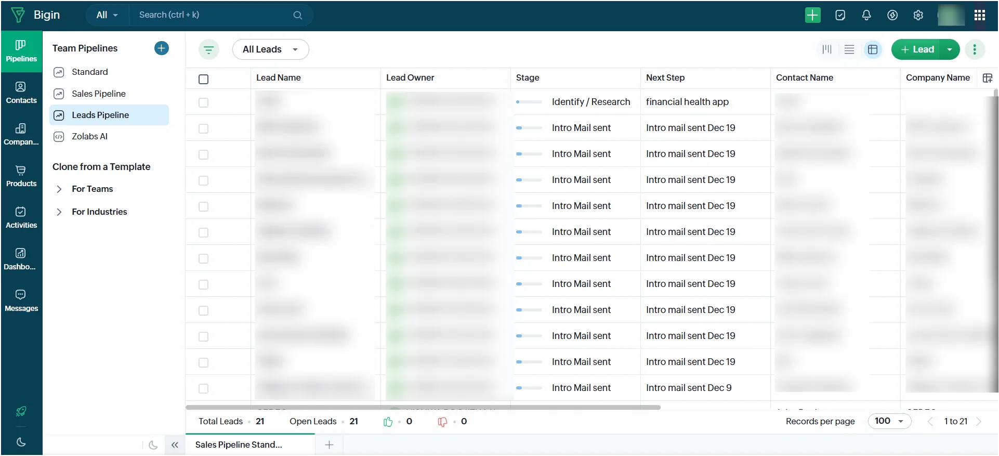

Last month, I found myself in a situation that felt all too familiar to many of the NGO teams I work with. The Quarter was over, revenue planning was on bullet speed, and I was talking to nine different potential clients, each at different stages of the decision-making process. Some were reviewing proposals, others were *“interested but needed time,”* and then there were those waiting on specifications.

I tried tracking them multiple times my colleague and I built an Excel sheet, a fancy color-coded Google Document and even tried the Any Do app that gave us reminders to follow up… on following up! Nothing worked.

The problem? Too much information stored in too many places. The result was stress, missed follow-ups, and that nagging worry that I might accidentally let a promising client slip away simply because I wasn’t organized. That’s when I decided to practice what I preach.

## **Using Zoho Bigin**

At EdZola, I help NGOs adopt CRM systems to make donor management easier and more structured. But in my own client work, I realized I wasn’t applying the same discipline. CRMs can feel heavy if you try to use every feature at once, but [Zoho Bigin](https://www.edzola.com/zoho-products/zoho-crm) is lightweight, simple, and built for small non profits and first time CRM users and teams.

I’ll be honest: I wasn’t new to Zoho Bigin. I had been using it on and off for a while, but in a very loose way. My contacts were in there, some deals were tracked, and every now and then I’d update a stage. The problem was that I didn’t have a system it was not regular in my updates and just dumped information when I remembered.

## **Getting Serious About My Pipeline**

So last month, I gave myself a hard deadline. If I was going to recommend structured CRM usage to NGOs, I needed to hold myself accountable to the same standard. I mapped out my **sales touchpoints**: when I first meet a client, when I send a proposal, when to follow up, and how to track those *“waiting for decision”* moments. I then refined my pipeline in Bigin to reflect these steps:

**1.Initial Conversation** – first interaction

**2.Compatibility Meeting** – understanding needs and fit

**3.Proposal Shared** – submitted something concrete

**4.Awaiting Response** – where I often lost track

**5.Negotiation/Clarification** – ironing out details

**6.Contract** – finalizing the agreement

**7.Closed - Won/Lost** – a clean outcome record

The pipeline wasn’t new, but what changed was (1) allocating strict timelines between stages and (2) applying discipline. Instead of relying on memory or calendar entries, I tied every stage to **automated reminders** in Bigin.

For example:

> After moving someone to “Proposal Shared,” I set a reminder to check back in a week.

> If they shift to “Awaiting Response,” I create a recurring nudge every 10 days until I hear back.

The difference wasn’t about discovering new features in Bigin it was about using the existing ones properly, with intention. My biggest pain point was figuring out when to follow up. Sometimes I emailed too often and risked sounding pushy; other times I waited too long and clients went cold.

Bigin’s reminder system solved that. Now, I no longer waste mental energy asking, “Who do I need to reach out to today?” Bigin does the remembering for me, and I just execute.

## **Why This Matters for NGOs**

This is a great lesson for NGOs too! Without a structured system, it’s easy for opportunities to slip through the cracks. By using a CRM, NGOs can:

- Visualize their donor pipeline (from first contact to funded project)
- Automate reminders so follow-ups happen on time
- Keep communication history linked to each donor
- Reduce the stress of “Who do I need to call today?”

If it works for me managing clients, it can absolutely work for NGOs managing donors too.

## **My Key Takeaway**

I also need to warn you tools only make a difference if you use them consistently. Bigin didn’t magically solve my problems overnight. However, by committing to put every lead, conversation, and follow-up in the system, I’ve eliminated chaos from my process.

Many NGOs already have tools sometimes even CRMs but they’re not squeezing value out of them because they’re used inconsistently. It’s not just about storing data; it’s about building a repeatable process around it. Start small with something like Bigin, and you’ll feel less overwhelmed and far more organized just like I did. If you want to set up Bigin for your organization.

[Connect with us](https://www.edzola.com/contact)
