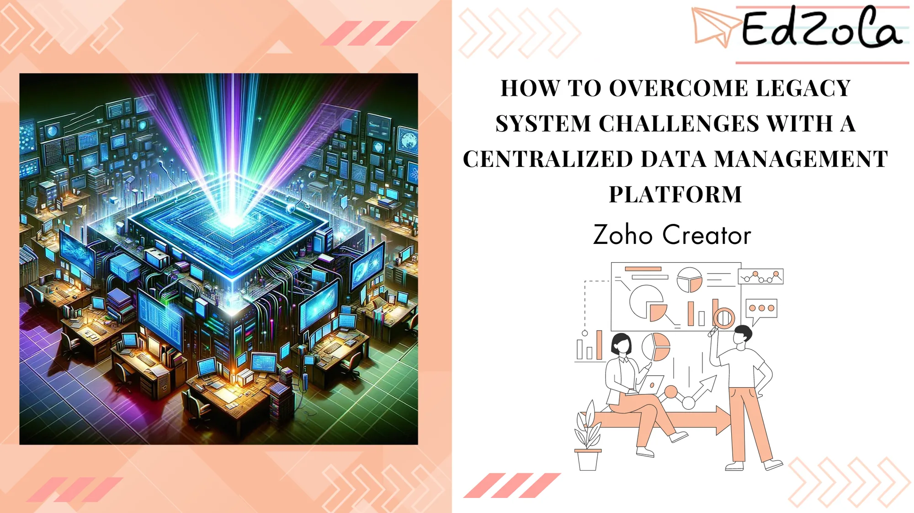

Many organizations, including nonprofits, find themselves struggling with outdated legacy systems that hinder their ability to effectively manage their data. These legacy systems are often fragmented, inflexible, and difficult to maintain, resulting in inefficiencies, data silos, and missed opportunities. However, with the right strategies and tools in place, organizations can break free from their legacy systems and transition to a modern, centralized data management platform that empowers them to achieve their goals more efficiently and effectively. In a world where data drives decisions, many nonprofits grapple with the complexities of handling vast information efficiently. Enter Zoho Creator, a low-code platform offering revolutionary solutions for data management tailored to the unique needs of nonprofits.

### The Importance of Data in Nonprofit Operations

Data, in the context of a nonprofit, is a powerful storyteller. It narrates the impact of initiatives, guides decision-making, and aids in securing funding. However, the challenge lies in effectively managing this data that often exists in siloed, diverse formats. **Accurately aggregating, analyzing, and utilizing this data** can make a significant difference in a nonprofit's ability to achieve its mission.

Explore more: [Innovating for Impact: How Non-Profits Can Harness Low-Code Platforms for Social Good](https://www.edzola.com/post/innovating-for-impact-how-non-profits-can-harness-low-code-platforms-for-social-good)

### What is Data Migration?

Data migration is the process of transferring data between storage types, formats, or computer systems. For nonprofits, this often involves moving data from outdated systems to more modern, efficient platforms. This migration is pivotal for enhancing **data accessibility, reliability, and security - all critical factors for effective nonprofit management.**

### Benefits of Low-Code Platforms for Nonprofits

Low-code platforms like Zoho Creator democratize application development, making it accessible to those without deep technical expertise. This technology enables nonprofits to build custom applications for data management, tracking, and reporting without the heavy investment typically associated with software development.

### Data Migration Tool for your nonprofit

Zoho creator is one of the best data migration tool and stands out for its user friendly, AI-assisted approach. It simplifies the complex process of transferring data from various sources such as **spreadsheets, cloud storage, and databases onto a unified platform, thereby enhancing operational clarity and efficiency.**

[Explore Zoho Creator with a 15-day free trial!](https://www.edzola.com/zoho-products/zoho-creator)

### AI-Assisted Data Enrichment with Zoho Creator

The platform's AI-assisted tools streamline data cleansing, ensuring that the data used in decision-making processes is accurate and reliable. It efficiently removes redundant or irrelevant data points, refines inconsistent data, and avoids duplication, which is crucial for maintaining data integrity.

### Revitalizing Legacy Systems in Nonprofits

Legacy systems in nonprofits often contain valuable historical data but are cumbersome to use and maintain. Zoho Creator allows for seamless integration of new applications with these existing systems, thereby preserving valuable data while enhancing functionality and user experience.

### Identifying the Challenges of Legacy Systems:

Legacy systems pose several challenges for organizations, including nonprofits. These challenges may include:

**Fragmented Data:** Legacy systems often store data in disparate formats and locations, making it difficult to access and analyze data effectively.

**Lack of Integration:** Legacy systems may lack integration with modern applications and technologies, limiting organizations' ability to leverage new tools and solutions.

**Limited Scalability:** Legacy systems may struggle to scale to meet the growing needs of organizations, resulting in performance issues and bottlenecks.

**High Maintenance Costs:** Maintaining and supporting legacy systems can be expensive and time-consuming, diverting resources away from more strategic initiatives.

**Security Risks:** Legacy systems may lack modern security features and protocols, increasing the risk of data breaches and cyberattacks.

### Transitioning to a Central Data Management Platform:

To overcome the challenges posed by legacy systems and transition to a central data management platform, organizations can follow these steps:

**Assess Current Systems:** Evaluate your organization's current systems, processes, and data management needs to identify areas for improvement and determine the scope of the transition.

**Define Requirements:** Define the requirements and objectives for your new data management platform, including functionality, scalability, security, and integration capabilities.

**Research Solutions:** Research and evaluate potential data management platforms that meet your organization's needs and budget constraints. Look for platforms that offer centralized data storage, integration with existing systems, and scalability.

**Plan the Transition:** Develop a detailed transition plan that outlines the steps, timelines, and resources required to migrate from your legacy systems to the new platform.

Consider factors such as data migration, training, and user adoption.

Implement the Platform: Implement the selected data management platform according to your transition plan, ensuring smooth integration with existing systems and minimal disruption to operations.

**Train Users:** Provide comprehensive training and support to users to ensure they are comfortable using the new platform and understand its capabilities.

**Monitor and Iterate:** Continuously monitor the performance of the new platform and gather feedback from users to identify areas for improvement and iterate as needed.

### Building Custom Applications with Zoho Creator

The platform’s intuitive drag-and-drop app builder, along with over 500 pre-built integrations, empowers nonprofits to build customized solutions for their unique needs. From donor management systems to volunteer coordination tools, the possibilities are limitless.

Dig Deeper: [Zoho Creator Unleashed: Expertise in Program Management for Nonprofits](https://www.edzola.com/post/zoho-creator-unleashed-expertise-in-program-management-for-nonprofits)

In an era where data is king, nonprofits can significantly benefit from Zoho Creator's low-code platform to manage their data effectively. It’s a tool that not only simplifies data management but also opens doors to innovative ways of engaging with stakeholders, measuring impact, and achieving mission-critical goals. For nonprofits looking to step up their data game, Zoho Creator offers a pathway to transformation and efficiency.

Embrace the power of low-code for your nonprofit with Zoho Creator. Explore its capabilities and let your data take the front seat in driving your mission forward. Transform your data management, transform your impact.

## Getting Started with EdZola

> ***Let's innovate with purpose and use technology as a force for good.***

Every nonprofit is unique, and one size does not fit all when it comes to data solutions. At [EdZola](https://www.edzola.com/), we specialize in creating customized solutions that align with your organization’s specific goals and needs. Our team works closely with you to identify pain points, develop a tailored plan, and implement the right tools to maximize your impact.

[Let's Connect](https://www.edzola.com/contact)
