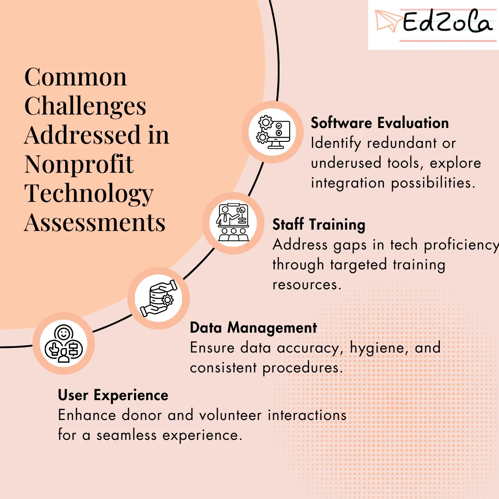

Technology plays a pivotal role in the success of nonprofit organizations. Whether it's engaging donors, streamlining fundraising efforts, or optimizing operations, the right technology can drive significant impact. However, ensuring that your tech infrastructure is aligned with your organizational goals requires strategic evaluation. This is where nonprofit technology assessments come in.

### Why Conduct a Nonprofit Technology Assessment?

Nonprofits rely on technology to fulfill their missions, but mere adoption isn't enough. A technology assessment provides insights into your current digital maturity, helping you:

- Understand where your organization stands in terms of technology adoption and utilization.
- Identify gaps and inefficiencies in your tech stack.
- Explore opportunities to leverage technology for greater impact.
- Develop a strategic roadmap to optimize your tech infrastructure.
- Key Components of a Nonprofit Technology Assessment

Explore More: [Digital Transformation is NOT expensive for Non-Profits! - Zoho Discounts](https://www.edzola.com/post/zoho-discounts-for-non-profits)

### Conducting a successful assessment involves:

**Discovery:** Gather information about your organization's goals, current tech infrastructure, and pain points.

**Analysis & Strategy:** Evaluate existing technology solutions, data management practices, and staff training needs. Develop a strategic plan to optimize your tech stack.

**Documentation:** Document findings and recommendations in a clear format, outlining existing tech solutions, optimizations, and implementation timelines.

**Review:** Discuss assessment findings with stakeholders and determine the best path forward, potentially involving partnership with a tech consulting firm for implementation.

By following these steps, nonprofits can unlock the full potential of their technology, driving meaningful change and advancing their missions in the digital age.

### Common Challenges Addressed in Nonprofit Technology Assessments

Nonprofit tech assessments commonly reveal areas ripe for improvement:

### Software Evaluation

The right software can streamline processes, enhance productivity, and ultimately lead to more effective fulfillment of the nonprofit's mission. It’s about working smarter, not harder, and in the nonprofit sector, this efficiency can make all the difference.

**Key Considerations for Software Evaluation Compatibility:**

Ensure the software integrates well with existing systems.

**Cost-Effectiveness:** Evaluate the cost against the nonprofit's budget and the software's potential return on investment.

**Functionality:** Assess whether the software meets the specific needs of the organization. **Scalability:** Consider if the software can grow with the organization’s needs. Support and **Maintenance:** Check the availability of reliable customer support and maintenance services.

**Best Practices**

- Involve stakeholders in the evaluation process.
- Conduct a trial or a pilot test when possible.
- Regularly review and reassess software needs.

### Staff Training

Investing in staff training is investing in the future of the nonprofit. Equipped with the necessary technological skills, staff can propel their organization forward, making a more significant impact in their causes.

**Developing an Effective Training Program**

**Assessment of Training Needs:** Tailoring training to meet staff competencies and organizational requirements.

**Engaging Training Methods:** Utilizing interactive and practical methods for effective learning.

**Continuous Learning:** Encouraging ongoing skill development and keeping up with technological advancements.

**Measuring Training Effectiveness**

- Feedback Mechanisms: Using staff feedback to improve training programs.
- Performance Metrics: Assessing the impact of training on staff productivity and technology use.

### Data Management

Data management is more than a back-office function for nonprofits; it’s a strategic tool that can significantly enhance their impact and efficiency. By effectively managing data, nonprofits can make informed decisions, demonstrate accountability, and ultimately achieve their mission more effectively.

**Essential Components of Data Management**

**Data Collection:** Methods and tools for efficient data gathering.

**Data Storage:** Secure and accessible data storage solutions.

**Data Analysis:** Turning data into actionable insights.

**Data Privacy:** Ensuring compliance with privacy laws and ethical guidelines.

**Overcoming Common Data Management Challenges**

- Addressing limited resources with cost-effective solutions.
- Ensuring staff are trained in data handling and analysis.
- Implementing user-friendly systems to encourage data-driven culture.

### User Experience

User experience in nonprofit technology is not just about making tools that are easy and pleasant to use; it's about creating an environment where technology acts as an enabler, not a barrier. By focusing on UX, nonprofits can ensure that their technology investments genuinely contribute to their mission and help make a more significant impact in their work.

**Key Elements of Good User Experience**

**Intuitive Design:** Ensuring the technology is easy to navigate and use.

**Accessibility:** Making technology accessible to all users, including those with disabilities. **Responsiveness:** Fast and efficient performance of technology tools.

**Strategies for Improvement**

**Regular User Feedback:** Incorporating feedback from staff and beneficiaries.

**Usability Testing:** Conducting tests to identify and fix usability issues.

**Keeping Updated:** Staying abreast of new UX trends and best practices.

### Conducting Effective Technology Assessments in your NGO's

Nonprofit organizations can play an active role in conducting technology assessments, empowering themselves with insights to enhance their digital capabilities. Here's a detailed guide on how nonprofits can navigate through the process effectively:

### 1. Outline Goals and Budget

Begin by clearly defining the goals and objectives of the assessment. Identify what you aim to achieve through the evaluation of your technology infrastructure. Whether it's **improving operational efficiency, enhancing donor engagement, or strengthening data security, setting specific goals will guide the assessment process.**

Allocate resources accordingly to ensure that the assessment receives the attention and investment it deserves. While budget constraints may exist, consider the long-term benefits of optimizing your technology stack and allocate resources accordingly.

### 2. Choose a Consulting Firm

Selecting the right consulting firm is crucial for the success of your technology assessment. Look for partners with a strong understanding of nonprofit technology and a proven track record of success in the field. **Consider factors such as expertise, experience, and reputation when making your decision.**

Ensure that the consulting firm understands the unique challenges and opportunities facing nonprofits. Look for partners who are committed to tailoring their approach to meet your organization's specific needs and priorities.

### 3. Prepare Questions and Key Areas of Focus

Before the assessment begins, take the time to develop a list of questions and key areas of focus for the consulting team. This will help ensure that the assessment is comprehensive and aligned with your organization's goals.

Consider questions related to your current technology infrastructure, pain points, and desired outcomes. Identify key areas of focus such as data management, software integration, and staff training needs.

By providing the consulting team with clear guidance on your organization's priorities, you can ensure that the assessment delivers actionable insights that drive meaningful change.

### 4. Review and Implement Recommendations

Once the assessment is complete, review the findings with key stakeholders within your organization. Discuss the identified strengths, weaknesses, and opportunities for improvement.

Develop an implementation plan for recommended strategies and improvements, taking into account factors such as timelines, resource requirements, and budget considerations. Consider partnering with the consulting firm to ensure successful implementation and ongoing support.

By actively engaging in the review and implementation process, nonprofits can translate assessment findings into tangible actions that drive positive change and advance their mission in the digital age.

In Conclusion, Conducting a nonprofit technology assessment is crucial for optimizing your organization's impact. By understanding your current tech landscape, identifying areas for improvement, and developing a strategic roadmap, nonprofits can achieve their mission more effectively.

Investing in a nonprofit technology assessment is an investment in your organization's future success. Partner with a trusted consulting firm to harness technology's power for positive change in your community.

Remember, the journey to digital transformation begins with a single step. Start by conducting a nonprofit technology assessment to ensure your organization thrives in the digital age.

## Getting Started with EdZola

> ***Let's innovate with purpose and use technology as a force for good.***

Every nonprofit is unique, and one size does not fit all when it comes to data solutions. At [EdZola](https://www.edzola.com/), we specialize in creating customized solutions that align with your organization’s specific goals and needs. Our team works closely with you to identify pain points, develop a tailored plan, and implement the right tools to maximize your impact.

[Book a consultation call with us](https://www.edzola.com/contact)
