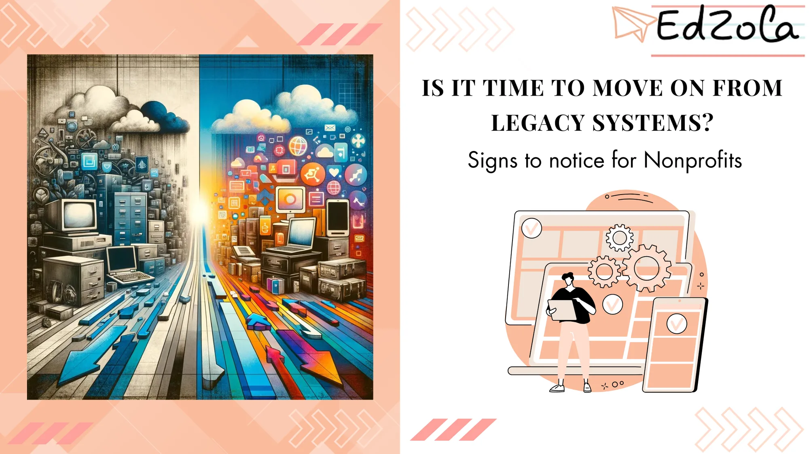

Nonprofits are increasingly facing the decision of whether to cling to legacy systems or embrace modern solutions. While the familiarity of legacy systems is comforting, it often comes at the cost of efficiency and innovation. In this article will delve into the key signs that it's time for a change and explore trending technologies that can revitalize your nonprofit's operations.

### 1. Decreased Efficiency and Productivity

**Sign**

Legacy systems in NGOs often suffer from outdated architecture, struggling to handle the volume and complexity of current data processing needs. This can be particularly problematic in environments where managing extensive datasets and generating insightful reports is crucial. For instance, an NGO may find it laborious and time-consuming to extract meaningful insights from large sets of data using these outdated systems. Moreover, these systems usually lack integration capabilities with modern tools, leading to disjointed workflows where data must be manually transferred between systems, increasing the risk of errors and inefficiency.

**Solution:**

Transitioning to cloud-based solutions represents a transformative step for NGOs towards resolving the inefficiencies inherent in legacy systems. Cloud computing offers a powerful alternative to traditional on-premises systems, with several key advantages for NGOs:

**Real-Time Collaboration:** Cloud-based platforms facilitate seamless collaboration among team members. Tools like Zoho, Microsoft Azure and Google Cloud offer functionalities where documents and data can be accessed, edited, and shared in real-time, regardless of the users’ location. This capability is vital for nonprofits that often have decentralized teams or work with volunteers and stakeholders spread across different geographies.

**Scalability:** One of the significant advantages of cloud solutions is their scalability. As your nonprofit grows or experiences fluctuations in data needs or user loads, cloud services can easily scale up or down. This flexibility ensures that you’re not overpaying for unused resources or running into capacity issues during peak times.

**Intuitive User Interface:** Modern cloud services are designed with user experience in mind. They offer intuitive interfaces that are easier to navigate, reducing training time and making the transition smoother for your team. Compared to legacy systems, which often have steep learning curves and cumbersome interfaces, cloud applications are more user-friendly.

**Integration Capabilities:** Cloud platforms are generally built to integrate seamlessly with a wide array of other applications and services. This integration allows for a more streamlined workflow, as data can flow smoothly between different tools, reducing manual entry and the potential for errors.

**Accessibility and Mobility:** With data stored in the cloud, your team can access it from anywhere, using any internet-enabled device. This flexibility is particularly important in today’s mobile-centric world and can greatly enhance responsiveness and decision-making speed.

### 2. Escalating Maintenance Costs

**Sign**

A clear indicator that your NGO might need to migrate from legacy systems is the spiraling cost of maintenance. **As software and hardware age, they often require more frequent fixes and specialized support. These systems were typically designed in a time with different technological standards, making them incompatible with modern, cost-effective solutions.** The costs aren't just monetary; they also come in the form of time and resources spent managing these outdated systems.

**Solution**

A practical approach for NGOs to counter these escalating costs is to transition to cloud-based services and modern software solutions. This shift can significantly reduce both direct and indirect maintenance costs for NGOs. By **adopting cloud services, NGOs can minimize the need for physical hardware, which in turn reduces the expenses related to hardware purchase, repair, and replacement.**

**No Hardware Dependencies:** Cloud services eliminate the need for maintaining specific hardware. The cloud provider handles all aspects of infrastructure maintenance, including regular updates and upgrades.

**Increased Reliability:** Modern software solutions hosted in the cloud are more reliable and less prone to breakdowns compared to legacy systems. This translates to reduced downtime and fewer emergency fixes.

**Seamless Integration:** Modern systems are designed for compatibility with a range of technologies, reducing the need for costly custom integrations or workarounds.

### 3. Incompatibility with New Software

**Sign**

A significant issue with legacy systems in NGOs is their incompatibility with new software. As technology evolves rapidly, **older systems in these organizations often fail to keep pace, creating integration issues. This incompatibility results in a fragmented technological environment within the NGO**, where new and old systems cannot communicate effectively. This leads to inefficient workflows and the creation of data silos.

**Solution**

The solution for NGOs to overcome these compatibility issues lies in transitioning to more modern, integration-friendly platforms and adopting a more flexible IT architecture.

**API-First Approach:** Modern software solutions are built with integration in mind and often offer robust APIs. These APIs facilitate the exchange of data and functionalities between different software systems, enabling a cohesive technological ecosystem.

**Choosing Integration-Friendly Platforms:** When selecting new software, prioritize solutions known for their compatibility and integration capabilities. Tools like [Zoho Flow](https://www.edzola.com/zoho-products/zoho-flow), Zapier or MuleSoft can serve as intermediaries to link disparate systems, ensuring seamless data flow.

**Regular Technology Audits:** Conducting regular reviews of your tech stack can help identify and phase out systems that are becoming increasingly incompatible with new software. This proactive approach ensures that your technology infrastructure remains agile and adaptable.

### 4. Security Vulnerabilities

**Sign**

A critical concern with legacy systems in NGOs is their susceptibility to security vulnerabilities. As technology advances, so do the techniques and tools used by cybercriminals, and older systems in these organizations often lack the robust, up-to-date security features necessary to protect against these evolving threats. For NGOs, which often handle sensitive information related to their donors, beneficiaries, and operations, the implications of such security vulnerabilities can be severe.

**Solution**

To address these security vulnerabilities, NGOs should consider a comprehensive approach involving both technological upgrades and strategic security practices:

**Migrating to Secure Platforms:** Upgrading to modern, solutions can significantly enhance your security posture. These platforms usually offer advanced security features like data encryption, regular security updates, and compliance with the latest data protection standards.

**Regular Security Audits and Updates:** Conducting regular security audits can help identify vulnerabilities in your current system. Ensuring that all software, not just your primary systems, is regularly updated is crucial in maintaining a secure environment.

**Training and Awareness:** Equipping your staff with the knowledge to recognize and respond to security threats is as important as technological solutions. Regular training sessions on cybersecurity best practices can greatly reduce the risk of breaches caused by human error.

**Implementing a Layered Security Approach:** Adopting a multi-layered security strategy, which includes firewalls, intrusion detection systems, secure data backup solutions, and access controls, can provide comprehensive protection against various types of cyber threats.

### 5. Limited Functionality and Scalability

**Sign**

Legacy systems often suffer from limited functionality and scalability, impeding the growth and adaptability of NGOs. As organizations evolve, their technological needs change. Legacy systems, which were perhaps once cutting-edge, may no longer support newer functionalities or scale effectively to meet increased demands.

**Solution**

To overcome these limitations, NGOs should consider transitioning to more flexible and scalable technological solutions:

**Modular Software Solutions:** Modern software systems, especially those built on a modular architecture, allow for the addition or modification of features as needed. This approach provides the flexibility to adapt to changing needs without the need for a complete system overhaul.

**Software as a Service (SaaS):** SaaS solutions can be a game-changer for nonprofits looking for scalable options. These platforms are regularly updated by the provider to include new features and improvements, ensuring that your organization always has access to the latest functionalities.

[Explore Zoho Products](https://www.edzola.com/zoho-products)

**Open Standards and APIs:** Choosing solutions that embrace open standards and offer robust APIs can facilitate easier integration with other systems and services. This openness allows for more seamless expansion and customization of functionalities.

### 6. Difficulty in Accessing Real-Time Data

**Sign**

A major limitation of legacy systems, particularly for NGOs, is the difficulty in accessing real-time data. In an era where timely information is crucial for decision-making, these older systems often fall short. They are typically built on outdated technologies that rely on batch processing, resulting in significant delays in data availability. For NGOs, this impediment in accessing up-to-date information can severely hinder strategic decision-making and responsiveness.

**Solution**

To address these challenges and enable access to real-time data, NGOs should consider the following strategies:

**Implementing Modern Database Systems:** Modern database technologies offer superior performance in terms of data retrieval and analysis. Solutions like SQL Server or NoSQL databases can handle complex queries more efficiently, providing faster access to data.

**Data Integration Tools:** Utilizing data integration tools or platforms can help in consolidating data from various sources, breaking down silos, and providing a more unified, real-time view of information. Tools like [Zoho creator](https://www.edzola.com/zoho-products/zoho-creator), Informatica or Talend can be instrumental in achieving this.

**Business Intelligence (BI) and Analytics Tools:** Modern BI tools, such as [Zoho Analytics](https://www.edzola.com/zoho-products/zoho-analytics-) Tableau or Microsoft Power BI, are designed to provide real-time insights and visualizations. They can connect to various data sources, aggregate data, and present it in an easily digestible format, enabling quicker and more informed decision-making.

### 7. The Rise of AI and Machine Learning

**Sign**

The increasing prominence of Artificial Intelligence (AI) and Machine Learning (ML) in various sectors is a trend that NGO can no longer afford to overlook. These technologies offer transformative capabilities, from enhancing operational efficiency to providing deeper insights into donor behavior and program effectiveness.

**Solution**

To effectively leverage AI and ML, nonprofits should consider upgrading their technology infrastructure and adopting AI/ML-friendly platforms:

**Utilizing Specialized AI Services:** Many cloud platforms provide specialized AI and ML services that can be leveraged without the need for deep expertise in these fields.

**Data Modernization:** Updating data management practices is crucial for AI and ML applications. This involves not only moving data to more capable platforms but also ensuring that data is clean, well-organized, and readily accessible for analysis.

**Partnerships and Collaborations:** Nonprofits can consider partnering with technology providers or academic institutions specializing in AI and ML. These partnerships can provide access to expertise, tools, and resources that might be otherwise out of reach.

### 8. The Shift Towards Mobile Technology

**Sign**

The global shift towards mobile technology is a significant trend impacting nearly every sector, including NGOs. With the majority of internet traffic now coming from mobile devices, the ability to effectively engage and operate in a mobile-first environment has become crucial. Legacy systems, often designed for desktop use, can lack the responsiveness and functionality needed for optimal mobile engagement.

**Solution**

To address the challenges of a mobile-centric world, NGOs should consider the following strategies:

**Adopting Mobile-Responsive Design:** Ensure that all digital platforms, from websites to custom applications, are built with mobile-responsive design. This means they automatically adjust to the size and capabilities of the user's device, providing an optimal experience across all devices.

**Mobile-Friendly Platforms:** Utilize platforms and tools that are inherently mobile-friendly. Many modern cloud-based solutions offer robust mobile versions or apps, ensuring that staff and stakeholders can access information and functionalities seamlessly, regardless of their location.

**Emphasizing Mobile in Digital Strategies:** Incorporate a mobile-first approach in your overall digital strategy. This includes optimizing content for mobile consumption, utilizing mobile-centric communication channels (like SMS and social media), and considering mobile usability in all technology decisions.

## Conclusion

The decision to migrate from legacy systems is significant but necessary for nonprofits aiming to stay relevant and effective. By recognizing these signs and adopting trending technologies, your organization can not only overcome the limitations of outdated systems but also pave the way for a more efficient, secure, and dynamic future. Embracing change is not just about keeping up with technology; it's about ensuring your nonprofit is equipped to make the biggest impact in your community.

This expanded content, now providing solutions alongside each sign, offers a comprehensive guide for nonprofits looking to modernize their operations. It aligns the identified challenges with current technological trends, offering actionable insights for organizations ready to embrace change. Feel free to adapt or extend any section to better fit the specific needs and context of your audience.

## Getting Started with EdZola

> ***Let's innovate with purpose and use technology as a force for good.***

Every nonprofit is unique, and one size does not fit all when it comes to data solutions. At [EdZola](https://www.edzola.com/), we specialize in creating customized solutions that align with your organization’s specific goals and needs. Our team works closely with you to identify pain points, develop a tailored plan, and implement the right tools to maximize your impact.

[Let's Connect](https://www.edzola.com/contact)
